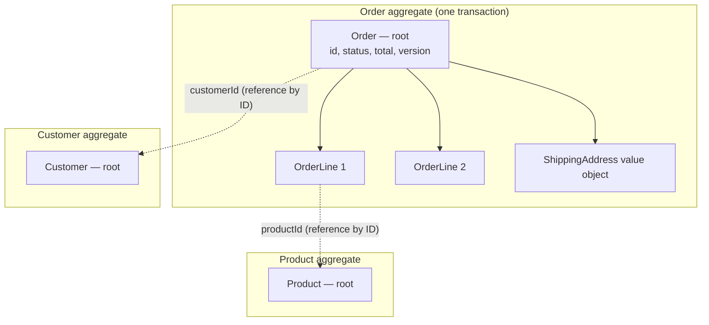

Every microservice transaction pattern — sagas, outboxes, event sourcing — eventually raises the same question: **what must be consistent *immediately*, and what can be consistent *eventually*?** Domain-Driven Design's answer is the **Aggregate**.

An aggregate is a **cluster of domain objects treated as a single unit for data changes**. It has one entry point — the **aggregate root** — and it guarantees that its **invariants** (business rules that must always hold) are true at the end of every transaction. Outside the aggregate, consistency is eventual.

## The problem

Without explicit boundaries, domain models drift into one of two failure modes:

- **Everything is connected.** `Customer` → `Orders` → `Lines` → `Products` → `Suppliers`… Loading anything loads everything; every save locks half the database; concurrent users constantly conflict.
- **Nothing is protected.** Any code can modify any entity. The rule "an order's total can't exceed the customer's credit limit" is checked in some code paths and not others.

Aggregates fix both by defining **small, explicit units of consistency**.

## How it works



The classic rules, from Eric Evans and Vaughn Vernon:

1. **Protect invariants inside the boundary.** Everything needed to check a rule that must be immediately true lives in one aggregate.
2. **Modify only through the root.** External code calls `order.addLine(...)`, never `order.getLines().add(...)`.
3. **Reference other aggregates by ID**, not object references. `Order` holds `customerId`, not a `Customer`.
4. **One aggregate per transaction.** A transaction modifies a single aggregate instance; other aggregates are updated eventually, via [domain events](/blog/domain-events/).
5. **Design small aggregates.** Large aggregates mean contention, slow loads, and big transactions.

## Example: an Order aggregate in Kotlin

```kotlin
class Order private constructor(
    val id: OrderId,
    val customerId: CustomerId,          // reference by ID
    private val lines: MutableList<OrderLine>,
    var status: OrderStatus,
    val creditLimit: Money,               // snapshot taken when the order was opened
    var version: Long,
) {
    private val events = mutableListOf<DomainEvent>()
    val pendingEvents: List<DomainEvent> get() = events.toList()

    val total: Money get() = lines.fold(Money.zero(creditLimit.currency)) { acc, l -> acc + l.subtotal }

    fun addLine(productId: ProductId, qty: Int, unitPrice: Money) {
        require(status == OrderStatus.DRAFT) { "Lines can only be added to draft orders" }
        require(qty in 1..100) { "Quantity must be between 1 and 100" }
        require(lines.size < 50) { "An order can have at most 50 lines" }

        val existing = lines.find { it.productId == productId }
        if (existing != null) existing.increase(qty) else lines += OrderLine(productId, qty, unitPrice)

        // Invariant enforced on every change, inside the boundary
        check(total <= creditLimit) { "Order total exceeds credit limit" }
    }

    fun place(clock: Clock) {
        require(status == OrderStatus.DRAFT) { "Order already placed" }
        require(lines.isNotEmpty()) { "Cannot place an empty order" }
        status = OrderStatus.PLACED
        events += OrderPlaced(id, customerId, lines.map { it.toSnapshot() }, total, clock.instant())
    }

    companion object {
        fun open(id: OrderId, customer: CustomerId, creditLimit: Money) =
            Order(id, customer, mutableListOf(), OrderStatus.DRAFT, creditLimit, 0)
    }
}

// OrderLine is an entity *inside* the aggregate — no repository of its own
class OrderLine(val productId: ProductId, qty: Int, val unitPrice: Money) {
    var qty: Int = qty; private set
    val subtotal: Money get() = unitPrice * qty
    internal fun increase(by: Int) { qty += by }
}
```

The repository loads and saves the **whole aggregate**, using optimistic concurrency on the root's `version`:

```sql
UPDATE orders SET status = $1, total = $2, version = version + 1
WHERE  id = $3 AND version = $4;   -- 0 rows => concurrent modification: reload and retry
```

## Sizing aggregates

The hardest part is choosing boundaries. Ask:

| Question | If yes… |
|---|---|
| Must this rule be true **at the end of every transaction**? | Keep the data in the same aggregate. |
| Can the business tolerate this being fixed up **seconds later**? | Separate aggregates, coordinated by events. |
| Do different users frequently edit these at the **same time**? | Separate aggregates to avoid conflicts. |
| Can this collection grow **without bound**? | It's not part of the aggregate (e.g., a customer's orders). |

**Example decisions:**

- *Order and its lines* — one aggregate: totals and line limits must be consistent immediately.
- *Customer and their orders* — separate: a customer can have thousands of orders; "total lifetime spend" can be eventually consistent.
- *Product price and order line price* — separate: the order line captures the price at the time of ordering (a value copy), so later price changes don't alter placed orders.
- *Account and its transactions* — often one aggregate per account, or an account with a ledger of entries using [event sourcing](/blog/event-sourcing/) and [snapshots](/blog/snapshot-pattern/) to keep it fast.

> **Rule of thumb:** when you think a rule needs two aggregates in one transaction, ask the domain expert what happens if it's briefly violated. Often the real-world answer is "we'd fix it" — which is an eventual-consistency process, not an invariant.

## Aggregates and microservices

Aggregates define the **minimum** consistency unit. That has direct consequences:

- A **service** usually contains several aggregate types, but **an aggregate must never be split across services**.
- **Cross-aggregate rules** become [Sagas](/blog/saga-pattern/) or event-driven policies.
- **Domain events** are emitted by aggregates and published via an [outbox](/blog/transactional-outbox/).
- In **event sourcing**, one stream = one aggregate instance.
- Partition keys in Kafka are usually aggregate IDs, giving per-aggregate ordering.

If two "services" constantly need to change their data in one transaction, you've probably split an aggregate — merge them.

## Trade-offs

| Benefits | Costs |
|---|---|
| Invariants have one clear home | Requires real domain understanding to draw boundaries |
| Small transactions → less contention, better scaling | Cross-aggregate rules need eventual-consistency processes |
| Natural unit for persistence, events, and partitioning | More IDs and lookups instead of object navigation |
| Clear ownership in code and in services | Boundaries need revisiting as the domain evolves |

## Common pitfalls

> **Pitfall:** the anemic aggregate — getters and setters everywhere, with rules enforced in "service" classes. The boundary exists on paper, but nothing stops code from breaking invariants. Put behavior on the root.

- **Giant aggregates** that load thousands of children for every operation.
- **Object references across aggregates**, letting ORMs cascade saves and lazy-load across boundaries.
- **Modifying multiple aggregates in one transaction** "for convenience" — it works until the aggregates move to different services or databases.
- **Exposing internal collections** (`getLines()` returning a mutable list).

## Tools and real-world usage

- **Axon Framework** (`@Aggregate`), **EF Core** owned entities, **Spring Data** with `AbstractAggregateRoot`, **Marten** for event-sourced aggregates.
- **jMolecules** — annotations and architecture rules (with ArchUnit) to enforce DDD building blocks in Java.

## Related patterns

- [Domain Events](/blog/domain-events/) — how aggregates announce changes.
- [Event Sourcing](/blog/event-sourcing/) and [Snapshot](/blog/snapshot-pattern/) — persisting aggregates as events.
- [Saga](/blog/saga-pattern/) — coordinating across aggregates.
- [Database per Service](/blog/database-per-service/) — aggregates never span service databases.

## Key takeaways

1. An aggregate is the unit of immediate consistency, entered only through its root.
2. Keep aggregates small; reference others by ID.
3. Modify one aggregate per transaction; use events for the rest.
4. Never split an aggregate across services.
