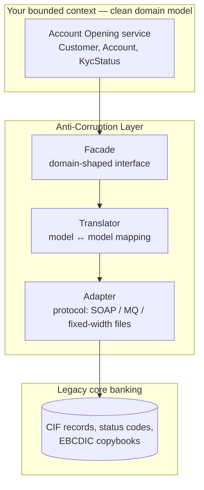
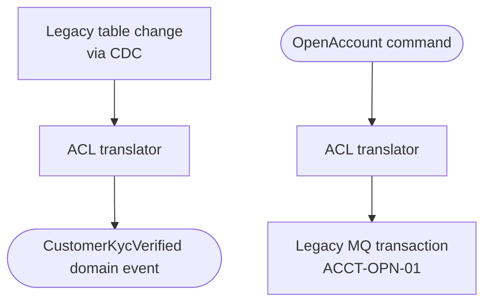

Every enterprise has a system whose model you didn't choose: a mainframe core-banking platform with 8-character field names and status codes like `"A"`, `"C"`, `"9"`; a 20-year-old ERP; a SaaS CRM with its own idea of a "customer"; a partner API that returns everything as strings. If your new services consume those models directly, the legacy concepts **leak** into your domain — and soon your shiny microservice speaks mainframe.

The **Anti-Corruption Layer (ACL)**, from Eric Evans's *Domain-Driven Design*, is a **translation boundary**: it talks to the other system in *its* language and presents a clean interface in *yours*.

## The problem

Integrating directly with a foreign model causes:

- **Semantic leakage** — `CUST_STAT_CD = '9'` means "deceased" in one system and "dormant" in another; your code fills up with magic values.
- **Structural coupling** — your entities mirror their tables and fields.
- **Change amplification** — when the legacy system changes, every consumer changes.
- **Migration paralysis** — you can't replace the legacy system because everything depends on its model.

## How it works



An ACL typically has three parts:

| Component | Responsibility |
|---|---|
| **Facade** | An interface expressed in *your* domain language (`CustomerDirectory.findByNationalId(...)`) |
| **Translator** | Maps concepts and values both ways: codes → enums, flat records → aggregates, error codes → domain exceptions |
| **Adapter** | Handles the foreign protocol and format: SOAP, MQ messages, fixed-width files, proprietary SDKs, pagination quirks |

The ACL can be a module inside your service or a **separate translation service** shared by several consumers.

## Example: translating a core-banking customer

The legacy system returns:

```json
{
  "CIF_NO": "0004418823",
  "CUST_NM": "RAO/ANANYA",
  "CUST_TYP": "I",
  "STAT_CD": "A",
  "KYC_FLG": "Y",
  "KYC_DT": "20240311",
  "RISK_CAT": "02",
  "BR_CD": "0412"
}
```

Your domain wants:

```kotlin
data class Customer(
    val id: CustomerId,
    val name: PersonName,
    val type: CustomerType,
    val status: CustomerStatus,
    val kyc: KycStatus,
    val riskRating: RiskRating,
    val homeBranch: BranchId,
)
```

The ACL:

```kotlin
// Facade — the only thing the domain sees
interface CustomerDirectory {
    fun find(id: CustomerId): Customer?
}

// Implementation lives in the ACL module
class CoreBankingCustomerDirectory(
    private val adapter: CoreBankingSoapAdapter,
    private val translator: CustomerTranslator,
) : CustomerDirectory {
    override fun find(id: CustomerId): Customer? =
        adapter.inquireCif(id.value.padStart(10, '0'))      // legacy quirks stay here
            ?.let(translator::toDomain)
}

class CustomerTranslator(private val clock: Clock) {
    fun toDomain(r: CifRecord): Customer = Customer(
        id = CustomerId(r.cifNo.trimStart('0')),
        name = r.custNm.split("/").let { (last, first) -> PersonName(first.titleCase(), last.titleCase()) },
        type = when (r.custTyp) {
            "I" -> CustomerType.INDIVIDUAL
            "C" -> CustomerType.CORPORATE
            else -> throw UnknownLegacyValue("CUST_TYP", r.custTyp)
        },
        status = when (r.statCd) {
            "A" -> CustomerStatus.ACTIVE
            "D" -> CustomerStatus.DORMANT
            "C" -> CustomerStatus.CLOSED
            "9" -> CustomerStatus.DECEASED
            else -> throw UnknownLegacyValue("STAT_CD", r.statCd)
        },
        kyc = if (r.kycFlg == "Y")
            KycStatus.Verified(LocalDate.parse(r.kycDt, DateTimeFormatter.BASIC_ISO_DATE))
        else KycStatus.Pending,
        riskRating = RiskRating.fromScore(r.riskCat.toInt()),
        homeBranch = BranchId(r.brCd),
    )
}
```

All the legacy weirdness — zero-padding, slash-separated names, single-letter codes, `yyyyMMdd` dates — is confined to one place. The domain never sees `STAT_CD`.

## Two directions

ACLs translate **both** ways:

- **Inbound** — legacy data and events → your domain objects/events (e.g., translating CDC records from legacy tables into clean [Domain Events](/blog/domain-events/)).
- **Outbound** — your commands → legacy transactions (e.g., `OpenAccount` → a sequence of mainframe calls with the right codes).



## Testing the ACL

The ACL is where integration bugs hide, so test it heavily:

- **Translation unit tests** — table-driven tests for every code and edge case (blank fields, unknown codes, invalid dates).
- **Contract tests** — record real legacy responses (sanitized) and replay them; alert when the legacy system starts returning unexpected values.
- **Fail loudly on unknown values** — an unrecognized status code should raise an error and an alert, not silently map to a default.

## When is an ACL worth it?

| Situation | ACL? |
|---|---|
| Legacy/external model differs substantially from yours | **Yes** |
| You plan to replace the legacy system (strangler migration) | **Yes** — swap the adapter, keep the facade |
| Multiple new services consume the same legacy system | **Yes** — consider a shared translation service |
| The external model is a well-designed, stable public standard (e.g., ISO 20022) | Maybe — you might adopt it as a shared kernel |
| Thin CRUD integration with a simple, aligned model | Probably not — a small adapter suffices |

## Trade-offs

| Benefits | Costs |
|---|---|
| Domain model stays clean and expressive | Extra layer to build and maintain |
| Legacy changes are absorbed in one place | Translation adds latency and possible data loss |
| Enables gradual replacement of legacy systems | Can become a bottleneck if one team owns a shared ACL |
| Centralizes knowledge of legacy quirks | Requires real understanding of both models |

## Common pitfalls

> **Pitfall:** a "pass-through" ACL that just renames fields (`CUST_NM` → `custName`) and passes legacy codes straight through. The legacy *concepts* still leak. Translate meaning, not just spelling.

- **Leaky abstractions** — facade methods that mirror legacy transactions (`inquireCif`) rather than domain needs.
- **Silent defaults** for unknown codes, hiding data-quality problems.
- **Business logic in the ACL** — it should translate, not decide.
- **Bypassing the ACL** "just this once" for a quick feature.

## Tools and real-world usage

- **Adapter services** written in the team's main language, often with mapping libraries (MapStruct, AutoMapper).
- **Integration frameworks** — Apache Camel, Spring Integration, MuleSoft and other iPaaS tools for protocol and format conversion.
- **Mainframe integration** — IBM MQ, CICS web services, z/OS Connect APIs wrapped behind ACLs.

In banking modernization programmes, ACLs around core banking, card management, and document management platforms are what let new digital channels move fast without inheriting decades of legacy semantics.

## Related patterns

- [Strangler Fig](/blog/strangler-fig/) — the ACL keeps the new system clean while the old one is replaced.
- [Change Data Capture](/blog/change-data-capture/) — feed legacy changes through an ACL into domain events.
- [Shared Database](/blog/shared-database/) — what ACLs help you avoid depending on.
- [Backend for Frontend](/blog/backend-for-frontend/) — a client-facing adapter, often in front of ACL-protected services.

## Key takeaways

1. An ACL translates between a foreign model and your domain, in both directions.
2. Structure it as facade (your language), translator (meaning), adapter (protocol).
3. Translate concepts, not just field names, and fail loudly on unknown values.
4. It's the enabler for replacing legacy systems incrementally.
