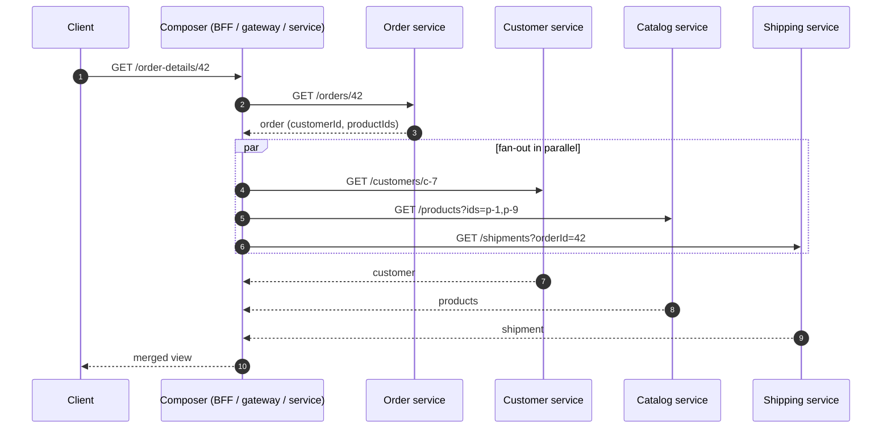
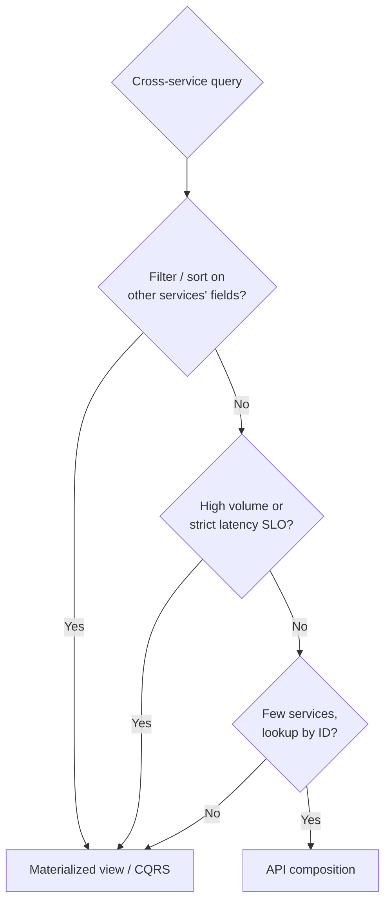

With [Database per Service](/blog/database-per-service/), the SQL join is gone. "Show order 42 with its customer name, product details, and shipment status" now needs data from four services. **API Composition** answers such queries by having a **composer** call each owning service and **merge the results in memory**.

It's the simplest way to query across services — and, past a certain point, the most expensive. Knowing where that point is matters.

## The problem

A single screen or API response needs data owned by several services:

| Field | Owner |
|---|---|
| Order date, status, lines | Order service |
| Customer name, tier | Customer service |
| Product names, images | Catalog service |
| Tracking number, ETA | Shipping service |

You can't join their databases. You need to fetch and combine.

## How it works



Typical flow:

1. Call the **primary** service to get the root entity and the IDs of related data.
2. **Fan out in parallel** to the other services, **batching** IDs.
3. **Merge**, apply any cross-service filtering or sorting, and shape the response.
4. **Degrade gracefully** if a non-critical service fails.

The composer can live in an [API Gateway](/blog/api-gateway/), a [Backend for Frontend](/blog/backend-for-frontend/), a dedicated query service, or a GraphQL router.

## Example: a composer in TypeScript

```typescript
type OrderDetails = {
  orderId: string; placedAt: string; status: string;
  customer: { name: string; tier: string } | null;
  lines: Array<{ productId: string; name: string; imageUrl?: string; qty: number; price: number }>;
  shipment: { tracking: string; eta: string } | "unavailable" | null;
};

export async function getOrderDetails(orderId: string, signal: AbortSignal): Promise<OrderDetails> {
  // 1. Primary call — required. If it fails, the whole query fails.
  const order = await orders.get(orderId, { signal, timeoutMs: 800 });

  // 2. Parallel fan-out with per-call timeouts; batch product IDs into one request.
  const productIds = [...new Set(order.lines.map((l) => l.productId))];
  const [customer, products, shipment] = await Promise.allSettled([
    customers.get(order.customerId, { signal, timeoutMs: 300 }),
    catalog.getMany(productIds, { signal, timeoutMs: 300 }),
    shipping.byOrder(orderId, { signal, timeoutMs: 300 }),
  ]);

  // 3. Merge, degrading gracefully per field.
  const productById = new Map(
    products.status === "fulfilled" ? products.value.map((p) => [p.id, p]) : [],
  );
  return {
    orderId: order.id,
    placedAt: order.placedAt,
    status: order.status,
    customer: customer.status === "fulfilled"
      ? { name: customer.value.name, tier: customer.value.tier }
      : null,
    lines: order.lines.map((l) => ({
      productId: l.productId,
      name: productById.get(l.productId)?.name ?? l.nameSnapshot,   // fall back to data captured at order time
      imageUrl: productById.get(l.productId)?.imageUrl,
      qty: l.qty,
      price: l.price,
    })),
    shipment: shipment.status === "fulfilled" ? shipment.value : "unavailable",
  };
}
```

Notice:

- **Required vs. optional data** — the order is required; customer, catalog, and shipping are enrichments.
- **Timeouts per call** shorter than the overall budget. See [Timeout](/blog/timeout-pattern/).
- **Fallbacks** — the order line stored a name snapshot at purchase time. See [Fallback](/blog/fallback-pattern/).
- **Batching** — one catalog call for all products, not one per line (avoids N+1 over HTTP).

## GraphQL federation

GraphQL is API composition with a schema. In **federation** (Apollo Federation, GraphQL Fusion, Netflix DGS), each service publishes a **subgraph**, and a **router** plans and executes cross-service queries.

```graphql
# Order subgraph
type Order @key(fields: "id") {
  id: ID!
  placedAt: DateTime!
  status: OrderStatus!
  customer: Customer!
  lines: [OrderLine!]!
}
type Customer @key(fields: "id", resolvable: false) { id: ID! }

# Customer subgraph — contributes fields to the same Customer entity
type Customer @key(fields: "id") {
  id: ID!
  name: String!
  tier: Tier!
}
```

The client writes one query; the router fetches `Order` from the order subgraph, then batch-resolves `Customer` entities from the customer subgraph. Federation gives you query planning, batching (via `_entities`), and a single schema — but the runtime cost is the same fan-out.

## The limits of composition

API composition gets expensive — and sometimes impossible — when:

| Situation | Why it hurts |
|---|---|
| **Filtering or sorting on another service's data** ("orders where customer tier = GOLD, sorted by product category") | You must fetch huge result sets from several services and filter in memory. |
| **Large result sets / pagination across services** | Consistent pages require fetching and merging far more than one page. |
| **Deep call chains** | Latency adds up; availability multiplies down (4 services at 99.9% → ~99.6%). |
| **High query volume** | Every read fans out to N services; their load scales with your reads. |
| **Point-in-time consistency** | Each service answers at a slightly different moment. |

When you hit these, switch that query to a **pre-joined read model** — [CQRS](/blog/cqrs/) / [Materialized View](/blog/materialized-view/) — fed by events.



## Trade-offs

| Benefits | Costs |
|---|---|
| Simple; no extra data stores | Latency of the slowest call (plus the primary) |
| Always reads current data from the owners | Availability multiplies down across calls |
| Easy to start; fits BFFs and gateways | In-memory joins don't scale to big result sets |
| GraphQL federation gives a unified schema | Load on every service grows with read traffic |

## Common pitfalls

> **Warning:** sequential calls. A composer that awaits each service in turn turns four 50 ms calls into 200 ms. Fan out in parallel wherever dependencies allow.

- **No timeouts or circuit breakers** — one slow service makes every composed response slow. Combine with [Circuit Breaker](/blog/circuit-breaker/).
- **N+1 over HTTP** — fetching each related item individually. Batch.
- **Business logic creeping into the composer** — keep it to fetching, merging, and shaping.
- **Treating missing data as errors** — decide per field whether to fail, omit, or fall back.

## Tools and real-world usage

- **Apollo Router / GraphOS, GraphQL Fusion, Netflix DGS** — federated GraphQL composition.
- **API gateways** (Kong, Spring Cloud Gateway, AWS API Gateway with Lambda) — simple aggregation endpoints.
- **BFF services** — per-client composition, commonly in Node.js or Kotlin.

## Related patterns

- [Backend for Frontend](/blog/backend-for-frontend/) and [API Gateway](/blog/api-gateway/) — common homes for composition.
- [CQRS](/blog/cqrs/) and [Materialized View](/blog/materialized-view/) — the alternative when composition hits its limits.
- [Timeout](/blog/timeout-pattern/), [Fallback](/blog/fallback-pattern/), [Circuit Breaker](/blog/circuit-breaker/) — keeping composed calls resilient.

## Key takeaways

1. API composition calls each owning service and merges results in memory.
2. Fan out in parallel, batch IDs, set per-call timeouts, and degrade gracefully.
3. It's ideal for lookups by ID across a few services.
4. For cross-service filtering, sorting, big pages, or high volume, use a materialized view instead.
