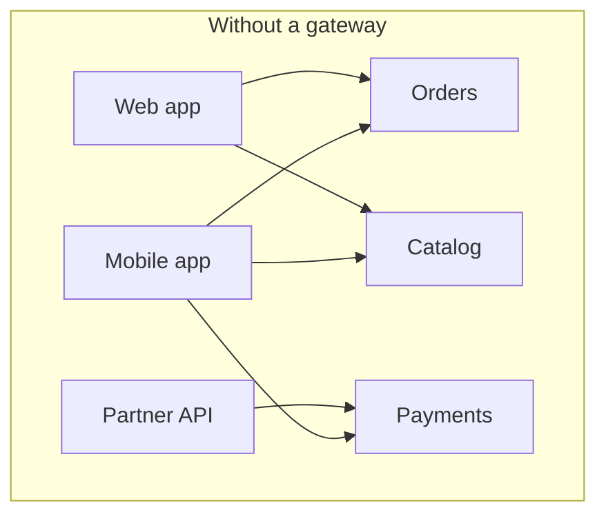
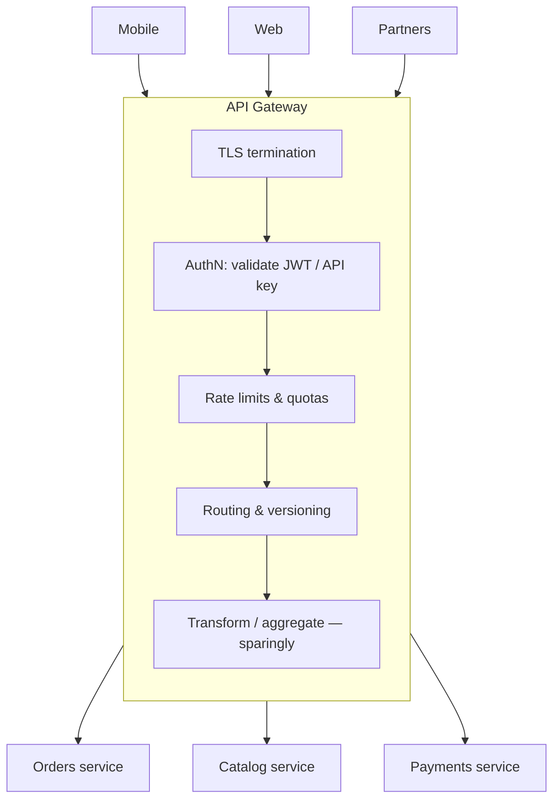

Without a gateway, every client must know every service's address, authenticate against each one, cope with each one's protocols, and make many round trips over slow mobile networks. Every service must, in turn, re-implement TLS, authentication, rate limiting, CORS, and request logging.

An **API Gateway** puts a **single entry point** in front of your services. It handles the **cross-cutting edge concerns** once, and routes each request to the right backend.

## The problem



- Clients are coupled to internal service topology; splitting a service breaks them.
- Auth, TLS, rate limiting, and logging are duplicated (and inconsistently implemented).
- Internal services are directly exposed to the internet.
- Chatty clients make many calls per screen.

## How it works



### Responsibilities

| Belongs in the gateway | Belongs in services |
|---|---|
| TLS termination, HTTP/2/3 | Business logic and validation |
| Authentication (token validation, API keys) | Fine-grained authorization ("can user X refund order Y?") |
| Coarse authorization (scopes, plans) | Data ownership and invariants |
| [Rate limiting](/blog/rate-limiting/), quotas, spike arrest | Domain-specific limits |
| Routing, path rewriting, versioning | Orchestration of business workflows |
| CORS, request size limits, WAF integration | Composition with business rules |
| Correlation IDs, access logs, metrics | — |
| Simple protocol translation (REST ↔ gRPC) | — |

The line to watch: a gateway that starts holding **business logic** becomes a shared, centrally owned bottleneck — the "ESB monolith" problem in new clothes.

## Example: Kong declarative configuration

```yaml
_format_version: "3.0"
services:
  - name: orders
    url: http://orders.shop.svc.cluster.local:8080
    connect_timeout: 500
    read_timeout: 2000
    retries: 1
    routes:
      - name: orders-v1
        paths: ["/api/v1/orders"]
        strip_path: true
        methods: [GET, POST]
    plugins:
      - name: jwt                          # validate bearer tokens from the IdP
      - name: rate-limiting
        config:
          minute: 600
          policy: redis
          limit_by: consumer
          redis: { host: redis.shared, port: 6379 }
      - name: correlation-id
        config: { header_name: X-Correlation-ID, generator: uuid#counter, echo_downstream: true }
      - name: request-size-limiting
        config: { allowed_payload_size: 1 }   # MB

  - name: catalog
    url: http://catalog.shop.svc.cluster.local:8080
    routes:
      - name: catalog-public
        paths: ["/api/v1/products"]
        methods: [GET]
    plugins:
      - name: proxy-cache                   # cache public, read-only responses at the edge
        config: { strategy: memory, cache_ttl: 60, content_type: ["application/json"] }
```

## Example: AWS API Gateway (HTTP API) with a JWT authorizer

```yaml
# AWS SAM
Resources:
  ShopApi:
    Type: AWS::Serverless::HttpApi
    Properties:
      StageName: prod
      Auth:
        DefaultAuthorizer: Cognito
        Authorizers:
          Cognito:
            IdentitySource: $request.header.Authorization
            JwtConfiguration:
              issuer: !Sub https://cognito-idp.${AWS::Region}.amazonaws.com/${UserPool}
              audience: [!Ref UserPoolClient]
      DefaultRouteSettings:
        ThrottlingBurstLimit: 200
        ThrottlingRateLimit: 100
      CorsConfiguration:
        AllowOrigins: ["https://shop.example.com"]
        AllowMethods: [GET, POST]
```

## Deployment topologies

| Topology | Description | Fits |
|---|---|---|
| **Single shared gateway** | One gateway for all clients and APIs | Small/medium systems |
| **Gateway per client type** | Separate edges for web, mobile, partners — see [BFF](/blog/backend-for-frontend/) | Diverse client needs |
| **Gateway per domain / team** | Each domain owns its edge config | Large orgs, autonomy |
| **Edge gateway + service mesh** | Gateway handles north-south traffic; mesh handles east-west | Kubernetes platforms — see [Service Mesh](/blog/service-mesh/) |

Whichever you choose, **let teams own their routes and policies** (GitOps, declarative config, Kubernetes Gateway API resources) rather than filing tickets with a central gateway team.

## Kubernetes Gateway API

The Kubernetes **Gateway API** standardizes gateway configuration across implementations (Envoy Gateway, Istio, Kong, NGINX, cloud load balancers), separating platform-owned `Gateway` resources from team-owned `HTTPRoute`s:

```yaml
apiVersion: gateway.networking.k8s.io/v1
kind: HTTPRoute
metadata: { name: orders, namespace: orders }
spec:
  parentRefs: [{ name: public-gateway, namespace: platform }]
  hostnames: ["api.example.com"]
  rules:
    - matches: [{ path: { type: PathPrefix, value: /api/v1/orders } }]
      backendRefs: [{ name: orders, port: 8080 }]
    - matches: [{ path: { type: PathPrefix, value: /api/v2/orders } }]
      backendRefs:
        - { name: orders-v2, port: 8080, weight: 10 }   # canary 10%
        - { name: orders, port: 8080, weight: 90 }
```

## Trade-offs

| Benefits | Costs |
|---|---|
| Clients decoupled from internal topology | Extra network hop and latency |
| Cross-cutting concerns implemented once | Critical shared component — must be HA |
| Smaller attack surface | Risk of becoming a centralized bottleneck (team and technical) |
| Central place for metrics, logs, and policies | Configuration sprawl without ownership rules |
| Enables canaries, versioning, migrations | Business logic creep |

## Common pitfalls

> **Pitfall:** trusting the gateway alone. "The gateway authenticates, so services don't need to." Internal traffic, misrouted requests, or a compromised pod then bypass security. Services should still verify identity (e.g., validate the forwarded JWT or use mTLS) and enforce authorization — zero trust.

- **Business logic in the gateway** (pricing rules, orchestration) owned by a platform team.
- **No timeouts** to upstreams — the gateway becomes the place where requests pile up.
- **One giant config file** edited by every team.
- **Retries at the gateway *and* in services** — multiplicative retry storms. See [Retry with Backoff](/blog/retry-with-backoff/).

## Tools and real-world usage

- **Kong**, **Apigee**, **Azure API Management**, **AWS API Gateway**, **Google API Gateway** — full API management (keys, plans, developer portals).
- **Envoy Gateway**, **Istio ingress**, **Traefik**, **NGINX**, **HAProxy** — high-performance proxies used as gateways.
- **Spring Cloud Gateway**, **YARP** (.NET) — code-centric gateways for JVM and .NET teams.

## Related patterns

- [Backend for Frontend](/blog/backend-for-frontend/) — client-specific gateways.
- [Rate Limiting](/blog/rate-limiting/) — commonly enforced here.
- [API Composition](/blog/api-composition/) — light aggregation at the edge.
- [Strangler Fig](/blog/strangler-fig/) — the gateway routes traffic between old and new systems.
- [Service Mesh](/blog/service-mesh/) — the east-west counterpart.

## Key takeaways

1. A gateway is the single front door that handles edge concerns once.
2. Keep business logic out; keep fine-grained authorization in services.
3. Make it highly available, set upstream timeouts, and let teams own their routes declaratively.
4. Pair with BFFs for client-specific needs and a mesh for internal traffic.
