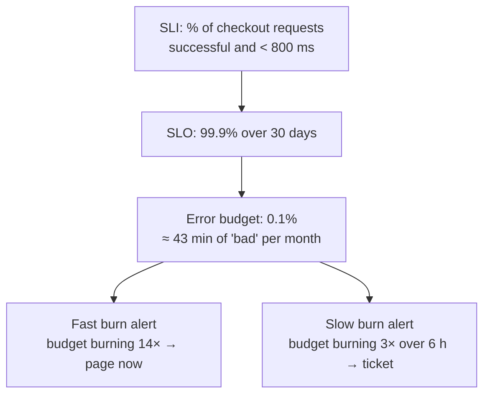

Logs tell stories; traces show journeys; **metrics show trends**. A metric is a **numeric measurement aggregated over time** — requests per second, error ratio, p99 latency, queue depth, connection-pool usage. Metrics are cheap to store, fast to query, and ideal for **dashboards and alerts**: they answer *"is the system healthy right now, and how does that compare to yesterday?"*

## The problem

Without metrics:

- you learn about outages from customers,
- you can't tell whether a deploy made things worse,
- capacity planning is guesswork,
- and "is it slow?" is a matter of opinion.

Logs can't replace metrics at scale: counting events by scanning logs is slow and expensive, and log-based alerts are brittle.

## What to measure

### The RED method (for request-driven services)

| Signal | Meaning | Example metric |
|---|---|---|
| **R**ate | Requests per second | `http_server_requests_seconds_count` |
| **E**rrors | Failed requests per second (or ratio) | same, filtered by `status=~"5.."` |
| **D**uration | Latency distribution | `http_server_requests_seconds_bucket` (histogram) |

### The USE method (for resources)

| Signal | Meaning | Example |
|---|---|---|
| **U**tilization | % of time the resource is busy | CPU, connection-pool active / max |
| **S**aturation | Queued work the resource can't serve yet | Run queue, pool pending threads, Kafka consumer lag |
| **E**rrors | Resource-level errors | Pool timeouts, disk errors |

Google's **four golden signals** — latency, traffic, errors, saturation — combine both views.

### Business metrics

Technical metrics can look fine while the business is broken. Add a few **business KPIs**: orders placed per minute, payment success ratio, sign-ups, statement generation completed. A sudden drop in orders is often the fastest outage detector.

## Metric types

| Type | Behavior | Use for | Example |
|---|---|---|---|
| **Counter** | Only increases (resets on restart) | Events: requests, errors, messages | `orders_placed_total` |
| **Gauge** | Goes up and down | Current values: queue depth, in-flight, pool size | `db_pool_active_connections` |
| **Histogram** | Counts observations into buckets | Latency and size distributions; percentiles across instances | `http_request_duration_seconds` |
| **Summary** | Client-side quantiles | Rarely preferred — quantiles can't be aggregated across instances | — |

> **Rule of thumb:** use **histograms** for latency. You can compute percentiles across all instances (`histogram_quantile`), whereas averaging per-instance p99s is mathematically meaningless.

## Example: Micrometer (Spring Boot)

Spring Boot Actuator with Micrometer exposes HTTP, JVM, pool, and Kafka metrics automatically at `/actuator/prometheus`. Add domain metrics explicitly:

```java
@Service
public class PaymentService {

  private final Counter captured;
  private final Counter declined;
  private final Timer gatewayLatency;

  public PaymentService(MeterRegistry registry) {
    this.captured = Counter.builder("payments_captured_total")
        .description("Payments successfully captured").register(registry);
    this.declined = Counter.builder("payments_declined_total")
        .tag("reason", "unknown").register(registry);        // see note on tags below
    this.gatewayLatency = Timer.builder("payment_gateway_duration")
        .publishPercentileHistogram()                         // export histogram buckets
        .serviceLevelObjectives(Duration.ofMillis(300), Duration.ofSeconds(1))
        .tag("gateway", "primary")
        .register(registry);
  }

  public PaymentResult capture(Payment p) {
    PaymentResult r = gatewayLatency.record(() -> gateway.capture(p));
    if (r.isSuccess()) captured.increment(); else declined.increment();
    return r;
  }
}
```

```yaml
management:
  endpoints.web.exposure.include: health,prometheus
  metrics:
    tags:                                  # common tags on every metric
      service: payments
      env: prod
    distribution:
      percentiles-histogram:
        http.server.requests: true
```

## Example: Prometheus queries

```promql
# Request rate per route (RED: Rate)
sum by (uri) (rate(http_server_requests_seconds_count{service="payments"}[5m]))

# Error ratio (RED: Errors)
sum(rate(http_server_requests_seconds_count{service="payments", status=~"5.."}[5m]))
/
sum(rate(http_server_requests_seconds_count{service="payments"}[5m]))

# p99 latency across all instances (RED: Duration)
histogram_quantile(0.99,
  sum by (le) (rate(http_server_requests_seconds_bucket{service="payments"}[5m])))

# Saturation: Kafka consumer lag for the ledger group
sum by (topic) (kafka_consumergroup_lag{consumergroup="ledger"})
```

## SLOs and alerting

Alert on **symptoms users feel**, not on every cause. Define **Service Level Objectives** and alert when you're burning the **error budget** too fast.



```yaml
# Prometheus alerting rule: multi-window burn rate (page)
groups:
  - name: checkout-slo
    rules:
      - alert: CheckoutErrorBudgetFastBurn
        expr: |
          (
            sum(rate(http_server_requests_seconds_count{service="checkout",status=~"5.."}[5m]))
            / sum(rate(http_server_requests_seconds_count{service="checkout"}[5m]))
          ) > (14.4 * 0.001)
          and
          (
            sum(rate(http_server_requests_seconds_count{service="checkout",status=~"5.."}[1h]))
            / sum(rate(http_server_requests_seconds_count{service="checkout"}[1h]))
          ) > (14.4 * 0.001)
        for: 2m
        labels: { severity: page }
        annotations:
          summary: "Checkout is burning its 30-day error budget ~14x too fast"
          runbook: "https://runbooks.example.com/checkout/error-budget"
```

The two windows (5 m and 1 h) make the alert both **fast** and **resistant to blips** — the approach described in Google's SRE Workbook.

## Cardinality: the silent killer

Every unique combination of label values is a separate time series. Labels like `user_id`, `order_id`, `email`, or raw URL paths create **millions** of series and can take down your metrics backend.

| Good labels (bounded) | Bad labels (unbounded) |
|---|---|
| `service`, `env`, `region`, `status_class` | `user_id`, `order_id`, `session_id` |
| `route` template (`/orders/{id}`) | Raw path (`/orders/88121`) |
| `method`, `outcome`, `gateway` | Free-text error messages |

Put unbounded identifiers in **logs and traces**; use **exemplars** to link a metric data point to a sample trace.

## Dashboards that help

- **One service overview** per service: RED panels, saturation, dependencies, deploy markers.
- **Top-down** — start from user journeys (checkout, login) and drill into services.
- **Consistent layouts and units** across teams.
- **Annotations** for deployments and incidents, so cause and effect are visible.

## Trade-offs

| Benefits | Costs |
|---|---|
| Cheap, fast, ideal for alerting and trends | Aggregated — loses per-request detail |
| Clear SLOs and error budgets | Cardinality must be governed |
| Capacity planning and regression detection | Histogram bucket choices affect accuracy |
| Business KPIs alongside technical signals | Dashboards sprawl without curation |

## Common pitfalls

> **Pitfall:** alerting on causes (CPU > 80%, one pod restarted) instead of symptoms (error budget burning). You get paged constantly for things users never notice, and alert fatigue hides the real incidents.

- **Averages for latency** — hide the tail; use percentiles from histograms.
- **Counters reset on restart** — always use `rate()`/`increase()`, never raw counter values.
- **Missing saturation metrics** — pools, queues, and lags warn you before errors start.
- **Dashboards nobody owns** — review and prune them.

## Tools and real-world usage

- **Prometheus** (+ Alertmanager), **Grafana**, **Thanos / Cortex / Mimir / VictoriaMetrics** for long-term, multi-cluster storage.
- **Instrumentation** — Micrometer (Java), OpenTelemetry Metrics (all languages), `prometheus_client` libraries, .NET `System.Diagnostics.Metrics`.
- **SaaS** — Datadog, New Relic, Dynatrace, Grafana Cloud, cloud-native monitoring (CloudWatch, Azure Monitor, Cloud Monitoring).

## Related patterns

- [Distributed Tracing](/blog/distributed-tracing/) — exemplars link metrics to traces.
- [Log Aggregation](/blog/log-aggregation/) — investigate after a metric alert fires.
- [Health Check](/blog/health-check/) — binary health vs. rich metrics.
- [Dead Letter Queue](/blog/dead-letter-queue/) and [Circuit Breaker](/blog/circuit-breaker/) — DLQ depth and breaker state are key metrics.

## Key takeaways

1. Measure RED for services, USE for resources, plus a few business KPIs.
2. Use counters, gauges, and histograms; compute percentiles from histograms.
3. Alert on SLO burn rates, not on every cause.
4. Keep label cardinality bounded; put IDs in logs and traces.
