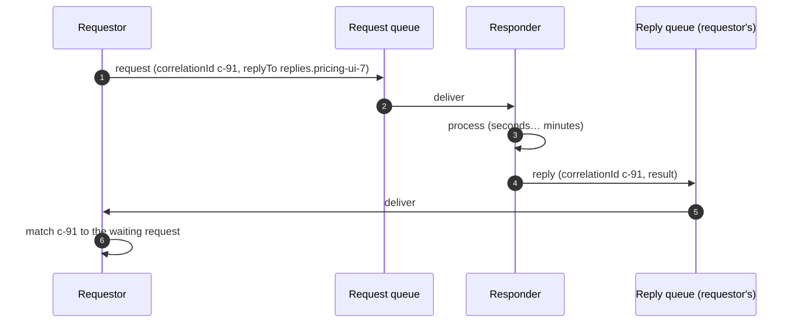
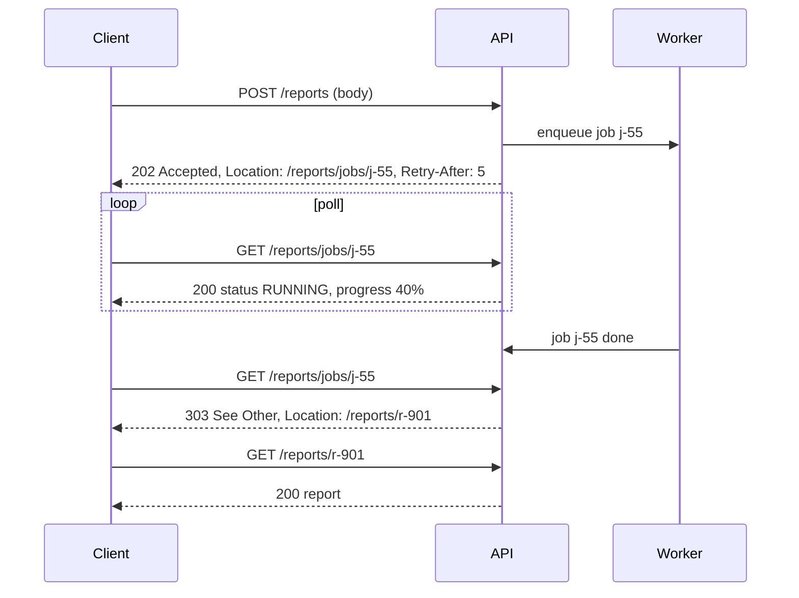

Some operations take too long, or must cross too many unreliable boundaries, to wait for a synchronous answer: generating a credit report, pricing a complex insurance policy, rendering a video, calling a mainframe through a message queue. Yet the caller still needs a **response**.

**Asynchronous Request-Reply** sends the **request on one channel** and receives the **reply on another**, matched by a **correlation ID**. The caller isn't blocked holding a connection, and the responder processes at its own pace.

## The problem

Synchronous HTTP for long operations causes:

- **Timeouts** at load balancers and gateways (often 30–60 s).
- **Held resources** — threads and connections waiting idle.
- **Tight availability coupling** — the responder must be up *right now*.
- **Lost work** if the caller disconnects mid-processing.

## How it works: messaging



Two message headers make it work (both standardized in JMS and AMQP):

- **`reply_to` / `JMSReplyTo`** — where the responder should send the reply.
- **`correlation_id` / `JMSCorrelationID`** — lets the requestor match a reply to its request.

The responder is generic: it just replies to whatever address the request names.

## Example: RabbitMQ requestor and responder (Python)

```python
import json, uuid, threading
import pika

class PricingClient:
    def __init__(self):
        self.conn = pika.BlockingConnection(pika.ConnectionParameters("rabbit"))
        self.ch = self.conn.channel()
        # Exclusive, auto-delete reply queue for this client instance
        self.reply_queue = self.ch.queue_declare(queue="", exclusive=True).method.queue
        self.pending: dict[str, dict] = {}
        self.ch.basic_consume(self.reply_queue, self._on_reply, auto_ack=True)

    def _on_reply(self, ch, method, props, body):
        if props.correlation_id in self.pending:
            self.pending[props.correlation_id]["result"] = json.loads(body)
            self.pending[props.correlation_id]["event"].set()
        # else: late reply for a request we already timed out — ignore (and count it)

    def price(self, quote_request: dict, timeout_s: float = 10.0) -> dict:
        cid = str(uuid.uuid4())
        self.pending[cid] = {"event": threading.Event(), "result": None}
        self.ch.basic_publish(
            exchange="", routing_key="pricing.requests", body=json.dumps(quote_request),
            properties=pika.BasicProperties(
                reply_to=self.reply_queue, correlation_id=cid,
                expiration=str(int(timeout_s * 1000)),   # don't process if nobody's waiting anymore
                delivery_mode=2),
        )
        deadline_hit = not self._wait(cid, timeout_s)
        entry = self.pending.pop(cid)
        if deadline_hit:
            raise TimeoutError(f"pricing reply not received in {timeout_s}s (cid={cid})")
        return entry["result"]

    def _wait(self, cid, timeout_s):
        # Pump the connection until the reply arrives or the timeout passes
        self.conn.process_data_events(time_limit=timeout_s)
        return self.pending[cid]["event"].is_set()


# Responder (any number of instances: competing consumers on pricing.requests)
def on_request(ch, method, props, body):
    result = compute_quote(json.loads(body))
    ch.basic_publish(exchange="", routing_key=props.reply_to,
                     properties=pika.BasicProperties(correlation_id=props.correlation_id),
                     body=json.dumps(result))
    ch.basic_ack(method.delivery_tag)
```

RabbitMQ also offers **direct reply-to** (`amq.rabbitmq.reply-to`), a pseudo-queue that avoids declaring a reply queue per client — handy for high request rates.

### Reply channel options

| Option | Pros | Cons |
|---|---|---|
| **Temporary queue per requestor instance** | Simple; replies go straight to the right instance | Replies lost if that instance dies |
| **Shared durable reply queue + correlation store** | Survives requestor restarts; any instance can handle replies | Needs persisted request state (e.g., a workflow or DB row) |
| **Sessions** (Azure Service Bus `SessionId`) | Broker routes replies to the session holder | Broker-specific |

For business-critical replies (e.g., a mainframe confirming a payment), use a **durable** reply queue and persist pending requests, so a restart doesn't lose the answer.

## How it works: HTTP (202 Accepted + status endpoint)

For web clients and public APIs, the same idea is expressed in HTTP:



```typescript
app.post("/reports", async (req, res) => {
  const jobId = await jobs.enqueue("generate-report", req.body, {
    idempotencyKey: req.header("Idempotency-Key"),   // safe client retries
  });
  res.status(202).location(`/reports/jobs/${jobId}`).set("Retry-After", "5").json({ jobId });
});

app.get("/reports/jobs/:id", async (req, res) => {
  const job = await jobs.get(req.params.id);
  if (!job) return res.sendStatus(404);
  if (job.state === "SUCCEEDED") return res.redirect(303, `/reports/${job.resultId}`);
  if (job.state === "FAILED") return res.status(200).json({ status: "FAILED", error: job.error });
  res.set("Retry-After", "5").json({ status: job.state, progress: job.progress });
});
```

Alternatives to polling: **webhooks/callbacks** (the client provides a URL; sign callbacks and retry them), **WebSockets / Server-Sent Events** for browsers, or **push notifications** for mobile.

## Timeouts and late replies

The requestor must decide how long to wait, and what to do when no reply arrives:

- **Set a message TTL** on the request so responders skip work nobody is waiting for.
- **Treat timeout as "unknown"**, not "failed" — the responder may still complete. Make the request idempotent and allow status queries.
- **Handle late replies** — log/count them and discard, or reconcile them if the business needs it.

## Trade-offs

| Benefits | Costs |
|---|---|
| No long-held connections or threads | More moving parts than a synchronous call |
| Responder can be temporarily unavailable | Correlation and reply routing to manage |
| Natural load leveling via the request queue | Timeouts and late replies need explicit handling |
| Works across protocols (MQ, AMQP, HTTP) | Harder to debug without correlation IDs and tracing |

## Common pitfalls

> **Pitfall:** synchronous waiting in disguise. A web request thread publishes to a queue and blocks for 60 seconds waiting for the reply. You've kept every downside of synchronous calls and added a broker. For user-facing flows, return `202` and let the client poll or subscribe.

- **Reusing correlation IDs** or using non-unique ones.
- **Temporary reply queues for critical replies** — lost on requestor restart.
- **Status endpoints without auth** — job IDs must not be guessable references to other users' data.
- **Webhooks without signatures or retries.**

## Tools and real-world usage

- **JMS / IBM MQ** — `JMSReplyTo` and `JMSCorrelationID`; ubiquitous in banking integrations with mainframes and core systems.
- **RabbitMQ** — `reply_to`, `correlation_id`, direct reply-to.
- **Azure Service Bus** — `ReplyTo`, `ReplyToSessionId`, sessions.
- **HTTP** — `202 Accepted` + `Location` is a widely documented cloud design pattern (e.g., in Microsoft's Azure Architecture Center).

## Related patterns

- [Correlation ID](/blog/correlation-id/) — the identifier that ties requests to replies.
- [Competing Consumers](/blog/competing-consumers/) — scaling the responders.
- [Orchestration](/blog/orchestration/) — orchestrators often talk to services this way.
- [Timeout](/blog/timeout-pattern/) — bounding the wait.

## Key takeaways

1. Send requests on one channel and replies on another, matched by correlation ID.
2. Use durable reply channels and persisted state for critical replies.
3. For HTTP, return `202 Accepted` with a status location; poll, call back, or push.
4. Treat timeouts as unknown outcomes, set request TTLs, and handle late replies.
