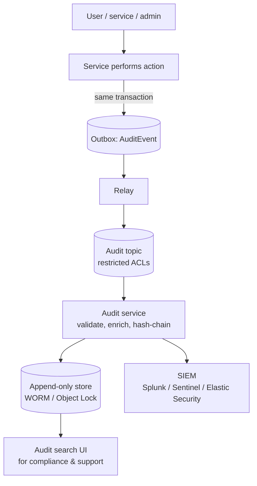

When a regulator asks *"who approved this loan limit increase, and what did they see when they approved it?"*, or a security team asks *"which accounts did this compromised user view yesterday?"*, application logs are not enough. They're noisy, inconsistently structured, sampled, rotated, and editable by the same teams whose actions are in question.

**Audit Logging** produces a **dedicated, structured, durable, tamper-evident record of security- and business-relevant actions**: *who* did *what* to *which resource*, *when*, from *where*, with *what outcome* — and often *why*.

## The problem

Audit requirements come from many directions:

- **Regulation and standards** — financial regulators, PCI DSS, SOX, HIPAA, ISO 27001, data-protection laws that require logging access to personal data.
- **Security** — detecting and investigating account takeover, insider misuse, privilege escalation.
- **Disputes and support** — "I never changed my nominee", "the price was different when I ordered".
- **Operations** — who changed the production configuration before the incident?

Application logs fail these needs because they're optimized for debugging, not evidence.

## How it works



Core properties of a good audit trail:

| Property | Meaning |
|---|---|
| **Complete** | Every auditable action produces exactly one record — no gaps on failures or retries |
| **Attributable** | Identifies the real actor (user, service, impersonating admin) and how they authenticated |
| **Accurate** | Captures what actually happened (outcome), not just what was attempted |
| **Immutable / tamper-evident** | Records can't be altered or deleted without detection |
| **Searchable & retained** | Queryable for the required retention period |
| **Access-controlled** | Only authorized people can read it; reading the audit log is itself audited |

## What to capture

```json
{
  "auditId": "7d3c8e5a-4f21-4b9e-9a0d-61f2b5c0e8a4",
  "occurredAt": "2026-10-17T09:53:41.218Z",
  "actor": {
    "type": "USER",
    "id": "emp-20931",
    "displayName": "R. Iyer",
    "roles": ["CREDIT_OFFICER"],
    "authMethod": "SSO+MFA",
    "onBehalfOf": null
  },
  "action": "credit-limit.increase",
  "resource": { "type": "CardAccount", "id": "CA-0042117" },
  "outcome": "SUCCESS",
  "reason": "Customer request ref SR-88123; income proof verified",
  "changes": [
    { "field": "creditLimit", "from": "150000.00", "to": "250000.00" }
  ],
  "context": {
    "sourceIp": "10.20.4.18",
    "userAgent": "BranchPortal/5.4",
    "channel": "branch",
    "service": "card-limits",
    "serviceVersion": "2026.10.17",
    "traceId": "4bf92f3577b34da6a3ce929d0e0e4736",
    "approvalId": "APR-2026-55102"
  },
  "schemaVersion": 2
}
```

Typical auditable actions:

- **Authentication** — logins, failures, MFA changes, password resets, session revocations.
- **Authorization changes** — role grants, permission changes, admin elevation.
- **Sensitive reads** — viewing customer PII, exporting data, downloading statements.
- **Business-critical writes** — limit changes, payments, approvals, overrides, refunds, price changes.
- **Configuration and operations** — production config changes, feature-flag flips, deployments, key rotations.

Capture **failures and denials** too — a run of `ACCESS_DENIED` events is often the first sign of an attack.

## Capturing reliably

Audit events must not be lost when the action succeeded, nor recorded when it rolled back.

- **Outbox** — write the audit event in the **same transaction** as the business change ([Transactional Outbox](/blog/transactional-outbox/)). The most dependable approach for writes.
- **Event sourcing** — if the domain is event-sourced, the event store already *is* an audit trail of state changes ([Event Sourcing](/blog/event-sourcing/)); enrich events with actor and reason metadata.
- **Gateway / middleware** — capture sensitive *reads* and access decisions at a central policy point (API gateway, authorization service) so every endpoint is covered.
- **Platform logs** — cloud control-plane logs (AWS CloudTrail, Azure Activity Log, GCP Audit Logs) and Kubernetes audit logs cover infrastructure actions.

```java
@Transactional
public void increaseLimit(CardAccountId id, Money newLimit, String reason, Actor actor) {
  CardAccount acct = accounts.load(id);
  Money old = acct.creditLimit();
  acct.changeLimit(newLimit, actor);                     // domain rules + approvals
  accounts.save(acct);

  outbox.save(AuditEvent.builder()                       // same transaction as the change
      .actor(actor)
      .action("credit-limit.increase")
      .resource("CardAccount", id.value())
      .outcome(Outcome.SUCCESS)
      .reason(reason)
      .change("creditLimit", old.toPlainString(), newLimit.toPlainString())
      .traceId(Tracing.currentTraceId())
      .build());
}
```

## Tamper evidence

Make undetected modification impractical:

- **Append-only storage** with retention locks — S3 Object Lock (compliance mode), Azure immutable blob storage, WORM-capable archives.
- **Hash chaining** — each record includes the hash of the previous record; altering one breaks the chain from that point on.
- **Periodic anchoring** — sign or publish the latest chain hash (daily digest) to a separate system so the chain itself can't be rewritten wholesale.
- **Separation of duties** — application teams can write audit events but not modify or delete them; a separate team administers the audit store.

```python
import hashlib, json

def chain(prev_hash: str, record: dict) -> dict:
    body = json.dumps(record, sort_keys=True, separators=(",", ":"))
    record["prevHash"] = prev_hash
    record["hash"] = hashlib.sha256((prev_hash + body).encode()).hexdigest()
    return record

def verify(records: list[dict]) -> bool:
    prev = "GENESIS"
    for r in records:
        body = {k: v for k, v in r.items() if k not in ("prevHash", "hash")}
        expected = hashlib.sha256((prev + json.dumps(body, sort_keys=True, separators=(",", ":"))).encode()).hexdigest()
        if r["prevHash"] != prev or r["hash"] != expected:
            return False
        prev = r["hash"]
    return True
```

*(Per-stream chains — per tenant or per day — keep this scalable; a single global chain becomes a serialization bottleneck.)*

## Audit logs vs. application logs

| | Application logs | Audit logs |
|---|---|---|
| Purpose | Debugging, operations | Accountability, compliance, forensics |
| Audience | Engineers | Auditors, security, compliance, support |
| Completeness | Best effort; sampled; levels | Every auditable action, guaranteed |
| Schema | Loose | Strict, versioned |
| Retention | Days to weeks | Years (per regulation) |
| Mutability | Rotated, deleted | Append-only, tamper-evident |
| Access | Broad within engineering | Restricted; access itself audited |

## Privacy

Audit logs often contain personal data and must themselves comply with data-protection rules:

- **Minimize** — record identifiers and changed fields, not entire records.
- **Mask** sensitive values (card numbers, national IDs) in `changes`.
- **Legal basis and retention** — keep for the legally required period, then delete or anonymize.
- **Erasure conflicts** — where audit retention obligations override erasure requests, document the basis; consider pseudonymous actor IDs with a separately managed mapping.

## Trade-offs

| Benefits | Costs |
|---|---|
| Accountability and regulatory compliance | Storage and long-term retention costs |
| Faster security investigations | Engineering effort to cover every auditable action |
| Evidence for disputes and support | Privacy obligations for the audit data itself |
| Deterrent against misuse | Operational separation of duties to maintain |

## Common pitfalls

> **Warning:** auditing via application `log.info()`. When log sampling, level changes, or rotation drop the line, the audit record is gone — and engineers can edit or delete it. Audit events need their own reliable path and storage.

- **Recording the attempt, not the outcome** — "user requested limit increase" without whether it succeeded.
- **Losing the real actor** behind service accounts — propagate the end-user identity (and any impersonation) through service calls.
- **No audit of reads** for sensitive data, which many regulations explicitly require.
- **Free-text actions** (`"changed stuff"`) instead of a controlled vocabulary.

## Tools and real-world usage

- **Capture** — outbox + Kafka, event stores, API gateway and policy-engine logs (OPA decision logs), Kubernetes audit logs, AWS CloudTrail / Azure Activity Logs / GCP Cloud Audit Logs.
- **Storage** — S3 Object Lock, Azure immutable storage, append-only databases or ledger tables (e.g., SQL Server ledger tables), dedicated audit services.
- **Analysis** — SIEM platforms such as Splunk, Microsoft Sentinel, Elastic Security, Google Security Operations.

In banking environments I've worked in, audit trails for document access and customer-data changes were as important as the features themselves — designed in from the first sprint and verified in every compliance review.

## Related patterns

- [Event Sourcing](/blog/event-sourcing/) — state changes as a built-in audit trail.
- [Transactional Outbox](/blog/transactional-outbox/) — reliable audit event capture.
- [Log Aggregation](/blog/log-aggregation/) — operational logs, kept separate from audit.
- [Correlation ID](/blog/correlation-id/) and [Distributed Tracing](/blog/distributed-tracing/) — linking audit events to the requests that caused them.

## Key takeaways

1. Audit logs answer who did what to which resource, when, from where, with what outcome — and why.
2. Capture them reliably (outbox, event store, central policy point), including failures and sensitive reads.
3. Store them append-only and tamper-evident, with separation of duties.
4. Treat the audit trail as regulated data: strict schema, restricted access, defined retention.
