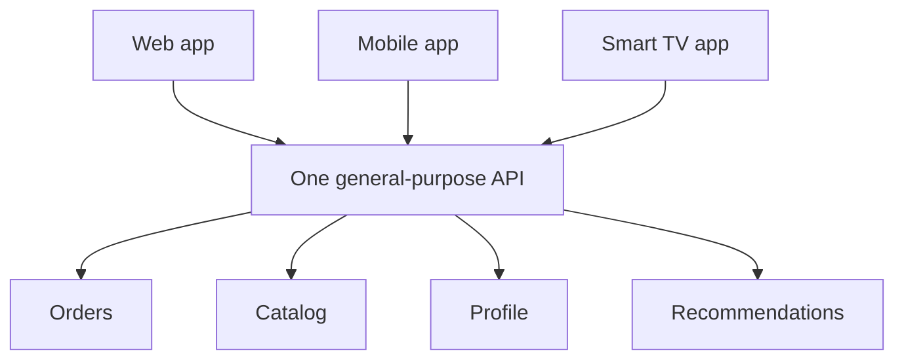
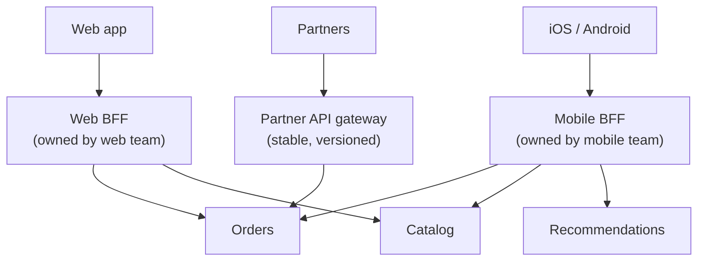
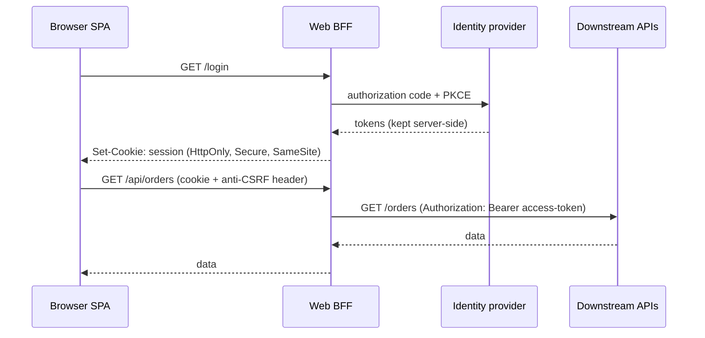

A mobile app on a patchy 4G connection, a desktop web app on fibre, a smartwatch, and a partner integration all want different things from your backend: different payload sizes, different fields, different numbers of round trips, different authentication flows. One general-purpose API forces every client to compromise — and the API team becomes a bottleneck for every UI change.

The **Backend for Frontend (BFF)** pattern, described by Sam Newman from his time at ThoughtWorks and widely associated with SoundCloud's architecture, gives each **client type its own backend**, owned by (or closely with) the **team that builds that client**.

## The problem



Symptoms:

- **Over-fetching** — mobile downloads the full 40-field product object to render a thumbnail and a price.
- **Under-fetching** — the home screen needs 7 calls, each a high-latency round trip on mobile.
- **Conflicting requirements** — the web team wants a field renamed; the mobile team can't change until users update the app.
- **Coordination bottleneck** — every UI feature needs a ticket for the API team.

## How it works



Each BFF:

- **Aggregates** downstream calls into exactly the shape its screens need ([API Composition](/blog/api-composition/)).
- **Trims and transforms** payloads (smaller images, fewer fields, client-friendly formats).
- **Owns UI-specific logic** — pagination styles, formatting, feature-flag evaluation, A/B variants.
- **Handles the client's auth flow** (cookies for web, tokens for mobile).
- **Evolves at the client's pace** — mobile BFFs often support several app versions in the field.

Domain logic stays in the downstream services; the BFF is a **thin adapter for one experience**.

## Example: a mobile home-screen endpoint (TypeScript)

```typescript
// GET /mobile/v3/home — one round trip for the whole screen
app.get("/mobile/v3/home", async (req, res) => {
  const user = req.auth.userId;
  const appVersion = req.header("X-App-Version") ?? "0";
  const signal = AbortSignal.timeout(900);

  const [profile, orders, recs, banners] = await Promise.allSettled([
    profileSvc.summary(user, { signal }),
    orderSvc.recent(user, { limit: 3, signal }),
    recsSvc.forUser(user, { limit: 10, signal }),
    cms.banners({ placement: "mobile-home", signal }),
  ]);

  res.json({
    greeting: profile.status === "fulfilled" ? `Hi, ${profile.value.firstName}` : "Welcome back",
    recentOrders: orders.status === "fulfilled"
      ? orders.value.map((o) => ({ id: o.id, status: o.statusLabel, eta: o.etaShort }))
      : [],
    recommendations: recs.status === "fulfilled"
      ? recs.value.map((p) => ({
          id: p.id,
          title: p.name,
          price: formatPrice(p.price, req.locale),
          image: imageUrl(p.imageId, { width: 320, format: "webp" }),   // mobile-sized
        }))
      : [],
    banners: banners.status === "fulfilled" ? banners.value.slice(0, 2) : [],
    // Version-aware response: older apps don't understand the new "stories" module
    ...(semverGte(appVersion, "5.2.0") ? { stories: await storiesFor(user, signal) } : {}),
  });
});
```

## The BFF security pattern for browser apps

For single-page applications, the BFF has become the **recommended way to handle OAuth** securely (see the IETF *OAuth 2.0 for Browser-Based Apps* guidance):

- The **BFF is the OAuth client**. It performs the authorization-code flow with PKCE server-side and keeps access and refresh tokens **on the server**.
- The browser gets only an **HttpOnly, Secure, SameSite session cookie** — no tokens in JavaScript, so XSS can't steal them.
- The BFF attaches the access token when proxying API calls downstream.



## Avoiding duplication

Multiple BFFs can drift into duplicating logic. Guardrails:

- **Push shared business logic down** into domain services, not sideways into a "shared BFF library".
- **Share only plumbing** — HTTP clients, auth middleware, tracing — as internal libraries.
- **Merge BFFs** whose clients have converged (e.g., iOS and Android usually share one mobile BFF).
- **Consider GraphQL** as a single, flexible BFF layer where client teams write their own queries; this trades per-client endpoints for schema governance.

## BFF vs. API gateway vs. GraphQL

| | API Gateway | BFF | GraphQL layer |
|---|---|---|---|
| Purpose | Cross-cutting edge concerns | Tailored API per experience | Client-specified queries |
| Owner | Platform team | Client team | Graph/platform team + clients |
| Contains UI logic | No | Yes (presentation-oriented) | Mostly in resolvers/clients |
| Number of instances | Few | One per client type | Usually one federated graph |

They combine well: a gateway in front for TLS, auth, and limits; BFFs (or a GraphQL router) behind it.

## Trade-offs

| Benefits | Costs |
|---|---|
| Optimal payloads and round trips per client | More services to build and run |
| Client teams ship independently | Risk of duplicated logic across BFFs |
| Secure token handling for SPAs | Another hop on every request |
| Supports multiple app versions in the field | Needs clear ownership to avoid becoming a mini-monolith |

## Common pitfalls

> **Pitfall:** the "BFF" that every client uses. If web, mobile, and partners all call the same "BFF", it's just a general-purpose API with a trendy name — and it will suffer all the original problems.

- **Domain logic in the BFF** (discount calculation, eligibility rules) that then has to be duplicated elsewhere.
- **BFF owned by a separate backend team** — loses the autonomy benefit.
- **No timeouts or partial-failure handling** in fan-out calls.
- **Tokens returned to the browser** "for convenience", defeating the security benefit.

## Tools and real-world usage

- **Node.js / TypeScript** (Express, Fastify, NestJS) and **Kotlin** — common BFF stacks because client teams already know them.
- **Next.js / Remix route handlers** — the framework's server side often *is* the web BFF.
- **GraphQL** (Apollo, Netflix DGS) — a flexible alternative or complement.
- **Duende BFF** (.NET) and similar libraries implement the OAuth BFF security pattern.
- **SoundCloud** and **Netflix** are frequently cited for per-device backend layers — Netflix with device-specific adapters on its API platform.

## Related patterns

- [API Gateway](/blog/api-gateway/) — the edge in front of BFFs.
- [API Composition](/blog/api-composition/) — what BFFs do internally.
- [Fallback](/blog/fallback-pattern/) — per-section degradation in aggregated screens.
- [Anti-Corruption Layer](/blog/anti-corruption-layer/) — BFFs can shield clients from legacy APIs.

## Key takeaways

1. One backend per client experience, owned by the client's team.
2. BFFs aggregate, trim, and adapt; domain logic stays in services.
3. For SPAs, the BFF keeps OAuth tokens server-side behind a secure cookie.
4. Share plumbing, not business logic, and merge BFFs when clients converge.
