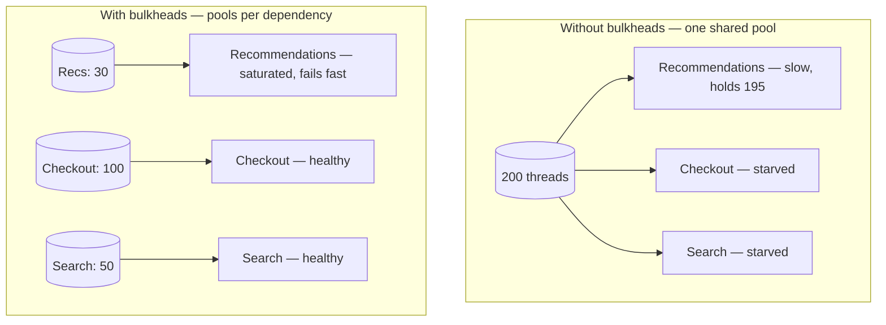
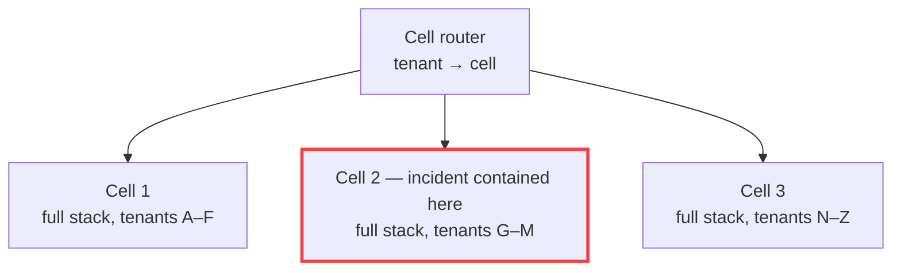

Ships are divided into watertight **bulkheads** so that a hull breach floods one compartment, not the whole vessel. The software **Bulkhead** pattern does the same with resources: give each dependency, workload, or tenant its **own limited pool** of threads, connections, or capacity, so that when one of them misbehaves, it can exhaust **only its own compartment**.

## The problem

Many services share a single pool for everything:

- One HTTP client connection pool for all downstream services.
- One request-thread pool (Tomcat's 200 threads) serving every endpoint.
- One database connection pool for interactive queries and batch exports.

If the **recommendations** service becomes slow, calls to it hold threads and connections for seconds each. Soon all 200 request threads are waiting on recommendations, and **checkout** — which doesn't even need recommendations — can't get a thread. A non-critical feature has taken down a critical one.



## How it works

Partition a shared resource and cap each partition. When a partition is full, **new work is rejected immediately** (or queued briefly), rather than waiting and spreading the damage.

Bulkheads exist at several levels:

| Level | Mechanism | Isolates |
|---|---|---|
| **In-process, per dependency** | Semaphores or dedicated thread pools | Slow dependencies from each other |
| **Connection pools** | Separate pools per downstream / per DB workload | Batch from interactive, critical from optional |
| **Per endpoint / workload** | Separate executors or deployments for critical vs. bulk APIs | Heavy endpoints from light ones |
| **Per tenant** | Quotas, rate limits, dedicated workers | Noisy neighbors |
| **Infrastructure** | Separate node pools, namespaces, resource quotas | Workloads at the cluster level |
| **Cells** | Independent copies of the full stack serving a subset of users | Blast radius of any failure, including bad deploys |

## Semaphore vs. thread-pool bulkheads

| | Semaphore bulkhead | Thread-pool bulkhead |
|---|---|---|
| How | Limits concurrent calls on the caller's thread | Runs calls on a dedicated, bounded executor |
| Overhead | Very low | Thread handoff, context propagation |
| Protects against hung calls | Only with a separate timeout | Caller can time out independently |
| Best for | Async/reactive clients, virtual threads, fast calls | Blocking clients where you need hard isolation |

With Java virtual threads or reactive stacks, **semaphore bulkheads** (concurrency limits) are usually the right tool — threads are cheap; concurrent load on the dependency is what you're limiting.

## Example: Resilience4j

```java
// Semaphore bulkhead: at most 25 concurrent calls to recommendations; wait up to 10 ms for a slot
BulkheadConfig recsConfig = BulkheadConfig.custom()
    .maxConcurrentCalls(25)
    .maxWaitDuration(Duration.ofMillis(10))
    .build();
Bulkhead recsBulkhead = Bulkhead.of("recommendations", recsConfig);

// Thread-pool bulkhead for a blocking legacy SOAP client
ThreadPoolBulkheadConfig legacyConfig = ThreadPoolBulkheadConfig.custom()
    .coreThreadPoolSize(10)
    .maxThreadPoolSize(10)
    .queueCapacity(20)                // small queue: fail fast rather than build latency
    .build();
ThreadPoolBulkhead legacyBulkhead = ThreadPoolBulkhead.of("legacy-core-banking", legacyConfig);

Supplier<List<Product>> recs = Decorators.ofSupplier(() -> recsClient.forUser(userId))
    .withBulkhead(recsBulkhead)
    .withFallback(List.of(BulkheadFullException.class), ex -> List.of())   // optional feature: degrade
    .decorate();

CompletionStage<AccountSummary> summary = legacyBulkhead
    .executeSupplier(() -> coreBankingClient.summary(accountId));
```

```yaml
# Equivalent Spring Boot configuration
resilience4j:
  bulkhead:
    instances:
      recommendations: { max-concurrent-calls: 25, max-wait-duration: 10ms }
  thread-pool-bulkhead:
    instances:
      legacy-core-banking: { core-thread-pool-size: 10, max-thread-pool-size: 10, queue-capacity: 20 }
```

## Sizing a bulkhead

Use **Little's Law**: `concurrency = throughput × latency`.

If recommendations normally serve 200 req/s at 50 ms p99, steady-state concurrency is `200 × 0.05 = 10`. A limit of **20–25** gives headroom for spikes while capping the damage if latency jumps to 2 s (which would otherwise demand `200 × 2 = 400` concurrent calls).

- Size **per instance**: total concurrency to the dependency = limit × replicas. Make sure that total doesn't exceed what the dependency can handle.
- Keep **queues small**. A long queue is a latency bulkhead with a leak.
- **Reserve capacity** for critical paths: give checkout a pool that nothing else can consume.

## Infrastructure and cell-level bulkheads

At the platform level, Kubernetes namespaces with **ResourceQuotas**, separate **node pools** for batch vs. latency-sensitive workloads, and **PodDisruptionBudgets** stop one workload from starving another.

The largest-scale form is **cell-based architecture**: deploy many independent copies ("cells") of the whole stack, each serving a slice of customers, routed by a thin layer. A bad deployment, poison request, or overload affects one cell's customers, not everyone. AWS has written extensively about using cells to limit blast radius.



## Trade-offs

| Benefits | Costs |
|---|---|
| Contains failures to one dependency/workload/tenant | Lower utilization — reserved capacity sits idle |
| Protects critical paths from optional features | More pools and limits to size and monitor |
| Makes overload visible as fast rejections | Wrong sizes cause rejections during normal peaks |
| Scales up to cell architectures for blast radius | Cells add routing and operational complexity |

## Common pitfalls

> **Pitfall:** a bulkhead with an unbounded queue. Calls never get rejected; they just wait — and you're back to threads piling up and latency spreading. Bounded concurrency *and* bounded (small) queues.

- **Bulkheads without timeouts** — a full pool of hung calls stays full forever. Pair with [Timeout](/blog/timeout-pattern/).
- **Shared connection pools hidden in libraries** — e.g., one global HTTP client used by every integration.
- **Same database pool for batch and online** — a nightly export starves the website.
- **Ignoring the replica multiplier** when sizing limits.

## Tools and real-world usage

- **Resilience4j** semaphore and thread-pool bulkheads; **Polly** concurrency limiter (`AddConcurrencyLimiter`).
- **Envoy / Istio** — per-cluster connection and pending-request limits (`connectionPool`).
- **Separate HikariCP pools** for different workloads; **PgBouncer** pools per application.
- **Kubernetes** ResourceQuotas, LimitRanges, priority classes, dedicated node pools.

## Related patterns

- [Circuit Breaker](/blog/circuit-breaker/) — stops calls to a failed dependency; bulkheads limit damage before it trips.
- [Timeout](/blog/timeout-pattern/) — frees bulkhead slots from hung calls.
- [Rate Limiting](/blog/rate-limiting/) and [Load Shedding](/blog/load-shedding/) — bulkheads for incoming traffic.
- [Fallback](/blog/fallback-pattern/) — what to do when a bulkhead is full.

## Key takeaways

1. Give each dependency, workload, or tenant its own bounded pool.
2. Reject quickly when a pool is full; keep queues tiny.
3. Size with Little's Law, per instance, mindful of replica counts.
4. Scale the idea up — node pools, quotas, and cells — to limit blast radius.
