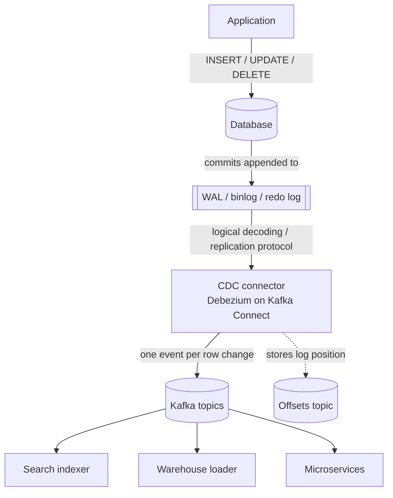

Every relational database already keeps a perfect, ordered record of every change: the **transaction log** — PostgreSQL's write-ahead log (WAL), MySQL's binlog, Oracle's redo log, SQL Server's transaction log. It exists for crash recovery and replication. **Change Data Capture (CDC)** reads that log and turns each committed change into an event.

CDC lets you publish events without touching application code, keep search indexes and caches in sync, migrate data with zero downtime, and power the relay of a [Transactional Outbox](/blog/transactional-outbox/) with exact commit ordering.

## The problem

You need other systems to react to data changes:

- A search index (Elasticsearch) must reflect product updates.
- A data warehouse needs a near-real-time copy of operational tables.
- A legacy monolith's changes must reach new microservices during a [Strangler Fig](/blog/strangler-fig/) migration.
- An outbox table's rows must be published to Kafka in commit order.

The alternatives each hurt: **dual writes** from the app are unreliable; **query-based polling** (`WHERE updated_at > ?`) misses deletes, misses intermediate updates, and loads the database; **triggers** add latency to every write and are hard to evolve.

## How it works



1. The connector registers as a **replication client** (a logical replication slot in PostgreSQL, a replica in MySQL).
2. Optionally it takes an **initial snapshot** of existing rows.
3. It then streams changes from the log **in commit order**, converting each into an event with `before` and `after` row images.
4. It records its **log position** (LSN, binlog file/offset, SCN) so it can resume exactly where it left off after a restart.

### What a change event looks like

```json
{
  "op": "u",
  "ts_ms": 1760692321000,
  "source": { "connector": "postgresql", "db": "shop", "table": "product", "lsn": 2398123344 },
  "before": { "id": 991, "name": "Desk Lamp", "price": 1499.00, "stock": 12 },
  "after":  { "id": 991, "name": "Desk Lamp", "price": 1299.00, "stock": 12 }
}
```

`op` is `c` (create), `u` (update), `d` (delete), or `r` (snapshot read). Deletes are typically followed by a **tombstone** (null value) so compacted Kafka topics can drop the key.

## Example: Debezium for PostgreSQL

### Prepare the database

```sql
-- postgresql.conf: wal_level = logical
CREATE ROLE debezium WITH LOGIN REPLICATION PASSWORD '<from-secret-store>';
GRANT SELECT ON ALL TABLES IN SCHEMA public TO debezium;

-- Publish only the tables you intend to stream
CREATE PUBLICATION dbz_publication FOR TABLE public.product, public.outbox;
```

### Register the connector (Kafka Connect REST)

```json
{
  "name": "shop-postgres",
  "config": {
    "connector.class": "io.debezium.connector.postgresql.PostgresConnector",
    "plugin.name": "pgoutput",
    "database.hostname": "shop-db",
    "database.port": "5432",
    "database.user": "debezium",
    "database.password": "${file:/secrets/db.properties:password}",
    "database.dbname": "shop",
    "topic.prefix": "shop",
    "publication.name": "dbz_publication",
    "slot.name": "debezium_shop",
    "table.include.list": "public.product,public.outbox",
    "snapshot.mode": "initial",
    "heartbeat.interval.ms": "10000",

    "transforms": "outbox",
    "transforms.outbox.type": "io.debezium.transforms.outbox.EventRouter",
    "transforms.outbox.table.fields.additional.placement": "event_type:header:eventType",
    "transforms.outbox.route.by.field": "aggregate_type",
    "transforms.outbox.route.topic.replacement": "events.${routedByValue}",
    "transforms.outbox.table.field.event.key": "aggregate_id",
    "transforms.outbox.table.field.event.payload": "payload"
  }
}
```

The **Outbox Event Router** turns raw change events on the `outbox` table into clean domain events: routed to `events.Order`, keyed by `aggregate_id` (preserving per-aggregate order), with the payload as the message body. *(In a real deployment you'd apply the transform only to the outbox table with a predicate, and stream `product` separately.)*

## Two ways to use CDC

| Style | What you stream | Pros | Cons |
|---|---|---|---|
| **Raw table CDC** | Every column of business tables | Zero app changes; great for replication, search, analytics | Leaks your internal schema as a public contract; events are "row changed", not business meaning |
| **Outbox CDC** | Only the outbox table | Intentional, versioned domain events; exact commit order | Requires writing outbox rows in the app |

> **Rule of thumb:** use raw CDC for **data replication** (warehouse, search, caches, migrations) and outbox CDC for **service-to-service integration**. Other services shouldn't couple to your table layout.

## Operational lessons

- **Replication slots retain WAL.** In PostgreSQL, if the connector stops, the slot keeps WAL on disk until it resumes. A stopped connector can fill the disk. Monitor `pg_replication_slots` lag in bytes and alert. Heartbeats help on low-traffic databases.
- **Snapshots are heavy.** Initial snapshots of large tables take hours and need consistent reads. Use incremental snapshots (Debezium signals) for big tables.
- **Schema changes.** Adding nullable columns is easy; renames and type changes break consumers. Use a schema registry (Avro/Protobuf/JSON Schema) with compatibility rules.
- **Failover.** Logical slots historically didn't survive primary failover in PostgreSQL; newer versions support slot synchronization to standbys. Know your database version's behavior before relying on it.
- **Delivery semantics.** Connectors provide at-least-once delivery; after a crash, some events may be re-emitted. Consumers stay idempotent.
- **Sensitive data.** CDC copies *everything* in the included tables. Exclude or mask PII columns (`column.exclude.list`, masking SMTs).

## Trade-offs

| Benefits | Costs |
|---|---|
| Captures every change, including deletes, in commit order | Kafka Connect cluster and connectors to operate |
| No application changes for raw CDC | Couples consumers to schema (raw mode) |
| Low overhead on the database vs. polling or triggers | WAL retention risk; requires replication privileges |
| Ideal for zero-downtime migrations and sync | Snapshot and schema-evolution complexity |

## Common pitfalls

> **Pitfall:** treating CDC topics as your domain API. When the DBA splits a table, every downstream consumer breaks. Publish domain events through an outbox for anything other teams depend on.

- Forgetting tombstones and compaction for keyed topics, leaving deleted rows "alive" downstream.
- Not monitoring connector status — a failed task can sit silently while lag grows.
- Using CDC to "fix" a missing domain model; CDC tells you *what* changed, not *why*.

## Tools and real-world usage

- **Debezium** — open-source CDC for PostgreSQL, MySQL/MariaDB, SQL Server, Oracle, Db2, MongoDB, and more; runs on Kafka Connect, Debezium Server, or embedded.
- **AWS DMS** — managed migration and ongoing replication with CDC between many sources and targets.
- **Oracle GoldenGate** — long-established enterprise CDC, common in banking for Oracle and Db2 replication.
- **Google Datastream, Azure Data Factory/Fabric mirroring, Fivetran, Airbyte** — managed CDC into warehouses and lakes.

## Related patterns

- [Transactional Outbox](/blog/transactional-outbox/) — CDC is the highest-fidelity outbox relay.
- [Polling Publisher](/blog/polling-publisher/) — the simpler relay alternative.
- [Materialized View](/blog/materialized-view/) — CDC streams are a common way to build them.
- [Strangler Fig](/blog/strangler-fig/) — CDC keeps old and new systems in sync during migration.

## Key takeaways

1. CDC reads the database's transaction log and emits ordered change events.
2. It captures deletes and every intermediate change, with low overhead.
3. Use raw CDC for replication; use outbox CDC for service contracts.
4. Monitor replication-slot lag, plan snapshots, and govern schemas.
