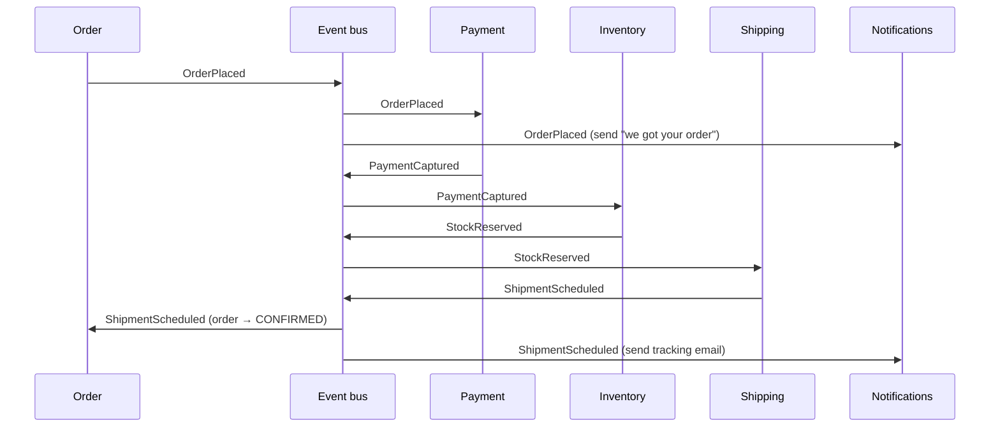
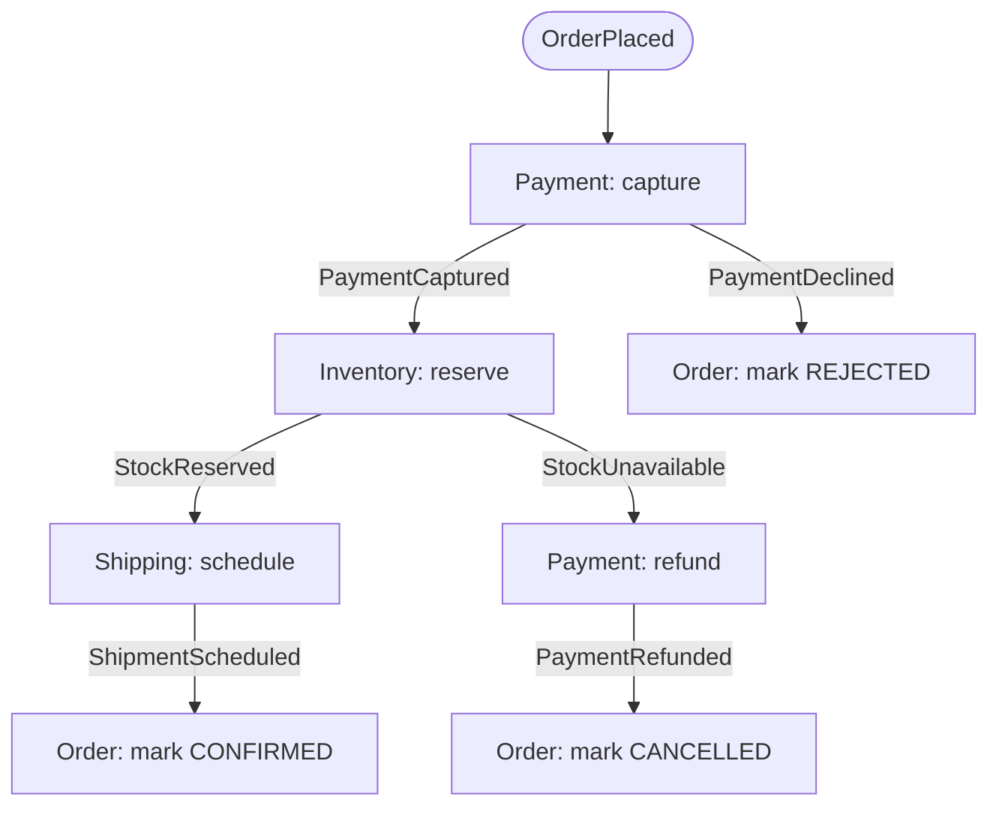

In a ballet, no conductor tells each dancer when to move; every dancer knows the choreography and reacts to the music and to each other. In **Choreography**, services work the same way: there's **no central coordinator**. Each service **listens for events**, does its part, and **publishes new events** that others react to. The overall business process **emerges** from these reactions.

It's the most loosely coupled way to coordinate services — and, past a certain complexity, the hardest to understand.

## The problem

A business process spans several services: placing an order involves payment, inventory, shipping, and notifications. Something must make sure each step happens. You can:

- have one service **call** the others in sequence (tight temporal coupling, cascading failures),
- introduce an **orchestrator** that commands each step ([Orchestration](/blog/orchestration/)),
- or let services **react to each other's events** — choreography.

## How it works



Each service:

- **owns its step** and its data,
- **subscribes** to the events that trigger its work,
- **publishes** events describing what it did ([Domain Events](/blog/domain-events/)),
- knows nothing about who consumes its events.

Adding a new reaction — say, a loyalty service that awards points on `ShipmentScheduled` — requires **no change** to existing services.

## Failure handling: compensating by events

When a step fails, the failing service publishes a failure event, and earlier participants react with [compensations](/blog/compensating-transaction/). This is a choreographed [Saga](/blog/saga-pattern/).



## Example: a choreographed participant (Kafka, Java)

```java
@Component
public class InventoryParticipant {

  private final InventoryService inventory;
  private final OutboxPublisher outbox;   // reliable publishing in the same transaction

  @KafkaListener(topics = "payments.events", groupId = "inventory")
  @Transactional
  public void on(PaymentEvent event, @Header("message-id") String messageId) {
    if (!(event instanceof PaymentCaptured captured)) return;   // only react to what we care about
    if (inbox.alreadyProcessed(messageId)) return;                // idempotent consumer

    ReservationResult result = inventory.reserve(captured.orderId(), captured.lines());

    switch (result) {
      case Reserved r -> outbox.publish("inventory.events",
          new StockReserved(captured.orderId(), r.reservationId(), captured.correlationId()));
      case Unavailable u -> outbox.publish("inventory.events",
          new StockUnavailable(captured.orderId(), u.missingSkus(), captured.correlationId()));
    }
    inbox.markProcessed(messageId);
  }
}
```

Three building blocks appear in every reliable choreography:

1. **[Transactional Outbox](/blog/transactional-outbox/)** — publishing events atomically with state changes.
2. **[Idempotent Consumer](/blog/idempotent-consumer/)** — tolerating redelivered events.
3. **[Correlation ID](/blog/correlation-id/)** — tying all events of one business process together.

## Making the invisible flow visible

Choreography's main weakness: **nobody owns the end-to-end flow**. It's spread across subscriptions in many codebases. Mitigations:

- **Event catalog / AsyncAPI** — document which service publishes and consumes which events.
- **Distributed tracing** — propagate trace context through message headers so one order's journey shows as one trace. See [Distributed Tracing](/blog/distributed-tracing/).
- **Process monitoring** — a passive "observer" that consumes all events for a process and tracks its state (and alerts on stuck processes) *without* controlling it.
- **Timeouts** — someone must notice when `StockReserved` never arrives. Usually the service that started the process (Order) schedules a timeout.
- **Event storming** — model the flow visually with domain experts before implementing it.

## Choreography vs. orchestration

| | Choreography | [Orchestration](/blog/orchestration/) |
|---|---|---|
| Coordination | Distributed, via events | Central coordinator sends commands |
| Coupling | Services know events, not each other | Orchestrator knows every participant |
| Adding a reaction | Subscribe — no other changes | Change the orchestrator |
| Visibility of the flow | Implicit; needs tooling | Explicit; one place to read |
| Complex branching, timeouts, human steps | Awkward | Natural |
| Single point of failure | None | The orchestrator (HA mitigates) |
| Risk | Cyclic dependencies, "event spaghetti" | God-orchestrator with business logic |

> **Rule of thumb:** choreograph **simple, linear reactions** and **fan-out notifications** (two to four steps, few branches). Orchestrate **long, branching, time-bound processes** where someone needs to answer "what state is this in?". Many systems use both: orchestration *within* a bounded context, choreography *between* contexts.

## Trade-offs

| Benefits | Costs |
|---|---|
| Very loose coupling between services | End-to-end flow is hard to see and change |
| No central bottleneck or single point of failure | Debugging spans many services and logs |
| Easy to add new consumers | Risk of cyclic event chains |
| Services remain autonomous and independently deployable | Timeouts and stuck processes need explicit design |

## Common pitfalls

> **Warning:** event chains that loop. Service A reacts to B's event and emits one that B reacts to, which A reacts to… Usually unintended, sometimes infinite. Map your event flows and watch for cycles.

- **Commands disguised as events** (`ReserveStockRequested`) — that's orchestration by another name, with less clarity.
- **Consumers depending on event order across topics** — ordering is only guaranteed within a partition.
- **No owner for the process** — every team owns a step, nobody owns the outcome.
- **Changing an event's meaning** and silently breaking unknown consumers.

## Tools and real-world usage

- **Apache Kafka**, **RabbitMQ topic exchanges**, **AWS EventBridge / SNS+SQS**, **Google Pub/Sub**, **Azure Service Bus topics** and **Event Grid**.
- **AsyncAPI**, **EventCatalog** — documentation for event-driven systems.
- **OpenTelemetry** messaging semantic conventions — tracing across asynchronous hops.

## Related patterns

- [Orchestration](/blog/orchestration/) — the centralized alternative.
- [Publish-Subscribe](/blog/publish-subscribe/) — the messaging mechanism underneath.
- [Saga](/blog/saga-pattern/) — choreographed sagas for consistency.
- [Domain Events](/blog/domain-events/) — the vocabulary of choreography.

## Key takeaways

1. Services react to events and publish their own; no one is in charge.
2. It maximizes decoupling and makes adding consumers trivial.
3. Use outbox, idempotent consumers, and correlation IDs as standard equipment.
4. Invest in visibility — tracing, event catalogs, process monitors — and switch to orchestration when flows get complex.
