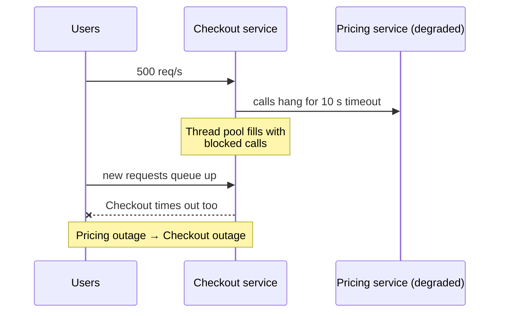
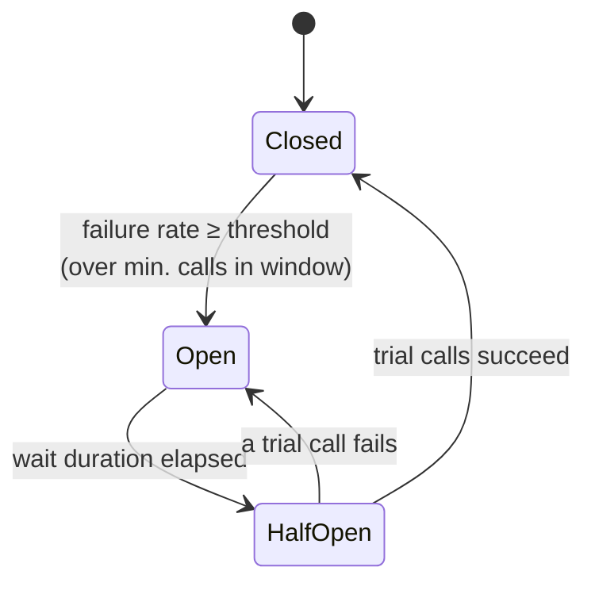

When a downstream service is failing, continuing to call it is worse than useless. Every request waits for a timeout, threads and connections pile up, latency spreads to your callers, and the struggling service gets no breathing room to recover. A **Circuit Breaker** — popularized by Michael Nygard's *Release It!* — watches calls to a dependency and, when failures cross a threshold, **trips**: subsequent calls **fail immediately** without touching the network. After a cool-down it lets a few trial calls through to see if the dependency has recovered.

## The problem: cascading failure



Without a breaker, one slow dependency consumes the caller's resources until the caller fails too — and then *its* callers fail. That's a **cascading failure**.

## How it works

A circuit breaker is a small state machine wrapped around calls to one dependency.



| State | Behavior |
|---|---|
| **Closed** | Calls flow normally. The breaker records outcomes in a sliding window (count- or time-based). |
| **Open** | Calls fail **immediately** with a "circuit open" error (or go to a [fallback](/blog/fallback-pattern/)). No load reaches the dependency. |
| **Half-open** | After the wait duration, a limited number of **trial calls** pass through. Success closes the circuit; failure re-opens it. |

What counts as a failure is configurable: exceptions, timeouts, specific status codes — and, importantly, **slow calls** above a duration threshold.

## Example: Resilience4j (Java)

```java
CircuitBreakerConfig config = CircuitBreakerConfig.custom()
    .slidingWindowType(SlidingWindowType.COUNT_BASED)
    .slidingWindowSize(50)                          // evaluate the last 50 calls
    .minimumNumberOfCalls(20)                       // don't trip on 2 failures out of 3
    .failureRateThreshold(50)                       // open at ≥50% failures
    .slowCallDurationThreshold(Duration.ofMillis(800))
    .slowCallRateThreshold(60)                      // ...or ≥60% calls slower than 800 ms
    .waitDurationInOpenState(Duration.ofSeconds(20))
    .permittedNumberOfCallsInHalfOpenState(5)
    .automaticTransitionFromOpenToHalfOpenEnabled(true)
    .recordExceptions(IOException.class, TimeoutException.class, HttpServerErrorException.class)
    .ignoreExceptions(BusinessValidationException.class)   // 4xx-style errors aren't dependency failures
    .build();

CircuitBreaker pricingBreaker = CircuitBreaker.of("pricing", config);

pricingBreaker.getEventPublisher()
    .onStateTransition(e -> log.warn("pricing breaker: {}", e.getStateTransition()));

// Compose: Retry (outer) → CircuitBreaker → TimeLimiter (inner) → call
Supplier<Price> guarded = Decorators.ofSupplier(() -> pricingClient.priceFor(sku))
    .withCircuitBreaker(pricingBreaker)
    .withRetry(Retry.of("pricing", RetryConfig.custom().maxAttempts(2).build()))
    .withFallback(List.of(CallNotPermittedException.class, IOException.class),
                  ex -> priceCache.lastKnown(sku))       // degrade gracefully
    .decorate();
```

> **In practice:** order matters. With retry **outside** the breaker, an open circuit fails each retry instantly (cheap). With retry **inside**, a single breaker call could hide several failed attempts and the breaker sees fewer failures than really happened.

## Example: Polly v8 (.NET)

```csharp
var pipeline = new ResiliencePipelineBuilder<HttpResponseMessage>()
    .AddCircuitBreaker(new CircuitBreakerStrategyOptions<HttpResponseMessage>
    {
        FailureRatio = 0.5,
        MinimumThroughput = 20,
        SamplingDuration = TimeSpan.FromSeconds(30),
        BreakDuration = TimeSpan.FromSeconds(20),
        ShouldHandle = new PredicateBuilder<HttpResponseMessage>()
            .Handle<HttpRequestException>()
            .Handle<TimeoutRejectedException>()
            .HandleResult(r => (int)r.StatusCode >= 500),
        OnOpened = args => { logger.LogWarning("Pricing circuit opened"); return default; },
    })
    .AddTimeout(TimeSpan.FromMilliseconds(800))
    .Build();
```

## Example: mesh-level outlier detection

Service meshes provide a related mechanism: **eject individual unhealthy instances** from the load-balancing pool rather than failing the whole dependency.

```yaml
apiVersion: networking.istio.io/v1
kind: DestinationRule
metadata:
  name: pricing
spec:
  host: pricing.shop.svc.cluster.local
  trafficPolicy:
    connectionPool:
      tcp: { maxConnections: 200 }
      http: { http1MaxPendingRequests: 100, maxRequestsPerConnection: 100 }
    outlierDetection:
      consecutive5xxErrors: 5
      interval: 10s
      baseEjectionTime: 30s
      maxEjectionPercent: 50     # never eject more than half the pool
```

Use **both**: mesh outlier detection handles "one bad pod", while an application-level breaker handles "the whole dependency is down" and can run business-aware fallbacks.

## Tuning thresholds

| Setting | Too low | Too high |
|---|---|---|
| Minimum calls | Trips on noise at low traffic | Slow to react |
| Failure-rate threshold | Trips during normal error rates | Lets damage spread |
| Slow-call threshold | Trips on normal latency variation | Misses brownouts |
| Open wait duration | Hammers a recovering service | Stays degraded after recovery |
| Half-open trial calls | One unlucky call re-opens it | Floods a fragile service |

Start from your dependency's **SLO**: if its p99 is 300 ms, a slow-call threshold of 800–1000 ms is a reasonable start. Tune with production metrics.

## One breaker per what?

- **Per dependency** (pricing service) — the default.
- **Per endpoint or operation** — when one slow endpoint shouldn't block healthy ones.
- **Per tenant or region** — when failures are localized.

Too coarse and a single bad endpoint cuts off everything; too fine and breakers never collect enough calls to decide.

## Trade-offs

| Benefits | Costs |
|---|---|
| Prevents cascading failures | Users see errors (or fallbacks) while open |
| Frees caller threads and connections instantly | Thresholds need tuning per dependency |
| Gives failing services room to recover | Per-instance breakers see only local traffic |
| Clear operational signal (state changes) | Can mask partial failures if fallbacks are silent |

## Common pitfalls

> **Warning:** counting business errors as failures. If "card declined" (a normal 4xx outcome) trips the payment breaker, a surge of declines on Black Friday will cut off all payments. Record only technical failures and timeouts.

- **No fallback strategy** — decide what users see when the circuit is open.
- **No visibility** — breaker state changes should be logged, metered, and alerted.
- **Breakers without timeouts** — a breaker only trips on outcomes; calls that hang forever never produce one. Always pair with a [Timeout](/blog/timeout-pattern/).
- **Sharing one breaker across unrelated dependencies.**

## Tools and real-world usage

- **Resilience4j** (Java, Spring Cloud CircuitBreaker), **Polly** (.NET), **opossum** (Node.js), **pybreaker** (Python), **gobreaker** (Go).
- **Envoy / Istio / Linkerd** — outlier detection and connection-pool limits at the mesh level.
- **Netflix Hystrix** — popularized the pattern; now in maintenance mode, with Resilience4j as the common successor.

## Related patterns

- [Retry with Backoff](/blog/retry-with-backoff/) — retries for blips; breakers for outages.
- [Timeout](/blog/timeout-pattern/) — produces the failures breakers count.
- [Fallback](/blog/fallback-pattern/) — what to return when open.
- [Bulkhead](/blog/bulkhead/) — limits damage even before the breaker trips.

## Key takeaways

1. A breaker trips on high failure or slow-call rates and fails fast while open.
2. Half-open trial calls test recovery before closing again.
3. Count only technical failures; pair with timeouts and fallbacks.
4. Combine app-level breakers with mesh outlier detection, and monitor state changes.
