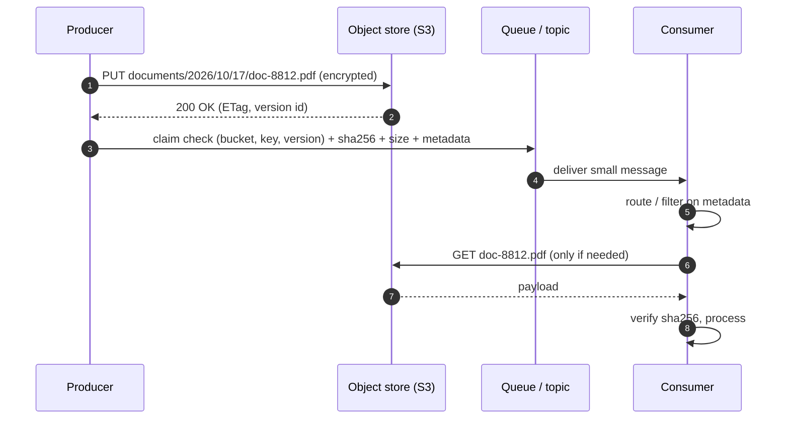

At an airport you hand over your suitcase and get a small paper tag. You travel light; at the destination, the tag lets you claim your bag. The **Claim Check** pattern does the same for messages: store the **large payload** in a data store (usually object storage), and send a **small message carrying a reference** to it. The consumer uses the reference to fetch the payload when — and if — it needs it.

## The problem

Message brokers are optimized for many small messages, not large ones:

| Broker | Typical maximum message size |
|---|---|
| Amazon SQS | 256 KB (larger via the extended client library) |
| Azure Service Bus | 256 KB Standard; up to 100 MB Premium |
| Google Pub/Sub | 10 MB |
| Kafka | ~1 MB by default (`message.max.bytes`), configurable but costly to raise |
| RabbitMQ | Configurable, but large messages hurt memory and throughput |

Meanwhile, real business events often involve **scanned documents, images, PDFs, audio, or large datasets**. Pushing them through the broker:

- hits size limits,
- multiplies storage (every replica, every retry topic, every DLQ),
- slows every consumer — including those that only need metadata,
- and copies sensitive content into systems not designed to hold it.

## How it works



The message carries enough **metadata** for routing and filtering, so many consumers never fetch the payload at all.

## Example: S3 + SQS in TypeScript

### Producer

```typescript
import { S3Client, PutObjectCommand } from "@aws-sdk/client-s3";
import { SQSClient, SendMessageCommand } from "@aws-sdk/client-sqs";
import { createHash, randomUUID } from "node:crypto";

const s3 = new S3Client({});
const sqs = new SQSClient({});
const BUCKET = "kyc-documents-claims";

export async function publishDocumentReceived(customerId: string, file: Buffer, contentType: string) {
  const id = randomUUID();
  const key = `incoming/${new Date().toISOString().slice(0, 10)}/${id}`;
  const sha256 = createHash("sha256").update(file).digest("hex");

  const put = await s3.send(new PutObjectCommand({
    Bucket: BUCKET, Key: key, Body: file, ContentType: contentType,
    ServerSideEncryption: "aws:kms",              // encrypted at rest with a KMS key
    ChecksumSHA256: Buffer.from(sha256, "hex").toString("base64"),
  }));

  const message = {
    messageId: id,
    type: "DocumentReceived",
    customerId,
    contentType,
    sizeBytes: file.length,
    sha256,
    claimCheck: { bucket: BUCKET, key, versionId: put.VersionId },  // reference, not a URL
  };

  await sqs.send(new SendMessageCommand({
    QueueUrl: process.env.DOCS_QUEUE_URL!,
    MessageBody: JSON.stringify(message),
    MessageAttributes: { contentType: { DataType: "String", StringValue: contentType } },
  }));
}
```

### Consumer

```typescript
import { GetObjectCommand } from "@aws-sdk/client-s3";

export async function handle(message: DocumentReceived) {
  if (!message.contentType.startsWith("image/")) return;   // filter on metadata only

  const obj = await s3.send(new GetObjectCommand({
    Bucket: message.claimCheck.bucket,
    Key: message.claimCheck.key,
    VersionId: message.claimCheck.versionId,               // immutable: exactly what was sent
  }));
  const bytes = Buffer.from(await obj.Body!.transformToByteArray());

  const actual = createHash("sha256").update(bytes).digest("hex");
  if (actual !== message.sha256) throw new Error("Claim check integrity failure");

  await runOcr(message.messageId, bytes);
}
```

## Design decisions

### Write order

Always **store the payload first, then publish the message**. The reverse order lets consumers receive a reference to something that doesn't exist yet. If the publish fails after the upload, you have an orphan object — harmless, and cleaned up by lifecycle rules.

If the claim-check message is a domain event tied to a database change, publish it through a [Transactional Outbox](/blog/transactional-outbox/): upload the object, then commit the business row and outbox row together.

### Reference vs. pre-signed URL

| Option | Pros | Cons |
|---|---|---|
| **Bucket + key (+ version)** | Consumers use their own IAM permissions; nothing secret in the message | Every consumer needs storage access configured |
| **Pre-signed URL** | Consumer needs no storage credentials | URL is a bearer token — anyone who sees the message (logs, DLQ) can fetch the data until expiry |

For sensitive data, prefer references plus least-privilege IAM. If you use pre-signed URLs, keep expiry short and remember that DLQ redrives may happen after expiry.

### Lifecycle and retention

Decide who deletes the payload, and when:

- **Lifecycle rules** — e.g., delete `incoming/` objects after 30 days, or transition to cheaper storage classes.
- **Retention ≥ message retention + DLQ retention + replay window** — otherwise a redriven message points at a deleted object.
- **Legal holds** — regulated documents (KYC, contracts) may have retention requirements that outlive the workflow.

### Immutability and integrity

Treat claimed objects as **immutable**. Use versioned buckets or write-once keys, and include a checksum in the message so consumers can verify integrity.

## Variants

- **Selective claim check** — only payloads above a threshold (say 200 KB) are offloaded; small ones go inline. The AWS SQS Extended Client Library and Azure's equivalents do this automatically.
- **Batch claim check** — a message references a manifest of many objects (e.g., a nightly file drop).
- **Content enricher** — a downstream step fetches the payload and enriches the message for later steps.

## Trade-offs

| Benefits | Costs |
|---|---|
| Removes broker size limits | Two systems must be available to process a message |
| Keeps broker storage and throughput healthy | Extra latency for the fetch |
| Consumers that need only metadata stay fast | Orphaned objects and lifecycle management |
| Sensitive payloads stay in a store with proper access control | Consistency between message and payload must be designed |

## Common pitfalls

> **Warning:** logging the pre-signed URL. Messages are routinely logged, traced, and copied to DLQs. A pre-signed URL in a log line is a credential leak for its lifetime.

- Deleting the object as soon as the first consumer finishes — other subscribers and replays still need it.
- Mutable keys (overwriting `latest.pdf`) — consumers process a different version from the one the message described.
- Forgetting cross-region access costs and latency when producers and consumers live in different regions.

## Tools and real-world usage

- **Amazon S3 + SQS/SNS/EventBridge** — the canonical combo; the SQS Extended Client Library implements claim check automatically.
- **Azure Blob Storage + Service Bus / Event Grid**, **Google Cloud Storage + Pub/Sub**.
- **Kafka** — teams store large values in object storage and send keys; Confluent and others also offer tiered storage, which addresses retention cost rather than message size.

Document-heavy domains — KYC onboarding, insurance claims, mortgage processing, medical imaging, media pipelines — rely on claim checks. In enterprise content management, the document lives in the repository and messages carry its object ID, which is the same idea.

## Related patterns

- [Routing Slip](/blog/routing-slip/) — keep slips small by carrying claim checks.
- [Transactional Outbox](/blog/transactional-outbox/) — publish claim-check events reliably.
- [Guaranteed Delivery](/blog/guaranteed-delivery/) — the message is guaranteed; the payload's durability depends on the store.
- [Audit Logging](/blog/audit-logging/) — record who accessed claimed documents.

## Key takeaways

1. Store big payloads in object storage; send a small reference with metadata.
2. Upload first, then publish; verify integrity with checksums.
3. Prefer IAM-scoped references over pre-signed URLs for sensitive data.
4. Align payload retention with message, DLQ, and replay windows.
