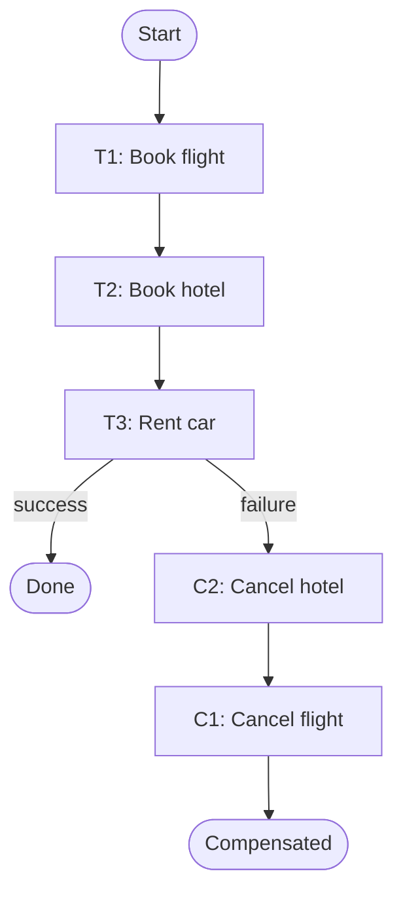

In a single database, a mistake is undone with `ROLLBACK`. Once a change is committed — or once it has left your system as an email, a card charge, or an API call to a partner — there is no rollback. The only way back is forward: perform a **new action that semantically cancels the old one**. That new action is a **compensating transaction**.

Compensations are the building block of every [Saga](/blog/saga-pattern/), but they are also useful on their own: in batch jobs, in manual operations tooling, and anywhere a multi-step process can fail halfway.

## The problem

Consider a travel booking that reserves a flight, a hotel, and a car through three different providers. The flight and hotel succeed; the car rental API returns "no availability". You can't leave the customer with a flight and a hotel they didn't want, and the providers' systems won't roll back on your behalf.

You need a disciplined way to **reverse each completed step** — in the right order, reliably, and with a record of what happened.

## How it works

For every forward operation `T`, define a compensating operation `C` such that applying `C` after `T` returns the system to a state that is **business-equivalent** to never having done `T`.

| Forward step | Compensation | Notes |
|---|---|---|
| Charge card ₹2,000 | Refund ₹2,000 | Shows on statement; may take days; fees may not be recoverable |
| Reserve 3 units of SKU-9 | Release 3 units of SKU-9 | Must not release more than was reserved |
| Create user account | Deactivate account | Usually soft delete — keep for audit |
| Send "Order confirmed" email | Send "Order cancelled" email | You cannot unsend; you correct |
| Book hotel room | Cancel booking | Partner's cancellation policy may charge a fee |
| Credit loyalty points | Debit loyalty points | Points may already be spent — needs a policy |

Note the word *business-equivalent*. A compensation rarely restores the exact original bytes; it restores the **meaning**. The refund is a new ledger entry, not the deletion of the old one.



Compensations run in **reverse order** of the forward steps. Later steps often depend on earlier ones (a hotel booking may reference the flight's arrival time), so undoing them last-in-first-out keeps every intermediate state valid.

## Example: a compensation log

A robust implementation records each completed step and the data needed to undo it — before moving on. If the process crashes, a recovery job reads the log and finishes compensating.

```typescript
type Step<Ctx> = {
  name: string;
  run: (ctx: Ctx) => Promise<Record<string, unknown>>;      // returns undo data
  compensate: (ctx: Ctx, undo: Record<string, unknown>) => Promise<void>;
};

interface StepLog {
  append(txId: string, step: string, undo: Record<string, unknown>): Promise<void>;
  completed(txId: string): Promise<Array<{ step: string; undo: Record<string, unknown> }>>;
  markCompensated(txId: string, step: string): Promise<void>;
}

export async function runWithCompensation<Ctx>(
  txId: string, ctx: Ctx, steps: Step<Ctx>[], log: StepLog,
): Promise<"completed" | "compensated"> {
  try {
    for (const step of steps) {
      const undo = await step.run(ctx);
      await log.append(txId, step.name, undo);   // persist BEFORE the next step
    }
    return "completed";
  } catch (err) {
    const done = (await log.completed(txId)).reverse();
    for (const { step, undo } of done) {
      const def = steps.find((s) => s.name === step)!;
      await retryForever(() => def.compensate(ctx, undo));  // must eventually succeed
      await log.markCompensated(txId, step);
    }
    return "compensated";
  }
}

async function retryForever(fn: () => Promise<void>, baseMs = 200, capMs = 30_000) {
  for (let attempt = 0; ; attempt++) {
    try { return await fn(); }
    catch (e) {
      const delay = Math.min(capMs, baseMs * 2 ** attempt) * Math.random(); // full jitter
      if (attempt > 8) alertOnCall(`compensation stuck: ${String(e)}`);
      await new Promise((r) => setTimeout(r, delay));
    }
  }
}
declare function alertOnCall(msg: string): void;
```

A booking step then becomes:

```typescript
const bookHotel: Step<Trip> = {
  name: "book-hotel",
  run: async (trip) => {
    const res = await hotelApi.book({ ...trip.hotel, idempotencyKey: `${trip.id}:hotel` });
    return { bookingRef: res.reference };
  },
  compensate: async (trip, undo) => {
    // Safe if the booking never happened or was already cancelled
    await hotelApi.cancel({ reference: undo.bookingRef as string, idempotencyKey: `${trip.id}:hotel:cancel` });
  },
};
```

## Rules for good compensations

1. **Idempotent.** A compensation may run more than once after a crash or retry. Use idempotency keys and "cancel if exists" semantics. See [Idempotent Consumer](/blog/idempotent-consumer/).
2. **Tolerant of the unknown.** A forward step can *time out and still succeed*. The compensation must work whether or not the forward step took effect — e.g., "refund any charge for order 42", not "refund charge ch_123" when you never got the ID back.
3. **Retryable until success.** A compensation that can permanently fail leaves the system inconsistent. Retry with backoff, then escalate to a human with full context.
4. **Commutative where possible.** If a compensation can arrive before its forward step (out-of-order messages), design both so the end state is the same — or record a "cancelled" marker that rejects a late forward step (the TCC *suspension* defence).
5. **Audited.** Compensations are business events. Record who/what triggered them and why. Regulators and support teams will ask.

> **In practice:** agree compensation semantics with the business *before* writing code. "What happens if the car rental fails after we've charged the customer?" is a product question, not just an engineering one.

## Compensations that aren't perfect

Some actions can't be fully reversed:

- **Side effects in the physical world** — a parcel already shipped. The compensation is a return-and-refund *process*, not an API call.
- **Fees and penalties** — a cancelled hotel booking may cost money. The compensation may need to absorb or pass on the fee.
- **Information disclosure** — once data is sent to a partner, you can request deletion but not guarantee it.

For these, either **reorder the workflow** so irreversible steps come last (the saga *pivot* idea), or **reduce exposure** with reservations and holds ([TCC](/blog/try-confirm-cancel/), [Reservation](/blog/reservation-pattern/)) so the irreversible step only happens once everything else has succeeded.

## Trade-offs

| Benefits | Costs |
|---|---|
| Works across any system with a reverse operation | Every step needs an extra, tested operation |
| No distributed locks | Intermediate states are visible to users and other processes |
| Explicit, auditable failure handling | Some actions can only be partially compensated |
| Fits long-running processes (minutes to days) | Requires durable logging of progress and undo data |

## Common pitfalls

> **Warning:** compensating based on in-memory state. If the orchestrator crashes, that state is gone and so is your ability to undo. Persist "what I did and how to undo it" *before* starting the next step.

- **Compensating the wrong amount.** Store the actual reserved/charged values from the forward step's response, not the values from the original request.
- **Forgetting downstream effects.** Releasing stock may need to re-trigger back-in-stock notifications; refunding may need to reverse loyalty points.
- **Hard deletes as compensation.** Deleting a row erases the audit trail. Prefer status changes and reversing entries.
- **Silent compensation failures.** Alert on any compensation retried more than N times or older than M minutes.

## Tools and real-world usage

- **Temporal** — the `Saga` helper registers compensations after each activity and runs them in reverse.
- **AWS Step Functions** — `Catch` and `Retry` route failed states to compensation branches.
- **Camunda/BPMN** — native *compensation events* and *compensation handlers* attached to tasks.
- **Accounting systems** — the double-entry *reversing entry* is the original compensating transaction: never edit a posted entry, post its opposite.

## Related patterns

- [Saga](/blog/saga-pattern/) — sequences of steps with compensations.
- [Try-Confirm/Cancel](/blog/try-confirm-cancel/) — avoids compensation by reserving first.
- [Retry with Backoff](/blog/retry-with-backoff/) — how compensations eventually succeed.
- [Audit Logging](/blog/audit-logging/) — recording compensations as first-class events.

## Key takeaways

1. A compensation is a new, opposite business action — not a technical rollback.
2. Run compensations in reverse order, from durably logged undo data.
3. Make them idempotent, tolerant of uncertain forward outcomes, and retry until success.
4. Put irreversible steps last, and agree compensation semantics with the business.
