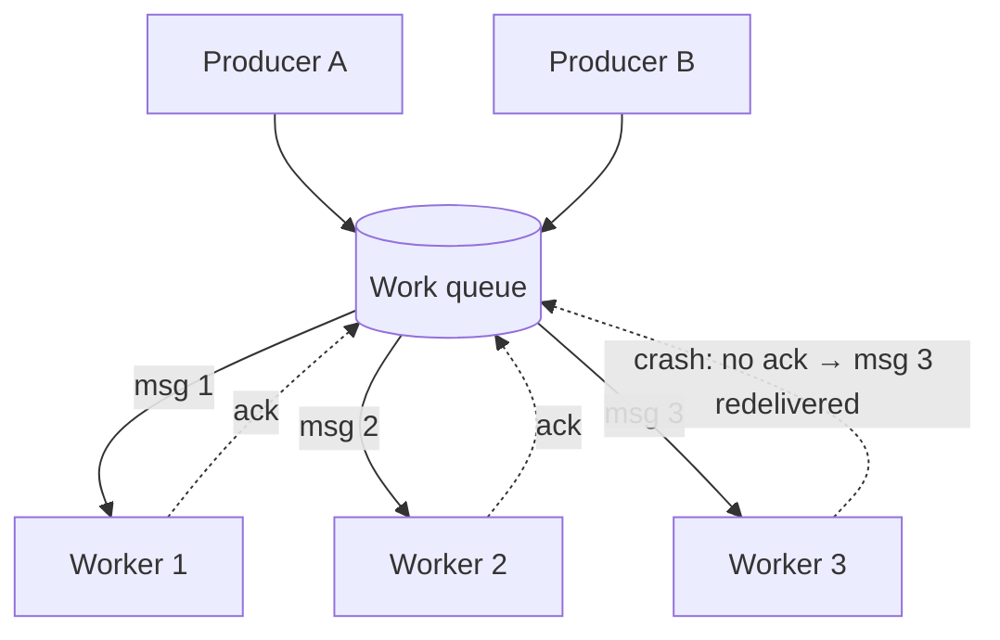

A single worker processing a queue is a bottleneck and a single point of failure. The **Competing Consumers** pattern runs **several consumers on the same queue**; the broker hands each message to **exactly one** of them. Add workers to go faster; lose a worker and the others carry on.

It's the default way to scale background work: image processing, document OCR, email sending, payment settlement batches, report generation.

## The problem

Work arrives faster than one consumer can handle, or arrives in bursts — month-end statement generation, a marketing email blast, a backlog after an outage. You need to:

- **scale out** throughput horizontally,
- **balance** load automatically across workers,
- **survive** worker crashes without losing work,
- and **scale back** when the burst is over.

## How it works



The broker guarantees that each message is **in flight to one consumer at a time**. If that consumer doesn't acknowledge within a lease (visibility timeout, lock duration, or connection loss), the message becomes available to another consumer. That's what provides fault tolerance — and why consumers must be [idempotent](/blog/idempotent-consumer/): a slow worker and its replacement can both process the same message.

### Queues vs. logs

The pattern looks different on queue-based and log-based brokers.

| | Queue (SQS, RabbitMQ, Service Bus) | Log (Kafka, Kinesis, Pulsar exclusive) |
|---|---|---|
| Unit of distribution | Individual message | Partition |
| Max parallelism | Effectively unlimited workers | Number of partitions per consumer group |
| Ordering | None across workers (FIFO variants trade throughput) | Per partition |
| Slow message impact | Only that worker | Blocks the rest of its partition |
| Redelivery | Lease/visibility timeout per message | Uncommitted offsets after rebalance |

In Kafka, consumers in the same **consumer group** compete for partitions: with 12 partitions and 4 consumers, each owns 3. A 13th consumer in a 12-partition group sits idle.

## Example: SQS workers in Python

```python
import boto3, json, signal

sqs = boto3.client("sqs")
QUEUE = "https://sqs.ap-south-1.amazonaws.com/123456789012/ocr-jobs"
running = True
signal.signal(signal.SIGTERM, lambda *_: globals().update(running=False))  # graceful shutdown

while running:
    resp = sqs.receive_message(
        QueueUrl=QUEUE,
        MaxNumberOfMessages=10,        # batch to cut API calls
        WaitTimeSeconds=20,            # long polling: no busy loop when idle
        VisibilityTimeout=120,         # > p99 processing time
    )
    for m in resp.get("Messages", []):
        job = json.loads(m["Body"])
        try:
            run_ocr(job["documentId"])                     # idempotent: keyed by documentId
            sqs.delete_message(QueueUrl=QUEUE, ReceiptHandle=m["ReceiptHandle"])
        except TransientError:
            # Make it visible again soon instead of waiting the full timeout
            sqs.change_message_visibility(QueueUrl=QUEUE, ReceiptHandle=m["ReceiptHandle"],
                                          VisibilityTimeout=10)
        # other exceptions: let it reappear; redrive policy will dead-letter it after N tries
```

For long-running jobs, a heartbeat thread should **extend** the visibility timeout while work continues, so the message isn't handed to a second worker mid-job.

## Tuning

**Prefetch / batch size.** Prefetching keeps workers busy but hoards messages. With RabbitMQ, `basic_qos(prefetch_count=N)` is the key knob: low for slow, uneven jobs (fair dispatch), higher for fast, uniform ones.

**Lease duration.** Visibility timeout / lock duration must exceed your p99 processing time, or you'll get duplicate processing. Too long, and crashed workers' messages wait a long time before retry.

**Graceful shutdown.** On `SIGTERM` (deploys, scale-in), stop receiving, finish in-flight messages, ack, then exit. Kubernetes' `terminationGracePeriodSeconds` must cover the longest job.

**Autoscaling on backlog, not CPU.** Queue depth (or Kafka consumer lag) is the true signal. KEDA makes this declarative on Kubernetes:

```yaml
apiVersion: keda.sh/v1alpha1
kind: ScaledObject
metadata:
  name: ocr-workers
spec:
  scaleTargetRef:
    name: ocr-worker            # Deployment
  minReplicaCount: 1
  maxReplicaCount: 40
  cooldownPeriod: 300
  triggers:
    - type: aws-sqs-queue
      metadata:
        queueURL: https://sqs.ap-south-1.amazonaws.com/123456789012/ocr-jobs
        queueLength: "20"       # target messages per replica
        awsRegion: ap-south-1
      authenticationRef:
        name: keda-aws-irsa
```

> **Tip:** set `maxReplicaCount` with your *downstream* limits in mind. Forty OCR workers might be fine; forty workers hammering one legacy database is an outage. Combine with [Rate Limiting](/blog/rate-limiting/) or a [Bulkhead](/blog/bulkhead/).

## Ordering

Competing consumers and strict ordering are in tension. Options:

- **Don't need it** — most work queues don't (each job is independent). Best case.
- **Per-key ordering** — Kafka partition keys, SQS FIFO **message group IDs**, or Service Bus **sessions** keep messages with the same key in order on one consumer while different keys run in parallel.
- **Version checks** — process out of order but reject stale updates with sequence numbers.

## Trade-offs

| Benefits | Costs |
|---|---|
| Linear-ish horizontal scaling | No global ordering |
| Automatic load balancing | Duplicate processing on lease expiry or crash |
| Resilience to individual worker failures | Shared downstreams can become the bottleneck |
| Elastic — scale with backlog | Kafka parallelism capped by partition count |

## Common pitfalls

> **Warning:** a visibility timeout shorter than the job. The job is redelivered to a second worker while the first is still running; both finish; the customer gets two statements. Measure job duration and set leases above p99, with heartbeats for long jobs.

- **Under-partitioned Kafka topics** — you can't scale beyond the partition count; increasing partitions later changes key-to-partition mapping.
- **Poison messages** that crash workers in a loop — use max receive counts and a [Dead Letter Queue](/blog/dead-letter-queue/).
- **Uneven jobs with high prefetch** — one worker holds a pile of slow jobs while others idle.
- **Scaling on CPU** for I/O-bound workers — CPU stays low while the backlog explodes.

## Tools and real-world usage

- **Amazon SQS** — standard queues for throughput; FIFO queues with message groups for per-key order.
- **RabbitMQ** — multiple consumers on one queue with prefetch-based fair dispatch.
- **Kafka** — consumer groups with partition assignment and cooperative rebalancing.
- **Azure Service Bus** — peek-lock with lock renewal, sessions for ordered groups.
- **KEDA**, AWS Lambda event-source mappings, and Cloud Run are common autoscalers for worker pools.

## Related patterns

- [Guaranteed Delivery](/blog/guaranteed-delivery/) — acknowledgements make competition safe.
- [Idempotent Consumer](/blog/idempotent-consumer/) — handles duplicates from lease expiry.
- [Publish-Subscribe](/blog/publish-subscribe/) — the opposite distribution: every subscriber gets every message.
- [Load Shedding](/blog/load-shedding/) — when even scaling out isn't enough.

## Key takeaways

1. Many consumers, one queue, each message to one consumer at a time.
2. Leases plus acks give fault tolerance — and at-least-once duplicates.
3. Autoscale on backlog, respect downstream capacity, and shut down gracefully.
4. Use partition keys, message groups, or sessions when per-key ordering matters.
