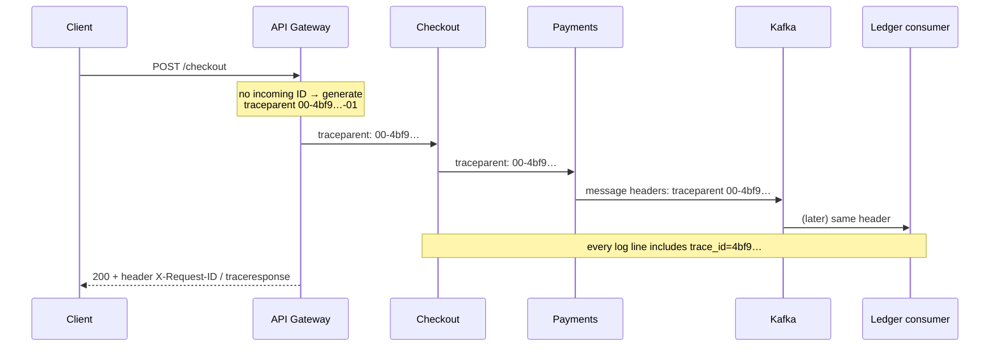

A customer calls support: *"My payment failed at 10:42."* The request touched the gateway, the checkout service, payments, fraud, a Kafka topic, a ledger consumer, and an email worker — each with its own logs on dozens of pods. Without a common identifier, you're grepping timestamps and guessing.

A **Correlation ID** is a unique identifier assigned when a request (or business transaction) enters the system and **propagated to every service, message, and log line** it causes. Search for it once and you see the whole story.

## The problem

In a monolith, one request is one thread with one log context. In a distributed system:

- one user action fans out into many synchronous calls,
- asynchronous messages trigger work minutes later in other services,
- retries and redeliveries repeat work,
- and logs are spread across services, pods, and time.

## How it works



Four rules:

1. **Generate at the edge** if the incoming request has none (and decide whether to trust IDs from external clients).
2. **Propagate on every outbound call** — HTTP headers, gRPC metadata, message headers.
3. **Put it in every log line** via the logging context (MDC, scopes, structured fields).
4. **Return it to the caller** so users and support can quote it.

## Which header?

| Header | Notes |
|---|---|
| **`traceparent`** (W3C Trace Context) | The standard. Carries trace ID, parent span ID, and sampling flags. Use this. |
| `tracestate` | Vendor-specific additions alongside `traceparent`. |
| `X-Request-ID` / `X-Correlation-ID` | Common legacy conventions; still useful as a human-friendly ID or for systems without tracing. |
| `b3` / `X-B3-*` | Zipkin's older format; supported by many tools for compatibility. |

With [Distributed Tracing](/blog/distributed-tracing/) via OpenTelemetry, the **trace ID is your correlation ID** — you get propagation for free, plus timing. Many teams still keep a separate **business correlation ID** (e.g., `orderId` or `checkoutSessionId`) that spans *multiple* traces over hours or days.

| ID type | Scope | Example |
|---|---|---|
| **Trace ID** | One request tree (ms–seconds) | `4bf92f3577b34da6a3ce929d0e0e4736` |
| **Business correlation ID** | One business process across many requests/messages (minutes–weeks) | `checkout-7f3a`, `loan-application-7781` |
| **Causation ID** | "Which message caused this one?" | Message ID of the triggering event |

Event-driven systems often carry all three in message metadata: `correlationId`, `causationId`, and `messageId`.

## Example: Spring Boot filter + MDC

With OpenTelemetry's Java agent or Micrometer Tracing, `traceId` and `spanId` are put in the MDC automatically. Here's the manual version, which also shows the moving parts:

```java
@Component
@Order(Ordered.HIGHEST_PRECEDENCE)
public class CorrelationIdFilter extends OncePerRequestFilter {

  public static final String HEADER = "X-Correlation-ID";

  @Override
  protected void doFilterInternal(HttpServletRequest req, HttpServletResponse res, FilterChain chain)
      throws ServletException, IOException {
    String incoming = req.getHeader(HEADER);
    String id = isValid(incoming) ? incoming : UUID.randomUUID().toString();
    MDC.put("correlationId", id);
    res.setHeader(HEADER, id);                 // return it to the caller
    try {
      chain.doFilter(req, res);
    } finally {
      MDC.remove("correlationId");             // threads are pooled: always clean up
    }
  }

  private boolean isValid(String v) {          // don't trust arbitrary input into logs
    return v != null && v.length() <= 64 && v.matches("[A-Za-z0-9-]+");
  }
}

// Propagate on outbound HTTP calls
@Bean
RestClient restClient(RestClient.Builder b) {
  return b.requestInterceptor((request, body, exec) -> {
    String id = MDC.get("correlationId");
    if (id != null) request.getHeaders().set(CorrelationIdFilter.HEADER, id);
    return exec.execute(request, body);
  }).build();
}
```

```xml
<!-- logback-spring.xml: JSON logs with correlation fields -->
<encoder class="net.logstash.logback.encoder.LogstashEncoder">
  <includeMdcKeyName>correlationId</includeMdcKeyName>
  <includeMdcKeyName>traceId</includeMdcKeyName>
  <includeMdcKeyName>spanId</includeMdcKeyName>
</encoder>
```

## Across asynchronous hops

Propagation breaks most often at message boundaries and thread pools.

```java
// Producer: copy context into message headers (OpenTelemetry instrumentation does this automatically)
ProducerRecord<String, OrderPlaced> rec = new ProducerRecord<>("orders.events", order.id(), event);
rec.headers().add("correlationId", MDC.get("correlationId").getBytes(UTF_8));
rec.headers().add("causationId", currentMessageIdOrRequestId().getBytes(UTF_8));
kafka.send(rec);

// Consumer: restore context before processing
@KafkaListener(topics = "orders.events")
public void on(ConsumerRecord<String, OrderPlaced> rec) {
  Header h = rec.headers().lastHeader("correlationId");
  try (MDC.MDCCloseable c = MDC.putCloseable("correlationId",
          h != null ? new String(h.value(), UTF_8) : UUID.randomUUID().toString())) {
    handle(rec.value());
  }
}
```

Also:

- **Thread pools / `CompletableFuture`** — wrap executors so context is copied (OpenTelemetry's `Context.taskWrapping`, Micrometer's context propagation).
- **Outbox rows** — store correlation and trace headers in the outbox so the relay can attach them ([Transactional Outbox](/blog/transactional-outbox/)).
- **Batch jobs** — assign a correlation ID per run and per item.

## Security and privacy

- **Validate incoming IDs** (length, character set) to prevent log injection.
- **Don't encode personal data** in correlation IDs (no emails, phone numbers, account numbers).
- **Decide trust boundaries** — you may accept `traceparent` from internal callers but start a new trace (linking the external one) at the public edge.

## Trade-offs

| Benefits | Costs |
|---|---|
| Find every log line for one request in one search | Requires discipline in every service and library |
| Essential for support, incident response, and audit | Propagation gaps at async boundaries |
| Low cost — a header and a log field | Untrusted input if accepted blindly from clients |
| Foundation for distributed tracing | Multiple ID types to explain to teams |

## Common pitfalls

> **Pitfall:** generating a new ID in every service. Each service logs its own UUID, and nothing connects them. Generate once at the edge; everyone else **propagates**.

- **Losing the ID at the message broker** — producers don't set headers, consumers don't restore them.
- **MDC leaks** — not clearing context on pooled threads, so the next request logs the previous ID.
- **Unstructured logs** — the ID is in the text but not a field, making search slow and unreliable.
- **Not returning the ID** to clients, so support can't ask for it.

## Tools and real-world usage

- **OpenTelemetry** SDKs and auto-instrumentation — W3C Trace Context propagation across HTTP, gRPC, and messaging.
- **Micrometer Tracing** (Spring Boot 3), **Serilog** enrichers and `Activity` in .NET, **pino**/**winston** with AsyncLocalStorage in Node.js.
- **API gateways** (Kong `correlation-id` plugin, NGINX `$request_id`, Envoy `x-request-id`) — generate at the edge.
- Log platforms (ELK, Loki, Splunk, Datadog) — pivot from a correlation ID to all related logs and traces.

## Related patterns

- [Distributed Tracing](/blog/distributed-tracing/) — correlation plus timing and causality.
- [Log Aggregation](/blog/log-aggregation/) — where correlation IDs become searchable.
- [Async Request-Reply](/blog/async-request-reply/) — correlation IDs match replies to requests.
- [Saga](/blog/saga-pattern/) — business correlation IDs follow long-running processes.

## Key takeaways

1. Generate once at the edge, propagate everywhere, log it in every line, return it to the caller.
2. Prefer W3C `traceparent`; add a business correlation ID for long processes.
3. Carry IDs through message headers, outbox rows, and thread pools.
4. Validate incoming IDs and keep personal data out of them.
