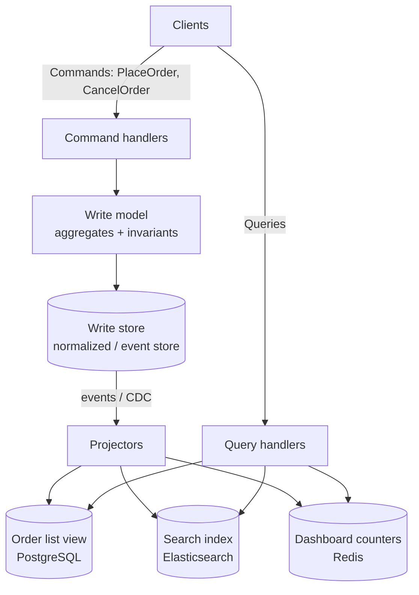

In most applications, one model does everything: the same `Order` entity validates business rules on writes and gets joined, filtered, and serialized for every screen on reads. As the system grows, the model gets pulled in two directions — **rich behavior** for commands, **flat, denormalized shapes** for queries — and serves neither well.

**Command Query Responsibility Segregation (CQRS)**, named by Greg Young building on Bertrand Meyer's command-query separation, splits them: a **write model** that handles commands and protects invariants, and one or more **read models** shaped for specific queries.

## The problem

Symptoms that a single model is overloaded:

- ORM entities with dozens of lazy-loaded relations so one screen can render.
- Queries joining eight tables, slowing down writes that lock the same rows.
- Read traffic 100× write traffic, but both scale together.
- Business rules leaking into query code ("only show orders where…") and vice versa.
- Different consumers (UI, search, reports, mobile) all wanting different shapes.

## How it works



- **Commands** express intent (`PlaceOrder`), return little or nothing (an ID, or success/failure), and go through the write model.
- **Queries** return data and **never change state**. They read from models designed for that exact query.
- **Projectors** keep read models up to date from the write side's changes — via [Domain Events](/blog/domain-events/), an [outbox](/blog/transactional-outbox/), or [CDC](/blog/change-data-capture/).

## CQRS is a spectrum

CQRS doesn't require event sourcing, separate databases, or message brokers. Pick the level you need.

| Level | Write side | Read side | Consistency | Complexity |
|---|---|---|---|---|
| **1. Code separation** | Command handlers + domain model | Query handlers with plain SQL/DTOs, same database | Immediate | Low |
| **2. Separate read tables** | Same DB | Denormalized tables updated in the same transaction or by triggers | Immediate | Low–medium |
| **3. Separate read store** | Own DB | Different DB/technology fed asynchronously | Eventual | Medium |
| **4. With event sourcing** | [Event store](/blog/event-sourcing/) | Projections rebuilt from events | Eventual | High |

Most teams get most of the value at **level 1 or 2**. Move to 3–4 when read scale, query diversity, or audit needs justify it.

## Example: level 1 with MediatR (C#)

```csharp
// ----- Write side: intent + invariants -----
public record PlaceOrder(Guid CustomerId, IReadOnlyList<OrderLineDto> Lines) : IRequest<Guid>;

public class PlaceOrderHandler : IRequestHandler<PlaceOrder, Guid>
{
    private readonly ShopDbContext _db;
    public PlaceOrderHandler(ShopDbContext db) => _db = db;

    public async Task<Guid> Handle(PlaceOrder cmd, CancellationToken ct)
    {
        var customer = await _db.Customers.FindAsync(new object[] { cmd.CustomerId }, ct)
                       ?? throw new NotFoundException("customer");
        var order = Order.Place(customer, cmd.Lines);   // aggregate enforces rules
        _db.Orders.Add(order);
        await _db.SaveChangesAsync(ct);                 // raises OrderPlaced via outbox
        return order.Id;
    }
}

// ----- Read side: shaped for one screen, no domain model -----
public record GetMyOrders(Guid CustomerId, int Page) : IRequest<IReadOnlyList<OrderListItem>>;
public record OrderListItem(Guid OrderId, DateTime PlacedAt, string Status, decimal Total, int ItemCount);

public class GetMyOrdersHandler : IRequestHandler<GetMyOrders, IReadOnlyList<OrderListItem>>
{
    private readonly IDbConnection _conn;               // Dapper, read replica
    public GetMyOrdersHandler(IDbConnection conn) => _conn = conn;

    public async Task<IReadOnlyList<OrderListItem>> Handle(GetMyOrders q, CancellationToken ct)
        => (await _conn.QueryAsync<OrderListItem>(@"
               SELECT order_id, placed_at, status, total, item_count
               FROM   order_list_view
               WHERE  customer_id = @CustomerId
               ORDER  BY placed_at DESC
               OFFSET @Offset ROWS FETCH NEXT 20 ROWS ONLY",
               new { q.CustomerId, Offset = q.Page * 20 })).ToList();
}
```

The command handler loads a rich aggregate; the query handler skips the domain model entirely and reads a flat view through a lightweight data mapper — possibly from a read replica.

## Example: an asynchronous projector

At level 3, a projector consumes events and updates a read store. It must be **idempotent** and tolerate redelivery.

```python
def project(event: dict, db) -> None:
    t, order_id, seq = event["type"], event["orderId"], event["sequence"]

    if t == "OrderPlaced":
        db.execute("""
            INSERT INTO order_list_view (order_id, customer_id, placed_at, status, total, item_count, last_seq)
            VALUES (%s, %s, %s, 'PLACED', %s, %s, %s)
            ON CONFLICT (order_id) DO NOTHING""",
            (order_id, event["customerId"], event["placedAt"], event["total"], len(event["lines"]), seq))

    elif t in ("OrderShipped", "OrderCancelled"):
        status = "SHIPPED" if t == "OrderShipped" else "CANCELLED"
        db.execute("""
            UPDATE order_list_view SET status = %s, last_seq = %s
            WHERE order_id = %s AND last_seq < %s""",      # skip duplicates and stale events
            (status, seq, order_id, seq))
```

Because the read model is derived, you can **delete and rebuild** it by replaying events — the standard fix for projection bugs and the way to add new views later.

## Handling the consistency gap

With asynchronous read models, a user may place an order and not see it in "My orders" for a moment. Options:

- **Return what's needed from the command** — the new ID and key fields — and render optimistically.
- **Read-your-writes token** — the command returns a version; the query waits briefly or falls back to the write side if the projection is behind.
- **Push updates** — notify the UI via WebSocket when the projection catches up.
- **Measure projection lag** as an SLO and alert on it.

See [Eventual Consistency](/blog/eventual-consistency/) for more techniques.

## Trade-offs

| Benefits | Costs |
|---|---|
| Write and read sides scale and evolve independently | More moving parts — projectors, extra stores |
| Each query gets an optimal, simple model | Eventual consistency (at levels 3–4) |
| Domain model stays focused on behavior | Duplicate data; projection bugs to manage |
| New views added without touching the write side | Team must understand the split |

## When to use it

- Read and write workloads differ greatly in volume or shape.
- Many different consumers need different views of the same data.
- The domain has rich behavior worth protecting from query concerns.
- You're already using [Event Sourcing](/blog/event-sourcing/) — CQRS is effectively mandatory there.

Skip it (beyond level 1) for simple CRUD where the screens mirror the tables.

## Common pitfalls

> **Pitfall:** applying asynchronous CQRS to the whole system. Udi Dahan and Greg Young have both warned that CQRS belongs in specific bounded contexts, not as a top-level architecture. Most parts of most systems don't need separate stores.

- **Commands that return full read models** — couples the write side back to query shapes.
- **Queries that write** ("mark as read" inside a GET) — breaks the separation and caching.
- **Non-idempotent projectors** — duplicates silently corrupt views.
- **No rebuild path** — design projections so they can be replayed from scratch.

## Tools and real-world usage

- **MediatR** (.NET), **Axon** (Java), **Spring Modulith**, NestJS CQRS module — command/query dispatch.
- **EventStoreDB, Marten, Axon Server** — event-sourced write sides with projections.
- **Elasticsearch/OpenSearch, Redis, Cassandra, PostgreSQL** — typical read stores.

## Related patterns

- [Event Sourcing](/blog/event-sourcing/) — the most common write side for advanced CQRS.
- [Materialized View](/blog/materialized-view/) — what read models are.
- [API Composition](/blog/api-composition/) — the alternative for cross-service queries.
- [Domain Events](/blog/domain-events/) — what feeds the projectors.

## Key takeaways

1. Commands change state through a model that enforces rules; queries read from models shaped for them.
2. CQRS is a spectrum — code separation alone delivers much of the value.
3. Asynchronous read models are eventually consistent; design the UX and measure lag.
4. Make projectors idempotent and rebuildable.
