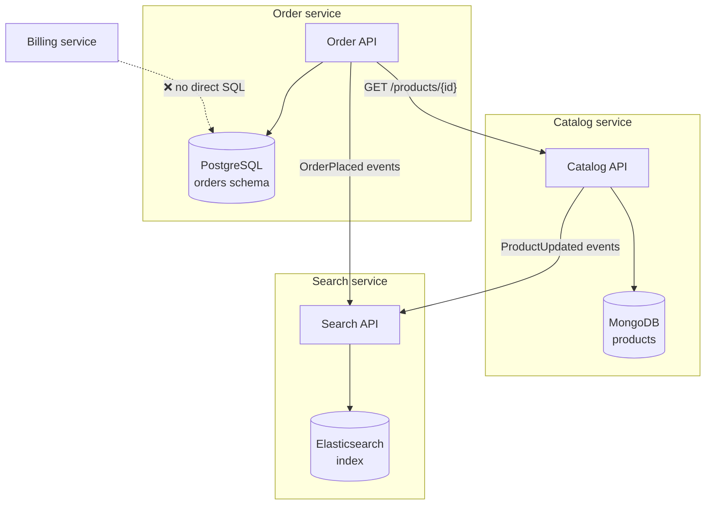
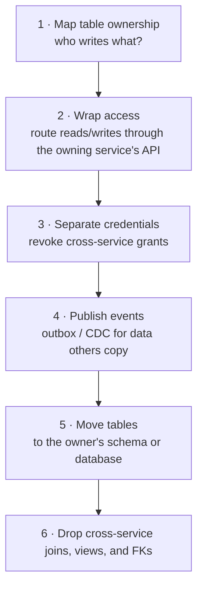

The single most important rule of microservice data design is also the simplest to state: **a service's data is private to that service**. Other services can't read or write its tables directly; they go through its API or consume its events. This is the **Database per Service** pattern, and without it most of the benefits of microservices — independent deployment, independent scaling, team autonomy — quietly evaporate.

## The problem

When several services share tables, they are coupled at the most rigid layer of the stack:

- A column rename in the Orders table breaks the Billing service's reports.
- A slow analytical query from one service locks rows another needs.
- Nobody can change the schema without a cross-team release.
- It's unclear who is allowed to write which column — so invariants live nowhere.

You've built a **distributed monolith**: all the operational complexity of microservices with none of the independence. (The pattern's foil is [Shared Database](/blog/shared-database/).)

## How it works

Each service owns a data store that only it can access. Everyone else interacts with that data through **the service's interface** — synchronous APIs for queries and commands, events for notifications.



### Levels of isolation

"Database per service" doesn't necessarily mean "a database server per service". Choose the level that matches your scale and operational maturity:

| Level | What it means | Isolation | Cost |
|---|---|---|---|
| **Private tables** | Shared database, but each service has its own tables, enforced by convention | Weak — easy to cheat | Lowest |
| **Schema per service** | Each service gets its own schema and DB user with grants only to it | Good — enforced by permissions | Low |
| **Database per service** | Separate logical database on a shared server/cluster | Strong logical isolation, shared resources | Medium |
| **Server per service** | Dedicated instance or managed cluster | Full isolation incl. performance | Highest |

A pragmatic default: **schema-per-service with separate credentials** on a shared managed cluster, graduating hot services to their own instance when their load justifies it.

```sql
-- Enforce ownership with permissions, not wiki pages
CREATE SCHEMA orders;
CREATE ROLE orders_svc LOGIN PASSWORD '<from-vault>';
GRANT USAGE, CREATE ON SCHEMA orders TO orders_svc;
REVOKE ALL ON SCHEMA orders FROM PUBLIC;
-- billing_svc has no grants on schema orders: direct reads fail loudly
```

### Polyglot persistence

Once data is private, each service can choose the store that fits its access pattern: relational for orders and payments, document for catalogs, key-value for sessions, search engines for full-text, graph for recommendations, time-series for telemetry. Choose deliberately — every new technology is something to operate, secure, back up, and hire for.

## Living with private data

Splitting data creates three new problems. Each has its own pattern in this series.

### 1. Queries that span services

"Show the customer's orders with product names and shipment status" now touches three services.

- **[API Composition](/blog/api-composition/)** — call each service and join in memory.
- **[CQRS](/blog/cqrs/) / [Materialized View](/blog/materialized-view/)** — maintain a read-optimized view fed by events.

### 2. Transactions that span services

"Place order, reserve stock, charge card" can't be one ACID transaction.

- **[Saga](/blog/saga-pattern/)** — local transactions plus compensations.
- **[Try-Confirm/Cancel](/blog/try-confirm-cancel/)** — reserve, then confirm.

### 3. Keeping copies in sync

Services often need a local copy of others' data (customer names on invoices).

- **[Domain Events](/blog/domain-events/)** via a [Transactional Outbox](/blog/transactional-outbox/) — publish changes reliably.
- **Event-carried state transfer** — events contain the data consumers need, so they don't call back.
- Accept [Eventual Consistency](/blog/eventual-consistency/) for these copies.

## Example: owning data, sharing facts

The Billing service needs the customer's legal name and tax ID. Instead of joining against the Customer service's tables, it keeps a minimal local projection fed by events:

```java
@KafkaListener(topics = "customer.events", groupId = "billing")
@Transactional
public void on(CustomerEvent e) {
  switch (e) {
    case CustomerRegistered r -> jdbc.update("""
        INSERT INTO billing.customer_ref (customer_id, legal_name, tax_id, version)
        VALUES (?, ?, ?, ?) ON CONFLICT (customer_id) DO NOTHING""",
        r.customerId(), r.legalName(), r.taxId(), r.version());
    case CustomerDetailsChanged c -> jdbc.update("""
        UPDATE billing.customer_ref
        SET legal_name = ?, tax_id = ?, version = ?
        WHERE customer_id = ? AND version < ?""",            // ignore stale/duplicate events
        c.legalName(), c.taxId(), c.version(), c.customerId(), c.version());
    default -> { /* events billing doesn't care about */ }
  }
}
```

Billing now owns *its copy* — only the fields it needs, in the shape it needs, versioned to ignore stale updates. The Customer service remains the **system of record**.

## Migrating from a shared database

Few teams start greenfield. A typical path out of a shared database:



Database views and CDC ([Change Data Capture](/blog/change-data-capture/)) can keep legacy readers working during the transition — combined with the [Strangler Fig](/blog/strangler-fig/) approach for the application layer.

## Trade-offs

| Benefits | Costs |
|---|---|
| Services evolve schemas independently | Cross-service queries need composition or views |
| Failures and load are isolated | No cross-service ACID transactions |
| Right storage technology per service | Data duplication and eventual consistency |
| Clear ownership of data and invariants | More databases to operate, back up, secure |
| Enables independent scaling | Reporting needs a separate analytics pipeline |

## When to use it

It's the default for microservices. Be pragmatic about the *level* of isolation, and be honest about whether you need microservices at all: if every feature requires changes to the same five services and their data, a **modular monolith** with schema-per-module may serve you better.

## Common pitfalls

> **Pitfall:** splitting the database but keeping foreign keys and joins "just for reporting". Reporting queries quietly become production dependencies. Feed reporting from events or CDC into a warehouse instead.

- **Splitting too fine** — data that must be consistent together (an order and its lines) belongs in one service and one [aggregate](/blog/aggregate-ddd/).
- **Chatty synchronous calls** to replace joins — N+1 HTTP calls are worse than N+1 queries. Use batching, composition, or local projections.
- **Shared reference data** (countries, currencies) — let one service own it, or treat it as versioned configuration; don't let it become a backdoor shared database.
- **Backups and restores** — restoring one service's database to a point in time can make it inconsistent with others. Plan reconciliation.

## Tools and real-world usage

- **Managed relational** — Amazon RDS/Aurora, Azure SQL/PostgreSQL, Cloud SQL — usually with schema- or database-per-service on shared clusters.
- **Document and key-value** — MongoDB, DynamoDB, Cosmos DB, Redis, chosen per service.
- **Search and analytics** — Elasticsearch/OpenSearch fed by events; warehouses fed by CDC.

In large banking re-architectures I've been part of, the decisive step wasn't splitting hardware — it was **making ownership explicit**: one service writes each table, everyone else consumes APIs or events, and credentials enforce it.

## Related patterns

- [Shared Database](/blog/shared-database/) — the anti-pattern this replaces.
- [API Composition](/blog/api-composition/) and [CQRS](/blog/cqrs/) — querying across services.
- [Saga](/blog/saga-pattern/) — transactions across services.
- [Domain Events](/blog/domain-events/) — keeping copies in sync.

## Key takeaways

1. Each service owns its data; others use its API or events — never its tables.
2. Enforce ownership with credentials; schema-per-service is a fine start.
3. Solve cross-service queries with composition or materialized views, and transactions with sagas.
4. Keep data that must be consistent together inside one service.
