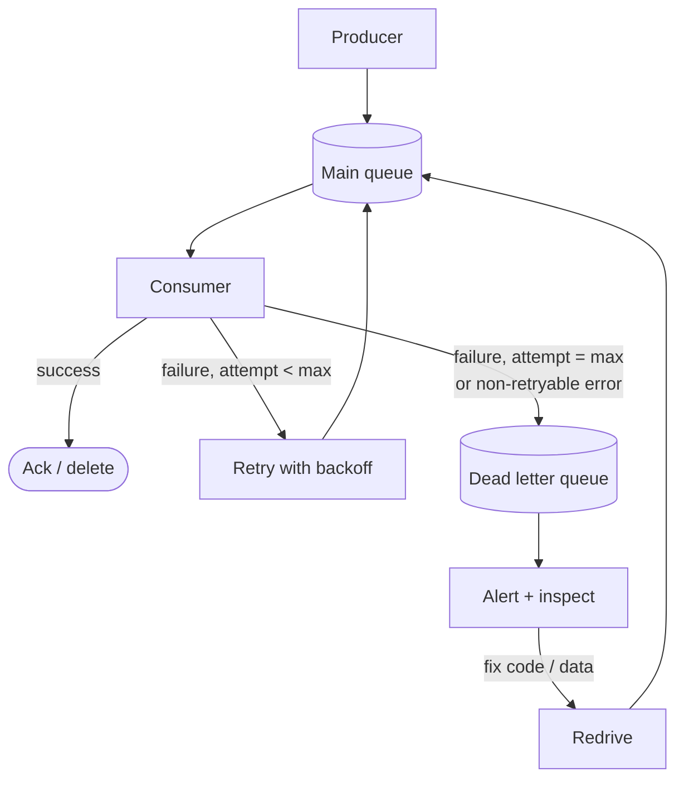
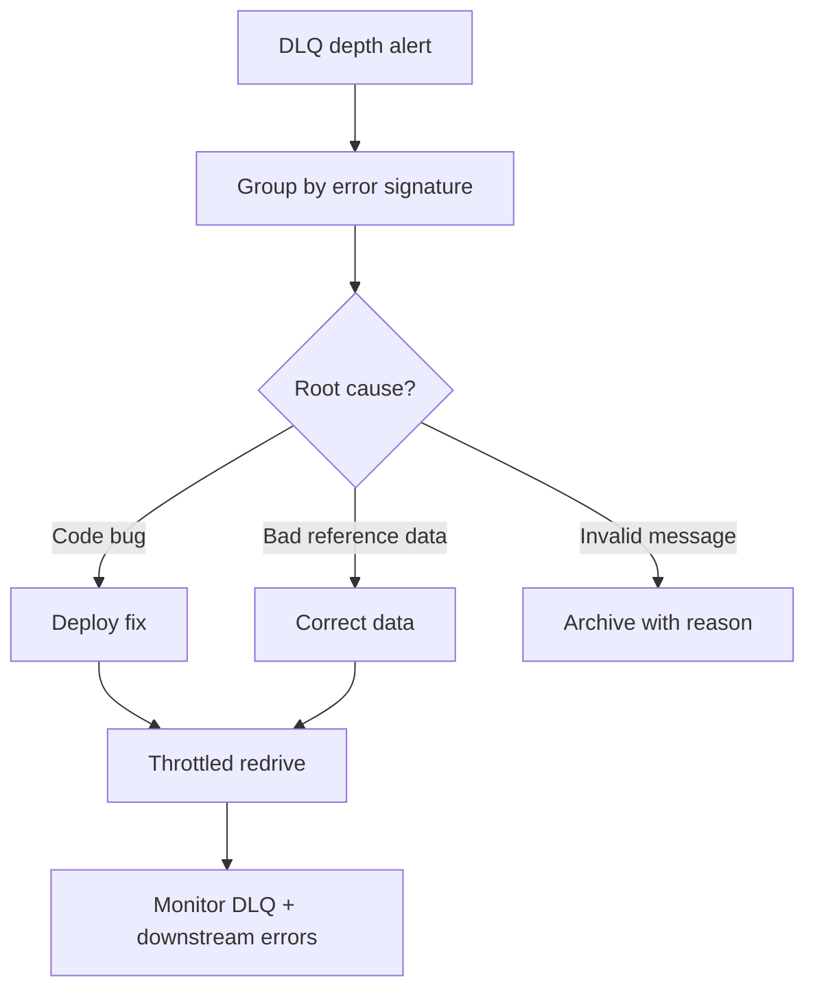

Sooner or later a message arrives that your consumer cannot process: malformed JSON, a schema version nobody deployed yet, a reference to a customer that doesn't exist, or a bug triggered only by one edge case. Retrying it forever achieves nothing — and in an ordered queue, it **blocks every message behind it**.

A **Dead Letter Queue (DLQ)** is where such messages go after a bounded number of attempts. The main flow keeps moving; the failed message is **parked with its context** for inspection, fixing, and replay.

## The problem

Without a DLQ, a **poison message** causes one of three bad outcomes:

1. **Infinite retry loop** — the consumer retries, fails, retries… burning CPU and logs while the backlog grows.
2. **Head-of-line blocking** — in ordered systems (Kafka partitions, FIFO queues), nothing behind it gets processed.
3. **Silent drop** — someone "fixes" the loop by catching and ignoring the error. The data is lost.

## How it works



Essential ingredients:

- **A max-attempts policy** (or immediate dead-lettering for non-retryable errors).
- **Context preserved** with the message: original topic/queue, error message, stack trace, attempt count, timestamps, consumer version.
- **Alerting** on DLQ depth > 0 (or a small threshold) — a DLQ nobody watches is just a slower way to lose data.
- **A redrive path** to replay messages after a fix.

## Classify errors first

Not every failure deserves retries.

| Error type | Examples | Action |
|---|---|---|
| **Transient** | Timeout, 503, DB connection reset, throttling | Retry with [backoff](/blog/retry-with-backoff/) |
| **Permanent — bad message** | Invalid schema, missing required field, unknown enum | Dead-letter immediately |
| **Permanent — business rule** | Order references deleted customer | Dead-letter, or route to a business exception queue |
| **Bug** | NullPointerException on a valid message | Dead-letter; fix code; redrive |

Retrying a permanently bad message just delays the inevitable and wastes capacity.

## Platform configurations

### Amazon SQS

SQS moves a message to the DLQ after it has been received `maxReceiveCount` times without being deleted.

```json
{
  "RedrivePolicy": "{\"deadLetterTargetArn\":\"arn:aws:sqs:ap-south-1:123456789012:orders-dlq\",\"maxReceiveCount\":\"5\"}",
  "VisibilityTimeout": "60"
}
```

Set the DLQ's retention **longer** than the source queue's (e.g., 14 days), and use SQS's built-in **DLQ redrive** to move messages back after a fix.

### RabbitMQ

Declare the queue with a dead-letter exchange. Messages that are rejected (`nack` with `requeue=false`), expire (TTL), or exceed the queue length are re-published there with `x-death` headers describing why.

```python
channel.exchange_declare("orders.dlx", exchange_type="direct", durable=True)
channel.queue_declare("orders.dlq", durable=True)
channel.queue_bind("orders.dlq", "orders.dlx", routing_key="orders")

channel.queue_declare("orders", durable=True, arguments={
    "x-dead-letter-exchange": "orders.dlx",
    "x-dead-letter-routing-key": "orders",
    "x-queue-type": "quorum",
    "x-delivery-limit": 5,          # quorum queues dead-letter after 5 redeliveries
})
```

### Kafka

Kafka has no built-in DLQ — a partition is a log, not a queue. The consumer (or framework) publishes the failed record to a separate topic and commits the offset to move on. Spring Kafka makes this declarative, including non-blocking retry topics:

```java
@RetryableTopic(
    attempts = "4",
    backoff = @Backoff(delay = 1_000, multiplier = 4.0, maxDelay = 60_000),
    exclude = { SchemaValidationException.class },   // non-retryable → straight to DLT
    dltTopicSuffix = ".dlt")
@KafkaListener(topics = "orders.placed", groupId = "fulfilment")
public void onOrderPlaced(OrderPlaced event) {
  fulfilment.start(event);
}

@DltHandler
public void onDeadLetter(OrderPlaced event,
                         @Header(KafkaHeaders.EXCEPTION_MESSAGE) String error,
                         @Header(KafkaHeaders.ORIGINAL_OFFSET) long offset) {
  log.error("Dead-lettered order {} at offset {}: {}", event.orderId(), offset, error);
  alerts.raise("orders.placed DLT", event.orderId());
}
```

This creates `orders.placed-retry-0`, `-retry-1`, … topics with increasing delays, so retries don't block the main partition, and finally `orders.placed.dlt`.

> **Warning:** retry topics break strict per-key ordering — a retried event for order 42 can be processed after a newer event for order 42. If order matters, either retry in place (blocking) or make handlers tolerant of reordering with version checks.

## The redrive process

Redriving is where DLQs earn their keep — or create a second incident.

1. **Triage** — group DLQ messages by error. One bug usually explains hundreds of messages.
2. **Fix** — deploy the code fix, correct reference data, or decide the messages are truly invalid.
3. **Verify idempotency** — redriving re-processes messages; handlers must be [idempotent](/blog/idempotent-consumer/).
4. **Redrive gradually** — throttle the replay so you don't overload downstream services with a burst.
5. **Discard deliberately** — messages that should never be processed are archived with a reason, not silently deleted.



## Trade-offs

| Benefits | Costs |
|---|---|
| Poison messages don't block or crash consumers | Another queue/topic to monitor and secure |
| Failed data is preserved, not lost | Redrives need tooling and process |
| Clear signal of bugs and contract breaks | Retry topics complicate ordering |
| Bounded retry cost | Risk of "DLQ as a graveyard" if nobody owns it |

## Common pitfalls

- **No alerts** — a DLQ silently filling for weeks.
- **Losing context** — dead-lettering only the payload, without error, source, and attempt details.
- **DLQ retention shorter than your response time** — messages expire before anyone looks.
- **Infinite redrive loops** — redriving to a queue whose DLQ redrives back automatically.
- **PII in DLQs** — they often hold sensitive data longer than the main queue; apply the same encryption and access controls.

## Tools and real-world usage

- **Amazon SQS** — redrive policy with `maxReceiveCount`, console/API redrive to source.
- **RabbitMQ** — dead-letter exchanges, `x-death` headers, quorum-queue delivery limits.
- **Kafka** — DLT topics via Spring Kafka, Kafka Connect `errors.deadletterqueue.topic.name`, or custom handlers.
- **Azure Service Bus** — built-in `$DeadLetterQueue` sub-queue per queue/subscription with dead-letter reason.
- **Google Pub/Sub** — dead-letter topics with max delivery attempts per subscription.

## Related patterns

- [Retry with Backoff](/blog/retry-with-backoff/) — what happens before dead-lettering.
- [Idempotent Consumer](/blog/idempotent-consumer/) — makes redrives safe.
- [Guaranteed Delivery](/blog/guaranteed-delivery/) — DLQs keep the "no message lost" promise when processing fails.
- [Application Metrics](/blog/application-metrics/) — DLQ depth is a key SLI.

## Key takeaways

1. Bound retries; move persistently failing messages aside instead of blocking the flow.
2. Dead-letter non-retryable errors immediately and preserve full context.
3. Alert on DLQ depth and own the triage → fix → throttled redrive process.
4. Idempotent consumers make redrives safe.
