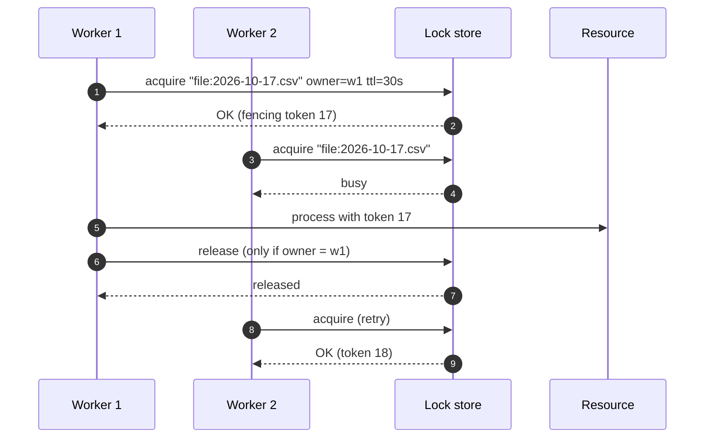
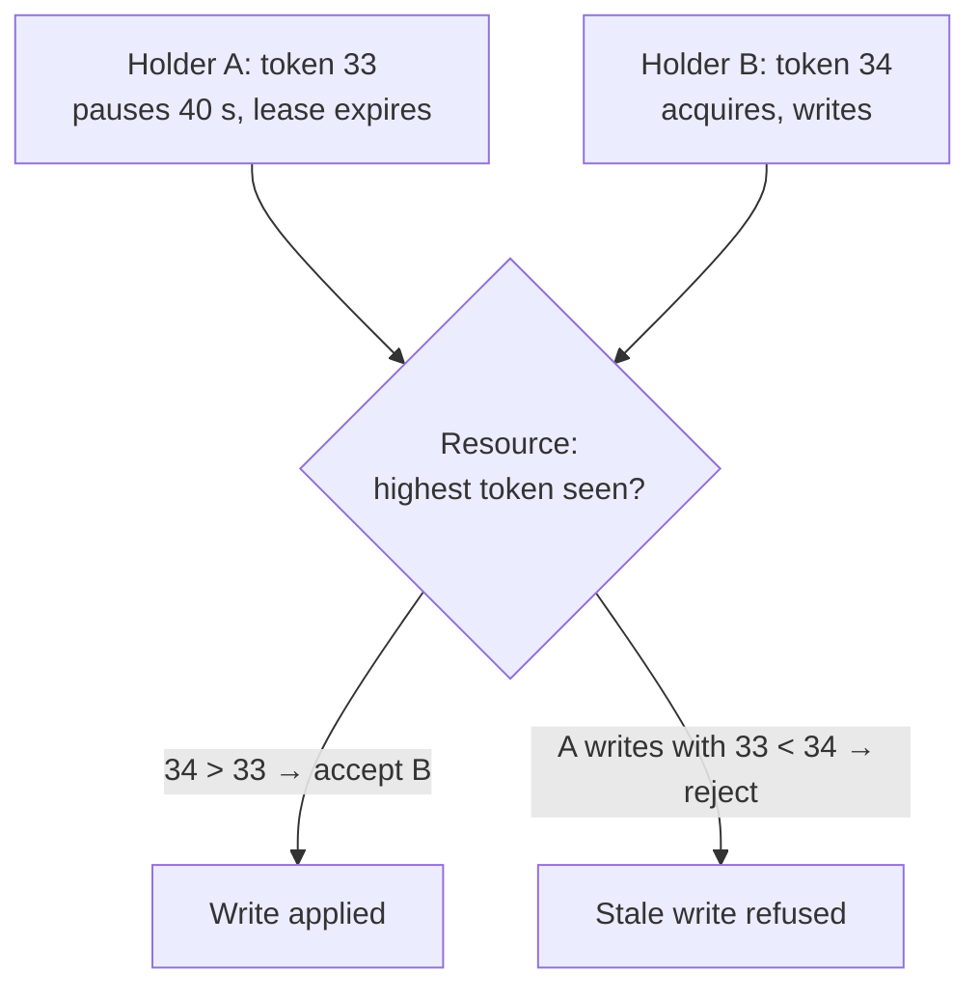

Inside one process, a mutex keeps two threads from corrupting shared state. Across many instances on many machines, you need a **Distributed Lock**: a lock held in a shared coordination system so that **only one process at a time** can act on a resource — regenerate a report, process a customer's file, rotate a credential, or run a migration.

Distributed locks are deceptively hard. The network can partition, processes can pause for seconds, and clocks drift. Getting them right starts with one question.

## First question: efficiency or correctness?

Martin Kleppmann's distinction is the most useful framing:

| | Lock for **efficiency** | Lock for **correctness** |
|---|---|---|
| Purpose | Avoid doing the same work twice | Prevent data corruption or invalid state |
| If two holders overlap occasionally | Some wasted work; acceptable | Corrupted data; unacceptable |
| Example | Avoid two instances regenerating the same cache entry | Two processes writing the same file or account |
| Suitable tools | Redis `SET NX PX`, DB advisory locks | Consensus-backed locks (etcd, ZooKeeper) **plus fencing tokens**, or database constraints |

If you need correctness, the lock alone is never enough — the **resource** must participate (fencing, constraints, or conditional writes).

## How it works

A lock is a key in a shared store, created atomically by the process that acquires it, with an **owner identity** and an **expiry** (so a crashed holder doesn't lock the resource forever).



Requirements:

1. **Atomic acquire** — check-and-set in one operation.
2. **Expiry / lease** — the lock frees itself if the holder dies.
3. **Owner-checked release** — a process may only release *its own* lock, never one that expired and was re-acquired by someone else.
4. **Renewal** for long tasks (watchdog/heartbeat).
5. **Fencing token** for correctness-critical work.

## Option 1: Redis single instance (efficiency locks)

```python
import uuid, redis

r = redis.Redis()
RELEASE = r.register_script("""
if redis.call('GET', KEYS[1]) == ARGV[1] then
  return redis.call('DEL', KEYS[1])
end
return 0
""")

def with_lock(name: str, ttl_ms: int, fn):
    token = str(uuid.uuid4())                       # owner identity
    if not r.set(f"lock:{name}", token, nx=True, px=ttl_ms):
        return None                                 # someone else holds it
    try:
        return fn()
    finally:
        RELEASE(keys=[f"lock:{name}"], args=[token])   # delete only if we still own it

with_lock("cache:rebuild:home-page", 30_000, rebuild_home_page_cache)
```

`SET key value NX PX ttl` is atomic, and the Lua release prevents deleting another owner's lock. This is fine for **efficiency**. It is **not** safe for correctness: if Redis fails over with asynchronous replication, the lock key can be lost and granted again.

### Redlock

Redlock acquires the lock on a majority of N independent Redis masters within a time bound. It improves availability but remains debated for correctness, because it depends on timing assumptions (bounded pauses, bounded clock drift) and doesn't produce fencing tokens. Treat it as a stronger efficiency lock — not a correctness guarantee.

## Option 2: ZooKeeper / etcd (correctness, with fencing)

Consensus systems provide linearizable operations and monotonically increasing revisions you can use as fencing tokens.

```java
// Apache Curator: a reentrant, distributed mutex on ZooKeeper
CuratorFramework zk = CuratorFrameworkFactory.newClient(zkConnect, new ExponentialBackoffRetry(200, 5));
zk.start();

InterProcessMutex lock = new InterProcessMutex(zk, "/locks/accounts/AC-1842");
if (lock.acquire(5, TimeUnit.SECONDS)) {
  try {
    // Ephemeral lock node: released automatically if this client's session expires
    long fencingToken = currentLockNodeZxid(zk, "/locks/accounts/AC-1842");
    ledger.applyAdjustment("AC-1842", adjustment, fencingToken);   // resource checks the token
  } finally {
    lock.release();
  }
}
```

```go
// etcd: lock tied to a lease; the key's create revision is a natural fencing token
sess, _ := concurrency.NewSession(cli, concurrency.WithTTL(15))
defer sess.Close()
m := concurrency.NewMutex(sess, "/locks/report/monthly")
if err := m.Lock(ctx); err != nil { return err }
defer m.Unlock(ctx)
token := m.Header().Revision      // monotonically increasing across acquisitions
return generateReport(ctx, token)
```

## Option 3: let the database do it

If the protected resource lives in a relational database, the database can often provide the lock — and the transactionality — directly.

```sql
-- PostgreSQL advisory lock scoped to the current transaction
BEGIN;
SELECT pg_try_advisory_xact_lock(hashtext('statement-run:2026-10'));   -- true = we own it
-- ... do the work in this same transaction ...
COMMIT;   -- lock released automatically at commit/rollback

-- Or skip locks entirely: claim rows atomically
UPDATE job SET owner = :worker, claimed_at = now()
WHERE id = :id AND (owner IS NULL OR claimed_at < now() - interval '5 minutes')
RETURNING id;
```

Advisory locks die with the session or transaction (no stale locks), and row-level claims double as fencing. For scheduled jobs across replicas, **ShedLock** (Java) wraps this approach.

## Fencing tokens

A lock holder can pause (GC, VM migration) past its lease, wake up, and still believe it holds the lock — while another process has acquired it. **Fencing** makes the resource reject the stale holder:



The resource must store the highest token seen and refuse lower ones — a conditional update in a database, a precondition in object storage, or a version check in an API.

## Design considerations

- **Lock granularity** — lock per resource (`account:AC-1842`), not globally. Coarse locks serialize everything.
- **TTL vs. task length** — TTL must exceed the task, or use a watchdog to renew (Redisson does this for Redis locks).
- **Acquire timeouts** — never block forever waiting for a lock.
- **Avoid locks where possible** — partitioning (route all work for a key to one consumer), idempotent operations, and optimistic concurrency often remove the need for a lock.

## Trade-offs

| Benefits | Costs |
|---|---|
| Prevents concurrent conflicting work across machines | Another dependency on the critical path |
| Simple mental model | Subtle failure modes (pauses, failover, clocks) |
| Useful for jobs, migrations, per-entity serialization | Contention reduces throughput |
| DB locks integrate with transactions | Correctness needs fencing or DB-level guarantees |

## Common pitfalls

> **Warning:** `DEL lock:key` without checking ownership. Your lock expired while you were slow, another worker acquired it, and you just deleted *their* lock — letting a third worker in. Always release with a compare-and-delete.

- **No TTL** — a crashed holder blocks the resource forever.
- **TTL shorter than the work** without renewal.
- **Using a Redis lock to protect money or ledgers** without fencing.
- **Global locks** that turn a horizontally scaled service into a single-threaded one.

## Tools and real-world usage

- **Redis** — `SET NX PX` with owner tokens; **Redisson** (Java) with watchdog renewal; Redlock implementations.
- **ZooKeeper + Apache Curator** — `InterProcessMutex`, `InterProcessSemaphoreMutex`.
- **etcd** — `concurrency.Mutex`; **Consul** — sessions with KV locks.
- **Databases** — PostgreSQL advisory locks, MySQL `GET_LOCK()`, SQL Server `sp_getapplock`; **ShedLock** for scheduled jobs.
- **Cloud** — DynamoDB conditional writes (the DynamoDB Lock Client), Azure Blob leases, GCS preconditions.

## Related patterns

- [Leader Election](/blog/leader-election/) — a long-lived, renewed lock on a role.
- [Reservation](/blog/reservation-pattern/) — a time-limited claim on a business resource.
- [Idempotent Consumer](/blog/idempotent-consumer/) — often removes the need for a lock.
- [Competing Consumers](/blog/competing-consumers/) — partitioning work instead of locking it.

## Key takeaways

1. Decide whether the lock is for efficiency or correctness.
2. Acquire atomically with a TTL; release only if you still own it.
3. For correctness, use consensus-backed locks or the database — and fencing tokens.
4. Prefer partitioning, idempotency, and optimistic concurrency when they can replace a lock.
