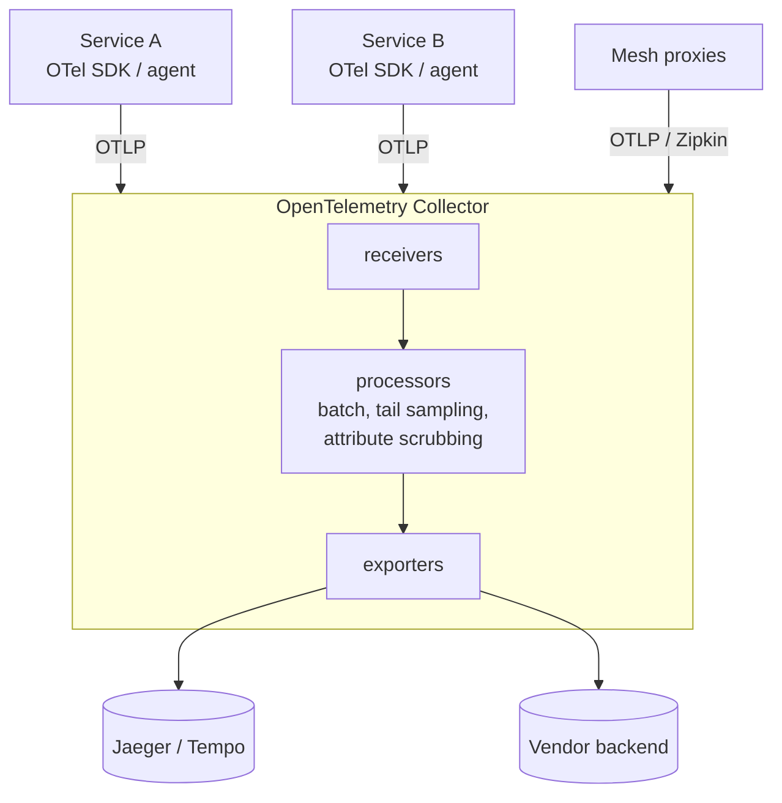

"Checkout is slow" is a hard problem when checkout calls eight services, two databases, a cache, and a payment provider. Metrics tell you **that** p99 latency doubled; logs tell you **what** each service said. **Distributed tracing** tells you **where the time went and where the error started** — by recording the full path of a single request as a tree of timed operations.

## The problem

In a distributed system:

- latency is the *sum and overlap* of many calls — which one is slow?
- errors surface far from their cause — a 500 at the gateway may originate in an inventory query three hops away;
- asynchronous hops (queues, topics) break the obvious request/response chain;
- each team sees only its own service's logs and metrics.

## How it works

A **trace** represents one end-to-end operation. It's composed of **spans** — named, timed operations with attributes, events, and status — linked by parent/child relationships.

```mermaid
gantt
    title Trace 4bf92f35… — POST /checkout (612 ms)
    dateFormat  x
    axisFormat  %L ms
    section Gateway
    POST /checkout                 :0, 612
    section Checkout svc
    PlaceOrder                     :8, 600
    validate cart                  :10, 40
    section Pricing svc
    GET /quote                     :42, 120
    section Inventory svc
    POST /reservations             :125, 455
    SELECT stock FOR UPDATE (slow) :130, 440
    section Payments svc
    POST /payments                 :458, 590
```



*Reading the waterfall: the inventory `SELECT … FOR UPDATE` dominates the request — a lock-contention problem, not a CPU one.*

Key concepts:

| Concept | Meaning |
|---|---|
| **Trace ID** | Shared by every span in the trace (the natural [Correlation ID](/blog/correlation-id/)) |
| **Span** | One operation: name, start/end time, attributes (`http.route`, `db.system`), status, events |
| **Parent span ID** | Links a span to the span that caused it |
| **Span kind** | `SERVER`, `CLIENT`, `PRODUCER`, `CONSUMER`, `INTERNAL` |
| **Context propagation** | Passing trace ID + parent span ID across process boundaries (W3C `traceparent` header) |
| **Span links** | Connect spans that are related but not parent/child (batch consumers, fan-in) |

## OpenTelemetry: the standard

**OpenTelemetry (OTel)** — a CNCF project — provides vendor-neutral APIs, SDKs, auto-instrumentation, a wire protocol (OTLP), and the **Collector**. Instrument once; send to Jaeger, Tempo, X-Ray, Honeycomb, Datadog, or anything else.



### Auto-instrumentation (Java)

The Java agent instruments common frameworks (Spring, JDBC, Kafka clients, HTTP clients) with no code changes:

```bash
java -javaagent:/otel/opentelemetry-javaagent.jar \
     -Dotel.service.name=checkout \
     -Dotel.resource.attributes=deployment.environment=prod,service.version=2026.10.17 \
     -Dotel.exporter.otlp.endpoint=http://otel-collector:4317 \
     -Dotel.traces.sampler=parentbased_traceidratio \
     -Dotel.traces.sampler.arg=0.10 \
     -jar checkout.jar
```

### Manual spans for business operations

Auto-instrumentation covers I/O; add spans and attributes for **business meaning**:

```typescript
import { trace, SpanStatusCode } from "@opentelemetry/api";

const tracer = trace.getTracer("checkout");

export async function placeOrder(cart: Cart) {
  return tracer.startActiveSpan("PlaceOrder", async (span) => {
    span.setAttributes({
      "order.line_count": cart.lines.length,
      "order.total": cart.total,            // business context, no PII
      "customer.tier": cart.customerTier,
    });
    try {
      const quote = await pricing.quote(cart);        // child CLIENT span via auto-instrumentation
      const reservation = await inventory.reserve(cart);
      span.addEvent("stock.reserved", { "reservation.id": reservation.id });
      return await payments.capture(cart, quote);
    } catch (err) {
      span.recordException(err as Error);
      span.setStatus({ code: SpanStatusCode.ERROR, message: (err as Error).message });
      throw err;
    } finally {
      span.end();
    }
  });
}
```

## Tracing across messaging

Asynchronous hops need explicit propagation in message headers. OTel's Kafka, RabbitMQ, and SQS instrumentations inject `traceparent` on produce and extract it on consume, creating `PRODUCER` and `CONSUMER` spans.

- For **one message → one handler**, the consumer span is a child of the producer span.
- For **batch consumers**, use **span links** to each message's context rather than a single parent.
- With an **outbox**, store the trace context in the outbox row so the relay's publish span links back to the original request ([Transactional Outbox](/blog/transactional-outbox/)).

## Sampling

Tracing every request at high volume is expensive. Choose a sampling strategy:

| Strategy | How | Pros | Cons |
|---|---|---|---|
| **Head-based (probabilistic)** | Decide at trace start (e.g., 10%); downstream follows the parent's decision | Cheap, simple | May miss rare errors and slow outliers |
| **Tail-based** | Collector buffers complete traces, then keeps errors, slow traces, and a sample of the rest | Keeps the interesting traces | Collector memory/CPU; needs all spans of a trace at one collector |
| **Rate-limited / adaptive** | Cap traces per second per service/route | Predictable cost | Low-traffic routes may be under-sampled |

```yaml
# OpenTelemetry Collector: tail sampling — keep all errors and slow traces, 5% of the rest
processors:
  tail_sampling:
    decision_wait: 10s
    policies:
      - name: errors
        type: status_code
        status_code: { status_codes: [ERROR] }
      - name: slow
        type: latency
        latency: { threshold_ms: 1000 }
      - name: baseline
        type: probabilistic
        probabilistic: { sampling_percentage: 5 }
  attributes/scrub:
    actions:
      - { key: http.request.header.authorization, action: delete }
      - { key: user.email, action: delete }
```

## Using traces well

- **Start from symptoms** — jump from a slow-latency alert or error log line to exemplar traces (metrics with trace exemplars, logs with `trace_id`).
- **Look for patterns**, not just single traces: sequential calls that could be parallel, N+1 queries, retries, lock waits.
- **Correlate the three signals** — traces, metrics, logs — via trace IDs and shared resource attributes (`service.name`, `deployment.environment`).
- **Service graphs** derived from spans show real dependencies — often surprising ones.

## Trade-offs

| Benefits | Costs |
|---|---|
| Pinpoints latency and error sources across services | Instrumentation effort, especially for async and legacy code |
| Reveals actual dependencies and call patterns | Storage and processing cost; sampling trade-offs |
| Vendor-neutral with OpenTelemetry | Context propagation gaps break traces |
| Links metrics and logs to concrete requests | Risk of leaking sensitive data in attributes |

## Common pitfalls

> **Pitfall:** broken context. One service uses an HTTP client that isn't instrumented, or a thread pool drops context, and the trace splits into disconnected fragments. Standardize on OTel auto-instrumentation and test propagation end-to-end in CI.

- **Head sampling at 1%** and then wondering why the failing request has no trace — use tail sampling for errors.
- **High-cardinality span names** (`GET /orders/8812`) instead of route templates (`GET /orders/{id}`).
- **PII in attributes** — scrub at the SDK or Collector.
- **Tracing only the backend** — include gateways, meshes, and (where useful) the browser/mobile client.

## Tools and real-world usage

- **OpenTelemetry** SDKs, auto-instrumentation agents, and the Collector.
- **Backends** — Jaeger, Zipkin, Grafana Tempo (open source); AWS X-Ray, Google Cloud Trace, Azure Monitor; Honeycomb, Datadog, New Relic, Dynatrace, Elastic APM.
- **Meshes** (Istio, Linkerd) emit spans for every hop; application spans connect them internally.

## Related patterns

- [Correlation ID](/blog/correlation-id/) — the trace ID doubles as one.
- [Log Aggregation](/blog/log-aggregation/) — logs stamped with trace IDs.
- [Application Metrics](/blog/application-metrics/) — metrics with exemplars that link to traces.
- [Service Mesh](/blog/service-mesh/) — automatic spans at the network layer.

## Key takeaways

1. A trace is a tree of timed spans for one request, stitched together by propagated context.
2. Use OpenTelemetry: auto-instrument I/O, add business spans and attributes.
3. Propagate context through messages, outboxes, and thread pools.
4. Use tail sampling to keep errors and slow traces, and scrub sensitive data.
