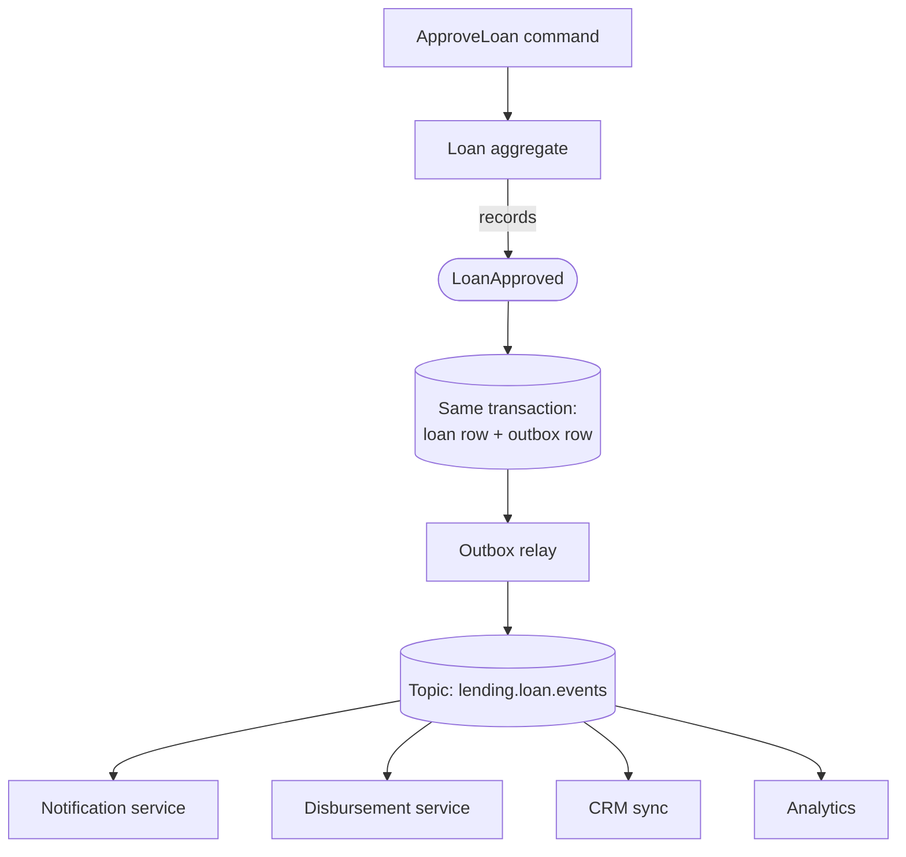

A **domain event** records **something that happened in the domain that domain experts care about**: `OrderPlaced`, `PaymentDeclined`, `LoanApproved`, `PolicyLapsed`. It's a fact, named in the past tense, in the language of the business.

Domain events are how services stay decoupled while still reacting to each other. They feed [sagas](/blog/saga-pattern/), [materialized views](/blog/materialized-view/), notifications, analytics, and audit — without the publisher knowing who's listening.

## The problem

Without explicit events, side effects pile up in the code that changes state:

```java
public void approveLoan(LoanId id) {
  loan.approve();
  repository.save(loan);
  emailService.sendApproval(loan);        // notifications
  disbursementClient.schedule(loan);      // payments
  crmClient.updateStage(loan);            // sales
  analytics.track("loan_approved", loan); // reporting
}
```

Every new reaction means changing this method; every downstream outage risks failing the approval; and the core domain is now coupled to email, CRM, and analytics. A domain event inverts the dependency: the loan service **announces** `LoanApproved`; interested parties **subscribe**.

## How it works



1. The **aggregate** records an event as part of executing a command.
2. The event is persisted **atomically** with the state change — via a [Transactional Outbox](/blog/transactional-outbox/) or by [event sourcing](/blog/event-sourcing/).
3. A relay publishes it to a topic.
4. Subscribers react independently, at their own pace.

## Internal vs. integration events

Distinguishing these two avoids most event-design trouble.

| | Domain (internal) event | Integration (public) event |
|---|---|---|
| Audience | Same bounded context / service | Other services and teams |
| Granularity | Fine-grained, reflects the model | Coarser, stable, intentional |
| Schema stability | Can change with refactoring | A contract — versioned, backward compatible |
| Transport | In-process dispatcher or private stream | Broker topic with schema registry |
| Example | `LoanTermAdjusted`, `CollateralRevalued` | `LoanApproved` (with the fields consumers need) |

Publish internal events freely inside your service; **curate** what crosses the boundary.

## Designing a good event

```json
{
  "specversion": "1.0",
  "type": "com.bank.lending.LoanApproved.v1",
  "source": "/lending/loan-service",
  "id": "8d1f6c2e-58a3-4b52-9b0c-2f9a7e1c3d44",
  "time": "2026-10-17T09:25:12.481Z",
  "subject": "loan/LN-2026-004211",
  "datacontenttype": "application/json",
  "traceparent": "00-4bf92f3577b34da6a3ce929d0e0e4736-00f067aa0ba902b7-01",
  "data": {
    "loanId": "LN-2026-004211",
    "customerId": "C-88120",
    "product": "HOME_LOAN",
    "approvedAmount": { "value": "4500000.00", "currency": "INR" },
    "tenureMonths": 240,
    "interestRate": "8.40",
    "approvedBy": "underwriter:u-341",
    "approvedAt": "2026-10-17T09:25:11.902Z",
    "aggregateVersion": 7
  }
}
```

Guidelines:

- **Past tense, business language.** `LoanApproved`, not `LoanStatusUpdated` or `UpdateLoan`.
- **Unique ID** for deduplication ([Idempotent Consumer](/blog/idempotent-consumer/)), plus **aggregate ID and version** for ordering.
- **Enough data to act on** — *event-carried state transfer*. Consumers shouldn't have to call back to ask "approved for how much?".
- **But not everything** — don't dump the whole aggregate. Include what consumers need, and keep sensitive fields out unless required.
- **Money as decimal strings with currency**, timestamps in UTC ISO-8601.
- **Metadata envelope** — the [CloudEvents](https://cloudevents.io/) spec standardizes `id`, `source`, `type`, `time`, `subject`, and works across Kafka, HTTP, and cloud event buses.

### Thin vs. fat events

| Style | Contents | Pros | Cons |
|---|---|---|---|
| **Notification (thin)** | `{ loanId, version }` | Tiny, no data leakage | Consumers call back → coupling and load |
| **State transfer (fat)** | Relevant fields | Consumers autonomous | Larger contract to version |
| **Delta** | Changed fields only | Compact | Consumers must hold prior state |

For integration events, **moderately fat** is usually right.

## Example: recording and dispatching events in the aggregate

```java
public class Loan extends AbstractAggregateRoot<Loan> {   // Spring Data helper

  private LoanStatus status;
  private Money approvedAmount;

  public void approve(Money amount, int tenureMonths, Rate rate, UnderwriterId by, Clock clock) {
    if (status != LoanStatus.UNDER_REVIEW) {
      throw new IllegalStateException("Only loans under review can be approved");
    }
    this.status = LoanStatus.APPROVED;
    this.approvedAmount = amount;
    registerEvent(new LoanApproved(id, customerId, product, amount, tenureMonths, rate,
        by, clock.instant(), version + 1));
  }
}

// Same transaction: translate the domain event into an outbox record (integration event)
@Component
class LoanEventsToOutbox {
  private final OutboxRepository outbox;

  @TransactionalEventListener(phase = TransactionPhase.BEFORE_COMMIT)
  void on(LoanApproved e) {
    outbox.save(OutboxRecord.of("Loan", e.loanId().value(), "LoanApproved.v1",
        IntegrationEvents.loanApprovedV1(e)));   // curated public schema
  }
}
```

Using `BEFORE_COMMIT` ensures the outbox row is written in the **same** transaction. `AFTER_COMMIT` would reintroduce the dual-write problem.

## Topics, keys, and ordering (Kafka)

- **Topic per aggregate type or bounded context** (`lending.loan.events`), not per event type — so all events for one loan share a topic and partition and stay in order.
- **Key by aggregate ID** to guarantee per-entity ordering.
- **Schema registry** (Avro, Protobuf, or JSON Schema) with **backward compatibility** checks in CI.
- **Retention** long enough for consumers to recover from outages and for new consumers to bootstrap — or compacted "state" topics alongside event topics.

## Versioning

- **Additive changes** (new optional fields) — same version.
- **Breaking changes** — new event type version (`LoanApproved.v2`), publish both during migration, retire v1 when consumers have moved.
- Never reuse a field name with a different meaning.

## Trade-offs

| Benefits | Costs |
|---|---|
| Loose coupling — publishers don't know subscribers | Harder to see end-to-end flows |
| New reactions without changing the source | Event contracts must be governed and versioned |
| Natural audit trail and analytics feed | Eventual consistency for subscribers |
| Enables sagas, views, and integration | Requires reliable publication (outbox) |

## Common pitfalls

> **Pitfall:** "events" that are really commands — `SendApprovalEmail`, `ScheduleDisbursement`. Those tell a specific receiver what to do and belong on a command queue. Events state facts; receivers decide what to do about them.

- **CRUD events** (`LoanUpdated` with every column) — meaningless to consumers, leak your schema.
- **Publishing before commit** — subscribers react to changes that roll back.
- **Missing IDs or versions** — consumers can't dedupe or order.
- **Event-driven spaghetti** — long chains of services reacting to each other's events with no owner. Use [Orchestration](/blog/orchestration/) for complex flows.

## Tools and real-world usage

- **Apache Kafka** + **Confluent/Apicurio Schema Registry** — the most common backbone.
- **AWS EventBridge**, **Azure Event Grid**, **Google Eventarc** — managed event buses, with CloudEvents support.
- **Spring Modulith**, **Axon**, **MediatR notifications** — in-process domain-event dispatch.
- **AsyncAPI** — documenting event-driven interfaces like OpenAPI does for REST.

## Related patterns

- [Transactional Outbox](/blog/transactional-outbox/) — reliable publication.
- [Event Sourcing](/blog/event-sourcing/) — events as the source of truth.
- [Publish-Subscribe](/blog/publish-subscribe/) — the distribution mechanism.
- [Choreography](/blog/choreography/) — coordination built on domain events.
- [Aggregate](/blog/aggregate-ddd/) — where events originate.

## Key takeaways

1. Domain events are past-tense business facts, emitted by aggregates.
2. Separate fine-grained internal events from curated, versioned integration events.
3. Publish atomically with the state change, keyed by aggregate ID.
4. Include IDs, versions, and enough data for consumers to act independently.
