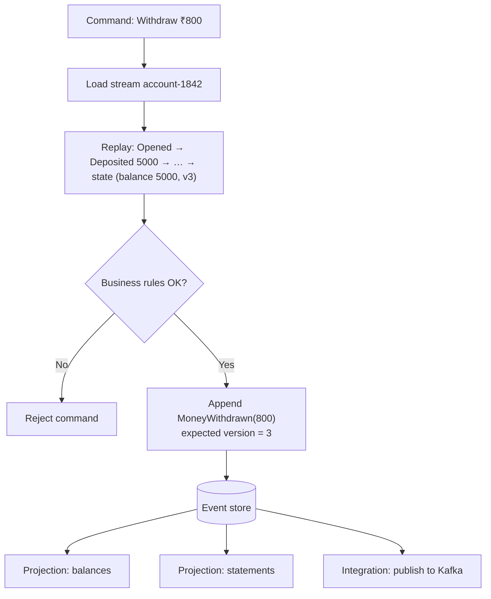

Most systems store **current state**: the account balance is 4,200; the order status is `SHIPPED`. When state changes, the old value is overwritten. **Event Sourcing** stores something different: the **sequence of events that led to the current state** — `AccountOpened`, `MoneyDeposited(5,000)`, `MoneyWithdrawn(800)`. Current state is *derived* by replaying those events.

Accountants have worked this way for centuries. A ledger never erases an entry; it posts a correcting one. Your bank balance is a projection of your transaction history.

## The problem

State-oriented persistence loses information:

- **Why** did the status change? Who changed it, and what was it before?
- What did the system believe **at 3:42 pm last Tuesday**, when the customer says the price was different?
- Can we **compute a new metric** over history we didn't think to record?
- How do we publish **reliable events** when state changes, without [dual writes](/blog/transactional-outbox/)?

Audit tables and change logs bolt this on afterwards, and they drift from the "real" data.

## How it works

An **event store** holds append-only **streams**, typically one per aggregate instance (`account-1842`). Each event has a type, payload, metadata, and a **version** (its position in the stream).



1. **Load** the aggregate by reading its events and folding them into state.
2. **Decide** — run the command against the state; produce zero or more new events.
3. **Append** the new events with **optimistic concurrency** (expected version).
4. **Project** — subscribers build read models ([CQRS](/blog/cqrs/)) and integration feeds from the stream.

## Example: an event-sourced account in TypeScript

```typescript
type AccountEvent =
  | { type: "AccountOpened"; accountId: string; owner: string }
  | { type: "MoneyDeposited"; amount: number; reference: string }
  | { type: "MoneyWithdrawn"; amount: number; reference: string }
  | { type: "AccountFrozen"; reason: string };

interface AccountState { id: string; balance: number; frozen: boolean; version: number }

// Pure function: state is a left fold over events
export function evolve(s: AccountState, e: AccountEvent): AccountState {
  switch (e.type) {
    case "AccountOpened":  return { id: e.accountId, balance: 0, frozen: false, version: s.version + 1 };
    case "MoneyDeposited": return { ...s, balance: s.balance + e.amount, version: s.version + 1 };
    case "MoneyWithdrawn": return { ...s, balance: s.balance - e.amount, version: s.version + 1 };
    case "AccountFrozen":  return { ...s, frozen: true, version: s.version + 1 };
  }
}

// Pure function: decide which events a command produces
export function withdraw(s: AccountState, amount: number, reference: string): AccountEvent[] {
  if (s.frozen) throw new Error("Account is frozen");
  if (amount <= 0) throw new Error("Amount must be positive");
  if (s.balance < amount) throw new Error("Insufficient funds");
  return [{ type: "MoneyWithdrawn", amount, reference }];
}

// Application service: load → decide → append with expected version
export async function handleWithdraw(store: EventStore, accountId: string, amount: number, ref: string) {
  const stream = `account-${accountId}`;
  const history = await store.read<AccountEvent>(stream);
  const initial: AccountState = { id: accountId, balance: 0, frozen: false, version: 0 };
  const state = history.reduce(evolve, initial);

  const newEvents = withdraw(state, amount, ref);
  await store.append(stream, newEvents, { expectedVersion: state.version });
  // If another writer appended first, append() throws WrongExpectedVersion → reload and retry
}
```

The *decide* and *evolve* functions are pure, which makes event-sourced domain logic unusually easy to test: **given** these past events, **when** this command, **then** these new events.

### Optimistic concurrency

Two withdrawals racing on the same account both load version 3. The first appends at version 4; the second's append with `expectedVersion: 3` fails, it reloads (now seeing the first withdrawal), re-checks the balance, and either succeeds or rejects. No locks; no lost updates.

## Projections and read models

Replaying streams for every query would be slow, and you can't query "all accounts with balance > X" by replaying. So subscribers maintain **projections** — tables, documents, or search indexes — updated from the event stream. This is why event sourcing is almost always paired with [CQRS](/blog/cqrs/). Projections are disposable: if one is wrong, fix the code and **rebuild it from the events**.

For long streams, [Snapshots](/blog/snapshot-pattern/) cap the replay cost.

## Schema evolution

Events are stored forever, so their schemas must evolve without rewriting history.

| Technique | Use when |
|---|---|
| **Add optional fields** with defaults | Most changes — backward compatible |
| **Upcasters** — transform old event versions to the new shape when read | Renames, restructuring |
| **New event type** (`AddressChangedV2`) | Meaning has changed |
| **Copy-and-transform** the stream into a new one | Rare, large migrations |

Name events in the **past tense** and in **business language** (`PaymentRefunded`, not `PaymentRowUpdated`). They're facts; facts don't get edited.

## Event sourcing and personal data

Immutable logs collide with the right to erasure (GDPR, DPDP Act, and similar laws). Common approaches:

- **Crypto-shredding** — encrypt personal data in events with a per-subject key stored elsewhere; delete the key to make the data unreadable.
- **Keep PII out of events** — store a reference to a separately deletable profile.
- **Retention policies** per stream where the domain allows.

Design this up front; retrofitting is painful.

## Trade-offs

| Benefits | Costs |
|---|---|
| Complete, trustworthy audit trail | Steeper learning curve for the team |
| Time travel and historical analysis | Querying requires projections (CQRS) |
| Reliable event publishing — events *are* the data | Event schema evolution is forever |
| Rebuildable, disposable read models | Eventual consistency between writes and reads |
| Natural fit for complex, behavior-rich domains | Erasure requires deliberate design |

## When to use it

Good fits: ledgers and payments, trading, insurance claims, logistics tracking, healthcare records, collaborative editing, any domain where **"how did we get here?"** matters or regulators demand complete history.

Poor fits: CRUD-heavy apps (settings, content management), domains with little behavior, teams without the appetite for the extra concepts. You can event-source **one bounded context** and keep the rest state-based — that's usually the right scope.

## Common pitfalls

> **Pitfall:** using Kafka as the event store. Kafka is a great **transport** for events, but it lacks per-aggregate streams with optimistic concurrency checks ("append only if the stream is at version 7"). Use a purpose-built store (EventStoreDB, Marten on PostgreSQL, Axon Server) or a database table with a unique `(stream_id, version)` constraint — and publish to Kafka from there.

- **CRUD events** (`OrderUpdated` with the whole row) — you've built an audit log, not a domain model.
- **Huge aggregates** with millions of events per stream — model smaller aggregates or snapshot.
- **Coupling other services to internal events** — publish curated integration events instead.
- **Projections with side effects** (sending emails on replay) — separate reactions from projections and guard them.

## Tools and real-world usage

- **EventStoreDB (Kurrent)** — purpose-built event database with streams, subscriptions, and projections.
- **Axon Framework + Axon Server** — Java event sourcing and CQRS.
- **Marten** — event sourcing on PostgreSQL for .NET.
- **DynamoDB / Cosmos DB** with conditional writes, or a relational table with a unique `(stream_id, version)` constraint — a simple, reliable foundation.

## Related patterns

- [CQRS](/blog/cqrs/) — the read side that makes event sourcing practical.
- [Snapshot](/blog/snapshot-pattern/) — bounding replay time.
- [Aggregate](/blog/aggregate-ddd/) — the consistency boundary each stream represents.
- [Domain Events](/blog/domain-events/) — the vocabulary of the event store.
- [Audit Logging](/blog/audit-logging/) — a lighter-weight alternative when you only need history.

## Key takeaways

1. Persist events, not state; derive state by folding events.
2. Use per-stream optimistic concurrency for safe, lock-free writes.
3. Pair with CQRS projections for queries, and snapshots for long streams.
4. Plan event versioning and personal-data erasure from day one.
5. Apply it to the bounded contexts that need history — not everywhere.
