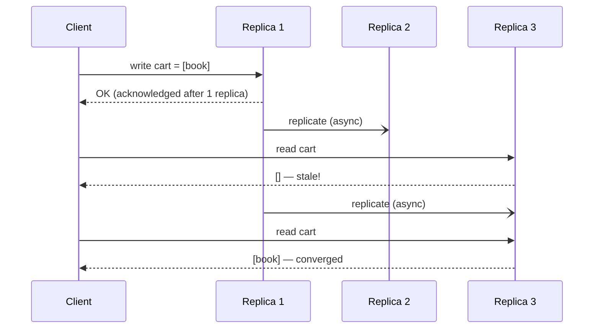

**Eventual consistency** is the promise that if no new updates are made to a piece of data, all replicas will *eventually* return the same value. It's not a pattern you add to a system so much as a **consistency model you choose** — and once you split a system into services with their own databases, you are choosing it whether you say so or not.

Done well, users never notice. Done badly, they see orders that vanish on refresh, balances that jump around, and "you have 3 unread messages" with an empty inbox.

## The problem

Strong consistency — every read sees the latest write — requires coordination. Replicas must agree before acknowledging a write, which costs latency and, during a network partition, availability.

The CAP theorem formalizes the extreme case: during a **partition**, a system must choose between **consistency** (refuse some requests) and **availability** (answer with possibly stale data). PACELC adds the everyday case: **else**, when there is no partition, you still trade **latency** against **consistency**.

Many workloads — shopping carts, social feeds, product catalogs, analytics, cross-service read models — value availability and low latency more than instantaneous agreement.

## How it works

Writes are accepted by one or more replicas and propagated **asynchronously** to the rest. Until propagation completes, different replicas may return different values. Mechanisms that make them converge include:

| Mechanism | What it does |
|---|---|
| **Asynchronous replication** | Leader ships its log to followers; followers lag by milliseconds to seconds. |
| **Anti-entropy / Merkle trees** | Replicas periodically compare data hashes and repair differences. |
| **Read repair** | A read that sees divergent replicas writes the newest value back to the stale ones. |
| **Hinted handoff** | If a replica is down, another node stores the write and replays it later. |
| **Conflict resolution** | Last-writer-wins timestamps, vector clocks, or CRDTs decide the winner when replicas diverge. |



### Between services, too

The same idea applies across microservices. When the Order service publishes `OrderPlaced` and the Search service updates its index from that event, the search index is an **eventually consistent replica** of order data. The replication mechanism is your message broker; the lag is your consumer lag.

## Tunable consistency: quorums

Dynamo-style stores (Cassandra, ScyllaDB, Riak, DynamoDB internally) let you pick consistency per request using quorums. With `N` replicas, a write acknowledged by `W` replicas and a read that consults `R` replicas:

- If **`R + W > N`**, every read overlaps at least one replica that has the latest write → read-your-latest behavior (barring concurrent writes and sloppy quorums).
- If **`R + W ≤ N`**, reads may be stale but are faster and more available.

```sql
-- Cassandra CQL: choose consistency per statement (cqlsh)
CONSISTENCY QUORUM;    -- N=3 -> W=2
INSERT INTO carts (user_id, items) VALUES ('u-42', ['book']);

CONSISTENCY ONE;       -- fast, possibly stale
SELECT items FROM carts WHERE user_id = 'u-42';

CONSISTENCY LOCAL_QUORUM; -- strong within one data center, async across DCs
SELECT items FROM carts WHERE user_id = 'u-42';
```

DynamoDB exposes a simpler switch:

```python
import boto3
table = boto3.resource("dynamodb").Table("carts")

# Default: eventually consistent read (half the read-capacity cost)
table.get_item(Key={"user_id": "u-42"})

# Strongly consistent read from the leader replica in this region
table.get_item(Key={"user_id": "u-42"}, ConsistentRead=True)
# Note: global tables replicate across regions asynchronously regardless.
```

## Stronger flavours of "eventual"

"Eventually" can be very weak. These session guarantees make it far more usable and are often cheap to provide:

| Guarantee | Meaning | Typical technique |
|---|---|---|
| **Read-your-writes** | After I write, I see my own write. | Route the user's reads to the leader for a short window, or pass a version token. |
| **Monotonic reads** | I never see data go backwards. | Pin a session to one replica, or reject replicas older than my last-seen version. |
| **Monotonic writes** | My writes apply in the order I made them. | Per-key ordering (Kafka partition key, single writer). |
| **Consistent prefix** | I see events in an order that makes causal sense. | Ordered logs, causal metadata (vector clocks). |
| **Causal consistency** | If A caused B, everyone sees A before B. | Dependency tracking; supported by MongoDB causal sessions. |

## Example: read-your-writes across services

A user updates their address in the Profile service, then the Checkout page (served from an eventually consistent read model) still shows the old one. A common fix is a **version token**:

```typescript
// Profile service returns the new version after a write
// PUT /profile/address -> { version: 1841 }

// Checkout read API accepts a minimum version
app.get("/checkout/summary", async (req, res) => {
  const minVersion = Number(req.header("X-Min-Profile-Version") ?? 0);
  const view = await readModel.getSummary(req.user.id);

  if (view.profileVersion < minVersion) {
    // Replica hasn't caught up: fall back to the source of truth for this one read
    const fresh = await profileClient.getAddress(req.user.id);
    return res.json({ ...view, address: fresh.address, profileVersion: fresh.version });
  }
  res.json(view);
});
```

## Designing the user experience

Most eventual-consistency bugs are UX bugs. Patterns that help:

- **Optimistic UI** — show the user's change immediately on their device, reconcile when the server confirms.
- **Explicit pending states** — "Payment processing…" is honest; a blank order list is alarming.
- **Acknowledge, then notify** — accept the command (`202 Accepted`) and push the result later. See [Async Request-Reply](/blog/async-request-reply/).
- **Avoid read-after-write on a different replica** in the same user flow without a version token.

## Trade-offs

| Benefits | Costs |
|---|---|
| High availability, including during partitions | Stale reads; anomalies users can notice |
| Low write and read latency | Conflict resolution logic (LWW can silently lose writes) |
| Scales horizontally and across regions | Harder testing — bugs appear only under lag |
| Natural fit for event-driven microservices | Requires monitoring of replication/consumer lag |

## When to use it

Good fits: carts, feeds, likes and counters, catalogs, search indexes, recommendation data, [materialized views](/blog/materialized-view/) and [CQRS](/blog/cqrs/) read models, cross-region replication.

Poor fits — prefer strong consistency here: account balances and ledgers, inventory at the moment of sale, uniqueness constraints (usernames), authorization changes (revoking access must be immediate), anything with a regulatory "single source of truth" requirement.

> **Rule of thumb:** keep the **invariant** strongly consistent inside one service or aggregate, and let everything that merely **reports on** that invariant be eventually consistent.

## Common pitfalls

> **Pitfall:** last-writer-wins with unsynchronized clocks. Two concurrent cart updates resolve by timestamp, and the "later" one is from a server whose clock runs 200 ms fast. One user's item silently disappears. Use logical clocks, CRDTs (e.g., an add-wins set for carts), or single-writer-per-key.

- **No lag metrics.** Track replication lag and consumer lag as SLOs, with alerts. "Eventually" must have a number.
- **Assuming convergence = correctness.** Replicas can converge on the *wrong* value if conflict resolution is naive.
- **Hidden strong-consistency assumptions** in code ("insert then immediately select by ID from the read replica").

## Tools and real-world usage

- **Amazon DynamoDB** — eventually consistent reads by default; strongly consistent reads optional per request; global tables replicate asynchronously.
- **Apache Cassandra / ScyllaDB** — per-query consistency levels (`ONE`, `QUORUM`, `LOCAL_QUORUM`, `ALL`), read repair, hinted handoff.
- **Riak, CouchDB** — sibling values and revision trees for conflict handling.
- **Kafka + consumers** — the backbone of eventually consistent read models across services.

## Related patterns

- [CQRS](/blog/cqrs/) and [Materialized View](/blog/materialized-view/) — eventually consistent read sides by design.
- [Saga](/blog/saga-pattern/) — business transactions that are consistent eventually.
- [Transactional Outbox](/blog/transactional-outbox/) — guarantees the replication events are published.
- [Domain Events](/blog/domain-events/) — what flows between services to drive convergence.

## Key takeaways

1. Eventual consistency guarantees convergence, not freshness — and only when writes stop.
2. Quorums (`R + W > N`) and session guarantees make it far stronger in practice.
3. Measure lag; "eventually" needs an SLO.
4. Keep invariants strongly consistent; let projections and replicas lag.
5. Design the UX for pending and stale states.
