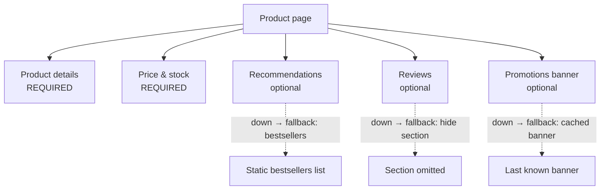

When the recommendations service is down, should the product page fail? Almost certainly not — show "popular products" instead, or nothing at all. When the pricing service is down, should checkout quote a cached price? Maybe — or maybe that's a regulatory problem. The **Fallback** pattern provides an **alternative response** when an operation fails, times out, or is short-circuited, so the system **degrades gracefully** instead of failing outright.

The pattern is easy to code and hard to design: the real work is deciding, feature by feature, what a *correct* degraded answer looks like.

## The problem

Modern pages and APIs aggregate many dependencies. If each is 99.9% available and a page needs ten of them, the page is ~99% available — unless optional dependencies can fail without failing the page.



## Fallback strategies

| Strategy | Example | Good for | Risk |
|---|---|---|---|
| **Cached / last known good** | Last fetched exchange rate, product description | Slow-changing data | Staleness — show age where it matters |
| **Static default** | Default avatar, generic bestseller list | Personalization, decoration | Low |
| **Reduced functionality** | Search without spelling suggestions; checkout without loyalty points | Optional sub-features | Users miss features |
| **Alternative provider** | Secondary SMS or payment gateway | Critical external integrations | Cost, consistency between providers |
| **Queue for later** | Accept order, process when downstream recovers | Writes that can be async | Users must be told it's pending |
| **Fail silent (omit)** | Hide the reviews widget | Purely optional UI | Silent failures need monitoring |
| **Fail fast with clear error** | "Payments are temporarily unavailable" | Critical operations with no safe alternative | — this *is* the correct fallback sometimes |

> **Rule of thumb:** fall back freely on **reads that inform**, carefully on **reads that decide**, and almost never on **writes that commit** — unless the fallback is "queue it and tell the user".

## Example: Resilience4j with cached fallback

```java
@Service
public class RecommendationsFacade {

  private final RecommendationsClient client;
  private final Cache<String, List<ProductCard>> lastGood;   // e.g. Caffeine, per user
  private final BestsellerService bestsellers;               // local, precomputed
  private final MeterRegistry metrics;

  @CircuitBreaker(name = "recs", fallbackMethod = "recsFallback")
  @TimeLimiter(name = "recs")
  @Bulkhead(name = "recs")
  public CompletableFuture<Recommendations> forUser(String userId) {
    return client.forUser(userId).thenApply(list -> {
      lastGood.put(userId, list);                             // refresh the fallback source
      return Recommendations.live(list);
    });
  }

  // Same signature + a Throwable parameter; invoked on failure, timeout, open circuit, or full bulkhead
  private CompletableFuture<Recommendations> recsFallback(String userId, Throwable cause) {
    metrics.counter("recs.fallback", "cause", cause.getClass().getSimpleName()).increment();
    List<ProductCard> cached = lastGood.getIfPresent(userId);
    if (cached != null) return CompletableFuture.completedFuture(Recommendations.stale(cached));
    return CompletableFuture.completedFuture(Recommendations.generic(bestsellers.top(12)));
  }
}
```

`Recommendations.stale` and `.generic` carry a **source flag** so the UI (and analytics) know what was shown.

## Example: Polly v8 fallback (.NET)

```csharp
var pipeline = new ResiliencePipelineBuilder<RateQuote>()
    .AddFallback(new FallbackStrategyOptions<RateQuote>
    {
        ShouldHandle = new PredicateBuilder<RateQuote>()
            .Handle<HttpRequestException>()
            .Handle<BrokenCircuitException>()
            .Handle<TimeoutRejectedException>(),
        FallbackAction = async args =>
        {
            var cached = await rateCache.GetAsync("USD/INR");
            // Only acceptable if fresh enough for this use case
            return cached is { Age.TotalMinutes: < 15 }
                ? Outcome.FromResult(cached with { Source = QuoteSource.Cached })
                : Outcome.FromException<RateQuote>(new RateUnavailableException());
        },
    })
    .AddCircuitBreaker(new CircuitBreakerStrategyOptions<RateQuote>())
    .AddTimeout(TimeSpan.FromMilliseconds(500))
    .Build();
```

Note the **freshness guard**: a cached FX rate is a fine fallback for an indicative quote on a dashboard, and an unacceptable one for executing a trade.

## Designing fallbacks per feature

For each dependency on a user journey, write down:

1. **Is it required for the journey to be correct?** If yes, the fallback is a clear error (or an async path).
2. **What's the safest degraded behavior?** Cached, default, reduced, or omitted.
3. **How stale is acceptable?** Seconds? Hours? Never?
4. **Does the user need to know?** "Prices may be out of date" vs. silently hiding a widget.
5. **How will we notice?** Fallback rate metrics and alerts.

This is a product conversation as much as an engineering one — and it belongs in design reviews, not just code reviews.

## Fallbacks at the edge

Not all fallbacks live in application code:

- **CDN `stale-if-error`** — serve cached pages when the origin fails: `Cache-Control: max-age=60, stale-if-error=86400`.
- **API gateway static responses** — return a canned response for non-critical endpoints when upstreams are unhealthy.
- **Feature flags / kill switches** — turn off expensive optional features during incidents, a deliberate, human-triggered fallback. See [Load Shedding](/blog/load-shedding/).

## Trade-offs

| Benefits | Costs |
|---|---|
| Higher perceived availability | Risk of serving stale or wrong data |
| Optional features can't break core journeys | Fallback paths are rarely exercised — and rot |
| Buys time during incidents | Silent degradation can hide outages |
| Better user experience than error pages | Extra caches and defaults to maintain |

## Common pitfalls

> **Warning:** fallbacks that lie. Returning "₹0.00 balance" when the balance service is down, or "no results" when search is down, presents a failure as a fact. Users act on it. If you can't produce a truthful degraded answer, return an honest error.

- **Fallbacks that call another fragile dependency** — the fallback fails too, and now you have two problems. Fallbacks should be local and cheap.
- **Never testing fallbacks** — use fault injection (chaos experiments, Istio fault injection) to exercise them regularly.
- **No metrics** — a fallback serving 100% of traffic for a week is an outage nobody noticed.
- **Caching everything "for fallback"** — including personal data that shouldn't be retained.

## Tools and real-world usage

- **Resilience4j** `fallbackMethod`, **Spring Cloud CircuitBreaker** fallbacks, **Polly** fallback strategy.
- **CDNs** (CloudFront, Fastly, Akamai, Cloudflare) — `stale-if-error`, `stale-while-revalidate`, custom error pages.
- **Feature-flag platforms** (LaunchDarkly, Unleash, OpenFeature-compatible tools) — kill switches for degraded modes.
- Large consumer platforms are known for degrading personalized content to generic content when personalization systems are unavailable.

## Related patterns

- [Circuit Breaker](/blog/circuit-breaker/) — triggers fallbacks instantly while open.
- [Timeout](/blog/timeout-pattern/) — produces the failure that triggers the fallback.
- [API Composition](/blog/api-composition/) — per-field fallbacks in composed responses.
- [Load Shedding](/blog/load-shedding/) — deliberately falling back to protect capacity.

## Key takeaways

1. Decide fallbacks per feature: cached, default, reduced, async, omitted — or an honest error.
2. Guard cached fallbacks with freshness limits appropriate to the use case.
3. Keep fallbacks local and cheap; never chain fragile dependencies.
4. Label degraded responses, measure fallback rates, and test fallback paths.
