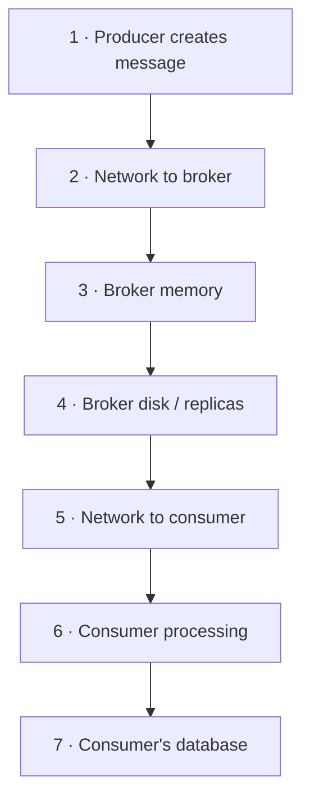
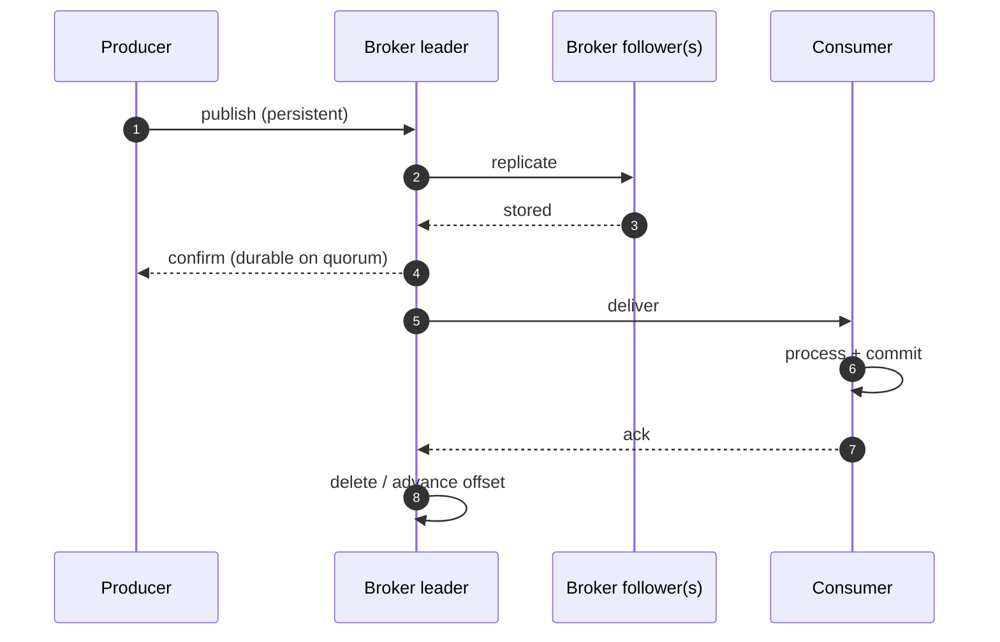

"We use a message queue, so messages can't get lost." That sentence has preceded many post-incident reviews. **Guaranteed Delivery** — from *Enterprise Integration Patterns* — means the messaging system **persists a message until it has been successfully delivered and acknowledged**, so that it survives crashes of the producer, the broker, or the consumer.

The guarantee isn't a single setting. It's a **chain**, and it's only as strong as its weakest link.

## The problem

A message can be lost at any of these points:



- Producer crashes after the business commit but before sending (**dual write** — see [Transactional Outbox](/blog/transactional-outbox/)).
- Producer sends "fire-and-forget"; the broker never received it.
- Broker accepted it in memory and crashed before writing to disk.
- Broker wrote to one disk, and that disk/node died before replication.
- Consumer auto-acknowledged on receipt, then crashed mid-processing.

## How it works

Guaranteed delivery combines four mechanisms:

| Link | Mechanism | Lost if missing |
|---|---|---|
| Producer → broker | **Publisher confirms / acks** — the send only succeeds when the broker has durably stored the message | Messages dropped in flight or in broker memory |
| Broker storage | **Persistent messages** on disk (fsync policy) | Messages lost on broker restart |
| Broker redundancy | **Replication** to multiple nodes, with a quorum required to acknowledge | Messages lost on node or disk failure |
| Broker → consumer | **Manual acknowledgements** sent *after* processing | Messages lost if the consumer crashes mid-processing |

Plus, at the edges: an **outbox** on the producer side so creation is atomic with your data, and **idempotent consumers** because guaranteed delivery means *at least once*.



## RabbitMQ configuration

```python
import pika

conn = pika.BlockingConnection(pika.ConnectionParameters("rabbit"))
ch = conn.channel()
ch.confirm_delivery()                                  # publisher confirms

# Quorum queues replicate via Raft across nodes — the modern default for durability
ch.queue_declare("payments", durable=True, arguments={"x-queue-type": "quorum"})

ch.basic_publish(
    exchange="",
    routing_key="payments",
    body=payload,
    properties=pika.BasicProperties(
        delivery_mode=pika.DeliveryMode.Persistent,    # write to disk
        message_id=event_id,                           # for consumer-side dedupe
    ),
    mandatory=True,                                    # fail if unroutable
)  # raises if the broker nacks or the message is unroutable

def on_message(ch, method, props, body):
    try:
        handle(body, props.message_id)                 # idempotent processing
        ch.basic_ack(method.delivery_tag)              # ack AFTER the work is committed
    except TransientError:
        ch.basic_nack(method.delivery_tag, requeue=True)
    except Exception:
        ch.basic_nack(method.delivery_tag, requeue=False)   # → dead-letter exchange

ch.basic_qos(prefetch_count=20)
ch.basic_consume("payments", on_message, auto_ack=False)
```

## Kafka configuration

```properties
# --- Producer ---
acks=all                         # leader waits for all in-sync replicas
enable.idempotence=true          # no duplicates from producer retries; preserves order
retries=2147483647
delivery.timeout.ms=120000
max.in.flight.requests.per.connection=5

# --- Topic / broker ---
replication.factor=3
min.insync.replicas=2            # with acks=all: a write needs 2 of 3 replicas
unclean.leader.election.enable=false   # never elect an out-of-sync replica

# --- Consumer ---
enable.auto.commit=false         # commit offsets only after processing
isolation.level=read_committed   # if producers use transactions
```

```java
while (running) {
  ConsumerRecords<String, Payment> batch = consumer.poll(Duration.ofMillis(500));
  for (ConsumerRecord<String, Payment> rec : batch) {
    paymentHandler.process(rec.value());          // idempotent; commits to its own DB
  }
  consumer.commitSync();                          // after the batch is durably processed
}
```

> **Rule of thumb:** `replication.factor=3`, `min.insync.replicas=2`, `acks=all`. That combination tolerates one broker failure without losing acknowledged writes *or* blocking producers.

## The cost of guarantees

Durability isn't free:

- **Latency** — waiting for disk and replica acknowledgements adds milliseconds per message. Batching and pipelining recover most throughput.
- **Availability trade-off** — with `min.insync.replicas=2`, if two of three replicas are down, producers get errors rather than silently writing to one replica. That's the right choice for payments; maybe not for click-stream metrics.
- **Duplicates** — every retry in the chain can duplicate. Guaranteed delivery is **at-least-once**; pair it with [Idempotent Consumer](/blog/idempotent-consumer/).

Not every message deserves the full chain. Telemetry, cache invalidations, and presence updates can often use at-most-once delivery for speed. Classify your message types.

| Message class | Example | Delivery choice |
|---|---|---|
| Business facts | `PaymentCaptured`, `OrderPlaced` | Guaranteed, replicated, outbox + inbox |
| Commands | `SendInvoiceEmail` | Guaranteed, idempotent handler |
| Notifications / hints | `CacheInvalidate` | At-least-once, short retention |
| Telemetry | Page-view events | At-most-once or sampled is often fine |

## Trade-offs

| Benefits | Costs |
|---|---|
| Messages survive producer, broker, and consumer crashes | Higher latency per message |
| Enables reliable asynchronous integration | Duplicates must be handled downstream |
| Decouples producer and consumer availability | More storage, replication traffic, and ops work |
| Foundation for sagas, outboxes, event sourcing | Can block producers when replicas are unavailable |

## Common pitfalls

> **Warning:** auto-ack. Many client libraries default to acknowledging on receipt (`auto_ack=True`, `enable.auto.commit=true`). A crash during processing then loses the message. Acknowledge after the work commits.

- **Durable queue, non-persistent messages** (or vice versa) in RabbitMQ — both must be durable.
- **`acks=1`** in Kafka — the leader acknowledges before followers copy the data; a leader crash loses it.
- **Unbounded prefetch** — a consumer grabs thousands of unacked messages, crashes, and causes a redelivery storm.
- **Retention shorter than outages** — if consumers are down for three days and topic retention is one day, messages are "guaranteed" right up until they're deleted.

## Tools and real-world usage

- **IBM MQ** — persistent messages with syncpoint/transactional get and put; a long-standing backbone for bank payment flows.
- **RabbitMQ** — durable quorum queues, publisher confirms, manual acks.
- **Apache Kafka** — replicated logs with `acks=all`, idempotent producers, transactions.
- **Amazon SQS / Azure Service Bus / Google Pub/Sub** — managed durability with visibility timeouts or lock durations and explicit delete/complete/ack.

## Related patterns

- [Transactional Outbox](/blog/transactional-outbox/) — guarantees the message is created.
- [Idempotent Consumer](/blog/idempotent-consumer/) and [Transactional Inbox](/blog/transactional-inbox/) — handle at-least-once duplicates.
- [Dead Letter Queue](/blog/dead-letter-queue/) — where undeliverable messages go.
- [Competing Consumers](/blog/competing-consumers/) — scaling consumers while keeping guarantees.

## Key takeaways

1. Guaranteed delivery is a chain: atomic creation, confirmed publish, persistence, replication, ack-after-processing.
2. It's at-least-once — design consumers to be idempotent.
3. In Kafka: `acks=all`, idempotent producers, RF=3, `min.insync.replicas=2`, manual commits.
4. Spend durability where it matters; not every message needs the full chain.
