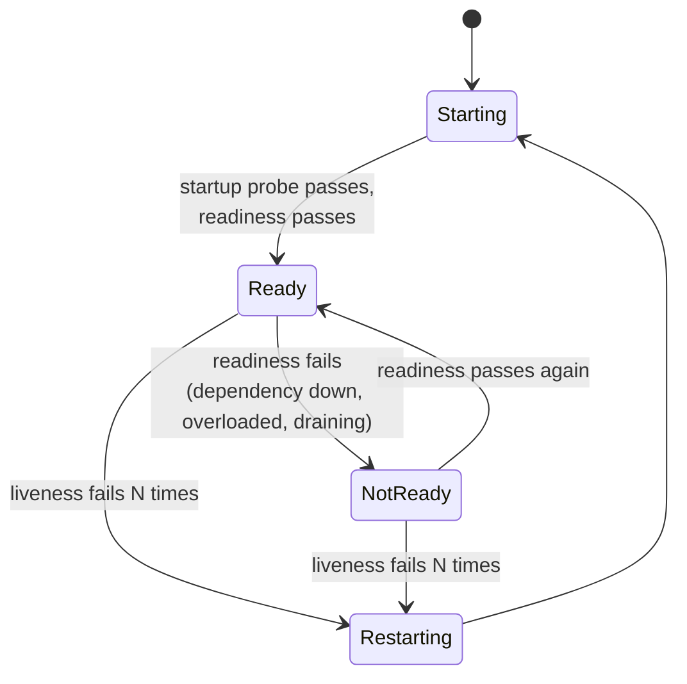

Orchestrators and load balancers need to know two things about every instance: **is it alive?** and **should it receive traffic?** A **Health Check** endpoint answers those questions so the platform can restart broken instances and route around ones that aren't ready.

Health checks look trivial — return `200 OK` — and are a surprisingly common cause of outages. A badly designed probe can restart healthy pods during a database blip, take an entire fleet out of rotation at once, or keep a deadlocked process in service.

## The problem

Without health checks, the platform only knows whether a process *exists*. It can't tell:

- the app is deadlocked and will never serve another request,
- it's still warming caches and will time out if given traffic,
- it has lost its connection to a required dependency,
- it's shutting down and should stop receiving new requests.

## How it works: three different questions

| Probe | Question | Action on failure | Should check |
|---|---|---|---|
| **Liveness** | "Is this process irrecoverably broken?" | **Restart** the container | Only the process itself (event loop, deadlock detector) |
| **Readiness** | "Can this instance serve requests *right now*?" | **Remove from load balancing** (no restart) | Local readiness + critical dependencies, warm-up, draining |
| **Startup** | "Has it finished starting?" | Delay liveness/readiness until it passes | Initialization complete |



The crucial distinction: **liveness failures restart; readiness failures only reroute.** Mixing them up is the source of most probe incidents.

## Example: Kubernetes probes

```yaml
apiVersion: apps/v1
kind: Deployment
metadata: { name: payments-api }
spec:
  replicas: 6
  template:
    spec:
      terminationGracePeriodSeconds: 45
      containers:
        - name: app
          image: registry.example.com/payments-api:2026.10.17
          ports: [{ containerPort: 8080 }]

          startupProbe:                    # allow up to 30 × 5 s = 150 s for cold start
            httpGet: { path: /actuator/health/liveness, port: 8080 }
            periodSeconds: 5
            failureThreshold: 30

          livenessProbe:                   # cheap, local; restart only if truly stuck
            httpGet: { path: /actuator/health/liveness, port: 8080 }
            periodSeconds: 10
            timeoutSeconds: 2
            failureThreshold: 3

          readinessProbe:                  # can I take traffic right now?
            httpGet: { path: /actuator/health/readiness, port: 8080 }
            periodSeconds: 5
            timeoutSeconds: 2
            failureThreshold: 2
            successThreshold: 1

          lifecycle:
            preStop:                       # let endpoints update before shutdown begins
              exec: { command: ["sh", "-c", "sleep 10"] }
```

## Example: Spring Boot Actuator health groups

```yaml
management:
  endpoint:
    health:
      probes:
        enabled: true                 # exposes /health/liveness and /health/readiness
      show-details: never             # don't leak internals publicly
      group:
        liveness:
          include: livenessState      # process state only — NOT the database
        readiness:
          include: readinessState, db, redis, paymentGateway
  endpoints:
    web:
      exposure:
        include: health
  server:
    port: 8081                        # serve probes on a management port, not the public one
```

A custom check for a critical dependency, with a short timeout and cached result:

```java
@Component("paymentGateway")
public class PaymentGatewayHealth implements HealthIndicator {

  private final GatewayClient client;
  private volatile Health cached = Health.unknown().build();
  private volatile Instant checkedAt = Instant.EPOCH;

  @Override
  public Health health() {
    // Cache for 5 s so frequent probes don't hammer the dependency
    if (Duration.between(checkedAt, Instant.now()).getSeconds() < 5) return cached;
    try {
      boolean ok = client.ping(Duration.ofMillis(300));
      cached = ok ? Health.up().build() : Health.down().withDetail("reason", "ping failed").build();
    } catch (Exception e) {
      cached = Health.down(e).build();
    }
    checkedAt = Instant.now();
    return cached;
  }
}
```

During shutdown, Spring Boot flips readiness to `REFUSING_TRAFFIC` automatically when graceful shutdown is enabled (`server.shutdown=graceful`), so the instance drains cleanly.

## Shallow vs. deep checks

| | Shallow | Deep |
|---|---|---|
| What it checks | Process responds; internal state OK | Dependencies reachable (DB, cache, downstream APIs) |
| Cost | Microseconds | Network calls |
| Risk | Misses dependency problems | Shared dependency outage marks **every** instance unhealthy |
| Use for | **Liveness** | **Readiness** (carefully), dashboards, synthetic monitoring |

> **Warning:** if every instance's readiness depends on the same database and the database blips, **every instance goes NotReady at once** and the load balancer has nowhere to send traffic — turning a partial degradation into a total outage. Include only dependencies without which the instance truly can't serve *anything*, and consider whether serving degraded responses ([Fallback](/blog/fallback-pattern/)) is better than being removed.

Some load balancers "fail open" when all targets are unhealthy (AWS ALB and Envoy's panic threshold route to all targets anyway). Know your platform's behavior.

## Design guidelines

1. **Liveness must not check dependencies.** A database outage should never restart your whole fleet.
2. **Keep probes fast and cheap.** Probes run constantly on every instance; cache dependency checks.
3. **Use startup probes** for slow starters instead of huge `initialDelaySeconds` on liveness.
4. **Fail readiness during graceful shutdown** and drain in-flight requests.
5. **Fail readiness when overloaded** (optional) so the load balancer prefers healthier instances — but avoid flapping with sensible thresholds.
6. **Serve probes on a separate port or path** not exposed publicly, and never include secrets or detailed internals in public responses.
7. **Prioritize probe requests** so [load shedding](/blog/load-shedding/) doesn't reject them.

## Health checks beyond Kubernetes

- **Load balancers** (ALB/NLB, Azure Load Balancer, GCP) — target health checks decide routing.
- **Service discovery** (Consul, Eureka) — instances are deregistered when checks fail; see [Service Discovery](/blog/service-discovery/).
- **Synthetic monitoring** — external checks that exercise real user journeys from outside, catching what internal probes can't.
- **Health-check aggregation** — dashboards that show dependency health for operators (deep checks belong here).

## Trade-offs

| Benefits | Costs |
|---|---|
| Automatic restart of stuck instances | Bad probes cause restarts and outages |
| Traffic only goes to ready instances | Deep checks can create correlated failures |
| Zero-downtime deploys and graceful draining | Probe load on dependencies |
| Foundation for autoscaling and discovery | Threshold tuning per service |

## Common pitfalls

> **Pitfall:** checking the database in the liveness probe. The database has a 30-second failover; every pod fails liveness three times; Kubernetes restarts all of them; they all reconnect at once; the new primary is overwhelmed. Liveness = "my process is broken", nothing else.

- **Liveness timeouts shorter than GC pauses** — pods restart under load, losing capacity when you need it most.
- **`initialDelaySeconds` instead of a startup probe** — slow starts get killed, fast starts wait needlessly.
- **Health endpoints that require authentication** the probe can't provide.
- **Always returning 200** from a "health" endpoint that doesn't check anything meaningful.

## Tools and real-world usage

- **Kubernetes** liveness, readiness, and startup probes (HTTP, TCP, gRPC, exec).
- **Spring Boot Actuator**, **ASP.NET Core Health Checks** (`MapHealthChecks` with tags), **MicroProfile Health** (`@Liveness`, `@Readiness`), **gRPC Health Checking Protocol**.
- **AWS ELB/ALB target groups**, **Consul** checks, **Eureka** heartbeats.

## Related patterns

- [Service Discovery](/blog/service-discovery/) — health decides which instances are discoverable.
- [Load Shedding](/blog/load-shedding/) — readiness can signal overload.
- [Circuit Breaker](/blog/circuit-breaker/) — caller-side detection of unhealthy dependencies.
- [Application Metrics](/blog/application-metrics/) — the richer picture behind a binary health status.

## Key takeaways

1. Liveness restarts, readiness reroutes, startup protects slow boots — keep them separate.
2. Liveness checks only the process; readiness may check critical dependencies, cautiously.
3. Make probes cheap, cached, and prioritized.
4. Fail readiness during shutdown and drain gracefully.
