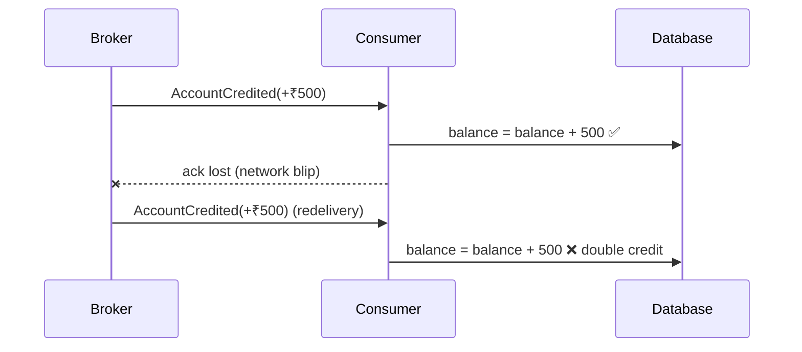

In distributed systems, "exactly once delivery" is a myth; **at-least-once delivery plus idempotent processing** is the reality. Brokers redeliver after timeouts, producers retry after ambiguous failures, users double-click "Pay", and load balancers retry requests on another instance.

An **Idempotent Consumer** is a handler designed so that **processing the same message more than once has the same effect as processing it once**. It's the safety net beneath nearly every other pattern in this series — sagas, outboxes, retries, and DLQ replays all assume it.

## The problem



You can't prevent the redelivery — the broker legitimately can't tell if you processed it. You *can* make the second processing a no-op.

## Techniques

There's no single implementation; pick by the kind of operation.

### 1. Make the operation naturally idempotent

Rewrite "apply a delta" as "set a state" whenever possible.

| Not idempotent | Idempotent |
|---|---|
| `balance = balance + 500` | `INSERT INTO ledger (txn_id, amount) …` with `txn_id` unique; balance = `SUM(amount)` |
| `stock = stock - 1` | `UPDATE reservation SET status='CONFIRMED' WHERE id=?` |
| `INSERT INTO shipment (...)` | `INSERT … ON CONFLICT (order_id) DO NOTHING` |
| `sendEmail()` | `sendEmail()` only if `email_log` has no row for `(order_id, template)` |

**Upserts keyed by a business identifier** are the workhorse:

```sql
INSERT INTO shipment (order_id, address, status)
VALUES ($1, $2, 'SCHEDULED')
ON CONFLICT (order_id) DO NOTHING;
```

### 2. Track processed message IDs

Store the IDs of messages you've handled and skip repeats. To be correct, the ID record and the side effects must commit **atomically** — that's the [Transactional Inbox](/blog/transactional-inbox/).

### 3. Conditional writes and version checks

Only apply a change if the entity is in the expected state or version. This protects against both duplicates and out-of-order delivery.

```python
# DynamoDB: apply OrderShipped only once, and only after OrderPaid
table.update_item(
    Key={"order_id": evt["orderId"]},
    UpdateExpression="SET #s = :shipped, last_event_seq = :seq",
    ConditionExpression="#s = :paid AND last_event_seq < :seq",
    ExpressionAttributeNames={"#s": "status"},
    ExpressionAttributeValues={":shipped": "SHIPPED", ":paid": "PAID", ":seq": evt["seq"]},
)
# ConditionalCheckFailedException => duplicate or stale event: acknowledge and move on
```

### 4. Idempotency keys for external calls

When your handler calls a third party (payment gateway, SMS provider), pass a deterministic **idempotency key** derived from the message, so *their* system dedupes.

```typescript
await stripe.paymentIntents.create(
  { amount: 1500_00, currency: "inr", customer: customerId },
  { idempotencyKey: `order-${orderId}-charge` },   // same key on every retry
);
```

### 5. Fast-path dedupe cache

A Redis `SET NX` with a TTL can drop obvious duplicates cheaply before hitting the database. Treat it as an **optimization**, not the guarantee — a cache can be flushed or the key can expire before a late redelivery.

```python
if not redis.set(f"seen:{msg_id}", 1, nx=True, ex=3600):
    return  # very likely a duplicate
process_with_db_level_guarantee(msg)   # inbox / upsert still enforces correctness
```

## Example: an idempotent ledger consumer

```java
@KafkaListener(topics = "payments.captured", groupId = "ledger")
@Transactional
public void onPaymentCaptured(ConsumerRecord<String, PaymentCaptured> rec) {
  PaymentCaptured e = rec.value();

  // The ledger entry's primary key IS the business idempotency key.
  int inserted = jdbc.update("""
      INSERT INTO ledger_entry (entry_id, account_id, amount, currency, occurred_at)
      VALUES (?, ?, ?, ?, ?)
      ON CONFLICT (entry_id) DO NOTHING""",
      "pay:" + e.paymentId(), e.accountId(), e.amount(), e.currency(), e.occurredAt());

  if (inserted == 0) {
    metrics.counter("ledger.duplicates").increment();
    return;                                        // duplicate — nothing else to do
  }
  // Follow-on effects happen only on first processing, in the same transaction
  jdbc.update("UPDATE account_summary SET balance = balance + ? WHERE account_id = ?",
      e.amount(), e.accountId());
}
```

The balance update *is* a delta — but it's protected because it only runs when the ledger insert succeeded in the same transaction.

## Choosing the idempotency key

The key must identify **the intent**, not the delivery:

- ✅ Producer-assigned event ID (from the outbox), command ID from the client, or a business key like `payment:{paymentId}`.
- ⚠️ Broker offsets or delivery tags — they change if the producer republishes.
- ❌ Timestamps or random IDs generated by the consumer.

For HTTP APIs, accept an `Idempotency-Key` header from clients, store the key with the **response**, and return the stored response for repeats. If the same key arrives with a *different* request body, reject it with `422` — it's a client bug.

## Ordering and idempotency

Idempotency handles duplicates; it doesn't automatically handle **reordering**. If `OrderCancelled` arrives before a redelivered `OrderPlaced`, a naive upsert might resurrect the order. Use:

- **Monotonic sequence numbers** per aggregate (`last_event_seq < :seq`),
- **State-machine guards** (only `PLACED → CANCELLED`, never `CANCELLED → PLACED`),
- **Partitioning by aggregate ID** so events for one entity arrive in order.

## Trade-offs

| Benefits | Costs |
|---|---|
| Makes retries, replays, and redeliveries safe | Extra storage for keys / versions |
| Enables at-least-once infrastructure everywhere | Requires thought per handler — no universal switch |
| Simplifies recovery (just replay) | Key retention windows must cover redelivery windows |
| Protects against client double-submits | External systems must support idempotency keys too |

## Common pitfalls

> **Warning:** "check, then act" in two steps — `if not exists(id): process(); save(id)`. Two concurrent deliveries both pass the check. Enforce uniqueness with a database constraint or a conditional write in the *same* atomic operation as the effect.

- Dedupe keys stored in a cache with a TTL shorter than the broker's redelivery window.
- Idempotent DB writes but **non-idempotent side effects** (emails, webhooks, payments) without their own keys.
- Treating *every* failure as "already processed" — distinguish duplicates from errors.
- Forgetting that DLQ replays and backfills will re-send old messages — idempotency must hold across days, not seconds.

## Tools and real-world usage

- **Database constraints** — unique keys, `ON CONFLICT`, `MERGE` — the most reliable foundation.
- **DynamoDB / Cosmos DB conditional writes**, **etcd/Consul compare-and-swap**.
- **Redis `SET NX EX`** for fast-path dedupe.
- **Payment APIs** (Stripe, Adyen, Razorpay and others) accept idempotency keys; **AWS SQS FIFO** dedupes within a 5-minute window using a deduplication ID.
- **Kafka idempotent producers** prevent duplicates *within Kafka* from producer retries — consumer-side effects still need the techniques above.

## Related patterns

- [Transactional Inbox](/blog/transactional-inbox/) — the table-based implementation.
- [Transactional Outbox](/blog/transactional-outbox/) — produces stable message IDs to dedupe on.
- [Retry with Backoff](/blog/retry-with-backoff/) — safe only with idempotent operations.
- [Dead Letter Queue](/blog/dead-letter-queue/) — replays depend on idempotency.

## Key takeaways

1. Assume every message and request can arrive more than once.
2. Prefer naturally idempotent operations and upserts keyed by business identity.
3. Record processed IDs atomically with effects; use conditional writes for order.
4. Propagate idempotency keys to external systems.
