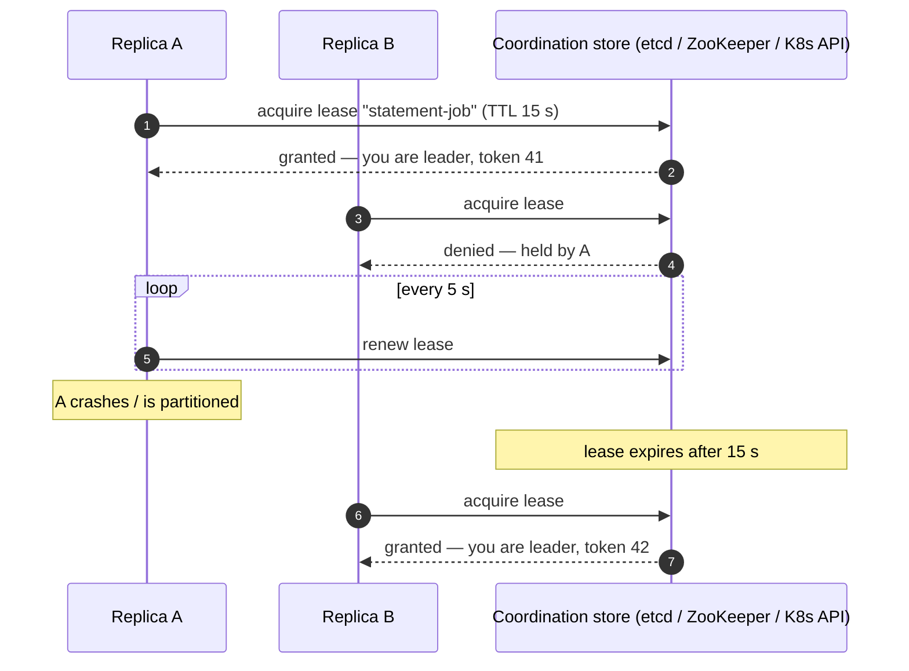
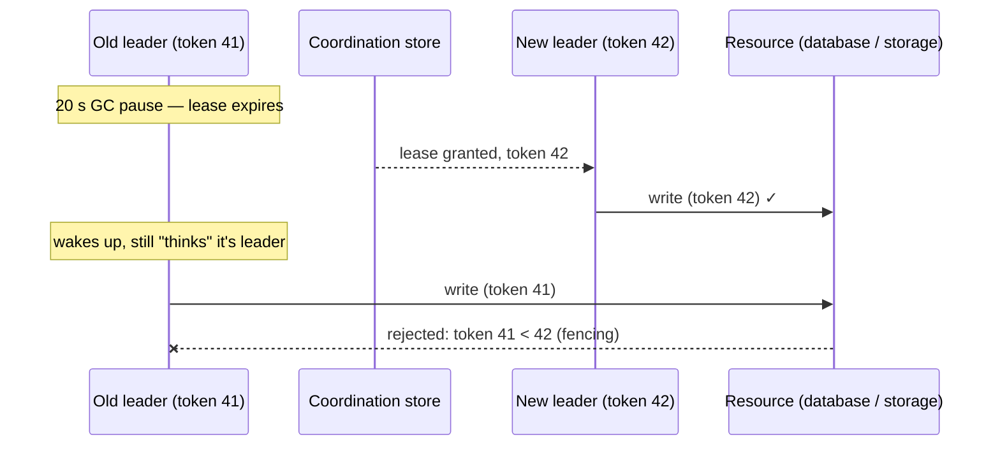

You scale a service to six replicas for availability. Then you add a nightly job that sends statements, or a poller that relays the [outbox](/blog/transactional-outbox/), or a coordinator that assigns work. Now six instances run it — six statements per customer. You need **exactly one** instance to do the job, and if that instance dies, **another must take over quickly**.

**Leader Election** is the pattern for this: replicas compete for leadership through a coordination service, exactly one wins, and the others stand by.

## The problem

- **Singleton work**: schedulers, cron-like jobs, cache warmers, report generators.
- **Coordination roles**: partition assignment, shard rebalancing, the primary in a primary/replica setup.
- **Ordered processing** that can't be parallelized.

Hard-coding "instance 0 is the leader" fails as soon as instance 0 dies. Running the job on every instance and hoping for idempotency wastes resources and fails for non-idempotent work.

## How it works: leases

Most practical leader election uses a **lease** — a time-limited lock held in a strongly consistent store.



Core mechanics:

1. **Acquire** — candidates try to create/claim a key atomically; one succeeds.
2. **Renew** — the leader periodically extends the lease (heartbeat).
3. **Expire** — if the leader stops renewing (crash, partition, long GC pause), the lease expires and another candidate takes over.
4. **Watch** — followers watch the key so they can contend immediately on expiry.

The store must be **strongly consistent** (linearizable) — etcd, ZooKeeper, Consul, or the Kubernetes API (backed by etcd). An eventually consistent store can grant the lease to two candidates.

## Example: Kubernetes Lease with client-go

Kubernetes ships a leader-election library used by its own controllers.

```go
lock := &resourcelock.LeaseLock{
	LeaseMeta: metav1.ObjectMeta{Name: "statement-job", Namespace: "billing"},
	Client:    clientset.CoordinationV1(),
	LockConfig: resourcelock.ResourceLockConfig{
		Identity: os.Getenv("POD_NAME"), // unique per replica
	},
}

leaderelection.RunOrDie(ctx, leaderelection.LeaderElectionConfig{
	Lock:            lock,
	LeaseDuration:   15 * time.Second, // how long a lease is valid without renewal
	RenewDeadline:   10 * time.Second, // leader gives up if it can't renew within this
	RetryPeriod:     2 * time.Second,  // how often candidates retry / leader renews
	ReleaseOnCancel: true,             // hand over quickly on graceful shutdown
	Callbacks: leaderelection.LeaderCallbacks{
		OnStartedLeading: func(ctx context.Context) {
			runStatementScheduler(ctx) // must stop promptly when ctx is cancelled
		},
		OnStoppedLeading: func() {
			log.Println("lost leadership; stopping work")
			os.Exit(0) // simplest safe choice: restart as a follower
		},
		OnNewLeader: func(id string) { log.Printf("current leader: %s", id) },
	},
})
```

Spring users get the same via **Spring Integration** `LockRegistryLeaderInitiator` or **Spring Cloud Kubernetes** leader election; .NET and Python have equivalents.

## ZooKeeper and etcd recipes

- **ZooKeeper** — each candidate creates an **ephemeral sequential** znode under `/election`; the lowest sequence number is leader. Each candidate watches the node just below its own, avoiding a "herd" of watchers when the leader dies. Ephemeral nodes vanish when the session expires. Apache Curator's `LeaderLatch` / `LeaderSelector` implement this.
- **etcd** — the `concurrency.Election` API uses a lease-attached key with revision ordering; `Campaign` blocks until elected, `Resign` steps down.

## The hard part: being sure you're still the leader

Leases expire based on time. A leader can **believe** it's still leader after its lease has expired — because of a long GC pause, a VM freeze, or a network partition. Meanwhile a new leader has been elected. Now **two** instances act as leader: **split brain**.



The defence is a **fencing token**: a number that increases with every new lease (etcd revision, ZooKeeper zxid, or a counter). The leader includes it with every write, and the **resource rejects tokens older than the newest it has seen**.

```sql
-- The protected resource enforces fencing
UPDATE job_state
SET    last_run = now(), fencing_token = :token
WHERE  job = 'statement-job' AND fencing_token < :token;
-- 0 rows updated => a newer leader exists; abort immediately
```

Additional safety habits:

- **Check leadership before each unit of work**, and stop as soon as renewal fails (`RenewDeadline` < `LeaseDuration`).
- **Make leader work idempotent** so a brief overlap is harmless.
- **Keep lease durations realistic** — too short and GC pauses cause flapping; too long and failover is slow. 10–30 s is common.

## Alternatives

| Need | Option |
|---|---|
| Distributed work, not a single worker | [Competing Consumers](/blog/competing-consumers/) or partitioning (Kafka consumer groups) |
| Periodic job with at-most-one run | Scheduler with a DB lock (ShedLock, Quartz clustered) |
| Exactly one *instance* overall | Kubernetes `replicas: 1` with a StatefulSet (but accept restart downtime) |
| Replicated state machine | Embed Raft (etcd's raft library, Hashicorp Raft) |

## Trade-offs

| Benefits | Costs |
|---|---|
| Singleton work with automatic failover | Depends on a strongly consistent coordination service |
| No manual "primary" configuration | Failover delay ≈ lease duration |
| Simple with platform libraries | Split-brain risk without fencing |
| Works for schedulers, coordinators, primaries | Leader becomes a throughput bottleneck |

## Common pitfalls

> **Warning:** using Redis `SET NX` with a TTL on a single node (or with async replication) for safety-critical leadership. A failover can lose the key and elect two leaders. Use a linearizable store, and fencing tokens for anything that writes.

- **Ignoring loss of leadership** — work keeps running after the lease is gone.
- **Long-running non-interruptible tasks** that can't stop when leadership is lost.
- **One leader for everything** — shard leadership by job or partition so one replica isn't doing all the singleton work.
- **Clock assumptions** — lease logic must use the coordination store's view of time, not local clocks, wherever possible.

## Tools and real-world usage

- **Kubernetes Lease** (`coordination.k8s.io`) — used by kube-controller-manager and kube-scheduler; client-go `leaderelection`.
- **Apache ZooKeeper + Curator** — `LeaderLatch`, `LeaderSelector`; historically used by Kafka (before KRaft), HBase, and Hadoop.
- **etcd** — `concurrency.Election`; **Consul** — sessions and KV locks.
- **Raft-based systems** — etcd, Consul, CockroachDB, and Kafka KRaft elect leaders as part of consensus.

## Related patterns

- [Distributed Lock](/blog/distributed-lock/) — leadership is a long-held lock with renewal.
- [Polling Publisher](/blog/polling-publisher/) — often run by a single elected relay.
- [Health Check](/blog/health-check/) — readiness can reflect leader/follower role.
- [Three-Phase Commit](/blog/three-phase-commit/) — why real systems replicate coordinators via consensus.

## Key takeaways

1. Use leases in a strongly consistent store; renew them and watch for expiry.
2. A leader must stop work promptly when it can't renew.
3. Use fencing tokens so a stale leader's writes are rejected.
4. Prefer platform libraries (Kubernetes Lease, Curator, etcd) over hand-rolled election.
