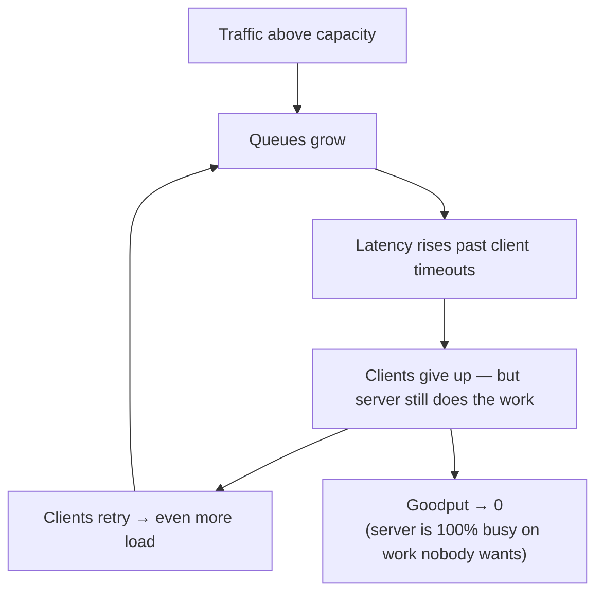

Every server has a point beyond which accepting more work makes **everything** slower — until nothing completes within its deadline and throughput collapses. **Load shedding** is the server's self-defense: when it detects overload, it **rejects some requests immediately** — preferably the least important ones — so it can continue to serve the rest well.

Where [rate limiting](/blog/rate-limiting/) asks *"is this client sending too much?"*, load shedding asks *"am I, the server, about to fall over?"* — regardless of who is sending.

## The problem: congestion collapse



Without shedding, an overloaded server keeps accepting requests, queues them, works on stale ones whose callers have already timed out, and triggers retries. Its **goodput** — useful work completed in time — drops toward zero even though CPU sits at 100%.

The fix is counterintuitive: **say no sooner** to keep saying yes to most.

## How it works

1. **Detect overload** with a leading signal.
2. **Classify** each request by priority.
3. **Reject early and cheaply** — before doing expensive work — starting with the lowest priority.
4. **Recover gradually** as the signal improves.

### Overload signals

| Signal | Why it's useful | Caveat |
|---|---|---|
| **In-flight requests / concurrency** | Directly measures load on the server | Needs a sensible limit (see adaptive limits below) |
| **Queue time** (time a request waited before processing) | Best indicator that you're behind | Must be measured at dequeue |
| **CPU utilization** | Simple, universal | Lags; misleading for I/O-bound services |
| **Event-loop / GC pause latency** | Great for Node.js / JVM saturation | Runtime-specific |
| **Memory pressure** | Prevents OOM kills | Coarse |
| **Downstream health** | Shed work that would hit a struggling dependency | Overlaps with circuit breakers |

### Priority classes

Decide in advance which work matters most. A typical scheme:

| Priority | Examples | Shed |
|---|---|---|
| **Critical** | Checkout, payments, login, health checks | Last |
| **High** | Interactive page loads, search | Under severe overload |
| **Normal** | Recommendations, reviews, personalization | Early |
| **Sheddable** | Prefetch, analytics beacons, batch/background sync, retries | First |

Propagate priority from the edge in a header (e.g., `x-priority: sheddable`) so every service along the path can make consistent decisions.

## Example: a priority-aware shedder (Go middleware)

```go
type Shedder struct {
	inflight   atomic.Int64
	limit      atomic.Int64          // can be adjusted by an adaptive algorithm
	maxQueueMs int64
}

// Fraction of capacity each priority may use before it is shed.
var share = map[string]float64{"critical": 1.0, "high": 0.9, "normal": 0.75, "sheddable": 0.5}

func (s *Shedder) Middleware(next http.Handler) http.Handler {
	return http.HandlerFunc(func(w http.ResponseWriter, r *http.Request) {
		prio := r.Header.Get("X-Priority")
		if _, ok := share[prio]; !ok {
			prio = "normal"
		}

		// 1. Queue-time check: work that already waited too long is likely useless
		if enq := r.Header.Get("X-Enqueued-At-Ms"); enq != "" {
			if t, err := strconv.ParseInt(enq, 10, 64); err == nil &&
				time.Now().UnixMilli()-t > s.maxQueueMs && prio != "critical" {
				reject(w, "queue-time")
				return
			}
		}

		// 2. Concurrency check scaled by priority
		allowed := int64(float64(s.limit.Load()) * share[prio])
		if s.inflight.Add(1) > allowed {
			s.inflight.Add(-1)
			reject(w, "concurrency:"+prio)
			return
		}
		defer s.inflight.Add(-1)

		next.ServeHTTP(w, r)
	})
}

func reject(w http.ResponseWriter, reason string) {
	shedCounter.WithLabelValues(reason).Inc()
	w.Header().Set("Retry-After", "1")
	w.WriteHeader(http.StatusServiceUnavailable) // cheap: no DB, no downstream calls
}
```

The rejection path does **no real work** — that's the point.

## Adaptive concurrency limits

Static limits go stale as code, hardware, and dependencies change. **Adaptive** algorithms, borrowed from TCP congestion control, adjust the limit continuously from observed latency:

- **AIMD** — increase the limit slowly while latency is healthy; cut it sharply when latency spikes or errors appear.
- **Gradient / Vegas-style** — compare current latency to the minimum observed (no-load) latency; shrink the limit as the ratio grows.

Netflix's open-source `concurrency-limits` library and Envoy's **adaptive concurrency filter** implement these ideas.

```yaml
# Envoy: adaptive concurrency + overload manager
http_filters:
  - name: envoy.filters.http.adaptive_concurrency
    typed_config:
      "@type": type.googleapis.com/envoy.extensions.filters.http.adaptive_concurrency.v3.AdaptiveConcurrency
      gradient_controller_config:
        sample_aggregate_percentile: { value: 90 }
        concurrency_limit_params:
          concurrency_update_interval: 0.1s
        min_rtt_calc_params:
          interval: 60s
          request_count: 50
---
overload_manager:
  refresh_interval: 0.25s
  resource_monitors:
    - name: envoy.resource_monitors.fixed_heap
      typed_config:
        "@type": type.googleapis.com/envoy.extensions.resource_monitors.fixed_heap.v3.FixedHeapConfig
        max_heap_size_bytes: 2147483648
  actions:
    - name: envoy.overload_actions.stop_accepting_requests
      triggers:
        - name: envoy.resource_monitors.fixed_heap
          threshold: { value: 0.95 }
```

## Brownouts: shedding features, not requests

Sometimes it's better to serve every request **with less work**:

- Turn off recommendations, personalization, or rich previews via **feature flags**.
- Reduce result counts or image quality.
- Serve cached pages to anonymous users.
- Pause non-urgent background jobs and batch exports.

Pre-define these **degraded modes** and make them one switch (or automatic at thresholds). During incidents, nobody should be writing new code to shed load.

## Where to shed

- **At the edge** (load balancer, gateway, CDN) — cheapest, protects everything behind it.
- **At each service** — every service must protect itself; you can't rely on upstream limits being right.
- **In queues and workers** — drop or defer stale messages (check message age against its usefulness).
- **Client-side** — well-behaved clients back off on 503/429 ([Retry with Backoff](/blog/retry-with-backoff/)) and drop optional requests themselves.

## Trade-offs

| Benefits | Costs |
|---|---|
| Keeps goodput high during overload | Some users get errors by design |
| Protects critical journeys | Requires agreed priority classes |
| Prevents congestion collapse and retry storms | Thresholds need tuning; adaptive limits add complexity |
| Fast recovery once load subsides | Wrong priorities shed the wrong work |

## Common pitfalls

> **Warning:** shedding *after* doing the expensive part. Parsing a 2 MB body, authenticating against a remote IdP, and loading the user profile — then returning 503 — saves almost nothing. Shed as early in the request path as possible.

- **Treating health checks as sheddable** — the orchestrator thinks the pod is dead and kills it, reducing capacity further. Prioritize probes ([Health Check](/blog/health-check/)).
- **Retries marked as normal priority** — they should be among the first to go.
- **Only CPU-based shedding** in I/O-bound services.
- **No shed metrics** — you need to see what was dropped, by priority and reason.

## Tools and real-world usage

- **Envoy** — adaptive concurrency filter, overload manager, local rate limits.
- **Netflix concurrency-limits** (Java), **Polly** concurrency limiter, **gRPC** server max concurrent streams.
- **Kubernetes** — Pod priority and preemption for cluster-level shedding of low-priority workloads.
- Large-scale operators (Google, Amazon, Netflix) have published extensively on criticality-based shedding and its role in preventing cascading failures.

## Related patterns

- [Rate Limiting](/blog/rate-limiting/) — per-client caps vs. server self-protection.
- [Bulkhead](/blog/bulkhead/) — isolates capacity so shedding in one area doesn't affect another.
- [Fallback](/blog/fallback-pattern/) — brownout modes are planned fallbacks.
- [Health Check](/blog/health-check/) — readiness can remove an overloaded instance from rotation.

## Key takeaways

1. Overloaded servers should reject early and cheaply to keep goodput high.
2. Classify requests by priority and shed the least important first.
3. Use leading signals — concurrency, queue time — and consider adaptive limits.
4. Pre-define brownout modes, protect health checks, and measure everything you drop.
