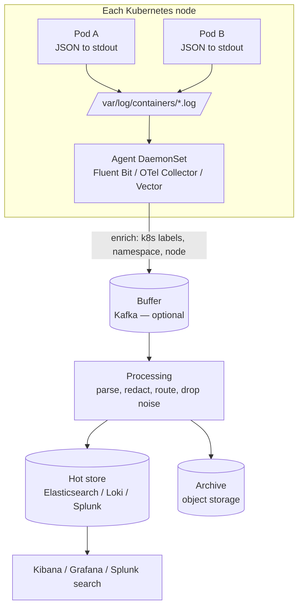

With one server, you `ssh` in and `tail -f` the log. With 300 pods that come and go every hour, that's impossible: logs are spread across nodes, and they **vanish when a container is replaced**. **Log Aggregation** collects logs from every service and instance into a **central, searchable, retained store**, so you can investigate any request, any time, across the whole system.

## The problem

- Container logs are ephemeral — a crashed pod takes its logs with it.
- One request's story spans many services ([Correlation ID](/blog/correlation-id/) only helps if logs are searchable together).
- Unstructured text logs are slow and unreliable to search.
- Compliance and security teams need retained, tamper-resistant logs.

## How it works



1. **Emit** — applications write **structured logs** (JSON) to **stdout/stderr**.
2. **Collect** — a node-level agent tails container log files (or receives OTLP logs), adding metadata: service, namespace, pod, node, version.
3. **Process** — parse, normalize fields, redact sensitive data, drop noise, route by type.
4. **Store** — index in a hot store for fast search; archive to cheap object storage for long retention.
5. **Search, alert, and correlate** — query by fields, pivot to traces via `trace_id`.

## Structured logging

Structured logs are the single biggest improvement you can make.

```json
{
  "ts": "2026-10-17T09:51:12.384Z",
  "level": "WARN",
  "service": "payments",
  "version": "2026.10.17",
  "env": "prod",
  "trace_id": "4bf92f3577b34da6a3ce929d0e0e4736",
  "span_id": "00f067aa0ba902b7",
  "correlation_id": "checkout-7f3a",
  "event": "payment.gateway.retry",
  "message": "Gateway timeout, retrying",
  "attempt": 2,
  "gateway": "primary",
  "duration_ms": 2003,
  "order_id": "ord-55120"
}
```

Guidelines:

- **Consistent field names** across services (adopt OpenTelemetry semantic conventions or ECS — Elastic Common Schema).
- **An `event` name** for each log type (`payment.gateway.retry`) — searchable and countable.
- **IDs as fields** — `trace_id`, `correlation_id`, business IDs (order, account) where policy allows.
- **Levels used deliberately** — `ERROR` means someone should look; `INFO` for business-significant events; `DEBUG` off in production by default.
- **No secrets, tokens, passwords, card numbers, or unnecessary personal data.**

```python
# Python: structlog with JSON output and trace correlation
import structlog
from opentelemetry import trace

def add_trace(_, __, event_dict):
    ctx = trace.get_current_span().get_span_context()
    if ctx.is_valid:
        event_dict["trace_id"] = format(ctx.trace_id, "032x")
        event_dict["span_id"] = format(ctx.span_id, "016x")
    return event_dict

structlog.configure(processors=[
    structlog.contextvars.merge_contextvars,
    structlog.processors.add_log_level,
    structlog.processors.TimeStamper(fmt="iso", utc=True, key="ts"),
    add_trace,
    structlog.processors.JSONRenderer(),
])

log = structlog.get_logger(service="payments")
log.warning("payment.gateway.retry", attempt=2, gateway="primary", duration_ms=2003, order_id="ord-55120")
```

## Collection: Fluent Bit example

```ini
[INPUT]
    Name              tail
    Path              /var/log/containers/*.log
    multiline.parser  docker, cri
    Tag               kube.*
    Mem_Buf_Limit     50MB
    Skip_Long_Lines   On

[FILTER]
    Name              kubernetes
    Match             kube.*
    Merge_Log         On          # parse JSON app logs into fields
    Keep_Log          Off
    Labels            On

[FILTER]
    Name              modify      # redact obvious secrets defensively
    Match             kube.*
    Remove            authorization
    Remove            password

[FILTER]
    Name              grep        # drop noisy health-check access logs
    Match             kube.*
    Exclude           path ^/actuator/health

[OUTPUT]
    Name              loki
    Match             kube.*
    Host              loki-gateway.observability
    Labels            job=fluent-bit, namespace=$kubernetes['namespace_name'], app=$kubernetes['labels']['app']
```

## Choosing a backend

| | Elasticsearch / OpenSearch (ELK) | Grafana Loki | Splunk / commercial SaaS |
|---|---|---|---|
| Indexing | Full-text index on fields | Indexes **labels only**; content scanned at query time | Full indexing, rich analytics |
| Query power | Very high (full-text, aggregations) | Good with LogQL; best when filtered by labels | Very high (SPL), mature security use cases |
| Cost profile | Storage + compute for indexes | Cheap storage (object store), lower index cost | License/ingest-based; can be expensive |
| Best for | Search-heavy investigations, security analytics | High-volume Kubernetes logs, cost efficiency | Enterprise SOC, compliance, mixed estates |

> **In practice:** Loki labels should be **low-cardinality** (namespace, app, level). Putting `order_id` or `user_id` in labels explodes the index; keep those as fields in the log line.

## Retention, cost, and noise

Logs are often the largest observability bill. Control it deliberately:

- **Tiered retention** — e.g., 7–14 days hot, 90 days warm, 1–7 years archived where regulation requires.
- **Drop or sample noise** — health checks, successful debug chatter, repetitive warnings.
- **Log levels per environment** and dynamic level changes for incidents.
- **Prefer metrics for counts** — don't log every request just to count them; that's what [Application Metrics](/blog/application-metrics/) are for.
- **Budget by service** — show teams their log volume and cost.

## Security and compliance

- **Redact at the source** first; filters are a safety net.
- **Access control** — logs often contain personal data; restrict by team and environment.
- **Integrity** — security-relevant logs may need tamper-evident storage (WORM object storage) and separation from application teams. For "who did what" records, see [Audit Logging](/blog/audit-logging/).
- **Data residency** — where logs are stored matters under data-protection laws.

## Trade-offs

| Benefits | Costs |
|---|---|
| Search across every service and instance | Storage and ingestion cost can be large |
| Logs survive container restarts | Pipeline (agents, buffers, backends) to operate |
| Correlate with traces and metrics | PII and secret leakage risk |
| Supports incident response, forensics, compliance | Noise drowns signal without discipline |

## Common pitfalls

> **Pitfall:** logging as the primary monitoring tool. Teams build alerts on regexes over log text — fragile, slow, and expensive. Use metrics for alerting; use logs for investigation.

- **Unstructured, multi-line logs** (stack traces split across events). Configure multiline parsing or log exceptions as single JSON fields.
- **Writing logs to files inside containers** instead of stdout, so agents never see them.
- **No backpressure handling** — a backend outage makes agents drop logs or exhaust node memory. Use buffers and limits.
- **Different field names per team** (`traceId`, `trace_id`, `TraceID`) — cross-service queries break.

## Tools and real-world usage

- **Collectors** — Fluent Bit, Fluentd, Vector, OpenTelemetry Collector, Logstash.
- **Backends** — Elasticsearch/OpenSearch + Kibana/Dashboards, Grafana Loki, Splunk, Datadog, Elastic Cloud, cloud-native options (CloudWatch Logs, Azure Monitor Logs, Google Cloud Logging).
- **Buffers** — Kafka between collectors and backends for high volume and resilience.

## Related patterns

- [Correlation ID](/blog/correlation-id/) — makes aggregated logs joinable.
- [Distributed Tracing](/blog/distributed-tracing/) — pivot from a log line to its trace.
- [Application Metrics](/blog/application-metrics/) — for counting and alerting.
- [Audit Logging](/blog/audit-logging/) — durable, tamper-evident records of user actions.

## Key takeaways

1. Emit structured JSON logs to stdout with consistent fields, including trace and correlation IDs.
2. Collect with node agents, enrich with platform metadata, redact, and route.
3. Choose a backend by query needs and cost profile; keep index labels low-cardinality.
4. Manage retention and noise deliberately — and use metrics, not logs, for alerting.
