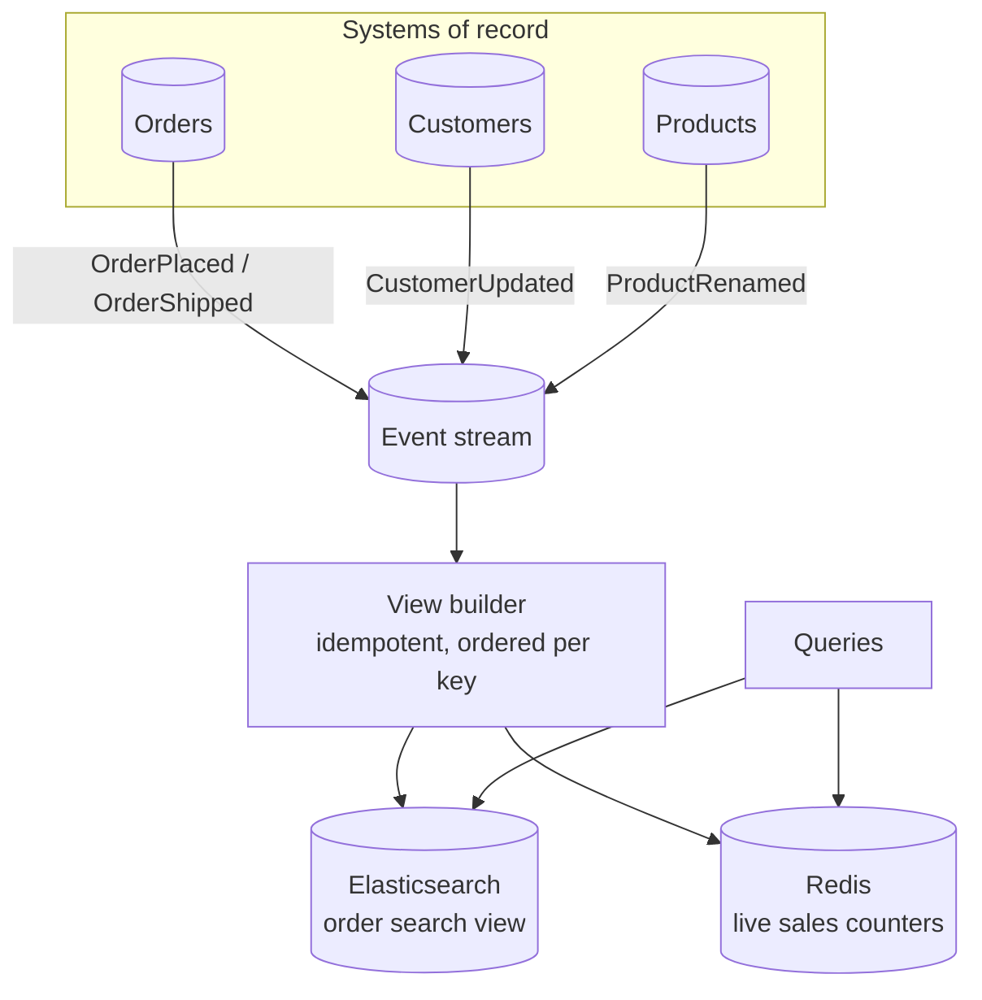
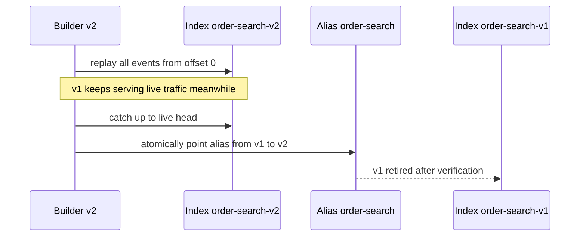

Some queries are expensive every time you run them: dashboards aggregating millions of rows, search across data owned by five services, "top sellers this hour". A **Materialized View** computes the answer **ahead of time** and stores it in a form that's cheap to read — then keeps it up to date as the source data changes.

Inside a single database, that's a `MATERIALIZED VIEW`. Across microservices, it's a **projection** built from events — the read side of [CQRS](/blog/cqrs/).

## The problem

- **[API Composition](/blog/api-composition/)** can't efficiently filter or sort on fields owned by other services.
- Aggregations over large tables are too slow to compute per request.
- Search requires full-text indexing the source database doesn't offer.
- High read volume would overload the services that own the data.

## How it works



A view has three parts:

1. **Sources** — the systems of record, which stay authoritative.
2. **A refresh mechanism** — periodic recomputation, database-managed refresh, or incremental updates from events/CDC.
3. **A read store** shaped for the query — denormalized documents, pre-aggregated counters, search indexes.

The view is **derived data**. It can always be thrown away and rebuilt from the sources.

## Refresh strategies

| Strategy | How | Freshness | Cost | Typical use |
|---|---|---|---|---|
| **Full recompute** | Rebuild on a schedule | Minutes–hours | High per refresh | Reports, nightly aggregates |
| **DB-managed** | `REFRESH MATERIALIZED VIEW` (PostgreSQL), indexed views (SQL Server), fast refresh (Oracle) | Depends on trigger/schedule | Medium | Single-database dashboards |
| **Incremental from events** | Apply each change event to the view | Seconds | Low per event | Cross-service search and views |
| **Stream processing** | Kafka Streams / ksqlDB / Flink maintain state tables | Sub-second | Infrastructure | Live counters, windows |

## Example: PostgreSQL materialized view

Inside one service's database, the built-in feature is often enough.

```sql
CREATE MATERIALIZED VIEW daily_sales AS
SELECT date_trunc('day', placed_at) AS day,
       product_id,
       sum(qty)            AS units,
       sum(qty * price)    AS revenue
FROM   order_line ol JOIN orders o USING (order_id)
WHERE  o.status <> 'CANCELLED'
GROUP  BY 1, 2;

-- A unique index lets PostgreSQL refresh without blocking readers
CREATE UNIQUE INDEX ON daily_sales (day, product_id);

-- Run from a scheduler (pg_cron, Kubernetes CronJob) every 5 minutes
REFRESH MATERIALIZED VIEW CONCURRENTLY daily_sales;
```

## Example: an event-fed search view

Across services, a view builder consumes events and upserts documents. This one maintains an Elasticsearch index for the customer-support "find any order" screen.

```java
@KafkaListener(topics = {"orders.events", "customers.events"}, groupId = "order-search-view")
public void on(ConsumerRecord<String, DomainEvent> rec) throws IOException {
  switch (rec.value()) {
    case OrderPlaced e -> upsert(e.orderId(), Map.of(
        "orderId", e.orderId(), "customerId", e.customerId(),
        "status", "PLACED", "total", e.total(), "placedAt", e.placedAt(),
        "productNames", e.lines().stream().map(Line::nameSnapshot).toList()), e.version());

    case OrderShipped e -> upsert(e.orderId(), Map.of(
        "status", "SHIPPED", "tracking", e.trackingNumber()), e.version());

    case CustomerRenamed e -> // fan-out update: every order document for this customer
        es.updateByQuery(u -> u.index("order-search")
            .query(q -> q.term(t -> t.field("customerId").value(e.customerId())))
            .script(s -> s.source("ctx._source.customerName = params.name")
                          .params("name", JsonData.of(e.newName()))));

    default -> { }
  }
}

private void upsert(String orderId, Map<String, Object> fields, long version) throws IOException {
  es.update(u -> u.index("order-search").id(orderId)
      .doc(fields).docAsUpsert(true)
      // ignore stale or duplicate events: only apply if version is newer
      .script(s -> s.source("""
          if (ctx._source.v == null || ctx._source.v < params.v) {
            for (e in params.f.entrySet()) { ctx._source[e.getKey()] = e.getValue(); }
            ctx._source.v = params.v;
          } else { ctx.op = 'noop'; }""")
          .params("v", JsonData.of(version)).params("f", JsonData.of(fields))),
      Object.class);
}
```

Key properties of a good view builder:

- **Idempotent** — redelivered events are no-ops (version check).
- **Order-tolerant** — partition by entity ID, and reject older versions.
- **Fan-out aware** — a change to one customer may update many order documents.
- **Rebuildable** — can replay from the beginning of the stream (or a fresh CDC snapshot) into a new index, then swap an alias.

## Rebuilding without downtime



Blue/green rebuilds are how you ship schema changes to views, fix projection bugs, and recover from corruption.

## Freshness and correctness

- **Expose staleness.** Store the last processed event time per view and show "updated 12 s ago" where it matters. Alert on lag.
- **Never write back.** Views are read-only. Commands go to the system of record.
- **Reconcile periodically.** For important views, compare counts or checksums against sources and auto-heal.
- **Decide what "deleted" means.** Tombstones/`Deleted` events must remove or flag documents.

## Trade-offs

| Benefits | Costs |
|---|---|
| Very fast, simple queries | Eventual consistency / staleness |
| Cross-service filtering, sorting, and search | Storage duplication |
| Offloads read traffic from source services | View builders to write, run, and monitor |
| Many specialized views from one stream | Rebuild tooling needed for schema changes |

## When to use it

- Cross-service queries with filtering, sorting, search, or pagination.
- Dashboards and aggregates too costly to compute on demand.
- Read volume that would overload the owning services.
- Different consumers needing different shapes of the same data.

Prefer [API Composition](/blog/api-composition/) for simple lookups by ID where freshness matters most.

## Common pitfalls

> **Pitfall:** treating the view as a source of truth. A team starts writing to the Elasticsearch index "just for this field", and now the view can't be rebuilt without losing data. Keep every write in a system of record.

- No version checks → out-of-order events overwrite newer data.
- Fan-out updates (`CustomerRenamed`) forgotten → stale denormalized fields.
- Views built from internal CDC of other teams' tables → break on their schema changes. Prefer published domain events.

## Tools and real-world usage

- **PostgreSQL** (`MATERIALIZED VIEW … REFRESH CONCURRENTLY`), **Oracle** (fast refresh with materialized view logs), **SQL Server** (indexed views).
- **Elasticsearch/OpenSearch** — search views with aliases for zero-downtime rebuilds.
- **Redis** — counters, leaderboards, and cached composite documents.
- **Kafka Streams, ksqlDB, Apache Flink, Materialize, RisingWave** — continuously maintained views over streams.

## Related patterns

- [CQRS](/blog/cqrs/) — materialized views are its read models.
- [Event Sourcing](/blog/event-sourcing/) — makes rebuilding views from history natural.
- [Change Data Capture](/blog/change-data-capture/) — a common feed for views.
- [Eventual Consistency](/blog/eventual-consistency/) — the consistency model to design for.

## Key takeaways

1. Precompute expensive or cross-service queries into read-optimized stores.
2. Feed views incrementally from events or CDC; make builders idempotent and version-aware.
3. Views are disposable — design for blue/green rebuilds.
4. Expose and monitor staleness; never write to a view directly.
