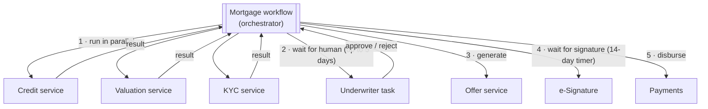

An orchestra has a conductor. Musicians don't watch each other to decide when to play; they follow the conductor, who holds the score. In **Orchestration**, a central **orchestrator** holds the business process definition and **tells each service what to do and when**, reacting to each result to decide the next step.

Where [Choreography](/blog/choreography/) optimizes for decoupling, orchestration optimizes for **visibility, control, and complex flows**: branching, parallel steps, timeouts, retries, human approvals, and compensation — all in one readable place.

## The problem

Consider a mortgage application: credit check, property valuation, and KYC in parallel; underwriter approval (a human, possibly days later); offer generation; e-signature with a 14-day expiry; and disbursement — with compensations if anything fails after funds are reserved.

In pure choreography this logic scatters across many services' event handlers, and answering "where is application 7781 stuck, and why?" requires correlating logs from all of them.

## How it works



The orchestrator:

1. **Persists the state** of each process instance.
2. **Sends commands** (or makes calls) to participants.
3. **Reacts to results**, timeouts, and signals.
4. **Retries** transient failures and **compensates** on business failures ([Saga](/blog/saga-pattern/)).
5. **Exposes status** for monitoring and operations.

Participants stay ignorant of the overall process; they just perform their step.

## Durable execution: Temporal

Modern workflow engines let you write orchestration as **ordinary code** that survives crashes. Temporal records every step's result in an event history; if a worker dies, another replays the history and resumes exactly where it left off.

```typescript
// workflows.ts — deterministic orchestration code
import { proxyActivities, condition, defineSignal, setHandler, sleep } from "@temporalio/workflow";
import type * as acts from "./activities";

const a = proxyActivities<typeof acts>({
  startToCloseTimeout: "30 seconds",
  retry: { initialInterval: "1s", backoffCoefficient: 2, maximumAttempts: 5,
           nonRetryableErrorTypes: ["ApplicationRejected"] },
});

export const underwriterDecision = defineSignal<[{ approved: boolean; by: string }]>("underwriterDecision");
export const documentSigned = defineSignal("documentSigned");

export async function mortgageWorkflow(app: Application): Promise<Outcome> {
  // 1. Parallel checks
  const [credit, valuation, kyc] = await Promise.all([
    a.runCreditCheck(app.applicantId),
    a.requestValuation(app.propertyId),
    a.runKyc(app.applicantId),
  ]);
  if (!kyc.passed || credit.score < 650) return a.reject(app.id, "eligibility");

  // 2. Human-in-the-loop with a deadline
  let decision: { approved: boolean; by: string } | undefined;
  setHandler(underwriterDecision, (d) => { decision = d; });
  await a.createUnderwritingTask(app.id, { credit, valuation });
  if (!(await condition(() => decision !== undefined, "5 days"))) {
    await a.escalate(app.id, "underwriting overdue");
    await condition(() => decision !== undefined);          // keep waiting after escalation
  }
  if (!decision!.approved) return a.reject(app.id, "underwriter");

  // 3–4. Offer, then wait up to 14 days for signature
  const offer = await a.generateOffer(app.id, valuation.amount);
  let signed = false;
  setHandler(documentSigned, () => { signed = true; });
  await a.sendForSignature(offer.id);
  if (!(await condition(() => signed, "14 days"))) {
    await a.expireOffer(offer.id);
    return { status: "EXPIRED" };
  }

  // 5. Disburse (activity is idempotent: keyed by application id)
  await a.disburse(app.id, offer.amount);
  return { status: "COMPLETED" };
}
```

Two rules make this work:

- **Workflow code must be deterministic** — no direct I/O, random numbers, or system time; use activities and the SDK's timers.
- **Activities must be idempotent** — they can be retried after timeouts. Pass business keys as idempotency keys.

## State machines: AWS Step Functions

Step Functions describes the orchestration declaratively in JSON/YAML (Amazon States Language), with built-in retries, catches, parallel branches, and wait states.

```json
{
  "StartAt": "ParallelChecks",
  "States": {
    "ParallelChecks": {
      "Type": "Parallel",
      "Branches": [
        { "StartAt": "Credit", "States": { "Credit": { "Type": "Task", "Resource": "arn:aws:states:::lambda:invoke", "Parameters": { "FunctionName": "credit-check", "Payload.$": "$" }, "End": true } } },
        { "StartAt": "Kyc", "States": { "Kyc": { "Type": "Task", "Resource": "arn:aws:states:::lambda:invoke", "Parameters": { "FunctionName": "kyc-check", "Payload.$": "$" }, "End": true } } }
      ],
      "Retry": [ { "ErrorEquals": ["Lambda.ServiceException", "States.Timeout"], "IntervalSeconds": 2, "BackoffRate": 2, "MaxAttempts": 4 } ],
      "Catch": [ { "ErrorEquals": ["States.ALL"], "Next": "Reject" } ],
      "Next": "WaitForUnderwriter"
    },
    "WaitForUnderwriter": {
      "Type": "Task",
      "Resource": "arn:aws:states:::sqs:sendMessage.waitForTaskToken",
      "Parameters": { "QueueUrl": "https://sqs.ap-south-1.amazonaws.com/123456789012/underwriting", "MessageBody": { "taskToken.$": "$$.Task.Token", "input.$": "$" } },
      "TimeoutSeconds": 432000,
      "Catch": [ { "ErrorEquals": ["States.Timeout"], "Next": "Escalate" } ],
      "Next": "Disburse"
    },
    "Escalate": { "Type": "Task", "Resource": "arn:aws:states:::sns:publish", "Parameters": { "TopicArn": "arn:aws:sns:ap-south-1:123456789012:escalations", "Message.$": "States.JsonToString($)" }, "Next": "Reject" },
    "Disburse": { "Type": "Task", "Resource": "arn:aws:states:::lambda:invoke", "Parameters": { "FunctionName": "disburse", "Payload.$": "$" }, "End": true },
    "Reject": { "Type": "Fail", "Error": "ApplicationRejected" }
  }
}
```

The `.waitForTaskToken` integration pauses the workflow until an external system (the underwriter UI) calls `SendTaskSuccess` with the token — the Step Functions way to wait for humans or callbacks.

## BPMN: Camunda

In regulated industries, **BPMN** diagrams let business analysts, auditors, and developers share one executable model. Camunda (and Flowable) execute BPMN with service tasks, user tasks, timers, message events, and compensation handlers — useful when the process itself must be reviewed and signed off.

## Keeping the orchestrator thin

| Belongs in the orchestrator | Belongs in services |
|---|---|
| Sequence, branching, parallelism | How a credit score is computed |
| Timeouts, deadlines, reminders | Validation rules for a valuation |
| Retries and compensation decisions | Data ownership and persistence |
| Waiting for signals and humans | Domain invariants |
| Process-level status for operations | — |

When the orchestrator starts computing prices or eligibility, it becomes a "god service" coupled to every domain.

## Versioning running workflows

Workflows can run for days or months, so code changes must not break in-flight instances:

- **Temporal** — `patched()` / worker versioning to branch logic for old vs. new executions.
- **Step Functions** — versions and aliases; existing executions continue on the version they started with.
- **Camunda** — process definition versions; instances can be migrated explicitly.

## Trade-offs

| Benefits | Costs |
|---|---|
| The whole flow is explicit and readable | Central component to run and scale (or a managed service) |
| Rich control: branches, timers, humans, compensation | Participants coupled to the orchestrator's commands |
| Built-in retries, history, and status per instance | Risk of a god-orchestrator with business logic |
| Easier testing and auditing of processes | Workflow versioning discipline required |

## When to use it

- Long-running processes (minutes to months) with waits and deadlines.
- Complex branching, parallel steps that must be joined, or human approvals.
- Processes that need audit trails and per-instance visibility.
- Sagas with more than three or four steps.

Use [Choreography](/blog/choreography/) for simple reactions and broadcast notifications.

## Common pitfalls

> **Pitfall:** non-deterministic workflow code in durable-execution engines — calling `Date.now()`, generating UUIDs, or doing HTTP inside the workflow function. Replays then diverge from history and the workflow fails. Put all side effects in activities.

- **Non-idempotent activities** that double-charge or double-send on retry.
- **Huge payloads** in workflow state/history — store documents elsewhere and pass references ([Claim Check](/blog/claim-check/)).
- **Orchestrating everything** — not every interaction needs a workflow engine.

## Tools and real-world usage

- **Temporal** (and its predecessor **Cadence**, from Uber) — durable execution in Go, Java, TypeScript, Python, .NET.
- **AWS Step Functions**, **Azure Durable Functions / Logic Apps**, **Google Workflows** — managed orchestration.
- **Camunda**, **Flowable** — BPMN engines, common in banking and insurance.
- **Netflix Conductor** (now community-maintained as Conductor OSS), **Argo Workflows**, **Apache Airflow** (data pipelines).

## Related patterns

- [Choreography](/blog/choreography/) — the decentralized alternative.
- [Saga](/blog/saga-pattern/) — orchestrated sagas for consistency.
- [Process Manager](/blog/process-manager-pattern/) — the message-driven form of an orchestrator.
- [Async Request-Reply](/blog/async-request-reply/) — how orchestrators talk to services asynchronously.

## Key takeaways

1. An orchestrator owns the process definition and commands each step.
2. Durable execution engines make orchestration code crash-proof — if it's deterministic.
3. Keep the orchestrator about *flow*; keep domain logic in services.
4. Version workflows deliberately and make every activity idempotent.
