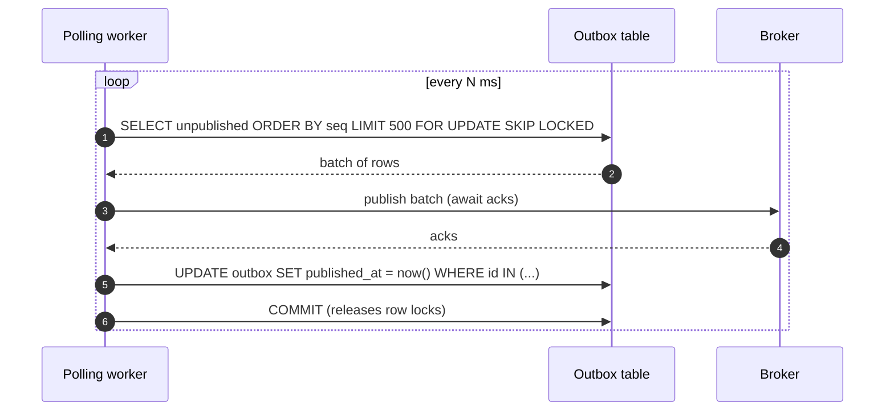

A [Transactional Outbox](/blog/transactional-outbox/) gets your events safely into a database table. Something still has to move them to the broker. The **Polling Publisher** is the simplest way: a background worker that **periodically queries the outbox for unpublished messages, publishes them, and marks them as sent**.

It needs no extra infrastructure — no Kafka Connect, no replication privileges, no log parsing — which is why it's the right *first* relay for most teams.

## The problem

Outbox rows are useless until they reach the broker. The relay must:

- publish **every** committed row (no losses),
- tolerate crashes at any point (resume without gaps),
- keep latency acceptable (sub-second to a few seconds),
- not overload the database,
- optionally preserve per-aggregate ordering,
- and scale when one worker isn't enough.

## How it works



If the worker crashes between publishing and marking, those rows are published **again** next cycle — the relay is **at-least-once** by design, and consumers must be idempotent ([Idempotent Consumer](/blog/idempotent-consumer/)).

## Example: a production-grade poller in Go

```go
package relay

import (
	"context"
	"database/sql"
	"time"

	"github.com/lib/pq"
)

type Row struct {
	ID          string
	AggregateID string
	Topic       string
	EventType   string
	Payload     []byte
}

type Publisher interface {
	// PublishBatch must return only after the broker has acknowledged every message.
	PublishBatch(ctx context.Context, rows []Row) error
}

type Poller struct {
	DB        *sql.DB
	Pub       Publisher
	BatchSize int
	Idle      time.Duration // sleep when the outbox was empty
	MaxIdle   time.Duration // cap for adaptive backoff
}

func (p *Poller) Run(ctx context.Context) error {
	wait := p.Idle
	for {
		n, err := p.tick(ctx)
		switch {
		case err != nil:
			wait = min(wait*2, p.MaxIdle) // back off on errors (DB or broker down)
		case n == p.BatchSize:
			wait = 0 // full batch: there's probably more, go again immediately
		default:
			wait = p.Idle
		}
		select {
		case <-ctx.Done():
			return ctx.Err()
		case <-time.After(wait):
		}
	}
}

func (p *Poller) tick(ctx context.Context) (int, error) {
	tx, err := p.DB.BeginTx(ctx, nil)
	if err != nil {
		return 0, err
	}
	defer tx.Rollback() // no-op after Commit

	// SKIP LOCKED: concurrent pollers take disjoint batches instead of blocking.
	rows, err := tx.QueryContext(ctx, `
		SELECT id, aggregate_id, topic, event_type, payload
		FROM outbox
		WHERE published_at IS NULL
		ORDER BY seq
		LIMIT $1
		FOR UPDATE SKIP LOCKED`, p.BatchSize)
	if err != nil {
		return 0, err
	}
	var batch []Row
	var ids []string
	for rows.Next() {
		var r Row
		if err := rows.Scan(&r.ID, &r.AggregateID, &r.Topic, &r.EventType, &r.Payload); err != nil {
			rows.Close()
			return 0, err
		}
		batch = append(batch, r)
		ids = append(ids, r.ID)
	}
	rows.Close()
	if len(batch) == 0 {
		return 0, nil
	}

	if err := p.Pub.PublishBatch(ctx, batch); err != nil {
		return 0, err // rollback: rows stay unpublished and unlocked
	}
	if _, err := tx.ExecContext(ctx,
		`UPDATE outbox SET published_at = now() WHERE id = ANY($1)`, pq.Array(ids)); err != nil {
		return 0, err // will republish next time — acceptable (at-least-once)
	}
	return len(batch), tx.Commit()
}
```

Key choices in this code:

- **`FOR UPDATE SKIP LOCKED`** lets you run several poller replicas safely; each grabs a different batch.
- **Adaptive sleep** — loop immediately while there's a backlog, sleep when idle, back off on errors.
- **Mark after ack** — never before.

## Ordering

Polling by `created_at` is not strictly commit order: transaction A can get an earlier timestamp but commit after transaction B. If a poller runs in between, it publishes B before A.

Options, from simplest to strictest:

| Approach | Guarantee |
|---|---|
| Order by `created_at` / identity column | Approximately ordered; fine when consumers tolerate reordering |
| Partition by aggregate ID downstream (Kafka key) | Ordered per aggregate *if* one poller handles each aggregate in order |
| Single poller, no `SKIP LOCKED`, order by sequence, plus a small "settle delay" (only read rows older than ~1 s) | Very close to commit order |
| Switch to [CDC](/blog/change-data-capture/) | Exact commit order from the log |

With `SKIP LOCKED` and multiple pollers, two events for the same aggregate can be published out of order. If per-aggregate order matters, either use one poller, or hash aggregates to pollers (`WHERE hashtext(aggregate_id) % 4 = :worker`).

## Keeping the database happy

- **Partial index** on unpublished rows: `CREATE INDEX ON outbox (seq) WHERE published_at IS NULL;` keeps the poll query cheap regardless of table size.
- **Batch updates** — one `UPDATE … WHERE id = ANY(...)` per batch, not one per row.
- **Cleanup** — delete published rows older than a few days, in small batches, or use time-partitioned tables and drop old partitions.
- **Poll interval** — 100–1000 ms is typical. Shorter intervals cost queries; adaptive polling (as above) gets low latency under load without hammering an idle database.
- **Optional wake-ups** — PostgreSQL `LISTEN/NOTIFY` can wake the poller right after commit, with polling as a safety net.

## Polling Publisher vs. CDC

| | Polling Publisher | CDC |
|---|---|---|
| Setup | A scheduled job in your service | Connector platform + DB replication config |
| Latency | Poll interval | Near-real-time |
| Ordering | Approximate (tunable) | Exact commit order |
| DB permissions | Normal read/write | Replication privileges |
| Throughput ceiling | Hundreds to low thousands/sec per DB | Much higher |
| Failure modes | Easy to reason about | Slot/WAL retention, connector state |

> **Rule of thumb:** start with polling. Move to CDC when you need strict ordering, very high throughput, or a platform team is already running Kafka Connect.

## Monitoring

Expose and alert on:

- **Outbox lag** — age of the oldest unpublished row (`now() - min(created_at) WHERE published_at IS NULL`). The single most useful signal.
- **Backlog size** — count of unpublished rows.
- **Publish errors** and retries per minute.
- **Batch duration** — rising durations hint at index or broker problems.

## Trade-offs

| Benefits | Costs |
|---|---|
| No additional infrastructure | Adds periodic query load |
| Easy to understand, test, and debug | Latency bounded by poll interval |
| Works with any database and broker | Ordering requires care |
| Scales horizontally with `SKIP LOCKED` | Duplicates on crash (at-least-once) |

## Common pitfalls

> **Warning:** running the poller inside every web-server replica *without* `SKIP LOCKED` or leader election. Each replica publishes the same rows and you multiply duplicates. Use `SKIP LOCKED`, or run a single relay via [Leader Election](/blog/leader-election/).

- Holding the transaction open across very slow broker calls — keep batches small enough to finish in seconds.
- Marking rows published when the broker call *started*, not when it *succeeded*.
- Forgetting a poison-row strategy: a row that can never be published (e.g., oversized) blocks ordered pollers. Move it to a failed table and alert.

## Tools and real-world usage

- **Spring `@Scheduled`**, **Quartz**, **Hangfire**, **Celery beat**, **Sidekiq** — common hosts for the poll loop.
- **Kubernetes CronJob** — for low-frequency batch publishing (not ideal for sub-second latency).
- **Eventuate Tram** and **NServiceBus/MassTransit outboxes** include polling dispatchers out of the box.

## Related patterns

- [Transactional Outbox](/blog/transactional-outbox/) — what the poller relays.
- [Change Data Capture](/blog/change-data-capture/) — the log-based alternative.
- [Competing Consumers](/blog/competing-consumers/) — `SKIP LOCKED` pollers are competing consumers of a table.
- [Leader Election](/blog/leader-election/) — for single-relay setups.

## Key takeaways

1. A polling publisher reads unpublished outbox rows, publishes, and marks them — at least once.
2. Use `FOR UPDATE SKIP LOCKED`, partial indexes, batching, and adaptive polling.
3. Ordering is approximate unless you constrain parallelism or switch to CDC.
4. Alert on outbox age — it's your earliest sign the relay is stuck.
