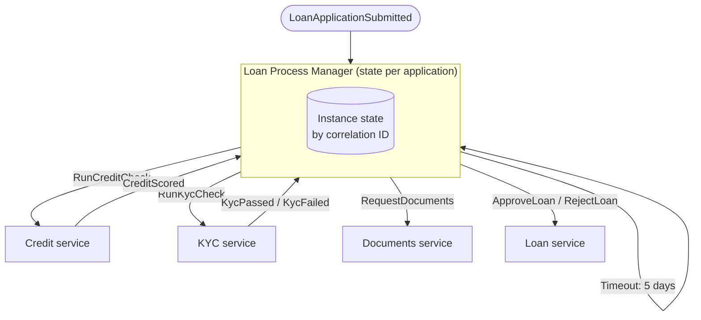

Some business processes don't follow a fixed script. Loan applications branch on credit scores, insurance claims wait days for documents, and orders take different paths for digital and physical goods. The **Process Manager** pattern — from Hohpe and Woolf's *Enterprise Integration Patterns* — puts that logic in one component that **keeps state for each process instance** and **decides the next step every time a message arrives**.

In the .NET and Java messaging worlds the same thing is often called a **saga** (NServiceBus sagas, MassTransit state machines, Axon `@Saga`). Strictly speaking, a [Saga](/blog/saga-pattern/) is the *consistency* idea — local transactions plus compensations — and a process manager is one *implementation* of the coordinator.

## The problem

With pure [choreography](/blog/choreography/), every service reacts to events and the overall flow is implicit. That works for short chains, but as soon as you have:

- **branching** ("if the score is below 600, request a guarantor"),
- **waiting** ("wait up to 5 days for documents, then remind, then cancel"),
- **aggregation** ("continue when both KYC and fraud checks are back"),

the logic ends up scattered across services, and nobody can answer "what state is application 7781 in?"

## How it works

A process manager:

1. **Starts** a new instance when a triggering message arrives (e.g., `LoanApplicationSubmitted`) and persists its state keyed by a **correlation ID**.
2. **Receives** each subsequent message, loads the instance by correlation ID, and applies a **transition**: update state, send commands, schedule timeouts.
3. **Completes** when the process reaches a final state, and archives the instance.



The process manager doesn't do the work itself — it **routes**. Each service still owns its own logic and data.

### Process manager vs. related ideas

| | Process Manager | Orchestrator workflow (Temporal) | Routing Slip | Choreography |
|---|---|---|---|---|
| Flow defined | As a state machine reacting to messages | As code that "awaits" steps | In the message itself | Implicitly, in subscriptions |
| State | Persisted instance record | Persisted event history | Carried in the message | Spread across services |
| Branching / waiting | Excellent | Excellent | Limited | Awkward |
| Central component | Yes | Yes | No | No |

## Example: a MassTransit state machine (C#)

MassTransit expresses a process manager as an explicit state machine persisted to a database.

```csharp
public class LoanState : SagaStateMachineInstance
{
    public Guid CorrelationId { get; set; }          // = application id
    public string CurrentState { get; set; } = default!;
    public int? CreditScore { get; set; }
    public bool KycPassed { get; set; }
    public Guid? DocumentsTimeoutToken { get; set; }
}

public class LoanProcess : MassTransitStateMachine<LoanState>
{
    public State Checking { get; private set; } = default!;
    public State AwaitingDocuments { get; private set; } = default!;
    public State Approved { get; private set; } = default!;
    public State Rejected { get; private set; } = default!;

    public Event<LoanSubmitted> Submitted { get; private set; } = default!;
    public Event<CreditScored> Scored { get; private set; } = default!;
    public Event<KycCompleted> Kyc { get; private set; } = default!;
    public Event<DocumentsReceived> Docs { get; private set; } = default!;
    public Schedule<LoanState, DocumentsOverdue> DocumentsDeadline { get; private set; } = default!;

    public LoanProcess()
    {
        InstanceState(x => x.CurrentState);
        Event(() => Submitted, e => e.CorrelateById(m => m.Message.ApplicationId));
        Event(() => Scored,    e => e.CorrelateById(m => m.Message.ApplicationId));
        Event(() => Kyc,       e => e.CorrelateById(m => m.Message.ApplicationId));
        Event(() => Docs,      e => e.CorrelateById(m => m.Message.ApplicationId));
        Schedule(() => DocumentsDeadline, x => x.DocumentsTimeoutToken,
                 s => s.Delay = TimeSpan.FromDays(5));

        Initially(
            When(Submitted)
                .Publish(ctx => new RunCreditCheck(ctx.Saga.CorrelationId))
                .Publish(ctx => new RunKycCheck(ctx.Saga.CorrelationId))
                .TransitionTo(Checking));

        During(Checking,
            When(Scored).Then(ctx => ctx.Saga.CreditScore = ctx.Message.Score)
                        .ThenAsync(DecideAsync),
            When(Kyc).Then(ctx => ctx.Saga.KycPassed = ctx.Message.Passed)
                     .ThenAsync(DecideAsync));

        During(AwaitingDocuments,
            When(Docs).Unschedule(DocumentsDeadline)
                      .Publish(ctx => new ApproveLoan(ctx.Saga.CorrelationId))
                      .TransitionTo(Approved),
            When(DocumentsDeadline.Received)
                      .Publish(ctx => new RejectLoan(ctx.Saga.CorrelationId, "Documents overdue"))
                      .TransitionTo(Rejected));

        SetCompletedWhenFinalized();
    }

    // Aggregator: only decide once both results are in
    private async Task DecideAsync(BehaviorContext<LoanState> ctx)
    {
        var s = ctx.Saga;
        if (s.CreditScore is null || ctx.Saga.CurrentState != nameof(Checking)) return;
        if (!s.KycPassed) { await ctx.Publish(new RejectLoan(s.CorrelationId, "KYC")); await ctx.TransitionToState(Rejected); return; }
        if (s.CreditScore >= 650) { await ctx.Publish(new ApproveLoan(s.CorrelationId)); await ctx.TransitionToState(Approved); return; }
        await ctx.Publish(new RequestDocuments(s.CorrelationId));
        await ctx.SchedulePayload(DocumentsDeadline, new DocumentsOverdue(s.CorrelationId));
        await ctx.TransitionToState(AwaitingDocuments);
    }
}
```

*(Simplified for readability — production code would also handle a `KycCompleted` arriving before `CreditScored` with `Passed = false`, and use a proper "both received" flag.)*

## Design considerations

**Persist state transactionally with outgoing messages.** If the process manager updates its state and then crashes before publishing the next command, the process stalls. Use an [outbox](/blog/transactional-outbox/) — NServiceBus and MassTransit both ship one — so state changes and outgoing messages commit together.

**Handle concurrency per instance.** Two replies for the same application can arrive simultaneously on different consumers. Use optimistic concurrency (a version column) or pessimistic row locks on the instance, and retry on conflict.

**Make transitions idempotent.** Messages are delivered at least once. A duplicate `CreditScored` must not trigger a second decision. Combine state checks with an [inbox](/blog/transactional-inbox/).

**Model time explicitly.** Timeouts are messages too. Schedule them durably (broker delayed delivery, Quartz, Hangfire, or the workflow engine) and cancel them when no longer needed.

**Keep business logic out.** The process manager decides *what happens next*; scoring, KYC, and pricing logic stay in their services. If the manager is computing interest rates, it's become a god object.

## Trade-offs

| Benefits | Costs |
|---|---|
| One place to read and change the flow | Central component to operate and scale |
| Explicit, queryable state per instance | Risk of becoming a "god service" with business logic |
| Natural support for branching, waiting, aggregation | Requires durable state storage and concurrency control |
| Easy to add monitoring ("stuck in AwaitingDocuments > 7 days") | Versioning running instances when the flow changes |

## When to use it

- Long-running processes measured in minutes to weeks.
- Flows with branches, parallel steps that must be joined, or deadlines.
- Processes where operations teams need to see and intervene on individual instances.

Prefer [Choreography](/blog/choreography/) for simple, linear reactions, and a [Routing Slip](/blog/routing-slip/) when the steps are known up front and don't branch.

## Common pitfalls

> **Warning:** changing the state machine while instances are in flight. A deployment that renames a state or adds a required field can strand thousands of running processes. Version your state machines, migrate instances deliberately, or let old instances finish on the old definition.

- **Unbounded instance tables** — archive completed instances.
- **Missing correlation** — every message must carry the instance's [Correlation ID](/blog/correlation-id/).
- **Lost timeouts** — in-memory timers die with the process; schedule durably.

## Tools and real-world usage

- **NServiceBus Sagas** and **MassTransit state machines** (.NET) — persisted to SQL Server, PostgreSQL, MongoDB, or Azure storage.
- **Axon Framework** (Java) — `@Saga` with `@SagaEventHandler` and deadline managers.
- **Spring State Machine** — embeddable state machines with persistence.
- **Temporal / Camunda** — workflow engines that subsume the process manager role.

Loan origination, insurance claims, customer onboarding/KYC, and order fulfillment with partial shipments are classic fits — exactly the multi-week, document-heavy flows common in banking.

## Related patterns

- [Saga](/blog/saga-pattern/) — the consistency model a process manager often implements.
- [Orchestration](/blog/orchestration/) — the broader architectural style.
- [Routing Slip](/blog/routing-slip/) — the stateless alternative for fixed flows.
- [Correlation ID](/blog/correlation-id/) — how messages find their instance.

## Key takeaways

1. A process manager holds per-instance state and decides the next step from each message.
2. It routes; services still do the work.
3. Persist state and outgoing messages atomically, and make transitions idempotent.
4. Model timeouts explicitly and version your state machines.
