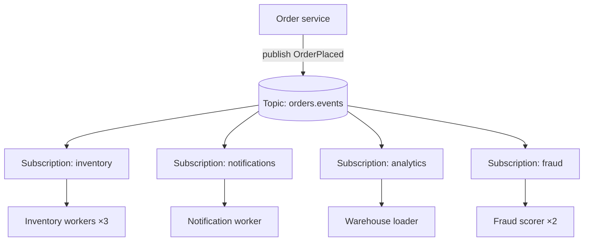

In **Publish-Subscribe**, a producer sends a message to a **topic** rather than to a specific receiver. **Every subscriber** to that topic gets its own copy. The producer doesn't know — or care — how many subscribers exist, who they are, or what they do.

It's the mechanism behind event-driven architecture: [domain events](/blog/domain-events/), [choreography](/blog/choreography/), cache invalidation, audit feeds, real-time notifications, and analytics pipelines.

## The problem

Point-to-point integration grows quadratically. When an order is placed, five systems need to know: inventory, notifications, analytics, fraud, and loyalty. If the Order service calls each one:

- it must know all five, and change whenever a sixth appears,
- a slow or failing receiver slows or fails order placement,
- every receiver gets data on the producer's schedule, not its own.

## How it works



Two distribution modes usually combine:

- **Across subscriptions → broadcast.** Each subscription (Kafka consumer group, SNS-subscribed SQS queue, Pub/Sub subscription) receives **every** message.
- **Within a subscription → competing consumers.** Multiple instances of the *same* subscriber share that subscription's messages ([Competing Consumers](/blog/competing-consumers/)).

## Broker models

| | Kafka / Pulsar / Kinesis (log) | SNS, Google Pub/Sub, RabbitMQ (push / queue) |
|---|---|---|
| Storage | Retained log; consumers track offsets | Message deleted per subscription after ack |
| New subscriber | Can **replay** from the beginning of retention | Receives only messages published after it subscribes |
| Ordering | Per partition | Varies (FIFO topics, ordering keys) |
| Filtering | Consumer-side (or separate topics) | Broker-side filter policies/attributes |
| Typical use | High-volume event streams, event sourcing feeds | Fan-out notifications, integration |

## Example: Kafka consumer groups

```java
// Each service uses its OWN group id → each gets every event
Properties props = new Properties();
props.put(ConsumerConfig.BOOTSTRAP_SERVERS_CONFIG, "kafka:9092");
props.put(ConsumerConfig.GROUP_ID_CONFIG, "loyalty-service");          // subscription identity
props.put(ConsumerConfig.AUTO_OFFSET_RESET_CONFIG, "earliest");         // new group starts from the beginning
props.put(ConsumerConfig.ENABLE_AUTO_COMMIT_CONFIG, false);

try (KafkaConsumer<String, OrderEvent> consumer = new KafkaConsumer<>(props)) {
  consumer.subscribe(List.of("orders.events"));
  while (running) {
    for (ConsumerRecord<String, OrderEvent> rec : consumer.poll(Duration.ofMillis(500))) {
      if (rec.value() instanceof OrderShipped shipped) {
        loyalty.awardPoints(shipped.customerId(), shipped.total(), rec.key());   // idempotent
      }
    }
    consumer.commitSync();
  }
}
```

Running three instances with `group.id=loyalty-service` splits partitions among them; a separate `group.id=fraud-service` receives the same events independently.

## Example: SNS → SQS fan-out with filtering

The classic AWS pattern: publish once to SNS; each subscriber has its own SQS queue (durable buffer, independent retries, own DLQ).

```yaml
# CloudFormation (excerpt)
OrdersTopic:
  Type: AWS::SNS::Topic
  Properties: { TopicName: orders-events }

FraudQueue:
  Type: AWS::SQS::Queue
  Properties:
    RedrivePolicy: { deadLetterTargetArn: !GetAtt FraudDLQ.Arn, maxReceiveCount: 5 }

FraudSubscription:
  Type: AWS::SNS::Subscription
  Properties:
    TopicArn: !Ref OrdersTopic
    Protocol: sqs
    Endpoint: !GetAtt FraudQueue.Arn
    RawMessageDelivery: true
    FilterPolicyScope: MessageAttributes
    FilterPolicy:                    # fraud only cares about large orders
      eventType: ["OrderPlaced"]
      totalAmount: [{ "numeric": [">=", 50000] }]
```

Broker-side filters cut wasted traffic and consumer work. With Kafka, the equivalent is choosing topic granularity well or filtering in the consumer.

## Designing topics

- **Granularity** — a topic per aggregate type or bounded context (`orders.events`) keeps related events ordered together. A topic per event type is easier to filter but loses cross-event ordering for the same entity.
- **Keys** — key messages by aggregate ID for per-entity ordering.
- **Retention** — long enough for consumers to recover from outages; consider compacted topics for "latest state per key".
- **Schemas** — register them and enforce compatibility; every subscriber is a contract consumer.
- **Naming** — `<domain>.<entity>.<events|commands>.<version>` makes ownership obvious.

## Delivery semantics

Most pub/sub systems are **at-least-once**. Subscribers must be [idempotent](/blog/idempotent-consumer/), handle out-of-order messages across partitions, and have a [Dead Letter Queue](/blog/dead-letter-queue/) for poison messages. Publishers should use a [Transactional Outbox](/blog/transactional-outbox/) so events are never lost or invented.

## Governance

Pub/sub makes it easy to add subscribers — which means it's easy to lose track of who depends on what.

- **Catalog** topics, owners, schemas, and subscribers (AsyncAPI, schema registry, EventCatalog).
- **Access control** — who may publish, who may subscribe (Kafka ACLs, IAM policies). Events often contain personal data.
- **Deprecation process** — announce, dual-publish, monitor consumers, then retire.

## Trade-offs

| Benefits | Costs |
|---|---|
| Producers decoupled from consumers | Hard to know all consumers of an event |
| Add subscribers without touching producers | At-least-once delivery → idempotency required |
| Subscribers fail and scale independently | Ordering only within partitions/keys |
| Natural fan-out and replay (log brokers) | Schema evolution affects unknown consumers |

## Common pitfalls

> **Pitfall:** sharing a consumer group (or subscription) between two different services. They'll *split* the messages instead of each getting all of them — each service silently sees about half the events. One subscription per consuming service.

- **Using pub/sub for request/response** — use [Async Request-Reply](/blog/async-request-reply/) with explicit reply channels.
- **Fat events with sensitive data** broadcast to every subscriber.
- **Unbounded retention** with personal data, violating data-protection policies.
- **Slow subscribers on push-based brokers** without buffering queues, causing message loss or backpressure on the topic.

## Tools and real-world usage

- **Apache Kafka**, **Apache Pulsar**, **Amazon Kinesis**, **Azure Event Hubs** — log-based pub/sub.
- **Amazon SNS** (+SQS), **AWS EventBridge**, **Google Cloud Pub/Sub**, **Azure Service Bus topics**, **RabbitMQ** fanout/topic exchanges, **NATS / JetStream**, **Redis Streams**.

## Related patterns

- [Competing Consumers](/blog/competing-consumers/) — scaling within a subscription.
- [Domain Events](/blog/domain-events/) — what is usually published.
- [Choreography](/blog/choreography/) — coordination built on pub/sub.
- [Guaranteed Delivery](/blog/guaranteed-delivery/) — durability across the chain.

## Key takeaways

1. Publish to topics; every subscription gets every message.
2. Within a subscription, instances compete; across subscriptions, messages are broadcast.
3. Key by aggregate ID, use an outbox, and make subscribers idempotent.
4. Govern topics: owners, schemas, ACLs, and deprecation.
