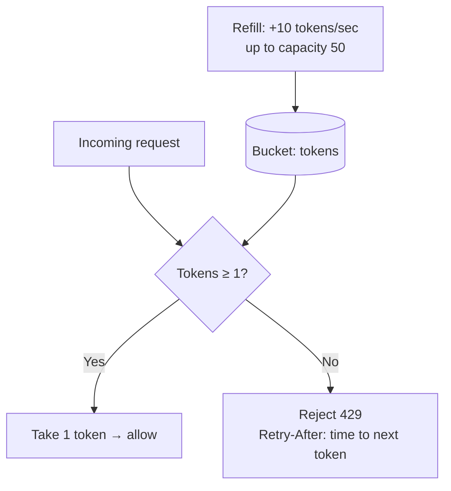
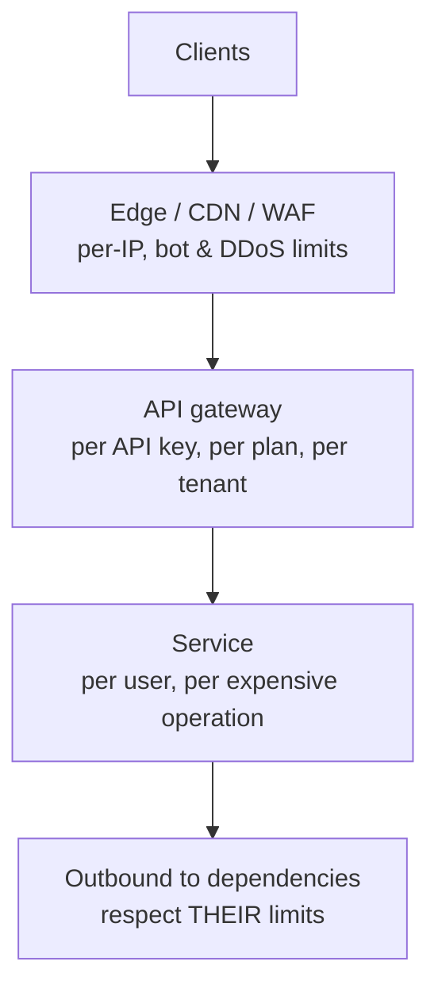

Every service has a finite capacity, and not every client is well-behaved. A buggy integration retries in a tight loop; a scraper hammers your search API; one large tenant's batch job starves everyone else. **Rate limiting** caps how many requests a client (or key, or tenant, or IP) can make in a period; **throttling** is the act of slowing or rejecting requests that exceed the cap.

Rate limits protect **availability** (no single client can overwhelm you), **fairness** (tenants get their share), **cost** (expensive operations and third-party APIs), and **security** (brute-force and credential-stuffing attempts).

## The problem

Without limits, your capacity is allocated to whoever sends the most traffic — which is rarely who you'd choose. Autoscaling helps with legitimate growth but not with abuse, and it can't scale dependencies like databases or third-party APIs that have their own hard limits.

## Algorithms

### Token bucket

A bucket holds up to `capacity` tokens and refills at `rate` tokens per second. Each request takes one token; if the bucket is empty, the request is rejected (or delayed). It allows **bursts** up to the bucket size while enforcing the long-run average.



### Others

| Algorithm | How it works | Bursts | Accuracy | Notes |
|---|---|---|---|---|
| **Token bucket** | Tokens refill at a rate; requests consume | Allowed up to capacity | Good | Most common for APIs |
| **Leaky bucket** | Requests queue and drain at a fixed rate | Smoothed out | Good | Shapes traffic; adds latency (NGINX's model) |
| **Fixed window** | Count per calendar window (per minute) | Up to 2× at window edges | Coarse | Simple, cheap |
| **Sliding window log** | Store each request timestamp | Precise | Exact | Memory-heavy at scale |
| **Sliding window counter** | Weighted blend of current and previous window counts | Smooth | Approximate, good | Cheap, popular in Redis-based limiters |
| **Concurrency limit** | Max in-flight requests | N/A | Exact | Protects against slow requests — see [Bulkhead](/blog/bulkhead/) |

## Where to enforce limits



- **Edge** — coarse, per-IP limits and bot protection, before traffic costs you anything.
- **API gateway** — business-aware limits per API key, subscription plan, or tenant.
- **Service** — fine-grained limits that need domain knowledge (e.g., 5 OTP requests per phone number per hour; 3 password attempts per account per minute).
- **Outbound** — client-side throttling so *you* don't exceed partners' quotas.

## Example: NGINX

```nginx
# 10 requests/second per client IP, shared across workers via a 10 MB zone
limit_req_zone $binary_remote_addr zone=per_ip:10m rate=10r/s;

# Per API key (from a header), 100 r/s
limit_req_zone $http_x_api_key zone=per_key:20m rate=100r/s;

server {
  location /api/ {
    limit_req zone=per_ip burst=20 nodelay;   # allow short bursts of 20 without queuing delay
    limit_req zone=per_key burst=200;
    limit_req_status 429;
    proxy_pass http://api_upstream;
  }

  location = /api/login {
    limit_req zone=per_ip burst=5;            # tighter limit on credential endpoints
    proxy_pass http://auth_upstream;
  }
}
```

## Example: distributed token bucket in Redis

With many service replicas, limits must be shared. A Lua script makes the check-and-consume atomic:

```lua
-- KEYS[1] = bucket key, e.g. "rl:tenant:acme"
-- ARGV: capacity, refill_per_sec, now_ms, cost
local capacity = tonumber(ARGV[1])
local rate     = tonumber(ARGV[2])
local now      = tonumber(ARGV[3])
local cost     = tonumber(ARGV[4])

local state  = redis.call('HMGET', KEYS[1], 'tokens', 'ts')
local tokens = tonumber(state[1]) or capacity
local ts     = tonumber(state[2]) or now

-- refill based on elapsed time
tokens = math.min(capacity, tokens + (now - ts) / 1000 * rate)

local allowed = tokens >= cost
if allowed then tokens = tokens - cost end

redis.call('HSET', KEYS[1], 'tokens', tokens, 'ts', now)
redis.call('PEXPIRE', KEYS[1], math.ceil(capacity / rate * 1000) * 2)

-- return allowed flag, remaining tokens, ms until one token is available
local wait = allowed and 0 or math.ceil((cost - tokens) / rate * 1000)
return { allowed and 1 or 0, math.floor(tokens), wait }
```

```typescript
const [allowed, remaining, waitMs] = await redis.evalsha(sha, 1, `rl:tenant:${tenantId}`,
  /* capacity */ 200, /* refill/sec */ 50, Date.now(), /* cost */ weightOf(req));

res.setHeader("RateLimit-Policy", '200;w=4');                 // ~50/s with burst 200
res.setHeader("RateLimit", `limit=200, remaining=${remaining}, reset=${Math.ceil(waitMs / 1000)}`);
if (!allowed) {
  res.setHeader("Retry-After", Math.ceil(waitMs / 1000));
  return res.status(429).json({ error: "rate_limited", retryAfterMs: waitMs });
}
```

Use the server's clock consistently (or Redis `TIME`) and give expensive operations a higher **cost** than cheap ones.

## Communicating limits

- Respond with **`429 Too Many Requests`** and a **`Retry-After`** header.
- Advertise limits with **rate-limit headers** (the IETF `RateLimit` / `RateLimit-Policy` fields, or the widely used `X-RateLimit-Limit/Remaining/Reset`).
- Document limits per plan, and give clients a way to check their usage.
- Make your SDKs **honor `Retry-After`** with [backoff and jitter](/blog/retry-with-backoff/).

## Throttling strategies beyond rejecting

| Strategy | Behavior |
|---|---|
| **Reject** (429) | Fast, clear, client retries later |
| **Delay / queue** (leaky bucket) | Smooths bursts at the cost of latency |
| **Degrade** | Serve cheaper responses (cached, fewer results) to heavy users |
| **Prioritize** | Paid tiers or interactive traffic get capacity first — see [Load Shedding](/blog/load-shedding/) |

## Trade-offs

| Benefits | Costs |
|---|---|
| Protects capacity and dependencies from overload | Legitimate bursts can be rejected |
| Enforces fairness between tenants | Distributed limiters add latency and a dependency (Redis) |
| Mitigates abuse, scraping, brute force | Limits per plan/tenant need product decisions |
| Controls cost of expensive operations | Clients must handle 429s correctly |

## Common pitfalls

> **Pitfall:** limiting only by IP. Mobile carriers and corporate networks put thousands of users behind one IP (CGNAT), while attackers rotate through thousands of IPs. Limit by **authenticated identity** (API key, user, tenant) wherever possible, and use IP limits only as a coarse outer layer.

- **Per-instance limits** that multiply with replica count (10 replicas × 100 r/s = 1,000 r/s "limit").
- **Fixed windows** that allow double bursts at boundaries.
- **Failing closed when the limiter store is down** — decide explicitly whether to fail open (allow) or closed (reject) for each limit.
- **No limits on internal callers** — your own batch job is often the noisiest neighbor.

## Tools and real-world usage

- **NGINX** (`limit_req`, `limit_conn`), **Envoy** (local and global rate limit service), **HAProxy** stick tables.
- **API gateways** — Kong (rate-limiting plugins with Redis), AWS API Gateway (usage plans and throttling), Apigee (quotas and spike arrest), Azure API Management.
- **Edge platforms** — Cloudflare, AWS WAF, Akamai rate-based rules.
- **Libraries** — Bucket4j, Resilience4j RateLimiter, `golang.org/x/time/rate`, `rate-limiter-flexible` (Node.js).

## Related patterns

- [API Gateway](/blog/api-gateway/) — the natural enforcement point for per-client limits.
- [Load Shedding](/blog/load-shedding/) — protects the server regardless of who's sending.
- [Retry with Backoff](/blog/retry-with-backoff/) — how good clients respond to 429.
- [Bulkhead](/blog/bulkhead/) — concurrency limits per dependency.

## Key takeaways

1. Rate limits protect availability, fairness, cost, and security.
2. Token bucket is the usual choice; sliding windows avoid edge bursts.
3. Layer limits: edge (IP), gateway (key/tenant), service (operation), outbound (partners).
4. Share state for distributed limits, return 429 with `Retry-After`, and limit by identity, not just IP.
