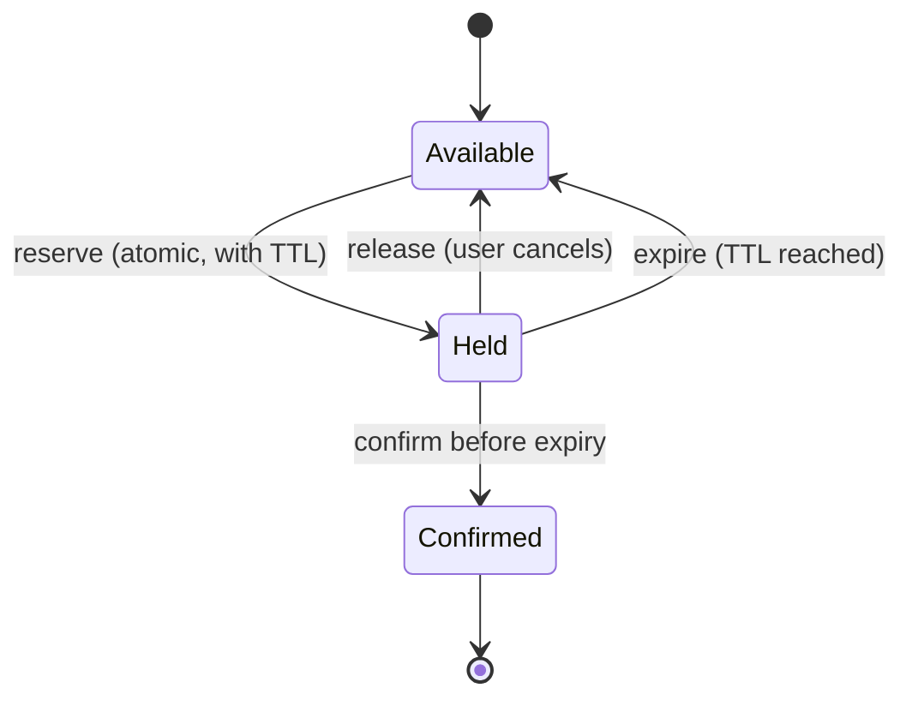

When two people click "Book" on the last seat at the same moment, only one can win. And when a customer adds the last concert ticket to their cart, you want to hold it for them while they enter payment details — but not forever. The **Reservation pattern** handles both: it **temporarily claims** a resource on someone's behalf, with an **expiry**, until the claim is either **confirmed** or **released**.

Reservations are the "Try" in [Try-Confirm/Cancel](/blog/try-confirm-cancel/), the hold in a seat map, and the authorization on your credit card before a hotel captures the payment.

## The problem

In a multi-step process (choose → pay → confirm) the resource you're selling can be taken by someone else between steps. You have three unappealing options without reservations:

1. **Check at the end** — users fill in payment details and *then* learn the seat is gone.
2. **Lock in the database** for the whole flow — locks held across user think-time destroy throughput.
3. **Oversell and apologize** — airlines do this deliberately; most businesses can't.

A reservation is a fourth option: a **committed, visible, time-limited claim**.

## How it works

A reservation has a small lifecycle:



Three properties make it safe:

1. **The claim is atomic.** Two concurrent reserve requests for the last unit can't both succeed — use a conditional update, a unique constraint, or a compare-and-set.
2. **The claim expires.** If the holder disappears, the resource returns to the pool automatically. Expiry is what keeps abandoned carts from starving real customers.
3. **Confirm checks the claim.** Confirmation must verify the reservation still exists *and belongs to this holder* — otherwise an expired-and-reclaimed seat could be confirmed twice.

## Example: seat holds in PostgreSQL

```sql
CREATE TABLE seat (
  show_id     BIGINT      NOT NULL,
  seat_no     VARCHAR(6)  NOT NULL,
  status      VARCHAR(10) NOT NULL DEFAULT 'AVAILABLE',  -- AVAILABLE | HELD | SOLD
  hold_token  UUID,
  held_until  TIMESTAMPTZ,
  PRIMARY KEY (show_id, seat_no)
);

-- Reserve: atomic claim; an expired hold counts as available
UPDATE seat
SET    status = 'HELD', hold_token = $1, held_until = now() + interval '10 minutes'
WHERE  show_id = $2 AND seat_no = $3
  AND (status = 'AVAILABLE' OR (status = 'HELD' AND held_until < now()))
RETURNING seat_no;            -- 0 rows => someone else has it

-- Confirm: only the current, unexpired holder may confirm
UPDATE seat
SET    status = 'SOLD', held_until = NULL
WHERE  show_id = $1 AND seat_no = $2
  AND status = 'HELD' AND hold_token = $3 AND held_until >= now()
RETURNING seat_no;            -- 0 rows => hold expired or stolen; restart

-- Release (explicit cancel) — idempotent
UPDATE seat SET status = 'AVAILABLE', hold_token = NULL, held_until = NULL
WHERE  show_id = $1 AND seat_no = $2 AND status = 'HELD' AND hold_token = $3;

-- Reaper (optional): tidy expired holds so reports and seat maps are accurate
UPDATE seat SET status = 'AVAILABLE', hold_token = NULL, held_until = NULL
WHERE  status = 'HELD' AND held_until < now() - interval '1 minute';
```

Note that **correctness doesn't depend on the reaper**: the reserve query treats expired holds as available. The reaper only keeps the data tidy. That's an important design principle — *lazy expiry is safe; eager expiry is cosmetic.*

## Example: counted inventory in Redis

For high-traffic flash sales, a Redis Lua script can decrement stock and record the hold atomically:

```lua
-- KEYS[1] = stock:sku-9   KEYS[2] = hold:sku-9:<token>
-- ARGV[1] = qty           ARGV[2] = ttl seconds
local stock = tonumber(redis.call('GET', KEYS[1]) or '0')
local qty = tonumber(ARGV[1])
if stock < qty then
  return 0                                    -- not enough stock
end
redis.call('DECRBY', KEYS[1], qty)
redis.call('SET', KEYS[2], qty, 'EX', ARGV[2]) -- the hold itself expires
redis.call('ZADD', 'holds:expiry', redis.call('TIME')[1] + ARGV[2], KEYS[2])
return 1
```

A TTL on the hold key alone isn't enough here, because the stock was decremented separately. A small worker scans `holds:expiry` for entries whose time has passed and whose hold key no longer exists (or has been confirmed), and returns that quantity to `stock:sku-9`. Keep the durable record of truth in your database; Redis is the fast gate.

## Choosing the hold duration

| Context | Typical hold | Considerations |
|---|---|---|
| Cinema / event seats | 5–15 minutes | Show a visible countdown; extend once on activity. |
| E-commerce cart | Often none, or held only at checkout | Holding at add-to-cart lets bots hoard stock. |
| Hotel room | Minutes online; days for group blocks | Group holds need explicit release dates. |
| Card authorization | Days (network rules) | Capture or void before the authorization expires. |
| Cloud capacity / quota | Seconds to minutes | Release quickly to avoid starving other tenants. |

Shorter holds increase throughput and fairness; longer holds reduce checkout failures. Measure **hold-to-confirm conversion** and **expired-hold rate** to tune it.

## Design considerations

- **Per-user and global limits.** Cap how many holds a user/session can have, to stop hoarding and bots.
- **Visible countdowns.** Users accept holds that expire if they can see the timer.
- **Idempotent reserve.** If the client retries a reserve with the same token, return the existing hold instead of failing.
- **Payment and expiry races.** If payment succeeds one second after the hold expired, you need a policy: honor it if the seat is still free, otherwise refund automatically (a [compensating transaction](/blog/compensating-transaction/)).
- **Clock source.** Use the database's clock (`now()`) for both creating and checking holds, not the application servers' clocks.

## Trade-offs

| Benefits | Costs |
|---|---|
| Prevents overselling without long-lived locks | Held stock is temporarily unsellable |
| Better UX — users know they have the item | Requires expiry handling and reconciliation |
| Composes with TCC and sagas | Vulnerable to hoarding without limits |
| Works across services and over HTTP | Edge cases at the expiry boundary |

## Common pitfalls

> **Warning:** confirming without checking the token. If a hold expires and another user reserves the seat, the first user's late confirmation must fail. Always confirm with `hold_token = ? AND held_until >= now()`.

- **Relying only on in-memory timers** to release holds — a restart loses them all.
- **Showing held items as available** in listings, leading to "sorry, someone else got it" at the last step. Display holds explicitly.
- **Forgetting partial holds** — for multi-seat bookings, either reserve all seats atomically or release the ones you got when one fails.

## Tools and real-world usage

- **Ticketing and airline systems** — seat holds with countdowns; airline PNRs have "time limits" for ticketing.
- **Payment networks** — authorize (hold funds) → capture (confirm) or void (release).
- **Redis** (`SET key value NX EX ttl`), **DynamoDB TTL**, and conditional writes for atomic, expiring claims.
- **Kubernetes** resource quotas and cloud capacity reservations follow the same idea at the infrastructure level.

## Related patterns

- [Try-Confirm/Cancel](/blog/try-confirm-cancel/) — reservations coordinated across services.
- [Distributed Lock](/blog/distributed-lock/) — a reservation on a *process* rather than a *resource*.
- [Saga](/blog/saga-pattern/) — reserve early, capture at the pivot.
- [Compensating Transaction](/blog/compensating-transaction/) — handling payments that arrive after expiry.

## Key takeaways

1. A reservation is an atomic, committed, time-limited claim on a resource.
2. Make expiry lazy and safe — treat expired holds as available at claim time.
3. Confirm only with the holder's token and an unexpired hold.
4. Tune hold duration with data, and limit holds per user.
