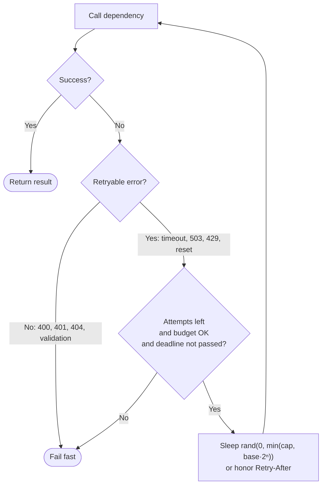

Most failures in distributed systems are **transient**: a dropped connection, a leader election, a brief throttle, a pod restarting. Simply trying again a moment later often succeeds. **Retry with backoff** does exactly that — but with **increasing delays** between attempts and **random jitter**, so that thousands of clients don't all retry in lockstep and knock the recovering service over again.

Retries are the most common resilience pattern and, misconfigured, one of the most common causes of cascading outages.

## The problem

Naive retries create three problems:

1. **Retry storms.** A service blips; every client retries immediately; load doubles or triples exactly when the service is weakest.
2. **Synchronized waves.** Fixed delays ("retry every 1 s") make clients retry at the same instants — spikes instead of smooth load.
3. **Amplification across layers.** If each of 4 layers retries 3 times, one user request can become 3⁴ = **81** calls at the bottom of the stack.

## How it works

### Exponential backoff

Delay grows geometrically with each attempt, up to a cap:

`delay = min(cap, base × 2^attempt)`

With `base = 100 ms` and `cap = 10 s`: 100, 200, 400, 800, 1600 ms…

### Jitter

Add randomness so clients spread out. AWS's well-known analysis compared strategies; **full jitter** performs very well and is simple:

`sleep = random(0, min(cap, base × 2^attempt))`

| Strategy | Formula | Behavior |
|---|---|---|
| No jitter | `min(cap, base·2ⁿ)` | Synchronized spikes |
| Full jitter | `rand(0, min(cap, base·2ⁿ))` | Smooth load, low total work |
| Equal jitter | `d/2 + rand(0, d/2)` | Guarantees some minimum wait |
| Decorrelated jitter | `min(cap, rand(base, prev·3))` | Good spread, adapts to previous sleep |



## What to retry

| Retry | Don't retry |
|---|---|
| Connection refused/reset, DNS hiccups | `400 Bad Request`, validation errors |
| Timeouts (if the operation is idempotent) | `401/403` auth failures |
| `429 Too Many Requests` (honor `Retry-After`) | `404 Not Found` (usually) |
| `502`, `503`, `504` | `409 Conflict` on business rules |
| gRPC `UNAVAILABLE`, `RESOURCE_EXHAUSTED` (with care) | gRPC `INVALID_ARGUMENT`, `PERMISSION_DENIED` |
| Database deadlocks / serialization failures | Constraint violations |

> **Warning:** only retry **idempotent** operations — or make them idempotent with an idempotency key. Retrying a timed-out `POST /payments` without a key can charge a customer twice, because the timeout doesn't tell you whether the first attempt succeeded. See [Idempotent Consumer](/blog/idempotent-consumer/).

## Example: Resilience4j (Java)

```java
RetryConfig config = RetryConfig.custom()
    .maxAttempts(4)                                           // 1 call + 3 retries
    .intervalFunction(IntervalFunction.ofExponentialRandomBackoff(
        Duration.ofMillis(100), 2.0, 0.5, Duration.ofSeconds(5))) // base, multiplier, randomization, cap
    .retryOnException(ex -> ex instanceof ConnectException
        || ex instanceof SocketTimeoutException
        || (ex instanceof HttpServerErrorException h && h.getStatusCode().value() >= 502))
    .retryOnResult(resp -> resp instanceof ResponseEntity<?> r && r.getStatusCode().value() == 503)
    .failAfterMaxAttempts(true)
    .build();

Retry retry = Retry.of("inventory", config);
retry.getEventPublisher().onRetry(e -> metrics.counter("retry", "dep", "inventory").increment());

Supplier<Stock> call = Retry.decorateSupplier(retry,
    () -> inventoryClient.getStock(sku, idempotencyKey));
```

Or declaratively with Spring Boot:

```yaml
resilience4j:
  retry:
    instances:
      inventory:
        max-attempts: 4
        wait-duration: 100ms
        enable-exponential-backoff: true
        exponential-backoff-multiplier: 2
        enable-randomized-wait: true
        randomized-wait-factor: 0.5
        exponential-max-wait-duration: 5s
        retry-exceptions:
          - java.net.ConnectException
          - java.net.SocketTimeoutException
        ignore-exceptions:
          - com.example.inventory.SkuNotFoundException
```

## Example: Polly v8 (.NET)

```csharp
var pipeline = new ResiliencePipelineBuilder<HttpResponseMessage>()
    .AddRetry(new RetryStrategyOptions<HttpResponseMessage>
    {
        MaxRetryAttempts = 3,
        BackoffType = DelayBackoffType.Exponential,
        UseJitter = true,                         // decorrelated jitter
        Delay = TimeSpan.FromMilliseconds(100),
        MaxDelay = TimeSpan.FromSeconds(5),
        ShouldHandle = new PredicateBuilder<HttpResponseMessage>()
            .Handle<HttpRequestException>()
            .HandleResult(r => (int)r.StatusCode is 429 or >= 502),
        DelayGenerator = args =>                 // honor Retry-After when present
            ValueTask.FromResult(args.Outcome.Result?.Headers.RetryAfter?.Delta),
    })
    .AddTimeout(TimeSpan.FromSeconds(2))          // per-attempt timeout (inner)
    .Build();
```

## Retry budgets

Attempt limits per request aren't enough during a broad outage — every request still retries. A **retry budget** caps retries as a *fraction of total traffic*:

- Allow retries only while `retries / requests < 10%` over a sliding window.
- gRPC's retry throttling and Envoy's `retry_budget` implement this.
- Google's SRE guidance: retry at **one layer** of the stack, typically the one closest to the user, and have lower layers fail fast.

```yaml
# Envoy cluster: limit concurrent retries to 20% of active requests
circuit_breakers:
  thresholds:
    - priority: DEFAULT
      retry_budget:
        budget_percent: { value: 20.0 }
        min_retry_concurrency: 3
```

## Retries and deadlines

A retry policy must respect the caller's **overall deadline**. If the user-facing request has 2 s left, don't schedule a 4 s backoff. Propagate deadlines (gRPC does this natively; for HTTP, pass a header like `X-Request-Deadline`) and stop retrying when the remaining budget is smaller than the expected attempt time. See [Timeout](/blog/timeout-pattern/).

## Trade-offs

| Benefits | Costs |
|---|---|
| Masks most transient failures from users | Adds latency on failure paths |
| Cheap to implement with libraries | Amplifies load if unbounded or multi-layered |
| Jitter smooths recovery load | Unsafe for non-idempotent operations |
| Combines well with circuit breakers | Can hide chronic problems if not monitored |

## Common pitfalls

> **Pitfall:** retrying at every layer. Client SDK retries 3×, the API gateway retries 3×, the service mesh retries 3×, and the service's HTTP client retries 3×. Pick one layer, and make the others fail fast.

- **No jitter** — synchronized retry waves.
- **Retrying non-retryable errors** — wastes capacity and delays error feedback.
- **Ignoring `Retry-After`** — the server told you when to come back.
- **Retrying inside a transaction or while holding locks** — extends lock time.
- **Not counting retries** — expose retry rate as a metric; a rising rate is an early outage signal.

## Tools and real-world usage

- **Resilience4j** (Java), **Polly** (.NET), **Spring Retry**, **tenacity** (Python), **cockatiel** (TypeScript).
- **AWS SDKs** — "standard" and "adaptive" retry modes with jitter and client-side rate limiting.
- **gRPC** — service-config retry policies with backoff and throttling.
- **Envoy / Istio** — retries, per-try timeouts, and retry budgets at the mesh layer.

## Related patterns

- [Circuit Breaker](/blog/circuit-breaker/) — stop retrying a dependency that's clearly down.
- [Timeout](/blog/timeout-pattern/) — every attempt needs one; the whole retry sequence needs a deadline.
- [Idempotent Consumer](/blog/idempotent-consumer/) — what makes retries safe.
- [Rate Limiting](/blog/rate-limiting/) — `429` is the signal to back off.

## Key takeaways

1. Retry only transient errors, and only idempotent operations (or use idempotency keys).
2. Use exponential backoff with jitter, a cap, and a small attempt limit.
3. Add a retry budget and retry at one layer only.
4. Respect deadlines and `Retry-After`, and monitor retry rates.
