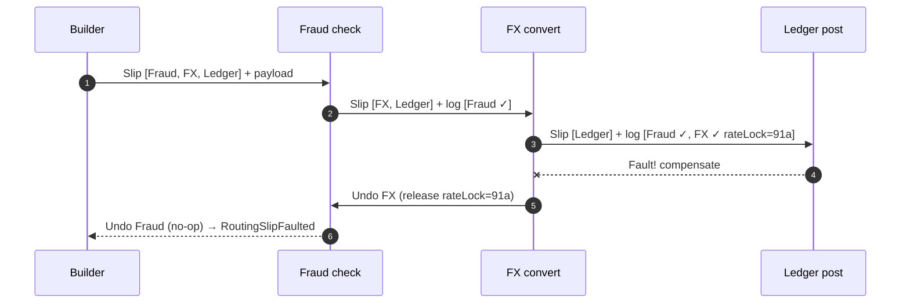

Imagine sending a parcel with a printed itinerary taped to the box: *"Warehouse A → Customs → Courier B → Customer."* Each stop reads the slip, does its job, ticks its line, and forwards the box to the next stop. No central dispatcher needs to track the parcel.

That's the **Routing Slip** pattern from *Enterprise Integration Patterns*. A message carries an **ordered list of processing steps**. Each step performs its work, records what it did, and forwards the message to the next address on the slip. MassTransit's **Courier** extends this with an **activity log** so completed steps can be **compensated** in reverse if a later step fails — making it a decentralized way to implement a [Saga](/blog/saga-pattern/).

## The problem

You have a pipeline of steps whose **sequence varies per message** but is **known when the message is created**:

- A document goes through *virus scan → OCR → classification → archive*, but only scanned images need OCR.
- A payment goes through *fraud check → FX conversion → ledger posting*, but domestic payments skip FX.
- A new customer goes through different compliance checks depending on country.

Hard-coding the sequence into each service couples them together. A central orchestrator works, but adds a stateful component for flows that don't branch mid-way.

## How it works

1. A **builder** (often at the entry point) decides the itinerary for this message and attaches it.
2. Each **activity** reads the slip, executes, appends an entry to the **activity log** (including data needed to undo), and forwards the message to the next activity.
3. When the itinerary is empty, the slip is **complete** and a completion event is published.
4. If an activity **faults**, the slip is routed **backwards** through the activity log, calling each completed activity's **compensate** handler in reverse order.



The **slip is the state.** It travels with the message, so no step needs a database of in-flight workflows.

### A slip's anatomy

```json
{
  "trackingNumber": "6f1c2e0a-3b7d-4c8e-9a51-0d2f7c4b8e19",
  "itinerary": [
    { "name": "FxConvert", "address": "queue:fx-convert_execute",
      "arguments": { "to": "USD" } },
    { "name": "LedgerPost", "address": "queue:ledger-post_execute" }
  ],
  "activityLogs": [
    { "name": "FraudCheck", "completedAt": "2026-10-17T09:12:01Z" }
  ],
  "compensateLogs": [
    { "address": "queue:fraud-check_compensate", "data": {} }
  ],
  "variables": { "paymentId": "pay-5521", "amount": 1500.0, "currency": "INR" }
}
```

- **Itinerary** — remaining steps.
- **Activity / compensate logs** — what's been done and how to undo it.
- **Variables** — shared data steps can read and add to.

## Example: MassTransit Courier (C#)

An activity implements both execution and compensation:

```csharp
public record FxArgs(Guid PaymentId, decimal Amount, string From, string To);
public record FxLog(string RateLockId);

public class FxConvertActivity : IActivity<FxArgs, FxLog>
{
    private readonly IFxClient _fx;
    public FxConvertActivity(IFxClient fx) => _fx = fx;

    public async Task<ExecutionResult> Execute(ExecuteContext<FxArgs> ctx)
    {
        var a = ctx.Arguments;
        var lockResult = await _fx.LockRateAsync(a.PaymentId, a.From, a.To, a.Amount);
        // Log what's needed to undo; add variables for later steps
        return ctx.CompletedWithVariables(
            new FxLog(lockResult.RateLockId),
            new { ConvertedAmount = lockResult.Converted, Currency = a.To });
    }

    public async Task<CompensationResult> Compensate(CompensateContext<FxLog> ctx)
    {
        await _fx.ReleaseRateAsync(ctx.Log.RateLockId);   // must be idempotent
        return ctx.Compensated();
    }
}
```

The entry point builds the itinerary per message:

```csharp
var builder = new RoutingSlipBuilder(NewId.NextGuid());
builder.AddVariable("PaymentId", payment.Id);
builder.AddVariable("Amount", payment.Amount);

builder.AddActivity("FraudCheck", new Uri("queue:fraud-check_execute"));
if (payment.Currency != payment.TargetCurrency)
    builder.AddActivity("FxConvert", new Uri("queue:fx-convert_execute"),
        new { From = payment.Currency, To = payment.TargetCurrency });
builder.AddActivity("LedgerPost", new Uri("queue:ledger-post_execute"));

builder.AddSubscription(new Uri("queue:payment-tracking"),
    RoutingSlipEvents.Completed | RoutingSlipEvents.Faulted);

await bus.Execute(builder.Build());
```

## Routing slip vs. orchestrator

| | Routing Slip | Central orchestrator / process manager |
|---|---|---|
| Where the flow lives | In each message | In the orchestrator |
| Runtime state store | None (state travels) | Instance table or event history |
| Branching after start | Limited (activities can revise the itinerary) | First-class |
| Waiting for human input / days | Poor fit | Good fit |
| Single point of failure | No | The orchestrator (mitigated by HA) |
| Visibility | Via tracking events | Query the instance |

Use a routing slip when the sequence is **decided up front** and steps run **back-to-back**. Use a [Process Manager](/blog/process-manager-pattern/) or [Orchestration](/blog/orchestration/) when the flow **reacts to results** or **waits**.

## Design considerations

- **Track centrally even though you route decentrally.** Subscribe a tracking consumer to `Completed`, `Faulted`, and `ActivityCompleted` events so support can answer "where is payment 5521?".
- **Keep the slip small.** It's copied on every hop. Put large payloads in storage and pass a reference ([Claim Check](/blog/claim-check/)).
- **Secure the itinerary.** A slip says where to send the message next. If untrusted parties can build or modify slips, sign them, or only accept known addresses.
- **Idempotent activities and compensations.** Messages can be redelivered at each hop. Use the tracking number plus activity name as an idempotency key.
- **Revisions.** Courier lets an activity *revise* the itinerary (e.g., insert a manual-review step). Use sparingly — it erodes the "known up front" benefit.

## Trade-offs

| Benefits | Costs |
|---|---|
| No central coordinator; scales with the activities | Harder to see the whole flow without tracking |
| Per-message flexibility in steps | Weak support for branching and long waits |
| Built-in compensation via activity logs | Slip size grows with logs and variables |
| Activities are reusable building blocks | Changing step contracts affects in-flight slips |

## Common pitfalls

> **Pitfall:** treating the routing slip as a general workflow engine. As soon as you need "wait for a callback, then decide", you'll be fighting the pattern. Switch to a process manager.

- Putting secrets or PII in slip variables that every activity (and every log) can read.
- Compensations that call the forward step's external API without idempotency keys.
- No dead-letter handling for compensation failures — a slip that can't compensate must alert someone ([Dead Letter Queue](/blog/dead-letter-queue/)).

## Tools and real-world usage

- **MassTransit Courier** — the most complete implementation, with activities, compensation, variables, and tracking events.
- **Apache Camel** — the `routingSlip` EIP computes endpoints from a header at runtime.
- **Azure Logic Apps / integration platforms** — itinerary-based processing in ESB-style tools such as BizTalk's ESB Toolkit.

Document processing pipelines, payment processing, and media transcoding pipelines — where each item's steps depend on its type — are natural fits.

## Related patterns

- [Saga](/blog/saga-pattern/) — routing slips are a decentralized saga implementation.
- [Process Manager](/blog/process-manager-pattern/) — the stateful, centralized alternative.
- [Compensating Transaction](/blog/compensating-transaction/) — what the compensate logs enable.
- [Claim Check](/blog/claim-check/) — keeping slips small.

## Key takeaways

1. A routing slip carries its itinerary, progress, and undo data inside the message.
2. Each activity executes, logs, and forwards; faults compensate backwards.
3. Best for flows decided up front with no long waits or mid-flow branching.
4. Add central tracking for visibility, keep slips small, and make every step idempotent.
