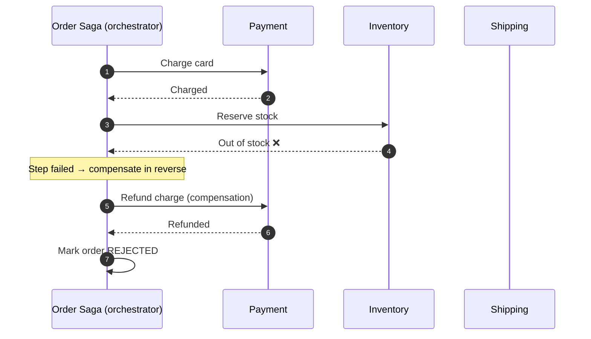
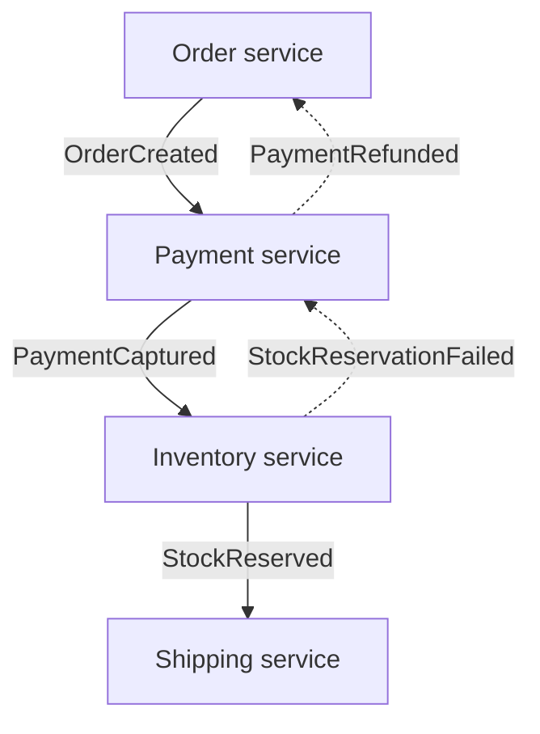
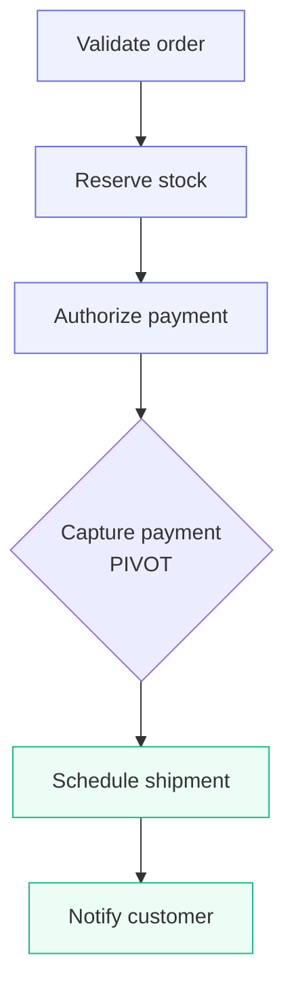

In a monolith, placing an order is one database transaction: debit the wallet, reserve stock, create the shipment — commit or roll back together. Split that into an Order service, a Payment service, and an Inventory service, each with its own database, and the single `COMMIT` disappears. The **Saga pattern** is the most widely used answer to that problem.

A saga models one business transaction as a **sequence of local transactions**. Each step commits in its own service's database and then triggers the next step. If a step fails, the saga runs **compensating transactions** for the steps that already succeeded, walking the system back to a consistent state.

> **In practice:** sagas trade *atomicity* for *availability*. You stop pretending the whole operation is instantaneous and instead design every step — and its undo — explicitly.

## The problem

Distributed ACID transactions (see [Two-Phase Commit](/blog/two-phase-commit/)) need every participant to hold locks until a coordinator decides. That couples the availability of every service to the slowest one, rarely works across message brokers or SaaS APIs, and many modern datastores (DynamoDB, Cassandra, most NoSQL) don't support XA at all.

Yet the business still needs guarantees like:

- Never ship an order that wasn't paid for.
- Never keep a customer's money for an order that couldn't be fulfilled.
- Never oversell inventory for long.

A saga gives you those guarantees **eventually**, without global locks.

## How it works

Every saga is a list of steps. Each step has two parts:

| Part | Meaning | Example |
|---|---|---|
| **Transaction** (`Tᵢ`) | A local, committed change in one service | `ReserveStock(order 42, 3 units)` |
| **Compensation** (`Cᵢ`) | A semantic undo of `Tᵢ` | `ReleaseStock(order 42, 3 units)` |

If `T1 → T2 → T3` succeed, the saga is complete. If `T3` fails, the saga executes `C2 → C1` in reverse order.

There are two ways to coordinate the steps.

### Orchestration

A central **saga orchestrator** (a workflow) tells each participant what to do and reacts to the replies. The flow lives in one place, which makes it easy to read, test, and monitor.



### Choreography

There is no central brain. Each service listens for events and publishes its own. `OrderCreated` triggers Payment; `PaymentCaptured` triggers Inventory; `StockReservationFailed` triggers Payment's refund.



Choreography is loosely coupled and has no single point of failure, but the end-to-end flow is implicit — you have to reconstruct it from event subscriptions. A useful rule of thumb: **choreograph sagas of two or three steps; orchestrate anything longer or anything with branching.** (More in [Choreography](/blog/choreography/) vs. [Orchestration](/blog/orchestration/).)

## Example: an orchestrated order saga

Below is an order saga written with [Temporal](https://temporal.io/)'s Java SDK. Temporal persists the workflow's state after every step, so if the worker crashes mid-saga, another worker resumes it from the last completed step — the durability you would otherwise hand-build with a [process manager](/blog/process-manager-pattern/) and a state table.

```java
public class OrderSagaWorkflowImpl implements OrderSagaWorkflow {

  private static final ActivityOptions OPTS = ActivityOptions.newBuilder()
      .setStartToCloseTimeout(Duration.ofSeconds(30))
      .setRetryOptions(RetryOptions.newBuilder()
          .setMaximumAttempts(5)
          .setDoNotRetry(CardDeclinedException.class.getName())
          .build())
      .build();

  private final PaymentActivities payment =
      Workflow.newActivityStub(PaymentActivities.class, OPTS);
  private final InventoryActivities inventory =
      Workflow.newActivityStub(InventoryActivities.class, OPTS);
  private final ShippingActivities shipping =
      Workflow.newActivityStub(ShippingActivities.class, OPTS);

  @Override
  public OrderResult placeOrder(Order order) {
    Saga saga = new Saga(new Saga.Options.Builder()
        .setParallelCompensation(false)   // undo strictly in reverse order
        .build());
    try {
      String chargeId = payment.charge(order.customerId(), order.total(), order.id());
      saga.addCompensation(payment::refund, chargeId, order.id());

      String reservationId = inventory.reserve(order.id(), order.lines());
      saga.addCompensation(inventory::release, reservationId);

      String shipmentId = shipping.schedule(order.id(), order.address());
      saga.addCompensation(shipping::cancel, shipmentId);

      return OrderResult.confirmed(order.id(), shipmentId);
    } catch (ActivityFailure e) {
      saga.compensate();               // runs refund/release/cancel as needed
      return OrderResult.rejected(order.id(), e.getMessage());
    }
  }
}
```

Three details make this production-grade:

1. **Compensations are registered *after* the step succeeds.** If `charge` fails, there is nothing to refund.
2. **Every activity is idempotent.** Temporal retries activities; `charge(..., order.id())` passes the order ID as an idempotency key so a retry never double-charges. See [Idempotent Consumer](/blog/idempotent-consumer/).
3. **Retries are bounded.** Transient errors are retried with backoff; business errors ("card declined") fail fast and trigger compensation.

## Designing good compensations

Compensations are where sagas succeed or fail in real systems.

- **Compensations are semantic, not technical.** You can't un-send an email. The compensation for `SendConfirmationEmail` is `SendCancellationEmail`. The compensation for a captured payment is a refund, which shows up on the customer's statement. Product owners need to agree on what "undo" means.
- **Compensations must be retryable and must eventually succeed.** If a refund call fails, retry it — forever if necessary — and alert a human. A compensation that can give up leaves the system inconsistent.
- **Order the steps to minimize compensation.** Put steps that are *likely to fail* and *cheap to undo* first (validate, reserve), and steps that are *hard to undo* last (capture payment, ship). This is why many checkout flows authorize a card early but capture it at the end.
- **Distinguish pivot and retriable steps.** In saga terminology, a *pivot transaction* is the go/no-go point. Steps before it are compensatable; steps after it must be retried until they succeed, because the saga can no longer go back.



*Blue steps are compensatable; green steps after the pivot are retried until they succeed.*

## The isolation problem

Sagas are **ACD, not ACID** — they give up isolation. Between `T1` and the final step, other transactions can see intermediate state: an order that is "paid" but not yet "reserved", or stock reserved for an order that will later be rejected.

Common countermeasures:

| Countermeasure | How it helps |
|---|---|
| **Semantic lock** | Mark records with a state like `PENDING_APPROVAL` so other flows treat them carefully. |
| **Commutative updates** | Design operations (e.g., `credit +10`, `debit -10`) so order doesn't matter. |
| **Pessimistic ordering** | Do the riskiest, most visible step last. |
| **Reread value** | Re-check a value before overwriting it, to detect concurrent changes (optimistic locking). |
| **Version file** | Record operations as they arrive so out-of-order requests can be reordered. |

## Trade-offs

| Benefits | Costs |
|---|---|
| No distributed locks; each service stays available | No isolation — intermediate states are visible |
| Works across heterogeneous databases, brokers, and SaaS APIs | Every step needs a designed, tested compensation |
| Scales with the number of services | Harder to reason about than a single transaction |
| Failure handling is explicit and auditable | Debugging requires good tracing and saga state visibility |

## When to use it

Use a saga when:

- A business operation spans **two or more services that own their own data** ([Database per Service](/blog/database-per-service/)).
- Steps can be **reversed semantically** (refund, release, cancel).
- The business can tolerate **seconds to minutes** of inconsistency.

Avoid it, or reconsider service boundaries, when:

- Two services always change together in one transaction — they may belong in one service (one [aggregate](/blog/aggregate-ddd/)).
- A step is truly irreversible and must be atomic with others (e.g., regulatory ledger postings). Consider [TCC](/blog/try-confirm-cancel/) or a single ledger service.

## Common pitfalls

> **Warning:** the most common saga bug is a compensation that assumes its forward step completed. In distributed systems a step can time out *and still succeed*. Compensations must handle "the thing I'm undoing may or may not exist" — for example, "refund if a charge for this order ID exists".

- **Lost messages between steps.** Publish step events with a [Transactional Outbox](/blog/transactional-outbox/) so a committed step always emits its event.
- **Duplicate messages.** Every participant must be an [Idempotent Consumer](/blog/idempotent-consumer/).
- **Invisible sagas.** Store saga state and propagate a [Correlation ID](/blog/correlation-id/) so support can answer "where is order 42 stuck?".
- **Cyclic choreography.** Event chains that loop back on themselves are a sign you need an orchestrator.
- **No timeout.** A saga waiting forever on a reply is a stuck order. Every step needs a deadline and a decision on expiry.

## Tools and real-world usage

- **Temporal / Cadence** — durable workflows in code; the `Saga` helper shown above.
- **Camunda / Zeebe** — BPMN-modelled workflows with compensation events; popular in banking and insurance where business analysts read the diagrams.
- **Axon Framework** — `@Saga` classes driven by domain events in event-sourced Java systems.
- **AWS Step Functions** — state machines with `Catch` blocks that route to compensation states.
- **MassTransit / NServiceBus** — saga state machines persisted to SQL or MongoDB in .NET.

Travel booking (flight + hotel + car), e-commerce checkout, loan origination, and account opening are the classic saga use cases. In banking, I've seen sagas coordinate document capture, KYC checks, and core-banking account creation — where each "undo" step also had to leave an audit trail.

## Related patterns

- [Compensating Transaction](/blog/compensating-transaction/) — the building block of every saga.
- [Process Manager](/blog/process-manager-pattern/) and [Routing Slip](/blog/routing-slip/) — two ways to implement the coordinator.
- [Try-Confirm/Cancel](/blog/try-confirm-cancel/) — a stricter variant with explicit reservations.
- [Transactional Outbox](/blog/transactional-outbox/) — reliable step-to-step messaging.

## Key takeaways

1. A saga is a sequence of local transactions plus a compensation for each.
2. Orchestrate long or branching flows; choreograph short, linear ones.
3. Compensations are business decisions — design them with product owners.
4. Make every step idempotent and every compensation retry until it succeeds.
5. Sagas give up isolation, so design for visible intermediate states.
