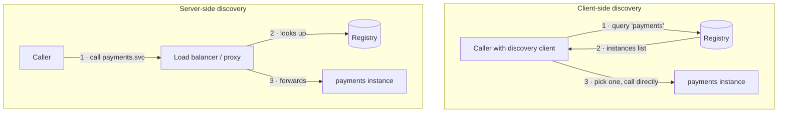

In a static data center, the payments service lived at `10.4.2.17:8080` for years, written into a config file. In a cloud or Kubernetes environment, instances are created and destroyed constantly — autoscaling, deployments, node failures, spot interruptions — and each gets a new address. **Service Discovery** lets callers find the **current, healthy instances** of a service **by name**, at runtime.

## The problem

- Instance addresses change with every deploy and scale event.
- Some instances are unhealthy, starting up, or draining.
- Hard-coded addresses or manually updated load-balancer pools break, lag, or route to dead instances.
- Different environments (dev, staging, prod, regions) need different addresses for the same logical service.

## How it works

Every discovery system has a **service registry** — a database of `service name → healthy instances` — plus a way for instances to **register** and for callers to **look up**.

### Registration

| Style | How | Examples |
|---|---|---|
| **Self-registration** | The instance registers itself on start, heartbeats, and deregisters on shutdown | Eureka client, Consul agent API |
| **Third-party registration** | The platform registers instances it manages, based on health | Kubernetes Endpoints/EndpointSlices, AWS ECS + Cloud Map, Consul catalog sync |

Third-party registration is generally more reliable: the platform knows when it starts and stops instances, and services don't need registry code.

### Lookup



| | Client-side discovery | Server-side discovery |
|---|---|---|
| Who picks the instance | The caller (library) | A load balancer or proxy |
| Load-balancing smarts | Rich (zone-aware, least-request) in the client | In the proxy |
| Language coupling | Needs a discovery client per language | Language-agnostic |
| Extra hop | No | Yes (unless the proxy is a local sidecar) |
| Examples | Eureka + Spring Cloud LoadBalancer, gRPC xDS clients | Kubernetes Services (kube-proxy), AWS ALB, Envoy/mesh |

Service meshes blur the line: a **local sidecar proxy** does client-side-style load balancing on behalf of the app, configured via the mesh's discovery (Envoy's xDS APIs).

## Kubernetes: discovery built in

In Kubernetes, discovery is a platform feature:

```yaml
apiVersion: v1
kind: Service
metadata: { name: payments, namespace: shop }
spec:
  selector: { app: payments }       # pods with this label are endpoints
  ports: [{ name: http, port: 80, targetPort: 8080 }]
---
# Only pods passing their readinessProbe appear in the EndpointSlice.
# Callers simply use DNS:
#   http://payments                       (same namespace)
#   http://payments.shop.svc.cluster.local (fully qualified)
```

- **Endpoints/EndpointSlices** are maintained by the control plane from pod labels and **readiness** ([Health Check](/blog/health-check/)).
- **CoreDNS** resolves service names to a stable **ClusterIP**; kube-proxy (or eBPF in Cilium) load-balances to endpoints.
- **Headless Services** (`clusterIP: None`) return pod IPs directly — useful for client-side load balancing (e.g., gRPC) and stateful sets.

## Consul: discovery across platforms

Consul spans VMs, Kubernetes, and multiple data centers, with health checks and DNS/HTTP interfaces.

```hcl
# Service definition registered with the local Consul agent
service {
  name = "payments"
  port = 8080
  tags = ["v2", "primary"]
  meta = { version = "2026.10.17" }

  check {
    id       = "payments-http"
    http     = "http://localhost:8080/actuator/health/readiness"
    interval = "10s"
    timeout  = "2s"
    deregister_critical_service_after = "1m"
  }
}
```

```bash
# DNS interface: only healthy instances are returned
dig @127.0.0.1 -p 8600 payments.service.consul SRV

# HTTP API with health filtering
curl -s "http://127.0.0.1:8500/v1/health/service/payments?passing=true"
```

## Eureka + Spring Cloud: client-side discovery

```yaml
# Service registers itself and fetches the registry
spring:
  application:
    name: checkout
eureka:
  client:
    service-url: { defaultZone: "http://eureka-1:8761/eureka/,http://eureka-2:8761/eureka/" }
    registry-fetch-interval-seconds: 10
  instance:
    prefer-ip-address: true
    lease-renewal-interval-in-seconds: 10
    lease-expiration-duration-in-seconds: 30
```

```java
@Bean
@LoadBalanced                       // resolves "http://payments" via the registry, client-side
RestClient.Builder restClientBuilder() { return RestClient.builder(); }

// Usage
restClientBuilder.build().post().uri("http://payments/v1/payments").body(req).retrieve();
```

## Design considerations

- **Health integration** — the registry must reflect *readiness*, not just "process exists". Stale entries route traffic to dead instances.
- **Caching and TTLs** — clients cache lookups. DNS TTLs, JVM DNS caching (`networkaddress.cache.ttl`), and registry fetch intervals determine how fast callers notice changes. Long caches → traffic to terminated instances; very short → registry load.
- **Graceful deregistration** — on shutdown, deregister/fail readiness *before* stopping, and let in-flight requests drain.
- **Registry availability** — the registry is critical infrastructure; run it highly available. Good clients keep using their last-known instance list if the registry is briefly unreachable (Eureka's self-preservation mode is an example).
- **Locality** — prefer instances in the same zone/region to cut latency and cross-zone costs (topology-aware routing).
- **Environment naming** — use namespaces, data centers, or tags rather than embedding environment names in service names.

## Trade-offs

| Benefits | Costs |
|---|---|
| No hard-coded addresses; works with autoscaling | Registry is critical infrastructure |
| Routes only to healthy instances | Staleness windows from caching and TTLs |
| Enables zone-aware and smarter load balancing | Client-side discovery couples you to libraries |
| Foundation for meshes, gateways, and failover | Cross-platform discovery (VMs + K8s) adds complexity |

## Common pitfalls

> **Pitfall:** JVM DNS caching. Some JVM configurations cache successful DNS lookups indefinitely (notably when a security manager is installed), so a client keeps calling an IP that no longer exists. Set `networkaddress.cache.ttl` to a small value (e.g., 30–60 s) in environments where IPs change.

- **Long-lived connections** (HTTP/2, gRPC) pinned to old instances — new instances get no traffic. Use client-side balancing with periodic re-resolution or connection max-age.
- **Self-registration without deregistration** — crashed instances linger until their lease expires.
- **Discovery that ignores readiness** — new pods receive traffic before they're warm.
- **Hard-coding cluster-internal DNS names** into clients outside the cluster.

## Tools and real-world usage

- **Kubernetes** Services, EndpointSlices, CoreDNS; headless Services for client-side load balancing.
- **HashiCorp Consul** — multi-platform registry with health checks, DNS, and service mesh.
- **Netflix Eureka** with **Spring Cloud** — client-side discovery popular in Spring estates.
- **AWS Cloud Map**, **ECS Service Connect**, **Azure Container Apps** built-in discovery.
- **etcd / ZooKeeper** — underlying registries for many systems; **Envoy xDS** — dynamic endpoint discovery for proxies.

## Related patterns

- [Health Check](/blog/health-check/) — determines which instances are discoverable.
- [Service Mesh](/blog/service-mesh/) — builds on discovery to route and secure traffic.
- [API Gateway](/blog/api-gateway/) — uses discovery to reach upstreams.
- [Sidecar](/blog/sidecar/) — local proxies that perform discovery-driven load balancing.

## Key takeaways

1. A registry maps service names to healthy instances; instances register themselves or are registered by the platform.
2. Client-side discovery gives smarter balancing; server-side is language-agnostic.
3. On Kubernetes, use Services and DNS — readiness controls membership.
4. Watch caching, long-lived connections, and graceful deregistration.
