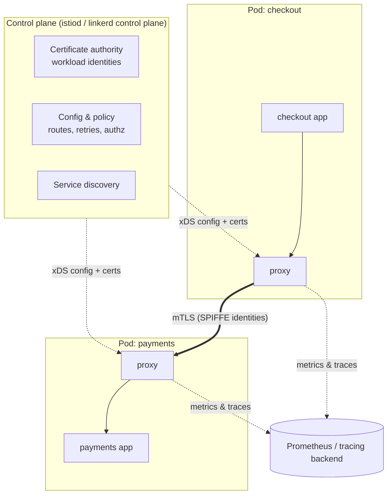

Once you have dozens of services calling each other, the **network between them** becomes a system in its own right. Who is allowed to call whom? Is that traffic encrypted? What's the error rate between checkout and payments? How do you send 5% of traffic to a new version? A **Service Mesh** answers these questions as **infrastructure**: a fleet of proxies that handle every service-to-service request, configured centrally by a **control plane**.

## The problem

Without a mesh, each service team must implement — in each language — mutual TLS, retries, timeouts, circuit breaking, traffic splitting, and per-call metrics. In practice:

- internal traffic is often **unencrypted** and **unauthenticated** ("it's inside the cluster");
- resilience policies are **inconsistent** across teams;
- there's no uniform view of **service-to-service health**;
- canary releases and traffic shifting require custom code or load-balancer tickets.

## How it works



- **Data plane** — proxies (Envoy in Istio, linkerd2-proxy in Linkerd) that intercept all inbound and outbound traffic of each workload, as [sidecars](/blog/sidecar/) or as node-level/ambient components.
- **Control plane** — distributes configuration and certificates to proxies, and watches the platform's service registry.

The application keeps making plain HTTP/gRPC calls; the mesh transparently adds security, policy, and telemetry.

## What a mesh provides

### 1. Security: mTLS and identity

Each workload gets a cryptographic identity (typically a SPIFFE ID derived from its Kubernetes service account) with automatically rotated certificates. Traffic between proxies is **mutually authenticated and encrypted**, and you can write **authorization policies by identity**, not IP address.

```yaml
# Istio: require mTLS for every workload in the namespace
apiVersion: security.istio.io/v1
kind: PeerAuthentication
metadata: { name: default, namespace: payments }
spec:
  mtls: { mode: STRICT }
---
# Only the checkout service account may call payments' capture endpoint
apiVersion: security.istio.io/v1
kind: AuthorizationPolicy
metadata: { name: payments-capture, namespace: payments }
spec:
  selector: { matchLabels: { app: payments } }
  action: ALLOW
  rules:
    - from:
        - source: { principals: ["cluster.local/ns/checkout/sa/checkout"] }
      to:
        - operation: { methods: ["POST"], paths: ["/v1/payments/*/capture"] }
```

### 2. Traffic management

Weighted routing, header-based routing, mirroring, and fault injection — the tools for canaries, blue/green, and [Strangler Fig](/blog/strangler-fig/) migrations.

```yaml
apiVersion: networking.istio.io/v1
kind: VirtualService
metadata: { name: payments }
spec:
  hosts: [payments]
  http:
    - match: [{ headers: { x-canary: { exact: "true" } } }]
      route: [{ destination: { host: payments, subset: v2 } }]
    - route:
        - { destination: { host: payments, subset: v1 }, weight: 95 }
        - { destination: { host: payments, subset: v2 }, weight: 5 }
      timeout: 2s
      retries: { attempts: 2, perTryTimeout: 800ms, retryOn: "connect-failure,refused-stream,unavailable" }
---
apiVersion: networking.istio.io/v1
kind: DestinationRule
metadata: { name: payments }
spec:
  host: payments
  subsets:
    - { name: v1, labels: { version: v1 } }
    - { name: v2, labels: { version: v2 } }
  trafficPolicy:
    outlierDetection: { consecutive5xxErrors: 5, interval: 10s, baseEjectionTime: 30s }
```

### 3. Resilience

Timeouts, retries with budgets, connection-pool limits ([Bulkhead](/blog/bulkhead/)), and outlier ejection (a form of [Circuit Breaker](/blog/circuit-breaker/)) — configured consistently, per destination.

### 4. Observability

Every proxy emits **golden signals** — request rate, error rate, latency — per source and destination, plus access logs and trace spans. You get a service graph without instrumenting code (though application-level tracing is still needed to connect spans *inside* a service; see [Distributed Tracing](/blog/distributed-tracing/)).

## Data-plane models

| Model | How | Pros | Cons |
|---|---|---|---|
| **Sidecar** (classic Istio, Linkerd) | A proxy in every pod | Mature; per-workload isolation; full L7 | CPU/memory per pod; injection and lifecycle complexity |
| **Ambient / sidecar-less** (Istio ambient: ztunnel + waypoints) | Node-level L4 proxy for mTLS; optional per-namespace L7 waypoint proxies | Much lower overhead; no app restarts to join | Newer; L7 features need waypoints |
| **eBPF-based** (Cilium service mesh) | Kernel-level L3/L4, Envoy for L7 | Very efficient networking | L7 features still use proxies; tied to Cilium CNI |

## Is a mesh worth it?

A mesh is significant operational investment. Rough guidance:

| Signal | Mesh helps |
|---|---|
| Regulatory or zero-trust requirement for encrypted, authenticated internal traffic | Strongly |
| Many services in several languages needing consistent resilience and telemetry | Strongly |
| Frequent canaries / progressive delivery | Yes |
| A handful of services in one language with good libraries | Probably not yet |
| Team lacks Kubernetes networking experience | Start with simpler tools; build skills first |

Linkerd's design emphasizes simplicity and low overhead; Istio offers the broadest feature set; Consul spans Kubernetes and VMs. Many teams start with mTLS and telemetry only, then adopt traffic management later.

## Trade-offs

| Benefits | Costs |
|---|---|
| Uniform mTLS and identity-based authorization | Operational complexity: control plane, upgrades, certificates |
| Consistent timeouts, retries, and outlier detection | Resource overhead (especially with sidecars) |
| Language-agnostic traffic control for canaries and migrations | Added latency per hop (typically small, but nonzero) |
| Golden-signal metrics for every service pair | Debugging now includes the mesh layer |

## Common pitfalls

> **Pitfall:** retries configured in the mesh *and* in application clients *and* at the gateway. A single failing call becomes dozens. Decide which layer owns retries for each path — see [Retry with Backoff](/blog/retry-with-backoff/).

- **Turning on `STRICT` mTLS cluster-wide on day one** — break non-meshed clients; roll out with `PERMISSIVE` first and watch telemetry.
- **Treating the mesh as authorization for business rules** — it knows *which service* calls; it doesn't know *which customer* may refund *which order*.
- **Ignoring upgrades** — control-plane and proxy versions must be upgraded regularly and carefully.
- **No owner** — a mesh needs a platform team.

## Tools and real-world usage

- **Istio** — feature-rich; sidecar and ambient modes; Envoy data plane.
- **Linkerd** — lightweight, Rust-based proxy, focused on simplicity and security.
- **Consul service mesh** — multi-platform (Kubernetes and VMs).
- **Cilium** — eBPF networking with mesh capabilities; **Kuma** / **Kong Mesh** — Envoy-based, multi-zone.

## Related patterns

- [Sidecar](/blog/sidecar/) — the classic data-plane deployment.
- [Service Discovery](/blog/service-discovery/) — the mesh builds on the platform's registry.
- [API Gateway](/blog/api-gateway/) — north-south counterpart to the mesh's east-west traffic.
- [Circuit Breaker](/blog/circuit-breaker/), [Timeout](/blog/timeout-pattern/), [Retry with Backoff](/blog/retry-with-backoff/) — policies the mesh can enforce.

## Key takeaways

1. A mesh = data-plane proxies handling all service traffic + a control plane configuring them.
2. Its biggest wins are mTLS identity, consistent resilience policy, and uniform telemetry.
3. Choose sidecar, ambient, or eBPF models based on overhead and maturity needs.
4. Adopt incrementally, own it with a platform team, and avoid layering retries.
