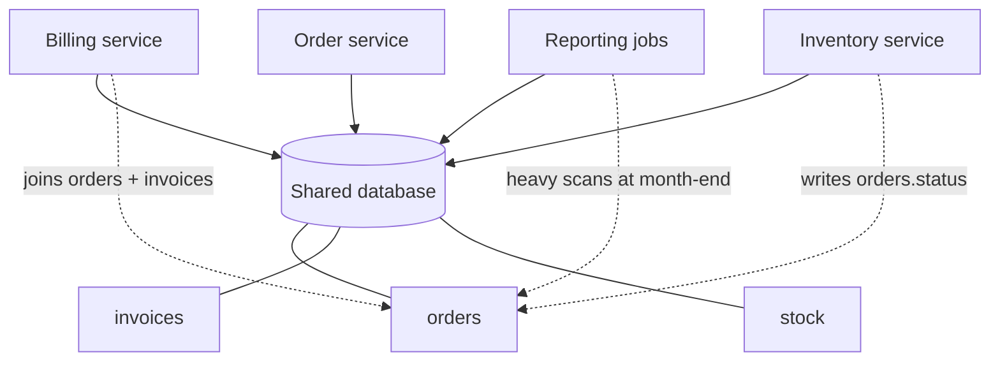
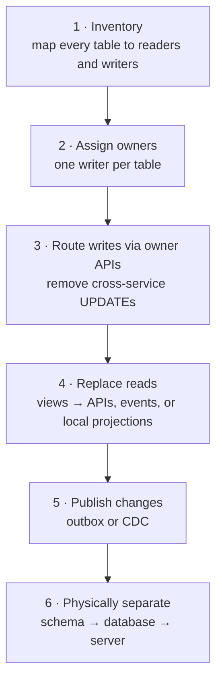

The **Shared Database** pattern is exactly what it sounds like: multiple services (or applications) read and write the **same database**, often the same tables. It's how most enterprise systems were integrated for decades — and it's still how many "microservices" architectures actually work underneath.

It's usually listed as an **anti-pattern** for microservices. That's mostly right. But it's worth understanding precisely *what* goes wrong, *when* sharing is acceptable, and *how* to get out — because you will inherit one.

## Why teams end up here

Shared databases aren't chosen out of ignorance. They're attractive:

- **ACID across "services"** — one transaction can update orders and inventory together.
- **Easy queries** — a SQL join answers questions that would otherwise need [API Composition](/blog/api-composition/) or [CQRS](/blog/cqrs/).
- **One thing to operate** — one backup, one DBA team, one set of credentials.
- **Speed of the first split** — carving services out of a monolith is faster if the data stays put.

## What goes wrong



### 1. Schema coupling

The schema becomes a **public API with no versioning**. Renaming `orders.cust_id` requires coordinated changes in every service, report, and ETL job that touches it — often discovered by breaking production. Teams stop refactoring the schema at all, and it fossilizes.

### 2. Runtime coupling

One service's bad query — a missing index, a table scan at month-end, a long transaction — **degrades everyone**. Lock contention and connection-pool exhaustion cross service boundaries. You can't scale one service's data tier independently.

### 3. Ownership ambiguity

When three services can `UPDATE orders`, **which one enforces the invariants?** Business rules get duplicated (and drift) across codebases, or move into triggers and stored procedures that nobody owns.

### 4. Deployment coupling

Schema migrations need cross-team scheduling. Independent deployability — the core benefit of microservices — is gone.

### 5. Technology lock-in

Every service is bound to the same database engine and version. Upgrading it is an organization-wide project.

## When sharing is acceptable

Not every shared database is a crisis. It's reasonable when:

| Situation | Why it's OK | Guardrails |
|---|---|---|
| **Modular monolith** | One deployable; modules share a DB but own separate schemas | Enforce module boundaries in code; no cross-module joins |
| **Same team, tightly cohesive services** | They change together anyway | Consider merging them into one service |
| **Transitional state** during migration | Splitting code first, data second | Time-boxed plan; ownership mapped |
| **Read-only reporting replica** | Analysts query a replica, not production | Replica/warehouse, not the primary |
| **Small system, small team** | Microservices overhead isn't justified | Be honest that it's not microservices |

> **Rule of thumb:** sharing **infrastructure** (a database server) is fine. Sharing **tables** between independently deployed services is the problem.

## Making a shared database less harmful

If you can't split yet, reduce the blast radius:

1. **Document table ownership** — exactly one service may write each table.
2. **Schema per service** with separate credentials; grant other services **read-only access to views**, not tables.
3. **Publish views as contracts** — versioned views (`orders_v1`) that you keep stable while changing underlying tables.
4. **Move writes behind the owner's API** first; reads can follow later.
5. **Isolate heavy reads** on replicas or a warehouse.
6. **Limit per-service connections and statement timeouts** to contain runaway queries.

```sql
-- The owner exposes a stable, versioned contract instead of raw tables
CREATE VIEW orders_api.order_summary_v1 AS
SELECT o.id            AS order_id,
       o.customer_id,
       o.status,
       o.total_amount,
       o.placed_at
FROM   orders.orders o;

GRANT USAGE  ON SCHEMA orders_api TO billing_svc;
GRANT SELECT ON orders_api.order_summary_v1 TO billing_svc;
-- billing_svc has no rights on orders.orders: internal changes stay internal

-- Contain runaway queries from any one consumer
ALTER ROLE billing_svc SET statement_timeout = '5s';
ALTER ROLE billing_svc CONNECTION LIMIT 20;
```

## Getting out: a staged plan



- Use [Change Data Capture](/blog/change-data-capture/) to feed new services from legacy tables without modifying the legacy app.
- Use an [Anti-Corruption Layer](/blog/anti-corruption-layer/) so new services don't adopt the legacy schema's model.
- Use the [Strangler Fig](/blog/strangler-fig/) pattern to move functionality incrementally.
- Replace cross-service transactions with [Sagas](/blog/saga-pattern/) only where the business really needs them — sometimes the right answer is to merge two "services" that were never really separate.

## Trade-offs

| Benefits | Costs |
|---|---|
| ACID transactions and joins across modules | Schema becomes an unversioned public API |
| Simple operations: one database | Performance problems cross service boundaries |
| Fast initial decomposition | Unclear ownership of data and rules |
| Familiar to most teams | Coordinated deployments, technology lock-in |

## Common pitfalls

> **Warning:** "We'll split the database later." Without an owner map and a deadline, later never comes — and each new feature adds another cross-service join that makes splitting harder.

- Splitting code into services while every service still connects as the same database user — there's no way to even *see* who depends on what.
- Moving business logic into triggers to "share" it — now nobody owns it and it runs on every write.
- Integrating new SaaS or cloud services by giving them direct database access to legacy systems.

## Tools and real-world usage

Shared databases are the norm in legacy enterprise estates — mainframe Db2, Oracle, and SQL Server databases with dozens of applications attached, often through nightly batch jobs and database links. Modern tooling that helps unwind them includes CDC platforms (Debezium, GoldenGate, AWS DMS), database proxies that log which application runs which query, and data catalogs that record lineage and ownership.

## Related patterns

- [Database per Service](/blog/database-per-service/) — the target state.
- [Strangler Fig](/blog/strangler-fig/) and [Anti-Corruption Layer](/blog/anti-corruption-layer/) — how to migrate.
- [Change Data Capture](/blog/change-data-capture/) — feeding new services from old tables.
- [API Composition](/blog/api-composition/) — replacing cross-service joins.

## Key takeaways

1. Shared tables couple schemas, runtime behavior, ownership, and deployments.
2. Sharing a database *server* is fine; sharing *tables* across independent services is not.
3. If you must share, enforce ownership with schemas, credentials, and versioned views.
4. Migrate in stages: map owners, route writes, replace reads, publish changes, then separate.
