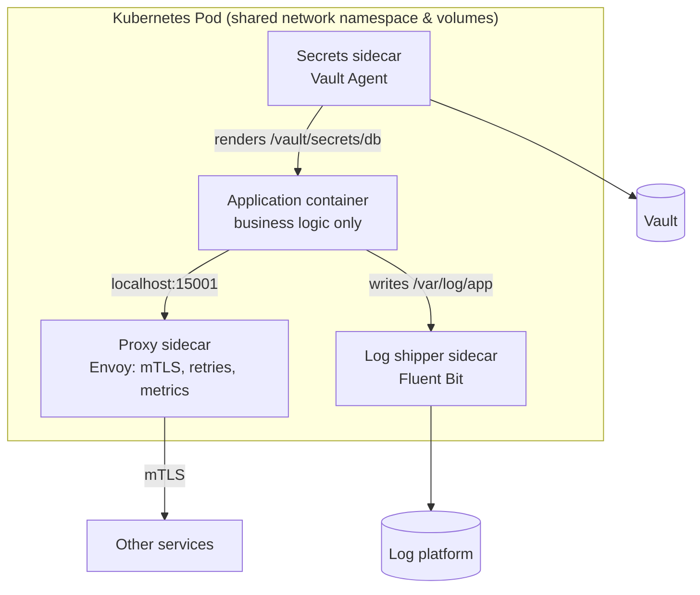

A motorcycle sidecar rides alongside the bike, shares its journey, and adds capacity without redesigning the motorcycle. The **Sidecar** pattern deploys a **helper process next to each service instance** — in the same Kubernetes pod, sharing its network namespace and lifecycle — to provide **cross-cutting capabilities** the service itself doesn't implement.

Sidecars are how service meshes inject mTLS and traffic control, how many teams ship logs and metrics, and how runtimes like Dapr give every language the same building blocks.

## The problem

Every service needs the same plumbing: TLS, retries and timeouts, metrics and traces, log shipping, secret fetching, configuration reload, auth token validation. Implementing these in every service:

- **duplicates effort** across teams and languages,
- **drifts** — each team's version behaves slightly differently,
- **couples upgrades** — patching a TLS library means rebuilding and redeploying every service,
- is **hard for polyglot estates** — the Java library doesn't help the Python or Go teams.

## How it works



Because sidecars share the pod's **network** (localhost) and can share **volumes**, they can intercept traffic, read files the app writes, or provide files the app reads — without the application knowing much about them.

## Common sidecar roles

| Role | Example | What the app gains |
|---|---|---|
| **Network proxy** | Envoy (Istio), linkerd2-proxy | mTLS, retries, timeouts, traffic splitting, L7 metrics |
| **Distributed runtime** | Dapr | State, pub/sub, bindings, workflows, secrets via a local HTTP/gRPC API |
| **Telemetry agent** | OpenTelemetry Collector | Local OTLP endpoint, batching, enrichment, export |
| **Log shipping** | Fluent Bit, Vector | Tail files, parse, forward |
| **Secrets / config** | Vault Agent, CSI drivers, config reloaders | Fetch and rotate credentials into files |
| **Auth** | OAuth2 Proxy, OPA | Authentication and policy decisions at localhost |
| **Adapter** | Protocol translators, legacy format converters | Expose a modern API for a legacy process |

## Example: native sidecars in Kubernetes

Kubernetes 1.29+ supports **native sidecars**: init containers with `restartPolicy: Always`. They start **before** the app, keep running alongside it, and shut down **after** it — fixing long-standing ordering problems (e.g., the app starting before the proxy is ready, or Jobs never completing because the sidecar keeps running).

```yaml
apiVersion: apps/v1
kind: Deployment
metadata: { name: statements }
spec:
  template:
    spec:
      initContainers:
        - name: otel-collector                  # native sidecar
          image: otel/opentelemetry-collector-contrib:0.110.0
          restartPolicy: Always
          args: ["--config=/conf/collector.yaml"]
          ports: [{ containerPort: 4317 }]       # app sends OTLP to localhost:4317
          resources:
            requests: { cpu: 50m, memory: 64Mi }
            limits:   { memory: 128Mi }
          volumeMounts: [{ name: otel-conf, mountPath: /conf }]

        - name: log-shipper
          image: fluent/fluent-bit:3.1
          restartPolicy: Always
          volumeMounts: [{ name: app-logs, mountPath: /var/log/app, readOnly: true }]

      containers:
        - name: app
          image: registry.example.com/statements:2026.10.17
          env:
            - { name: OTEL_EXPORTER_OTLP_ENDPOINT, value: "http://localhost:4317" }
          volumeMounts: [{ name: app-logs, mountPath: /var/log/app }]

      volumes:
        - { name: app-logs, emptyDir: {} }
        - { name: otel-conf, configMap: { name: statements-otel } }
```

## Example: Dapr sidecar

Dapr injects a `daprd` sidecar that exposes building blocks over localhost. The app publishes an event without a Kafka client library:

```python
import requests

# Dapr sidecar listens on localhost:3500; "pubsub" component maps to Kafka, Service Bus, etc.
requests.post(
    "http://localhost:3500/v1.0/publish/pubsub/statements.generated",
    json={"statementId": "st-2026-10-0042", "accountId": "AC-1842"},
    headers={"traceparent": current_traceparent()},
    timeout=2,
)
```

```yaml
apiVersion: dapr.io/v1alpha1
kind: Component
metadata: { name: pubsub }
spec:
  type: pubsub.kafka
  version: v1
  metadata:
    - { name: brokers, value: "kafka:9092" }
    - { name: consumerGroup, value: "statements" }
    - { name: authType, value: "none" }   # use mTLS/SASL in real environments
```

Switching from Kafka to Azure Service Bus becomes a component change, not a code change.

## Sidecar vs. alternatives

| Approach | Pros | Cons |
|---|---|---|
| **In-process library** | Fastest; no extra containers | Per-language; upgrades require redeploys |
| **Sidecar per pod** | Language-agnostic; upgrade independently; strong isolation | CPU/memory per pod; extra hop; lifecycle complexity |
| **Node agent (DaemonSet)** | One per node; lower overhead | Shared across tenants; less per-workload isolation |
| **Sidecar-less mesh** (Istio ambient, Cilium) | No per-pod proxy for L4; optional L7 waypoints | Newer; different operational model |

## Design considerations

- **Resource requests and limits** for every sidecar — they count toward pod scheduling and can be OOM-killed.
- **Startup and shutdown ordering** — use native sidecars, or hold the app's start until the proxy is ready.
- **Version management** — sidecars are often injected by a platform (mutating webhooks); coordinate upgrades and roll them like any release.
- **Security** — sidecars share the pod's network and often its service account; give them least privilege.
- **Observability of the sidecar itself** — its health, latency, and errors are now part of your service's behavior.

## Trade-offs

| Benefits | Costs |
|---|---|
| Cross-cutting concerns without app code changes | Extra CPU and memory in every pod |
| Same capabilities for every language | Additional network hop / latency (usually sub-millisecond on localhost) |
| Independent upgrades of platform features | More containers to debug; lifecycle subtleties |
| Clear separation of business logic and plumbing | Platform dependency and injection magic |

## Common pitfalls

> **Pitfall:** Jobs that never finish. A classic (pre-native-sidecar) bug: a Kubernetes Job's main container exits, but the proxy or log-shipper sidecar keeps running, so the Job never completes. Native sidecars (`restartPolicy: Always` init containers) fix this.

- **No resource limits** — a misbehaving log shipper starves the application.
- **App starts before the proxy** — the first requests fail with connection errors.
- **Too many sidecars** — five helpers per pod multiplies resource overhead across thousands of pods.
- **Hidden coupling** — the app depends on sidecar behavior (retries, auth) that isn't documented or tested.

## Tools and real-world usage

- **Envoy** (Istio, Consul), **linkerd2-proxy** — mesh data-plane sidecars.
- **Dapr** — portable building blocks via sidecar.
- **OpenTelemetry Collector**, **Fluent Bit**, **Vector** — telemetry and logs.
- **Vault Agent Injector**, **Secrets Store CSI Driver** — secrets delivery.
- **OAuth2 Proxy**, **Open Policy Agent** — authentication and authorization sidecars.

## Related patterns

- [Service Mesh](/blog/service-mesh/) — a fleet of proxy sidecars plus a control plane.
- [Distributed Tracing](/blog/distributed-tracing/) and [Log Aggregation](/blog/log-aggregation/) — commonly delivered via sidecars.
- [Anti-Corruption Layer](/blog/anti-corruption-layer/) — an adapter sidecar can translate a legacy protocol.
- [Health Check](/blog/health-check/) — sidecar readiness affects pod readiness.

## Key takeaways

1. A sidecar is a helper container sharing the service's pod, network, and lifecycle.
2. It delivers cross-cutting capabilities to any language without code changes.
3. Budget resources, manage ordering (native sidecars), and secure each sidecar.
4. Weigh it against libraries, node agents, and sidecar-less meshes.
