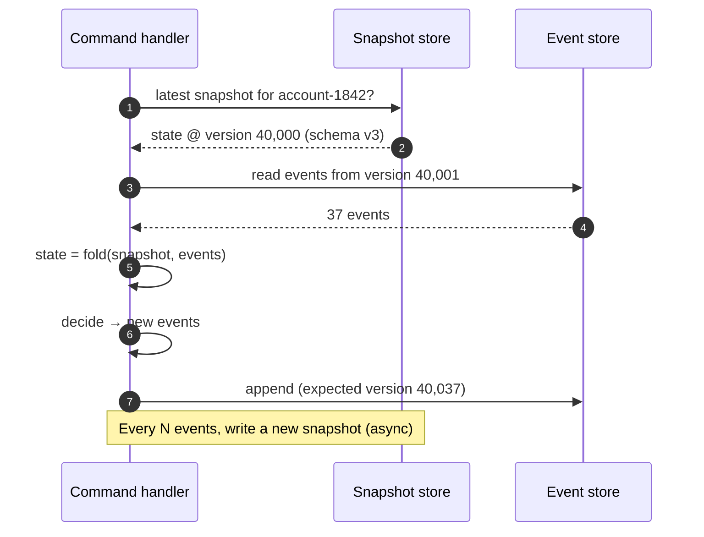

[Event Sourcing](/blog/event-sourcing/) rebuilds an aggregate's state by replaying its events. For an order with 12 events, that's instant. For a bank account with 40,000 transactions or an IoT device with millions of readings, replaying on every command becomes the bottleneck.

The **Snapshot** pattern periodically saves the **aggregate's state at a given version**. To load, you read the latest snapshot and replay **only the events after it**.

## The problem

Load time grows linearly with stream length:

| Events in stream | Replay time (illustrative, ~5 µs per event incl. deserialization) |
|---|---|
| 100 | 0.5 ms |
| 10,000 | 50 ms |
| 1,000,000 | 5 s |

Plus I/O to read the events. Long-lived aggregates — accounts, ledgers, subscriptions, devices, long-running workflows — eventually make every command slow.

## How it works



A snapshot record contains:

- **Stream / aggregate ID**
- **Version** — the last event folded into it
- **State** — serialized aggregate state
- **Snapshot schema version** — so old snapshots can be detected and discarded
- **Timestamp**

## Example: snapshotting in TypeScript

```typescript
interface Snapshot<S> { streamId: string; version: number; schema: number; state: S; takenAt: string }

const SNAPSHOT_EVERY = 500;
const SNAPSHOT_SCHEMA = 3;   // bump when the state shape or evolve() logic changes

export async function loadAccount(id: string, store: EventStore, snaps: SnapshotStore) {
  const streamId = `account-${id}`;
  const snap = await snaps.latest<AccountState>(streamId);

  // Ignore snapshots produced by an older state shape: fall back to full replay
  const usable = snap && snap.schema === SNAPSHOT_SCHEMA ? snap : undefined;

  let state = usable?.state ?? emptyAccount(id);
  const fromVersion = (usable?.version ?? 0) + 1;

  for await (const event of store.readFrom<AccountEvent>(streamId, fromVersion)) {
    state = evolve(state, event);
  }
  return state;   // state.version tells us how far we are
}

export async function handleCommand(id: string, cmd: AccountCommand, deps: Deps) {
  const state = await loadAccount(id, deps.store, deps.snaps);
  const newEvents = decide(state, cmd);
  await deps.store.append(`account-${id}`, newEvents, { expectedVersion: state.version });

  const after = newEvents.reduce(evolve, state);
  const lastSnapVersion = Math.floor(state.version / SNAPSHOT_EVERY);
  const nowSnapVersion = Math.floor(after.version / SNAPSHOT_EVERY);
  if (nowSnapVersion > lastSnapVersion) {
    // Fire-and-forget: a failed snapshot only costs performance, never correctness
    deps.snaps.save({ streamId: `account-${id}`, version: after.version, schema: SNAPSHOT_SCHEMA,
                      state: after, takenAt: new Date().toISOString() })
      .catch((e) => deps.log.warn("snapshot failed", { id, e }));
  }
}
```

A simple relational snapshot store:

```sql
CREATE TABLE snapshot (
  stream_id   VARCHAR(100) NOT NULL,
  version     BIGINT       NOT NULL,
  schema_ver  INT          NOT NULL,
  state       JSONB        NOT NULL,
  taken_at    TIMESTAMPTZ  NOT NULL DEFAULT now(),
  PRIMARY KEY (stream_id, version)
);
-- Keep only the most recent few per stream with a periodic cleanup job.
```

## When to take snapshots

| Strategy | How it works | Notes |
|---|---|---|
| **Every N events** | Snapshot when version crosses a multiple of N | Most common; N of 100–1,000 is typical |
| **Time-based** | Snapshot aggregates changed in the last period, nightly | Good for batch-friendly domains |
| **On load-time threshold** | Snapshot when replay took longer than X ms | Adapts to real cost |
| **Business milestones** | Snapshot at period close (month-end statement) | Doubles as a meaningful checkpoint |

Measure first. Many event-sourced systems never need snapshots because aggregates are small and short-lived — which is usually the better design.

## Snapshots are a cache

The single most important rule: **a snapshot is derived data**. The events remain the source of truth.

- Losing all snapshots must only cost **performance**, never correctness.
- If a snapshot looks wrong, **delete it** and let the next load replay from events.
- When the aggregate's state shape or `evolve` logic changes, **old snapshots are invalid**. Bump the schema version and let them be ignored or regenerated.
- Don't use snapshots as a shortcut to delete old events unless you deliberately want to give up history (a separate, explicit "archival" decision).

## Design considerations

- **Write asynchronously.** Snapshot creation shouldn't add latency to commands. A background process can also generate snapshots for hot streams.
- **Serialize state deliberately.** Use a stable format (JSON/Protobuf) with explicit fields, not language-native object serialization that breaks on refactors.
- **Consider "closing the books".** For ledgers, a periodic *closing* event (`StatementClosed(balance)`) is often better modelling than a technical snapshot: it's a real business fact and lets new streams start from an opening balance.
- **Model smaller aggregates first.** If a stream grows without bound, the aggregate may be too big (e.g., a device aggregate per day/month instead of per device lifetime).

## Trade-offs

| Benefits | Costs |
|---|---|
| Bounded load time for long streams | Extra storage and a snapshot store to manage |
| Lower read I/O on the event store | Invalidation when state shape changes |
| Transparent to domain logic | Risk of treating snapshots as truth |
| Can double as business checkpoints | Added code paths to test (with/without snapshot) |

## Common pitfalls

> **Warning:** forgetting snapshot versioning. You add a field to `AccountState`, deploy, and loads now start from old snapshots missing that field — silently computing wrong state. Always version snapshots and test loading with and without them.

- Snapshotting synchronously inside the command transaction and failing the command if the snapshot write fails.
- Snapshots written with a version that doesn't match the last folded event (off-by-one errors cause double-applied or skipped events).
- Using snapshots to hide a modelling problem (unbounded aggregates).

## Tools and real-world usage

- **Axon Framework** — `SnapshotTriggerDefinition` (e.g., `EventCountSnapshotTriggerDefinition`) with snapshot events stored alongside the stream.
- **Marten** — inline or async projections can maintain aggregate snapshots in PostgreSQL.
- **Akka Persistence / Pekko** — `SnapshotOffer` on recovery and snapshot criteria per persistent actor.
- **EventStoreDB** — commonly paired with a separate snapshot stream per aggregate (`account-1842-snapshot`) or a document store.

## Related patterns

- [Event Sourcing](/blog/event-sourcing/) — the storage model snapshots optimize.
- [Aggregate](/blog/aggregate-ddd/) — the unit being snapshotted; size it well first.
- [Materialized View](/blog/materialized-view/) — similar idea for read models.
- [CQRS](/blog/cqrs/) — read-side projections reduce the need to load aggregates for queries.

## Key takeaways

1. A snapshot stores aggregate state at a version; load = latest snapshot + newer events.
2. Snapshots are a disposable cache — events stay the source of truth.
3. Version snapshots and invalidate them when state shape or logic changes.
4. Measure before adding them; small aggregates often make snapshots unnecessary.
