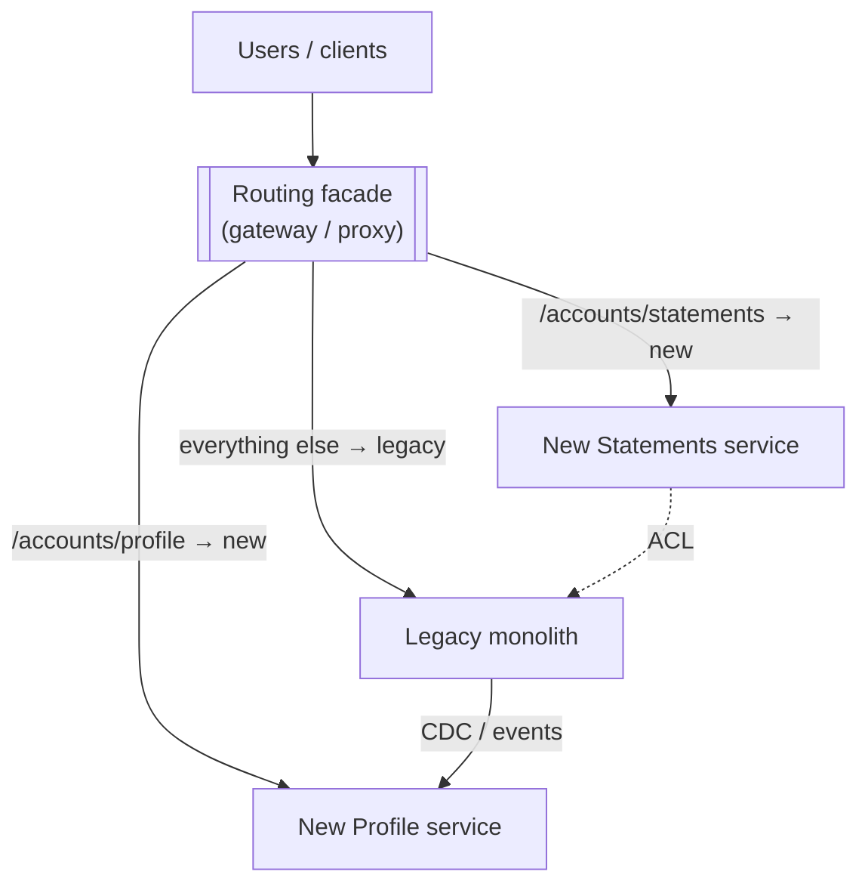
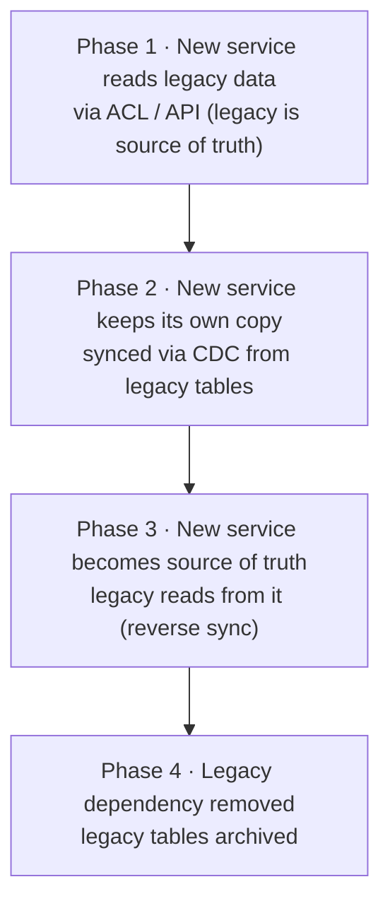

Strangler figs germinate in the branches of a host tree, send roots down around it, and grow until they can stand on their own — by which time the host has gone. Martin Fowler borrowed the image for the **Strangler Fig** pattern: build the new system **around the edges** of the old one, move functionality over **one slice at a time**, and retire the legacy system when nothing depends on it any more.

It's the antidote to the big-bang rewrite — the multi-year project that tries to replace everything at once and too often fails to ship.

## The problem

Big-bang rewrites fail for predictable reasons:

- The old system keeps changing while you rebuild it — you're chasing a moving target.
- Hidden behavior (undocumented rules, batch jobs, edge cases) is discovered at cut-over.
- No value reaches users until the very end.
- Cut-over day is a single, enormous, high-risk event.

## How it works



1. **Intercept** — put a routing layer (API gateway, reverse proxy, or a facade in the monolith) in front of the legacy system. Initially it routes 100% to legacy.
2. **Pick a slice** — a capability with clear boundaries and real value.
3. **Build it new** — in the target architecture, behind an [Anti-Corruption Layer](/blog/anti-corruption-layer/) where it must talk to legacy.
4. **Divert traffic** — route that slice to the new system, gradually (by user, percentage, or tenant).
5. **Remove** the legacy code for that slice once it's no longer used.
6. **Repeat** until the legacy system is empty — then switch it off.

## Example: routing with NGINX

```nginx
upstream legacy  { server legacy-app.internal:8080; }
upstream stmts   { server statements.svc.internal:8080; }

# Canary by cookie/header first, then by percentage
split_clients "${remote_addr}${http_user_agent}" $statements_backend {
    20%   stmts;          # 20% of anonymous traffic to the new service
    *     legacy;
}

map $http_x_canary $statements_target {
    "true"   stmts;       # internal testers always hit the new path
    default  $statements_backend;
}

server {
  listen 443 ssl;

  location /accounts/statements {
    proxy_pass http://$statements_target;
    proxy_set_header X-Correlation-ID $request_id;
  }

  location / {
    proxy_pass http://legacy;     # everything not yet migrated
  }
}
```

Gateways (Kong, Envoy, the Kubernetes Gateway API) offer the same with weighted routes and header matches, and feature flags can route by customer segment inside the application.

## Choosing the first slice

| Good first slices | Poor first slices |
|---|---|
| Read-mostly features (statements, catalog browsing) | The core transactional heart (ledger posting) |
| Clear inputs/outputs and few dependencies | Features tangled with dozens of tables |
| High change rate (you'll benefit immediately) | Stable features nobody needs to change |
| Visible value to users or the business | Pure "technical" rewrites with no observable benefit |
| New features that would otherwise be built in legacy | — |

> **Rule of thumb:** stop adding features to the legacy system first. Every *new* capability goes into the new architecture — this alone starts the strangling.

## The data problem

Routing requests is the easy part; data is the hard part. Options, roughly in order of maturity:



- **[Change Data Capture](/blog/change-data-capture/)** from legacy tables keeps new stores in sync without modifying legacy code.
- **Dual writes are dangerous** — prefer one source of truth per data set at each phase, with one-directional sync.
- **Reconcile** — run automated comparisons between old and new data during migration and alert on drift.

## Reducing risk: shadow traffic and parallel runs

Before sending real users to the new slice, compare behaviors:

- **Shadow (dark) traffic** — mirror production requests to the new service, discard its responses, and compare them with legacy's. Envoy/Istio support request mirroring.
- **Parallel run** — for calculations (interest, fees, eligibility), run both and alert on differences; the legacy result remains authoritative until confidence is high.
- **Gradual rollout** — internal users → 1% → 10% → 50% → 100%, with a one-switch rollback.

```yaml
# Istio: mirror 100% of statement traffic to the new service while legacy still serves
http:
  - match: [{ uri: { prefix: /accounts/statements } }]
    route: [{ destination: { host: legacy } }]
    mirror: { host: statements }
    mirrorPercentage: { value: 100.0 }
```

> **Warning:** shadow traffic must not cause side effects. Mirrored *writes* to a new service that sends emails or posts to a ledger will double-act. Mirror reads freely; mirror writes only to sandboxed or no-op paths.

## Finishing the job

Strangler migrations often stall at 80%. The last 20% is the hardest code with the least glamour — and keeping two systems running indefinitely is the worst outcome. Keep momentum with:

- A **visible migration map** of slices: legacy, in progress, migrated, removed.
- **Decommissioning as a goal** with dates and budget, not an afterthought.
- **Deleting legacy code** for each migrated slice (not just routing around it).
- Measuring **legacy traffic** and **legacy change requests** trending to zero.

## Trade-offs

| Benefits | Costs |
|---|---|
| Value delivered continuously, not at the end | Two systems run in parallel for a long time |
| Small, reversible steps reduce risk | Routing and data-sync infrastructure to maintain |
| Learn the legacy behavior slice by slice | Temporary integration code (ACLs, CDC) |
| The business keeps evolving during migration | Risk of stalling before decommissioning |

## Common pitfalls

> **Pitfall:** recreating the monolith's structure in microservices — same data model, same boundaries, same coupling — just over HTTP. Use the migration to redraw boundaries around business capabilities and [aggregates](/blog/aggregate-ddd/).

- **No routing layer** — every client must be changed to call the new service.
- **Bidirectional sync** between old and new databases, causing loops and conflicts.
- **Migrating the easiest technical layer first** (e.g., "the UI") with no capability moving.
- **Never deleting legacy code**, so the old system keeps being maintained.

## Tools and real-world usage

- **Routing** — API gateways (Kong, Apigee, AWS API Gateway), reverse proxies (NGINX, Envoy, HAProxy), service meshes (traffic splitting and mirroring), feature-flag platforms.
- **Data** — Debezium, Oracle GoldenGate, AWS DMS for CDC; reconciliation jobs.
- **Legacy integration** — ACL services, MQ bridges, z/OS Connect for mainframes.

Strangler-style migrations are the norm for banks moving off monolithic platforms: digital channels, statements, notifications, and document services move first, while the core ledger is strangled last, behind ACLs and CDC — the same approach I've seen work when re-architecting a legacy content-management platform into microservices that served both old SOAP consumers and new REST APIs during the transition.

## Related patterns

- [Anti-Corruption Layer](/blog/anti-corruption-layer/) — protects new services from the legacy model.
- [API Gateway](/blog/api-gateway/) — the usual routing facade.
- [Change Data Capture](/blog/change-data-capture/) — data sync during migration.
- [Shared Database](/blog/shared-database/) — the starting point you're often migrating from.

## Key takeaways

1. Put a routing facade in front of legacy, then move one capability at a time.
2. Stop building new features in legacy; start with valuable, well-bounded slices.
3. Keep one source of truth per data set per phase; sync one way with CDC; reconcile.
4. De-risk with shadow traffic, parallel runs, and gradual rollout — and finish by deleting the old system.
