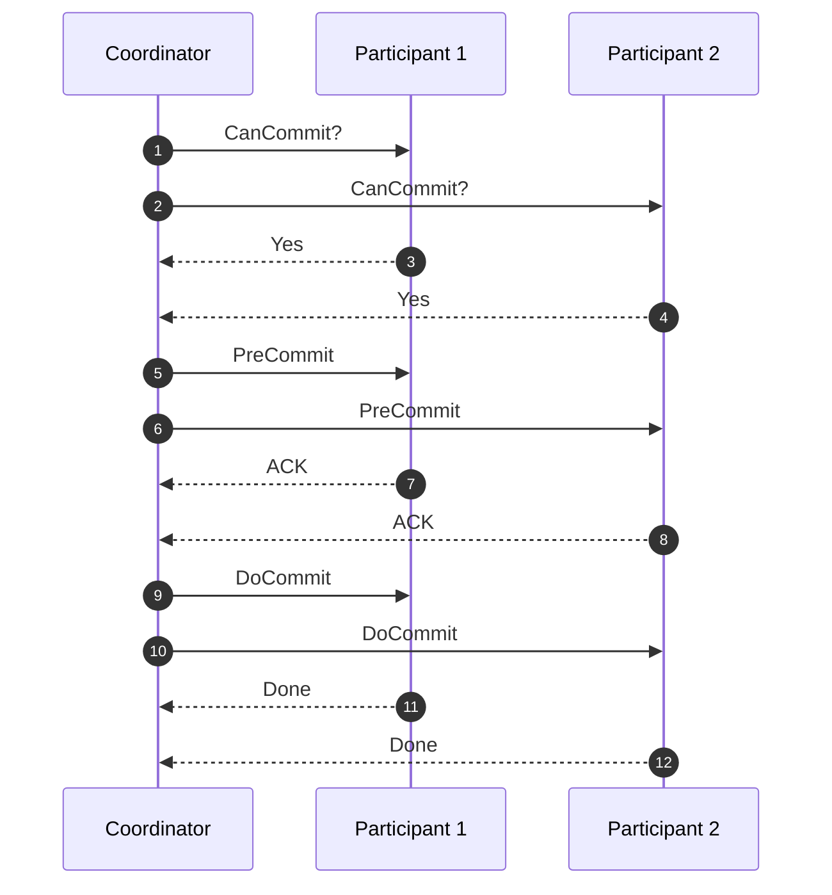
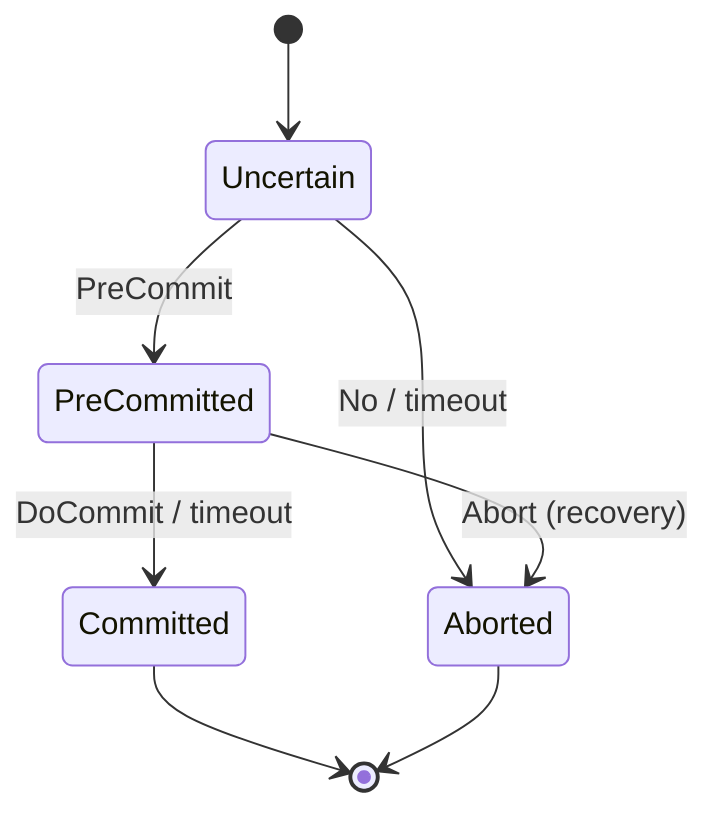
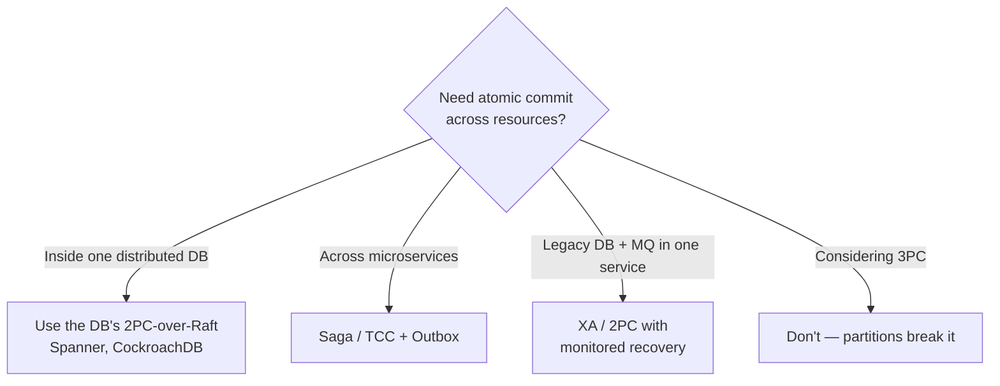

[Two-Phase Commit](/blog/two-phase-commit/) has one infamous weakness: if the coordinator crashes after participants vote Yes, they are stuck **in doubt**, holding locks until it comes back. **Three-Phase Commit (3PC)**, proposed by Dale Skeen in 1981, adds an extra round so that participants can always reach a safe decision on their own — without waiting for the coordinator.

You will almost never deploy 3PC. But understanding *why* it fails in practice explains why modern systems moved to consensus protocols instead, and it sharpens your intuition for every other distributed-transaction pattern.

## The problem 3PC tries to solve

In 2PC, a participant that voted Yes can't tell the difference between:

- "The coordinator decided **commit** and crashed before telling me," and
- "The coordinator decided **abort** (someone voted No) and crashed before telling me."

Both look identical from where it stands, so it must block. 3PC's insight is to make sure that **no participant commits until every participant knows the decision will be commit**. Then a surviving group can always infer the outcome.

## How it works

3PC splits 2PC's second phase into two.

1. **CanCommit?** — The coordinator asks each participant if it can commit. Participants vote Yes/No but **do not** lock-and-log as aggressively as 2PC's prepare.
2. **PreCommit** — If all voted Yes, the coordinator sends `PreCommit`. Participants prepare, then acknowledge. Now everyone knows *everyone* voted Yes.
3. **DoCommit** — After all `PreCommit` acks, the coordinator sends `DoCommit`. Participants commit.



### Recovery rules — the whole point

Each participant also uses **timeouts** to decide on its own:

| Participant state when coordinator goes silent | Safe local decision | Why |
|---|---|---|
| Waiting for `CanCommit` / voted but no `PreCommit` | **Abort** | No one can have committed — commit requires everyone to reach PreCommit first. |
| In `PreCommit` state, waiting for `DoCommit` | **Commit** | Everyone voted Yes, so commit is the only outcome the coordinator could have chosen. |

When the coordinator fails, a **recovery coordinator** is elected from the participants. It polls their states: if anyone is `PreCommitted`, the decision is commit; if anyone is still `Uncertain` and no one is pre-committed, abort.



## Why 3PC isn't used in production

3PC is non-blocking **only if** two assumptions hold:

1. **Failures are crash-stop** — nodes die cleanly and don't come back with stale ideas.
2. **The network is synchronous** — message delays are bounded, so a timeout reliably means "that node crashed", not "that node is slow".

Real networks break assumption 2 constantly. Consider a **network partition** during phase 3:

- Partition A contains participants that received `PreCommit`. They time out and **commit**.
- Partition B contains participants that never got `PreCommit`. They time out and **abort**.

Result: a split decision — the exact atomicity violation the protocol exists to prevent. 2PC would have blocked (safe but stuck); 3PC proceeds (live but wrong). The FLP impossibility result tells us no deterministic protocol can guarantee both safety and liveness in a fully asynchronous system with even one faulty process, so this isn't a fixable bug — it's a fundamental limit.

Add to that:

- **More latency** — three round trips instead of two on every commit.
- **More messages** — roughly 50% more network traffic.
- **More complexity** — recovery-coordinator election is itself a distributed-agreement problem.

## What production systems do instead

Rather than making the *protocol* non-blocking, modern systems make the **coordinator highly available**:

- **Paxos Commit** (Gray & Lamport, 2004) — each participant's vote is replicated via Paxos, so the decision survives coordinator failure. It's the theory behind non-blocking commit in practice.
- **2PC over consensus groups** — Google Spanner, CockroachDB, YugabyteDB, and TiDB run 2PC where each participant *and* the transaction record are Raft/Paxos groups. A crashed leader is replaced in seconds, and the in-doubt window shrinks to an election timeout.
- **Avoiding atomic commit altogether** — microservices typically use [Sagas](/blog/saga-pattern/), [TCC](/blog/try-confirm-cancel/), or [Eventual Consistency](/blog/eventual-consistency/) with an [Outbox](/blog/transactional-outbox/).



## A tiny simulation

This Python sketch shows the timeout rules — and how a partition produces a split decision.

```python
from enum import Enum

class State(Enum):
    UNCERTAIN = "uncertain"
    PRECOMMITTED = "precommitted"
    COMMITTED = "committed"
    ABORTED = "aborted"

def on_coordinator_timeout(state: State) -> State:
    """3PC's local decision rule when the coordinator goes silent."""
    if state is State.UNCERTAIN:
        return State.ABORTED        # nobody can have committed yet
    if state is State.PRECOMMITTED:
        return State.COMMITTED      # everybody must have voted yes
    return state

# Coordinator sent PreCommit, but a partition dropped it for P3.
participants = {"P1": State.PRECOMMITTED, "P2": State.PRECOMMITTED, "P3": State.UNCERTAIN}

outcome = {name: on_coordinator_timeout(s) for name, s in participants.items()}
print(outcome)
# {'P1': COMMITTED, 'P2': COMMITTED, 'P3': ABORTED}  -> atomicity violated
```

## Trade-offs

| Benefits | Costs |
|---|---|
| Non-blocking under crash-stop failures with bounded delays | Unsafe under network partitions (split decisions) |
| Participants can decide without the coordinator | Extra round trip on every transaction |
| Useful teaching tool for commit-protocol reasoning | Recovery coordinator election adds complexity |
| — | Practically no production implementations or tooling |

## When to use it

Honestly: **almost never**. Its value today is educational:

- Explaining *why* 2PC blocks and what information participants lack.
- Motivating consensus-based commit (Paxos Commit, Raft-replicated coordinators).
- Interview and design-review discussions about safety vs. liveness.

If someone proposes 3PC for a production system, ask how it behaves under a partition — and steer toward a consensus-backed coordinator or a saga.

## Common misconceptions

> **Pitfall:** "3PC is just a better 2PC." It isn't. It trades 2PC's *blocking* failure mode for a *wrong answer* failure mode. In most businesses, a stuck transaction is far better than a half-committed one.

- **"Timeouts detect failures."** Only in synchronous networks. In real networks a timeout means "slow *or* dead" — the root of 3PC's problem.
- **"Adding phases adds safety."** Phases add information, but no number of phases beats FLP without extra assumptions (failure detectors, randomness, or partial synchrony with consensus).

## Related patterns

- [Two-Phase Commit](/blog/two-phase-commit/) — the protocol 3PC extends.
- [Leader Election](/blog/leader-election/) — how real systems make coordinators highly available.
- [Saga](/blog/saga-pattern/) — the pragmatic alternative across services.
- [Eventual Consistency](/blog/eventual-consistency/) — relaxing atomicity instead of fighting for it.

## Key takeaways

1. 3PC adds a **PreCommit** phase so participants can safely decide without the coordinator.
2. It's non-blocking only with crash-stop failures **and** bounded network delays.
3. Partitions can make 3PC commit on one side and abort on the other.
4. Production systems instead replicate the coordinator with consensus — or avoid atomic commit with sagas.
