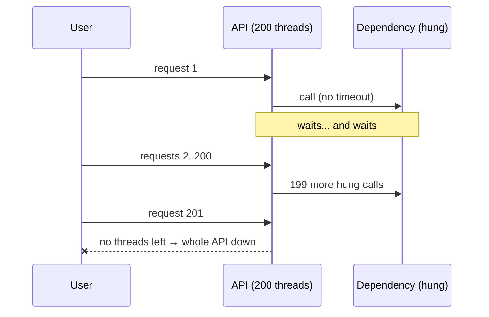
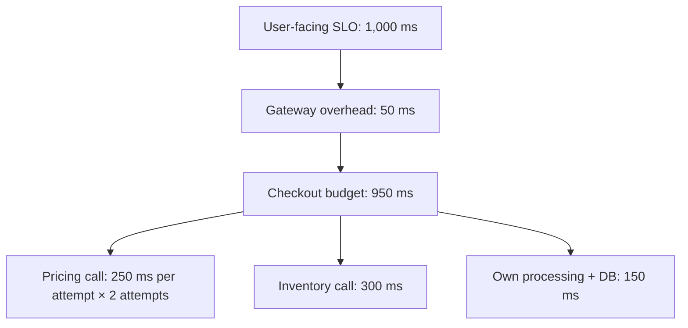

The most dangerous default in software is "wait forever". Many HTTP clients, database drivers, and SDKs ship with **no timeout** or with timeouts measured in minutes. When a dependency hangs — not fails, *hangs* — every call to it holds a thread, a connection, and a user's patience until something gives.

The **Timeout** pattern is simple: **cap how long you'll wait** for any remote operation, and treat exceeding that cap as a failure you can handle. It's the foundation every other resilience pattern stands on: [retries](/blog/retry-with-backoff/) need an attempt to end, [circuit breakers](/blog/circuit-breaker/) need outcomes to count, and [bulkheads](/blog/bulkhead/) need slots to be freed.

## The problem



A slow or hung dependency is worse than a dead one. A dead one fails fast (connection refused); a hung one silently consumes your resources.

## Kinds of timeouts

| Timeout | Bounds | Typical value |
|---|---|---|
| **Connect** | Establishing the TCP/TLS connection | 100 ms – 1 s within a region |
| **Read / socket / idle** | Time between bytes once connected | Slightly above dependency p99.9 |
| **Write** | Sending the request body | Similar to read |
| **Request / call / overall** | Whole operation, including retries | Derived from the caller's budget |
| **Pool acquisition** | Waiting for a free connection from a pool | Small (tens of ms) — a full pool means overload |
| **Idle connection** | Keeping unused pooled connections | Below load balancer/NAT idle timeouts |

Most incidents come from setting only one of these. A 2 s read timeout doesn't help if the connection pool wait is unbounded.

## Choosing values

Base timeouts on **measured latency**, not guesses:

1. Look at the dependency's latency distribution (p50, p99, p99.9) under normal load.
2. Set the per-attempt timeout a bit above the p99–p99.9 — high enough that healthy calls succeed, low enough that hung calls are cut off quickly.
3. Derive the overall timeout from **the caller's budget**: the user-facing SLO minus your own processing time.



If the budget doesn't fit, the architecture is telling you something — parallelize calls, cache, or make work asynchronous.

## Deadline propagation

Fixed per-hop timeouts don't compose. If service A gives up after 1 s but service C, three hops down, is configured for 5 s, C keeps working on a request nobody is waiting for — wasting capacity during exactly the overload that caused the slowness.

**Deadlines** solve this: the edge sets an **absolute** deadline, and each hop passes the **remaining** time downstream.

### gRPC (built in)

```go
// Edge handler: the whole request must finish within 800 ms
ctx, cancel := context.WithTimeout(r.Context(), 800*time.Millisecond)
defer cancel()

// gRPC propagates the deadline automatically as the grpc-timeout header
resp, err := pricing.Quote(ctx, &pb.QuoteRequest{Sku: sku})
if status.Code(err) == codes.DeadlineExceeded {
    // fall back, or return 504 to the caller
}

// Downstream service: check remaining time before expensive work
func (s *server) Quote(ctx context.Context, req *pb.QuoteRequest) (*pb.Quote, error) {
    if dl, ok := ctx.Deadline(); ok && time.Until(dl) < 20*time.Millisecond {
        return nil, status.Error(codes.DeadlineExceeded, "insufficient time budget")
    }
    return s.compute(ctx, req) // pass ctx into DB/cache calls so they're cancelled too
}
```

### HTTP (by convention)

There's no standard header, but the pattern is easy: pass an absolute deadline or remaining budget, and derive client timeouts from it.

```typescript
const DEADLINE_HEADER = "x-request-deadline";      // epoch millis

export function remainingMs(req: Request, fallbackMs = 1000): number {
  const h = req.headers.get(DEADLINE_HEADER);
  return h ? Math.max(0, Number(h) - Date.now()) : fallbackMs;
}

export async function callDownstream(url: string, req: Request, ownReserveMs = 30) {
  const budget = remainingMs(req) - ownReserveMs;   // keep time to build our response
  if (budget <= 0) throw new Error("deadline exceeded before call");

  const res = await fetch(url, {
    signal: AbortSignal.timeout(Math.min(budget, 500)),   // never exceed per-attempt cap
    headers: { [DEADLINE_HEADER]: String(Date.now() + budget) },
  });
  return res;
}
```

## Configuring clients

```java
// Java 11+ HttpClient — connect timeout on the client, request timeout per call
HttpClient client = HttpClient.newBuilder()
    .connectTimeout(Duration.ofMillis(300))
    .build();

HttpRequest request = HttpRequest.newBuilder(URI.create(pricingUrl))
    .timeout(Duration.ofMillis(400))          // whole response must arrive within 400 ms
    .GET().build();

// HikariCP — don't wait long for a pooled connection; a full pool is an overload signal
HikariConfig db = new HikariConfig();
db.setConnectionTimeout(250);                 // ms to get a connection from the pool
db.addDataSourceProperty("socketTimeout", "5");  // PostgreSQL JDBC: seconds of socket inactivity
// And a server-side guard: SET statement_timeout = '2s' for OLTP roles
```

```yaml
# Envoy / Istio route-level timeouts
apiVersion: networking.istio.io/v1
kind: VirtualService
metadata: { name: pricing }
spec:
  hosts: [pricing]
  http:
    - route: [{ destination: { host: pricing } }]
      timeout: 800ms            # overall, including retries
      retries:
        attempts: 2
        perTryTimeout: 300ms
        retryOn: connect-failure,refused-stream,unavailable,5xx
```

## What happens after a timeout?

A timeout tells you **"I don't know"** — not "it failed". The remote operation may have succeeded.

- **Reads** — safe to retry or fall back.
- **Writes** — retry only with an **idempotency key**, or check status before retrying. See [Idempotent Consumer](/blog/idempotent-consumer/).
- **Cancel downstream work** — propagate cancellation (gRPC context, `AbortSignal`, JDBC `Statement.cancel`) so the dependency stops wasting effort.
- **Return a clear error** — `504 Gateway Timeout` or gRPC `DEADLINE_EXCEEDED` — or a [Fallback](/blog/fallback-pattern/).

## Trade-offs

| Benefits | Costs |
|---|---|
| Bounds resource usage per call | Too-tight values fail healthy-but-slow calls |
| Converts hangs into handleable failures | Ambiguous outcomes for writes |
| Enables retries, breakers, bulkheads to work | Values must be revisited as latency changes |
| Deadlines prevent wasted downstream work | Propagation needs consistent client libraries |

## Common pitfalls

> **Pitfall:** downstream timeouts longer than upstream ones. The gateway gives up at 5 s; the service it calls waits 30 s on the database. Timeouts should **shrink** as you go deeper, or better, follow a propagated deadline.

- **Default infinite timeouts** in HTTP clients, SDKs, and drivers. Audit them.
- **Retry × timeout math** — 3 attempts × 2 s timeout + backoff can exceed the caller's 3 s budget.
- **Timeouts without cancellation** — the caller moves on but the work continues, consuming capacity.
- **Same timeout for every endpoint** — a report export and a price lookup have very different latency profiles.

## Tools and real-world usage

- **gRPC deadlines** — propagated automatically across hops; the reference implementation of the idea.
- **Resilience4j TimeLimiter**, **Polly Timeout**, Go `context.WithTimeout`, `AbortSignal.timeout()` in JavaScript.
- **Envoy/Istio** route timeouts and per-try timeouts; NGINX `proxy_read_timeout`; cloud load balancer idle timeouts.
- **Database guards** — PostgreSQL `statement_timeout`, MySQL `max_execution_time`, Oracle resource manager limits.

## Related patterns

- [Retry with Backoff](/blog/retry-with-backoff/) — each attempt needs a timeout; the series needs a deadline.
- [Circuit Breaker](/blog/circuit-breaker/) — counts timeouts as failures.
- [Bulkhead](/blog/bulkhead/) — timeouts free its slots.
- [Fallback](/blog/fallback-pattern/) — what to return when time runs out.

## Key takeaways

1. Never wait forever: set connect, read, pool, and overall timeouts.
2. Derive values from measured latency and the caller's budget.
3. Propagate deadlines so downstream work stops when nobody is waiting.
4. Treat a timeout as "unknown outcome" — retry writes only with idempotency.
