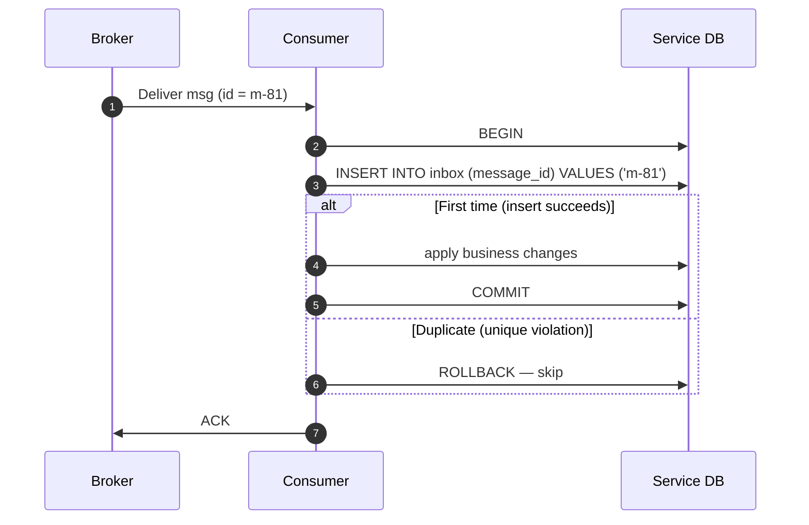
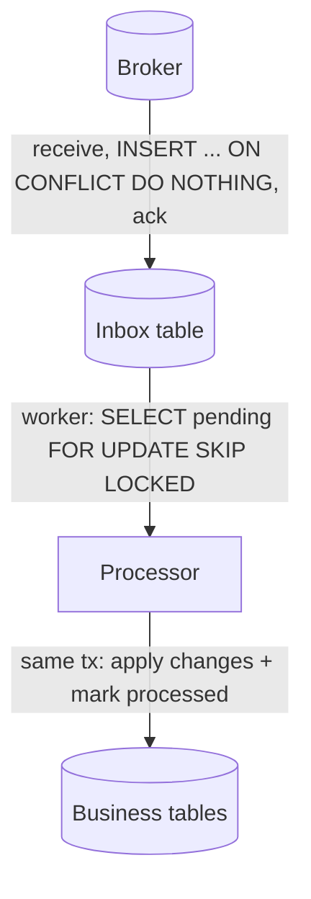

Message brokers are honest about one thing: they deliver **at least once**. A consumer can crash after processing but before acknowledging; a rebalance can hand the same partition to a new consumer; a producer using an [outbox](/blog/transactional-outbox/) can publish twice. Your consumer *will* see duplicates.

The **Transactional Inbox** pattern makes duplicates harmless. Before processing a message, the consumer records its ID in an **inbox table** — **in the same database transaction** as the processing itself. If the ID is already there, the message is a duplicate and is skipped.

## The problem

Consider a Payment service consuming `OrderPlaced` and charging the customer.

1. Consumer receives `OrderPlaced(order 42)`.
2. Charges the card and commits.
3. Crashes before acknowledging to the broker.
4. Broker redelivers `OrderPlaced(order 42)`.
5. Customer is charged **twice**.

Acknowledging *before* processing just swaps the bug: a crash between ack and commit **loses** the message. What you need is for "I've handled this message" and "here are the effects of handling it" to be **one atomic fact**.

## How it works



Two flavours exist:

- **Dedupe inbox (inline)** — insert the message ID and process in the same transaction, as above. Simple and most common.
- **Store-then-process inbox (buffered)** — the consumer only *stores* the full message in the inbox and acks immediately; a separate worker processes inbox rows in order. This decouples broker consumption from processing speed, enables ordered per-aggregate processing, and lets you replay failed messages from your own database.



## Example: inline dedupe in PostgreSQL

```sql
CREATE TABLE inbox (
  message_id   VARCHAR(100) NOT NULL,
  consumer     VARCHAR(100) NOT NULL,      -- one table can serve many handlers
  received_at  TIMESTAMPTZ  NOT NULL DEFAULT now(),
  PRIMARY KEY (message_id, consumer)
);
```

```python
import psycopg

HANDLER = "payment.charge-on-order-placed"

def handle_order_placed(conn: psycopg.Connection, msg) -> None:
    message_id = msg.headers["message-id"]          # set by the producer's outbox
    event = msg.value                               # {"orderId": ..., "total": ...}

    with conn.transaction():
        cur = conn.execute(
            """INSERT INTO inbox (message_id, consumer) VALUES (%s, %s)
               ON CONFLICT DO NOTHING""",
            (message_id, HANDLER),
        )
        if cur.rowcount == 0:
            return                                  # duplicate: already processed

        charge_id = payments_gateway.charge(
            order_id=event["orderId"], amount=event["total"],
            idempotency_key=f"order:{event['orderId']}",   # external side effect guard
        )
        conn.execute(
            "INSERT INTO payment (order_id, charge_id, amount) VALUES (%s, %s, %s)",
            (event["orderId"], charge_id, event["total"]),
        )
    # Transaction committed: the inbox row and the payment row exist together.
    # Only now acknowledge the message to the broker.
```

> **Warning:** the inbox makes your *database* changes exactly-once. The card charge above is an **external side effect** — if the transaction rolls back after the gateway call, a retry will call the gateway again. That's why the gateway call also carries an idempotency key. The inbox and idempotency keys are complementary.

## Choosing the message ID

The dedupe key must be **stable across redeliveries and republishes**:

| Option | Good? | Notes |
|---|---|---|
| Producer-assigned UUID (e.g., outbox row ID) | ✅ Best | Same ID even if the relay republishes. |
| Business key (`order-42:OrderPlaced:v1`) | ✅ Good | Natural, but make sure it's unique per event, not per entity. |
| Broker metadata (Kafka offset, SQS message ID) | ⚠️ Partial | Changes if the producer publishes twice. |
| Hash of the payload | ⚠️ Risky | Two legitimately identical events would be merged. |

## Retention

The inbox can't grow forever. Keep IDs at least as long as the broker could redeliver — typically your topic retention or maximum redelivery window, plus margin. A daily job deleting rows older than, say, 14 days, or time-partitioned tables you drop, works well.

## Inbox vs. idempotent business logic

You don't always need a table. If the handler is **naturally idempotent** — `UPDATE order SET status='SHIPPED' WHERE id=42` — a duplicate is harmless. The inbox earns its keep when processing:

- is **not** naturally idempotent (increments, inserts, emails, charges),
- involves **multiple** writes that must happen exactly once together,
- needs an **audit trail** of which messages were handled.

See [Idempotent Consumer](/blog/idempotent-consumer/) for the broader set of techniques.

## Trade-offs

| Benefits | Costs |
|---|---|
| Effectively-once processing for DB-side effects | Extra write per message |
| Works with any broker | Requires the handler to share a DB transaction with the inbox |
| Buffered variant decouples consumption from processing | Retention and cleanup jobs |
| Audit trail of processed messages | Doesn't protect external side effects by itself |

## Common pitfalls

- **Checking then inserting in separate transactions** (`SELECT` → process → `INSERT`). Two concurrent deliveries both see "not present". Rely on the **unique constraint** inside the processing transaction.
- **Acknowledging before commit** — loses messages on crash.
- **Inbox in a different database** than the business data — you're back to dual writes.
- **Treating poison messages as duplicates** — a message that fails every time should go to a [Dead Letter Queue](/blog/dead-letter-queue/), not loop forever.

## Tools and real-world usage

- **NServiceBus Outbox** — despite the name, it also performs inbox-style deduplication of incoming messages in the same transaction as the handler.
- **MassTransit** — the transactional outbox includes an inbox (`InboxState`) for consumer deduplication with EF Core and MongoDB.
- **Kafka exactly-once semantics** — transactional producers and `read_committed` consumers give exactly-once *within Kafka* (consume → produce). Writes to an external database still need an inbox or idempotent upserts.
- **Custom tables** — most teams implement the inline version in a few dozen lines, as above.

## Related patterns

- [Transactional Outbox](/blog/transactional-outbox/) — the producer-side counterpart; together they give end-to-end effectively-once.
- [Idempotent Consumer](/blog/idempotent-consumer/) — the general principle the inbox implements.
- [Dead Letter Queue](/blog/dead-letter-queue/) — where messages that can't be processed go.
- [Guaranteed Delivery](/blog/guaranteed-delivery/) — why duplicates happen in the first place.

## Key takeaways

1. At-least-once delivery means duplicates are guaranteed, not hypothetical.
2. Record the message ID in an inbox table in the same transaction as the processing.
3. Use a unique constraint, not a check-then-insert.
4. Pair it with idempotency keys for external side effects, and prune old IDs.
